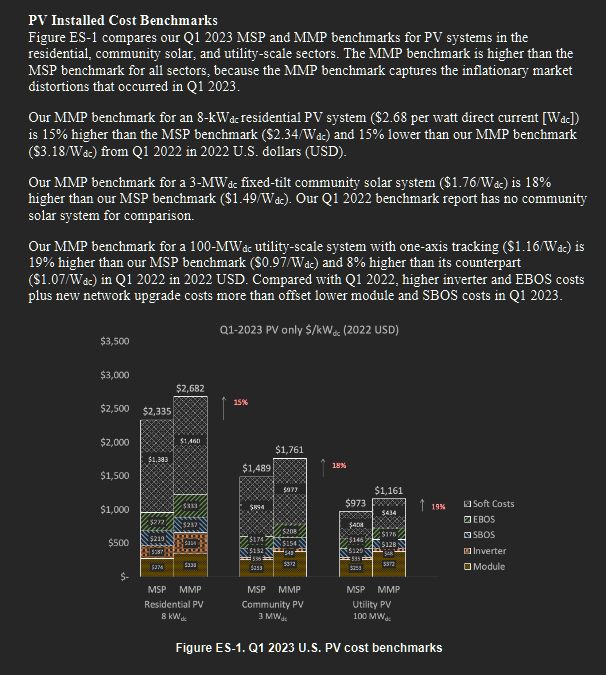

# Reference 03: Inverter & Charge Controller Costs

---

## 1. What is this? (Component & Checked Cost)
- **Component:** Fronius IG 40 Grid/Off-Grid Inverter ($4.4\text{ kW}$ DC / $3.5\text{ kW}$ AC) + MPPT Charge Controller & Protection
- **Checked Cost:** **$\$1,200\text{ USD}$**
- **Expected Lifetime:** **$10\text{–}12\text{ years}$**

---

## 2. The Proof (Screenshot & Commercial Quotes)

*Figure 3: NREL Q1 2023 U.S. Solar Photovoltaic System Cost Benchmark (Figure ES-1).*

> **NREL Benchmark Data:**
> Inverter hardware represents $\$0.21\text{–}\$0.25/\text{Wdc}$ in standalone commercial and residential solar systems. For our $4.41\text{ kWp}$ system:
> $$4,410\text{ W} \times \$0.25/\text{W} \approx \$1,102\text{ USD}$$

> **Commercial Retail Quote:**
> - Supplier: [SolarTopStore - Fronius IG Plus 3.0-1](https://www.solartopstore.com/products/fronius-ig-plus-3-0-1-grid-tied-inverter)
> - Price: **£929.00 GBP** ($\approx \mathbf{\$1,200\text{ USD}}$ at $1.30\text{ GBP/USD}$).

---

## 3. How was it calculated?
- **Base Inverter Cost:** Commercial quote of $\$1,100\text{–}\$1,200$ for Fronius IG units.
- **Integrated MPPT / Controller Overhead:** $\$100\text{–}\$200$.
- **Total Combined Allocation:** **$\$1,200\text{ USD}$**.
- **Comparison to Generative AI Guess:**
  - AI estimated $\$800$ for inverter + controller.
  - Generative AI underestimated the cost of European-standard transformer/MPPT equipment by $\sim 33\%$ ($+\$400$ adjustment required).

---

## 4. Source Link
- **NREL Technical Report:** [U.S. Solar Photovoltaic System and Energy Storage Cost Benchmarks: Q1 2023 (PDF)](https://docs.nlr.gov/docs/fy23osti/87303.pdf)
- **Retail Hardware Quote:** [SolarTopStore Fronius Inverter Catalog](https://www.solartopstore.com/products/fronius-ig-plus-3-0-1-grid-tied-inverter)
