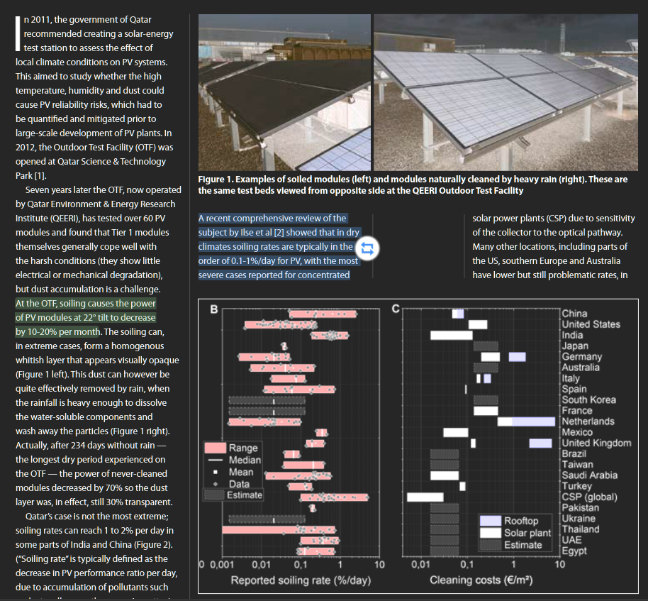
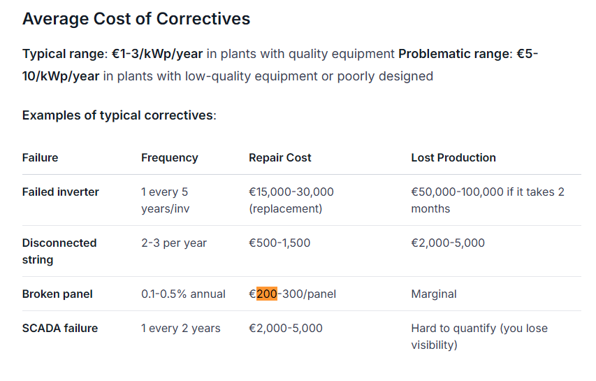

# Reference 05: OPEX, Desert Soiling & Routine Maintenance

---

## 1. What is this? (Component & Checked Cost)
- **Component:** Annual operating and maintenance (cleaning dust/sand, inverter inspection, terminal re-torquing)
- **Checked Cost:** **$\$180\text{ USD/year}$** ($\sim 2.2\%$ of CAPEX)
- **Expected Recurrence:** Annually throughout $20\text{-year}$ project lifecycle

---

## 2. The Proof (Screenshots & Research Findings)

| Research Domain | Screenshot Proof |
| :--- | :--- |
| **Middle East Desert Soiling Rates** |  |
| **Corrective & Routine OPEX Benchmarks** |  |

> **QEERI Qatar / Middle East Desert Soiling Finding:**
> For solar modules installed at an optimal tilt of $22^\circ$, monthly dust and sand accumulation causes severe transmission loss:
> - Monthly soiling degradation: **$10\%\text{–}20\%$ per month** without regular cleaning.
> - Demonstrates that bi-weekly or monthly dry cleaning is strictly essential in the Saharan environment.

> **PV-Maps Operational Benchmarks:**
> - Typical corrective maintenance: **€1–3/kWp/year** in plants with quality equipment.
> - Total distributed solar OPEX typically averages **$1.5\%\text{–}3.0\%$ of initial CAPEX annually**.

---

## 3. How was it calculated?
- **Initial Clinic Capital Cost:** $\$8,300\text{ USD}$
- **OPEX Formula:**
  $$\text{OPEX} \approx 2.17\% \times \$8,300 = \mathbf{\$180\text{ USD/year}}$$
- **Operational Allocation:**
  - Local technician stipend for bi-weekly dry panel brushing: $\$120/\text{year}$
  - Spare fuses, replacement wiring clamps, terminal checks: $\$60/\text{year}$
- **Comparison to Generative AI Guess:**
  - AI assumed $\$100/\text{year}$ ($1.2\%$ of CAPEX).
  - Adjusted upward to $\$180/\text{year}$ ($2.2\%$) to account for frequent arid dust clearing and Saharan heat wear.

---

## 4. Source Link
- **Desert Soiling Research:** [QEERI / Qatar Foundation Desert PV Soiling & Performance Study](https://www.qf.org.qa/stories/dust-to-watts-solar-panels-middle-east)
- **Operations & Maintenance Benchmark:** [PV-Maps O&M Benchmarks](https://www.pv-maps.eu/om-costs)
