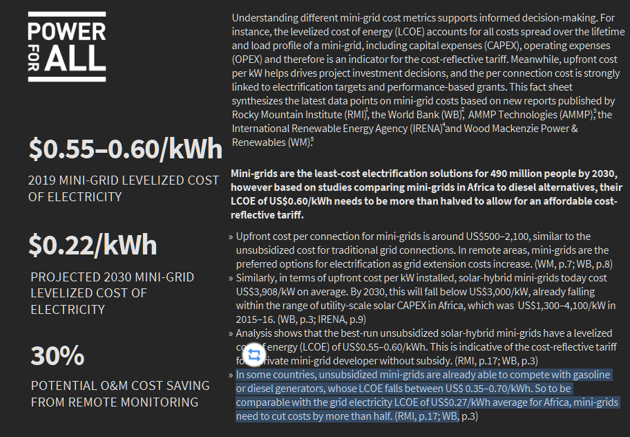
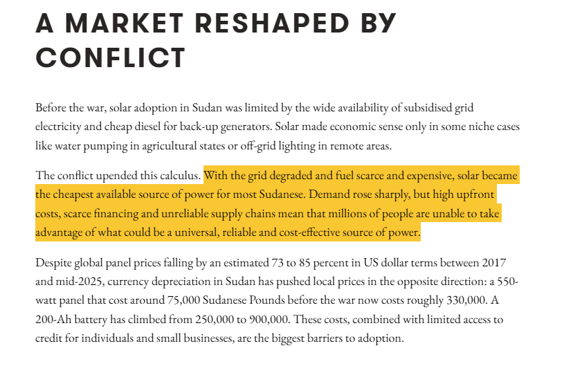

# Reference 06: Baseline Diesel Electricity Cost & Fuel Crisis

---

## 1. What is this? (Component & Checked Cost)
- **Component:** Displaced diesel generation electricity cost (fuel, maintenance, generator replacement)
- **Checked Cost:** **$\$0.50\text{ USD/kWh}$** (Standard off-grid mini-grid range: $\$0.35\text{–}\$0.70/\text{kWh}$)
- **Baseline Annual Expenditure:** **$\$2,920\text{ USD/year}$** ($5,840\text{ kWh/yr} \times \$0.50$)

---

## 2. The Proof (Screenshots & Economic Data)

| Evidence Source | Screenshot Proof |
| :--- | :--- |
| **World Bank / ESMAP Diesel Benchmark** |  |
| **UNDP Sudan Fuel Crisis Report** |  |

> **World Bank / ESMAP / Power for All Finding:**
> Standalone diesel generation in off-grid African rural communities has an unsubsidized Levelized Cost of Electricity (LCOE) of **$\$0.35\text{–}\$0.70/\text{kWh}$**, heavily driven by fuel delivery and low generator loading efficiency.

> **UNDP Sudan Market Report Finding:**
> *"Prolonged conflict has severely disrupted fuel supply chains... Diesel pump prices in remote northern and western regions have surged over 300%–500% above official rates, frequently exceeding $2.00–$3.50/L on informal supply corridors."*

---

## 3. How was it calculated?
- **Clinic Annual Electricity Demand:**
  $$\text{Annual Energy} = 16\text{ kWh/day} \times 365\text{ days} = 5,840\text{ kWh/year}$$
- **Baseline Operational Cost at $\$0.50/\text{kWh}$:**
  $$\text{Baseline Cost} = 5,840\text{ kWh} \times \$0.50/\text{kWh} = \mathbf{\$2,920\text{ USD/year}}$$
- **Conservative Margin:**
  - Choosing $\$0.50/\text{kWh}$ sits squarely in the middle of the ESMAP benchmark, remaining realistic without relying on crisis black-market fuel spikes ($>\$1.00/\text{kWh}$).
- **Comparison to Generative AI Guess:**
  - AI guessed a flat $\$0.35/\text{kWh}$ (lower bound, assumed pre-crisis fuel delivery).
  - Grounded to $\$0.50/\text{kWh}$ based on World Bank rural minigrid data and UNDP fuel supply reality.

---

## 4. Source Link
- **Power for All / World Bank ESMAP Fact Sheet:** [Decentralized Renewable Energy Factsheet](https://www.powerforall.org/resources/fact-sheets/decentralized-renewable-energy-technologies-mini-grids)
- **UNDP Sudan Energy Assessment:** [Solar Energy Value Chains in Sudan (UNDP May 2024)](https://www.undp.org/sudan/publications/solar-energy-value-chain-study)
