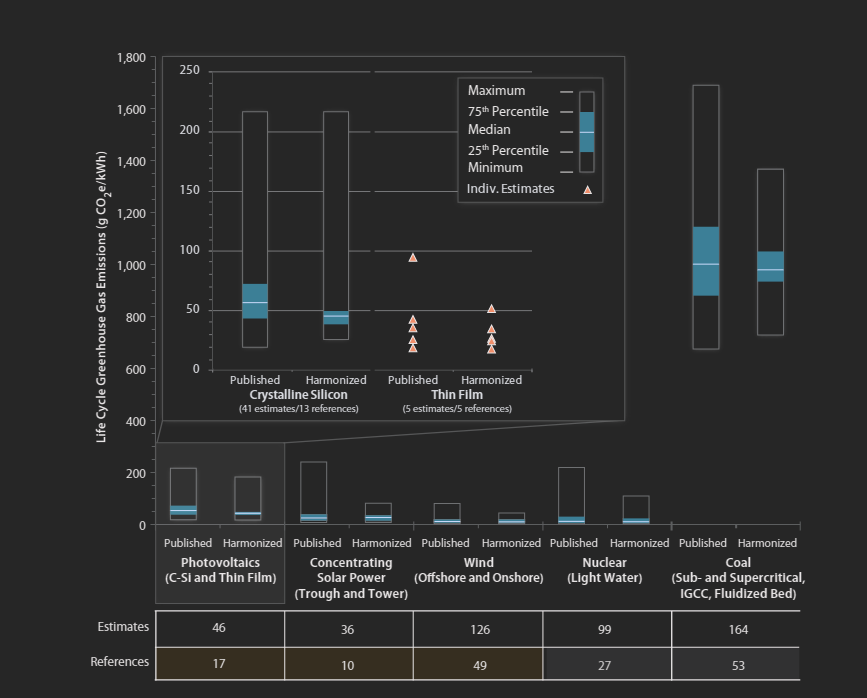

# Reference 07: Solar PV Lifecycle CO2 Emissions

---

## 1. What is this? (Metric & Checked Value)
- **Metric:** Lifecycle Greenhouse Gas Emissions of Solar Photovoltaics (Crystalline Silicon)
- **Checked Value:** **$46\text{ g CO}_2\text{e/kWh}$** (Median, with interquartile range of $35\text{–}65\text{ g CO}_2\text{e/kWh}$)
- **Lifecycle Scope:** Raw silicon mining, wafer/cell fabrication, aluminum frame extrusion, transport, installation, and end-of-life recycling.

---

## 2. The Proof (Screenshot & Harmonized Findings)

*Figure 7: NREL Harmonized Life Cycle Greenhouse Gas Emissions from Utility and Distributed Solar Photovoltaics.*

> **NREL Harmonized LCA Finding:**
> Across hundreds of published peer-reviewed lifecycle studies, crystalline silicon PV produces a median life cycle footprint of **$43\text{–}48\text{ g CO}_2\text{e/kWh}$** (standard reference value: **$46\text{ g CO}_2\text{e/kWh}$**).

---

## 3. How was it calculated?
- **Clinic Annual Generation:** $5,840\text{ kWh/year}$
- **Solar Lifecycle Footprint:**
  $$\text{Solar CO}_2 = 5,840\text{ kWh/yr} \times 0.046\text{ kg CO}_2/\text{kWh} = \mathbf{0.269\text{ tonnes CO}_2/\text{year}} \approx \mathbf{0.27\text{ t/yr}}$$
- **Over 20-Year Project Life:**
  $$20\text{ yrs} \times 0.269\text{ t/yr} = \mathbf{5.37\text{ tonnes CO}_2\text{ total}}$$
- **Comparison to Generative AI Guess:**
  - AI guessed $\approx 45\text{–}50\text{ g CO}_2/\text{kWh}$ ($0.26\text{–}0.29\text{ t/yr}$).
  - Confirms the AI's estimate is accurate and fully aligns with NREL's harmonized standard.

---

## 4. Source Link
- **NREL Harmonized Life Cycle Assessment:** [NREL Lifecycle Greenhouse Gas Emissions from Solar PV](https://www.nrel.gov/analysis/life-cycle-assessment.html)
- **Technical Report:** [Life Cycle Greenhouse Gas Emissions from Utility-Scale and Distributed Photovoltaics (PDF)](https://www.nrel.gov/docs/fy21osti/80786.pdf)
