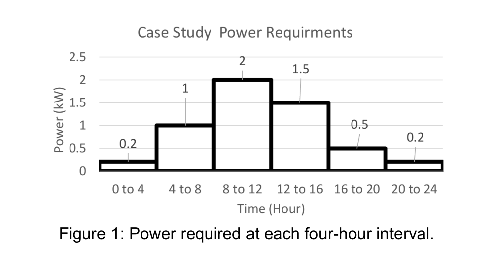

# Slide 1: Off-Grid Solar System for a Rural Health Centre

**Module:** EEEE3054 Renewable Energy Technologies (CW2)  
**Name & ID:** Nicholas Khor (`20617556`)  
**Assigned Coordinates:** $18.7^\circ\text{ N}, 29.6^\circ\text{ E}$ $\rightarrow$ **Chosen Village Site:** Dongola / Argo Island, Sudan ($19.16^\circ\text{ N}, 30.48^\circ\text{ E}$)

---

## 1. Daily Power Requirement

---

## 2. Daily & Annual Energy Demand ($E = P \times t$)

| 4-Hour Time Block | Power Needed $P$ (kW) | Hours $t$ (h) | Energy $E = P \times t$ (kWh) | Supply Mode |
| :---: | :---: | :---: | :---: | :--- |
| **0 to 4** | $0.2$ | $4$ | $0.8\text{ kWh}$ | Night (Battery) |
| **4 to 8** | $1.0$ | $4$ | $4.0\text{ kWh}$ | Morning (Battery) |
| **8 to 12** | **$2.0$ (Peak)** | $4$ | **$8.0\text{ kWh}$** | **Daytime (Direct Sun)** |
| **12 to 16** | **$1.5$** | $4$ | **$6.0\text{ kWh}$** | **Daytime (Direct Sun)** |
| **16 to 20** | $0.5$ | $4$ | $2.0\text{ kWh}$ | Evening (Battery) |
| **20 to 24** | $0.2$ | $4$ | $0.8\text{ kWh}$ | Night (Battery) |
| **Total per Day** | **Peak = $2.0\text{ kW}$** | **$24\text{ h}$** | **$21.6\text{ kWh/day}$** | **Day: $14.0\text{ kWh}$ / Night: $7.6\text{ kWh}$** |

*Table 1: Daily energy demand calculated from Figure 1.*

- **Total Daily Energy:** $0.8 + 4.0 + 8.0 + 6.0 + 2.0 + 0.8 = \mathbf{21.6\text{ kWh/day}}$
- **Total Yearly Energy ($E_{\text{req}}$):** $21.6\text{ kWh/day} \times 365\text{ days} = \mathbf{7,884\text{ kWh/year}}$
- **Main Point:** **$14.0\text{ kWh}$ ($65\%$)** is used between **8 AM and 4 PM** when the sun is shining!

---

### What to Say (Speaker Notes)
- "Hi, I'm Nicholas (ID 20617556). My task is to design an off-grid renewable power system for a rural health centre in Northern Sudan."
- "From Figure 1, multiplying each 4-hour power block by 4 hours gives a total daily demand of **21.6 kWh/day**, or **7,884 kWh/year**, with a peak power of **2.0 kW**."
- "Notice that **14 kWh out of 21.6 kWh (65%)** is needed between 8 AM and 4 PM during daylight hours, while only **7.6 kWh** is needed at night."
