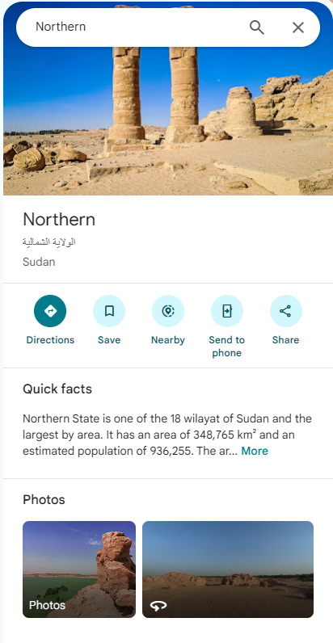
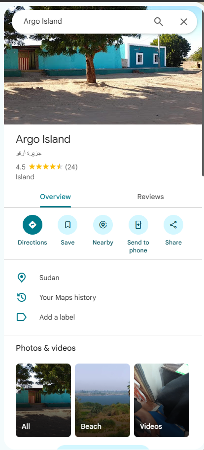
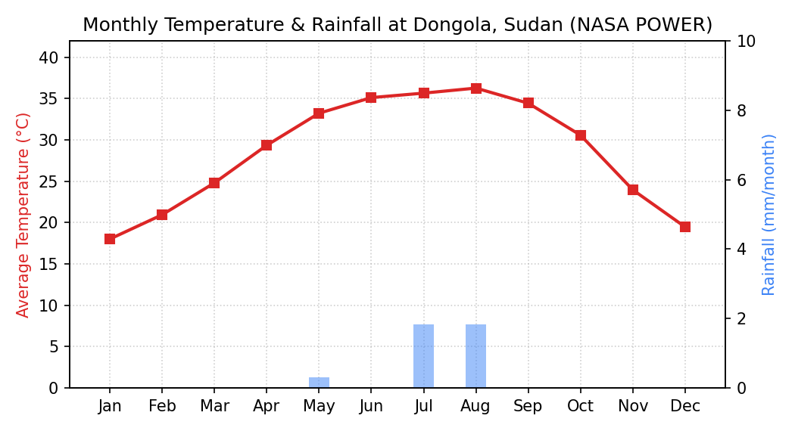

# Slide 2: Location Selection & Local Climate

---

## 1. Shifting Within the $1^\circ$ Rule: Empty Desert $\rightarrow$ Real Village (Dongola / Argo Island)

| Original Coordinates ($18.7^\circ\text{ N}, 29.6^\circ\text{ E}$) | Shifted Site within $1^\circ$ ($19.16^\circ\text{ N}, 30.48^\circ\text{ E}$) |
| :---: | :---: |
|  |  |
| **Empty Sahara Desert:** Open sand dunes 85 km west of the Nile River with zero residents. | **Dongola / Argo Island (Nile River):** Real village community with houses, clinics, and road/river access. |

*Figure 2: Comparison between the raw coordinates in the empty desert (left) and the selected village site by the Nile River within the $1^\circ$ allowance (right).*

---

## 2. Local Temperature & Rainfall Data (NASA POWER & Global Solar Atlas)

*Figure 3: Monthly average temperature and rainfall at Dongola, Sudan ([`nasa_power_dongola.csv`](../assets/api/nasa_power_dongola.csv)).*

- **Average Air Temperature ($T_{\text{amb}}$):** **$28.8^\circ\text{C}$** (Global Solar Atlas report) / **$28.5^\circ\text{C}$** (NASA POWER).
- **Annual Rainfall:** **$< 4\text{ mm/year}$** (Practically **zero rain** all year round).

---

### What to Say (Speaker Notes)
- **1° Rule Adjustment:** Shifted from uninhabited sand dunes (18.7°N, 29.6°E) to **Dongola / Argo Island (19.16°N, 30.48°E)** along the Nile to serve an actual community.
- **Temperature Profile:** Annual average ambient temperature of **28.8°C** (requires thermal derating in PV sizing).
- **Rainfall & Cloud Cover:** Hyper-arid desert with **< 4 mm/year** precipitation (virtually cloudless all year).
