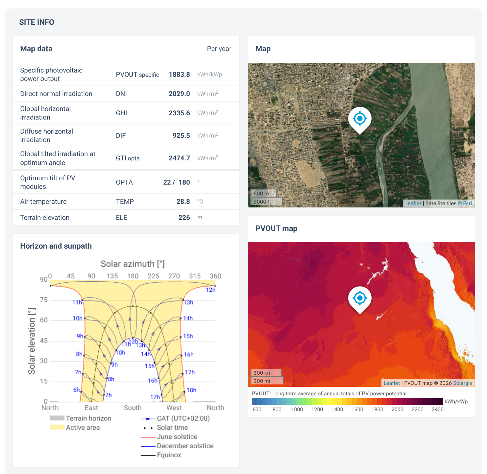
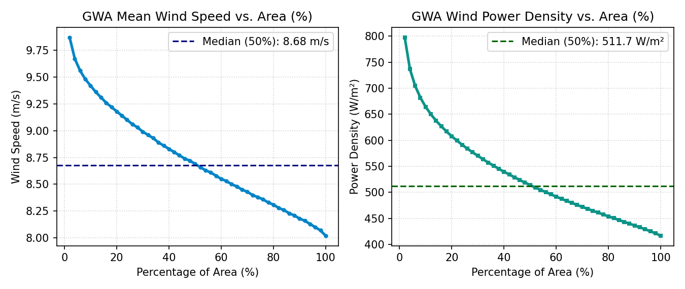

# Slide 3: Checking All Renewable Energy Sources at Our Location

---

## 1. Extracted Solar & Wind Data at Dongola ($19.16^\circ\text{ N}, 30.48^\circ\text{ E}$)

| Global Solar Atlas Data ([`GSA_Report_Dongola.pdf`](../assets/api/GSA_Report_Dongola.pdf)) | Global Wind Atlas Data ([`gwa-plot-data`](../assets/api/gwa-plot-data_2026-11-04179380525039303_14_10_UTC)) |
| :---: | :---: |
|  |  |

*Figure 4: Official Global Solar Atlas report (left) and Global Wind Atlas wind speed & power density curves (right) for Northern Sudan.*

---

## 2. Screening All 5 Renewable Sources

| Renewable Source | Data & Evidence at Dongola ($19.16^\circ\text{ N}, 30.48^\circ\text{ E}$) | Why Suitable or Unsuitable? |
| :--- | :--- | :--- |
| **1. Solar Power (PV)** | • **GHI:** **$2,335.6\text{ kWh/m}^2\text{/yr}$** ($\mathbf{6.40\text{ kWh/m}^2\text{/day}}$) • **Tilted (GTI at $22^\circ$):** **$2,474.7\text{ kWh/m}^2\text{/yr}$** ($\mathbf{6.78\text{ PSH/day}}$) • **Specific PV Output:** **$1,883.8\text{ kWh/kWp/yr}$** | **Best Choice (1st):** Massive, reliable sunshine every single day; matches daytime clinic hours (8 AM – 4 PM). |
| **2. Wind Power** | • **100m Wind Speed (GWA):** **$8.02\text{–}9.87\text{ m/s}$** (Median = **$8.69\text{ m/s}$**, Power Density = **$514\text{ W/m}^2$**) • **10m Wind Speed (NASA):** **$5.11\text{ m/s}$** average | **2nd Choice (Comparison):** Good desert wind, but small clinics use low $10\text{–}15\text{ m}$ towers (slower wind) and moving blades wear out in sandstorms. |
| **3. Hydro Power** | • Self-explanatory: Hyper-arid desert ($<4\text{ mm/yr}$ rain) and flat Nile River bank (no waterfall/head). | **Unsuitable:** Cannot build a micro-hydro dam without rainfall or elevation drop. |
| **4. Geothermal** | • Self-explanatory: Flat desert plain far ($>600\text{ km}$) from any volcanic rift zone. | **Unsuitable:** No hot springs or shallow underground steam. |
| **5. Wave & Tidal** | • Self-explanatory: Landlocked desert ($>650\text{ km}$ inland from the Red Sea). | **Impossible:** No ocean waves or tides. |

*Table 2: Screening summary of all five renewable energy options at Dongola, Sudan.*

---

### What to Say (Speaker Notes)
- **Solar PV (#1 Choice):** **6.78 PSH/day** (GTI 2,475 kWh/m²/yr at 22° tilt), specific yield 1,884 kWh/kWp/yr.
- **Wind Power (#2 Comparison):** 100m speed = **8.69 m/s** (514 W/m²), but 10m mast speed = **5.11 m/s** with high intermittency.
- **Hydro (Unsuitable):** < 4 mm rain/yr; flat river plain with zero elevation drop / hydraulic head.
- **Geothermal (Unsuitable):** Stable sedimentary basin >600 km from active tectonic or volcanic rift zones.
- **Wave / Tidal (Impossible):** Landlocked inland desert (>650 km from Red Sea).
