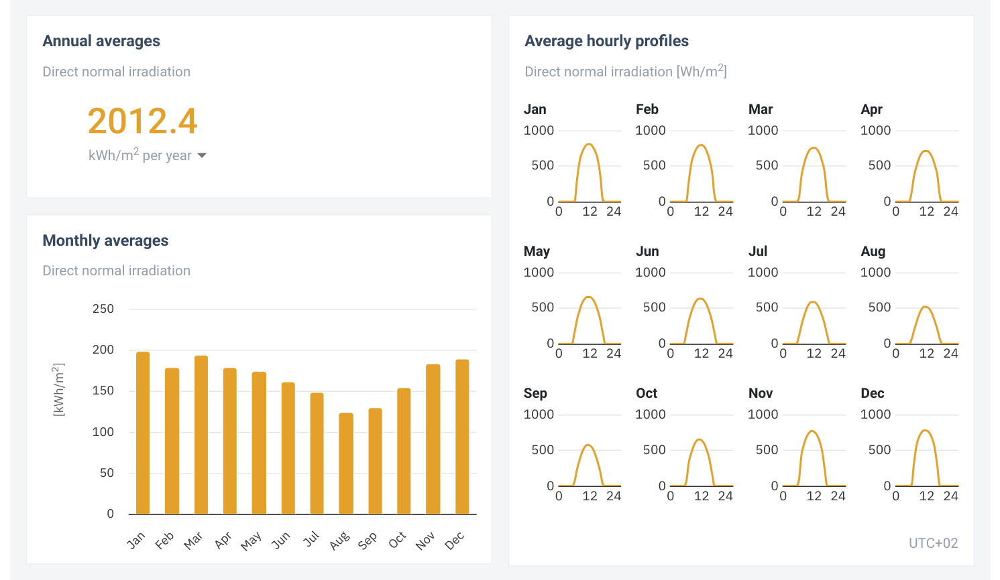
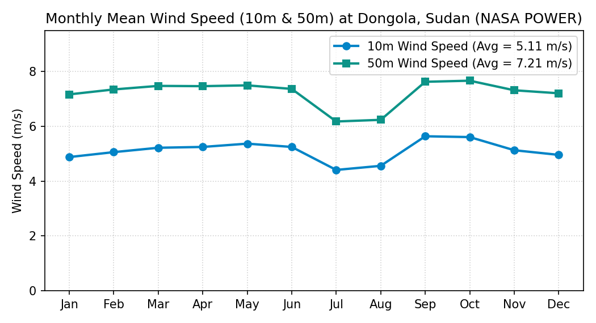

# Slide 4: Comparing Solar PV (1st Choice) vs. Wind Power (2nd Choice)

---

## 1. Monthly & Hourly Solar vs. Wind Profiles at Dongola

| Global Solar Atlas Monthly & Hourly Profiles ([`GSA_Report_Dongola.pdf`](../assets/api/GSA_Report_Dongola.pdf)) | Monthly 10m Wind Speed ([`nasa_power_dongola.csv`](../assets/api/nasa_power_dongola.csv)) |
| :---: | :---: |
|  |  |

*Figure 5: Monthly and hourly solar radiation profiles from Global Solar Atlas (left) vs. monthly 10m wind speed (right).*

---

## 2. Quantitative & Qualitative Comparison: Why Solar PV Wins

| Comparison Point | **Solar PV (Preferred Choice)** | **Small Wind Turbine (2nd Choice)** | Which is Better? |
| :--- | :--- | :--- | :---: |
| **1. Resource Consistency** | Very steady all year: **$\text{GTI} = 6.78\text{ PSH/day}$** ($\text{GHI} = 6.40\text{ PSH/day}$); every single month has strong sun (Fig 5 left). | Variable wind: **$4.4\text{ to }5.6\text{ m/s}$** at $10\text{ m}$ height (or $8.69\text{ m/s}$ only if we build a massive $100\text{ m}$ tower). Since $P \propto v^3$, small drops in wind speed cut power heavily. | **Solar PV** |
| **2. Matching Clinic Hours** | Hourly curves (Fig 5 left) peak from **8 AM to 4 PM**, directly matching **$65\%$ of the clinic's load ($14\text{ kWh}$)**. | Wind can drop during busy daytime clinic hours, requiring a much larger battery bank. | **Solar PV** |
| **3. Desert Maintenance** | **No moving parts**—clinic staff only need to wipe dust off the glass panels. | Moving blades, bearings, and gears suffer heavy wear from Sahara sandstorms and need a technician. | **Solar PV** |
| **4. Small-Scale Cost** | Low panel cost (**$\sim \$0.30/\text{Wp}$**) and simple ground/roof frames. | Expensive ($>\$2.00/\text{W}$) due to tall guyed tower, foundation, and mechanical upkeep. | **Solar PV** |

*Table 3: Head-to-head comparison between Solar PV and Wind Power.*

---

### What to Say (Speaker Notes)
- "Slide 4 compares our preferred choice—**Solar PV**—against our second choice—**Wind Power**."
- "Look at the hourly solar curves from Global Solar Atlas on the left of Figure 5: every single month from January to December has a clean, predictable bell curve between 7 AM and 5 PM, giving **6.78 Peak Sun Hours per day** at a 22° tilt."
- "Solar PV beats Wind across all four criteria in Table 3: First, solar is consistent every day, whereas wind power depends on velocity cubed ($v^3$) and only reaches 8.7 m/s at 100m height (at 10m height it is only ~5.1 m/s). Second, solar peaks right when the clinic uses 65% of its energy (8 AM to 4 PM). Third, solar panels have no moving parts to break in desert sandstorms, and fourth, solar is much cheaper at a 2 kW clinic scale."
