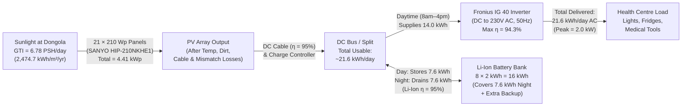

# Slide 5: Proposed Off-Grid Solar + Battery System Diagram

---

## 1. Reference Single-Phase PV & Battery Storage Architecture

| Single-Phase PV Connection Layout | Battery Energy Storage System (BESS) Layout |
| :---: | :---: |
|  |  |

*Figure 6: Standard single-phase PV protection/switching layout (left) and BESS control block diagram (right).*

---

## 2. Custom Off-Grid Health Centre System Diagram & Energy Flow

*Figure 7: Custom off-grid system diagram showing main components, efficiencies, and daily energy flow.*

---

### What to Say (Speaker Notes)
- **Architecture:** DC-coupled hybrid PV + battery feeding a single-phase 230V AC, 50 Hz inverter.
- **Solar Generation:** 21 × SANYO 210W modules (**4.41 kWp STC**) mounted at 22° South tilt.
- **Daytime Power Flow:** 14.0 kWh routed directly to clinic loads via Fronius IG 40 inverter (94.3% eff).
- **Storage Power Flow:** 7.6 kWh excess solar charges Li-Ion battery (95% round-trip eff) to sustain 7.6 kWh night load.
