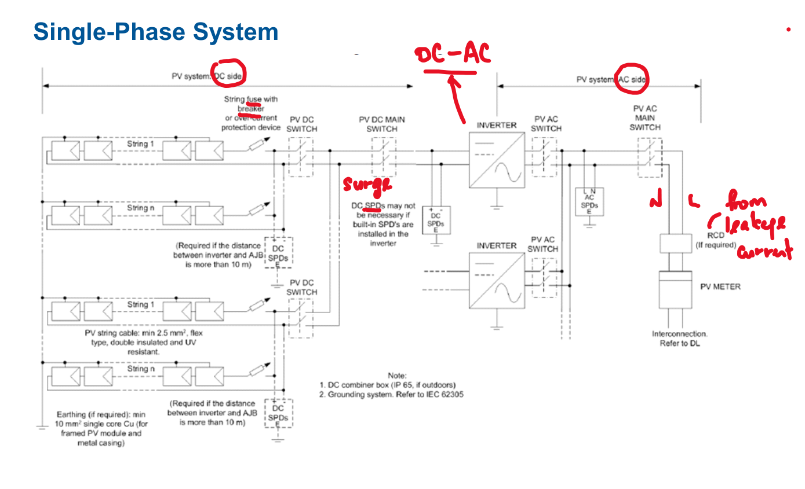
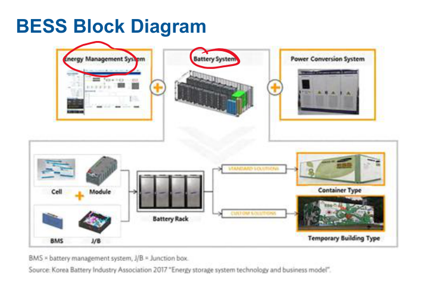
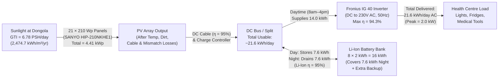

# Slide 5: Proposed Off-Grid Solar + Battery System Diagram

---

## 1. Reference Single-Phase PV & Battery Storage Architecture

| Single-Phase PV Connection Layout | Battery Energy Storage System (BESS) Layout |
| :---: | :---: |
|  |  |

*Figure 6: Standard single-phase PV protection/switching layout (left) and BESS control block diagram (right).*

---

## 2. Custom Off-Grid Health Centre System Diagram & Energy Flow

*Figure 7: Custom off-grid system diagram showing main components, efficiencies, and daily energy flow.*

---

### What to Say (Speaker Notes)
- "Slide 5 shows how our off-grid system is connected, combining a standard single-phase PV protection layout with a Battery Energy Storage System (BESS)."
- "In Figure 7, sunlight hits our **21 SANYO 210W solar panels (4.41 kWp total)**."
- "During the daytime (8 AM to 4 PM), **14.0 kWh** goes straight through our **Fronius IG 40 inverter** to run the health centre."
- "At the same time, the extra **7.6 kWh** generated during the day is stored inside our **Lithium-Ion battery bank**, and then drained at night (4 PM to 8 AM) so the clinic has 24-hour power totaling **21.6 kWh/day**."
