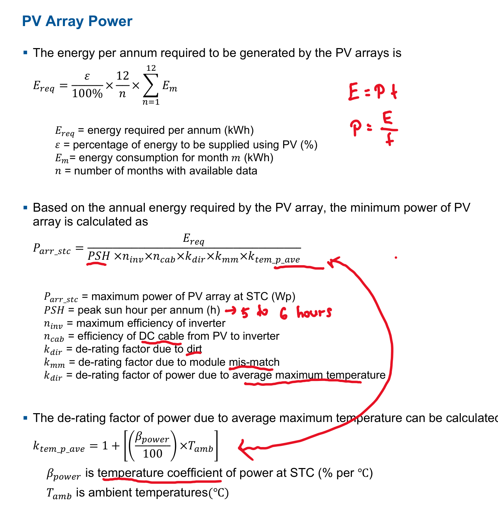
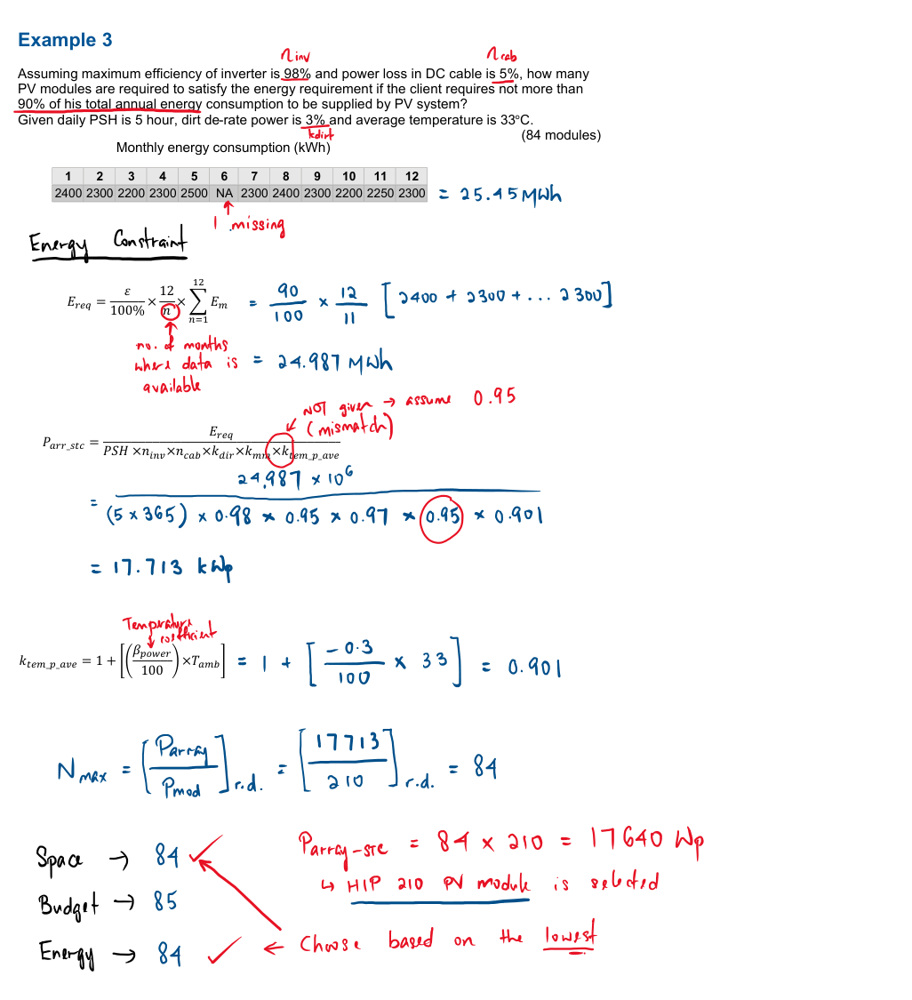
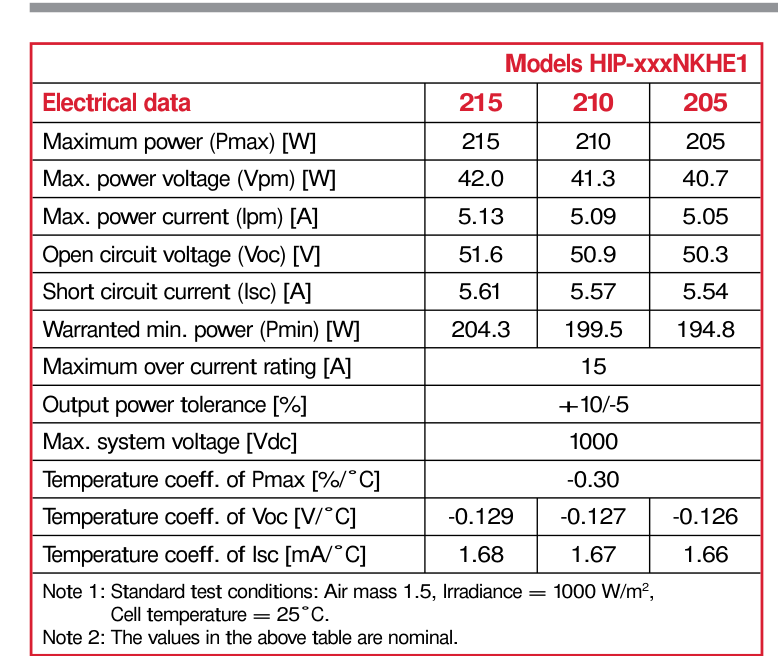
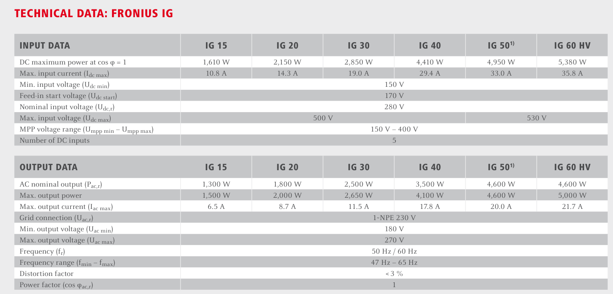

# Slide 6: Sizing the Solar PV Array & Inverter

---

## 1. PV Array Sizing Equations & Reference Worked Method

| PV Array Sizing Equations | Reference Calculation Method |
| :---: | :---: |
|  |  |

*Figure 8: Energy-constraint PV array sizing equations and reference calculation steps.*

---

## 2. Selected Equipment Datasheets

| SANYO `HIP-210NKHE1` Module ($210\text{ Wp}$) | Fronius `IG 40` Inverter ($3,500\text{ W}$ AC / $4,410\text{ W}$ DC) |
| :---: | :---: |
|  |  |

*Figure 9: Electrical specifications for the selected SANYO `HIP-210NKHE1` PV panel and Fronius `IG 40` inverter.*

---

## 3. Step-by-Step Sizing Calculation Using Global Solar Atlas Data

1. **Annual Energy Required ($E_{\text{req}}$):**
   $$E_{\text{req}} = 21.6\text{ kWh/day} \times 365\text{ days} = \mathbf{7,884\text{ kWh/year}} \quad (\varepsilon = 100\%\text{ off-grid})$$
2. **Temperature De-Rating Factor ($k_{\text{tem\_p\_ave}}$):**
   - From SANYO datasheet: $\beta_{\text{power}} = -0.30\%/^\circ\text{C}$. From Global Solar Atlas (Slide 3): $T_{\text{amb}} = 28.8^\circ\text{C}$:
   $$k_{\text{tem\_p\_ave}} = 1 + \left[ \left(\frac{-0.30}{100}\right) \times 28.8 \right] = 1 - 0.0864 = \mathbf{0.9136}$$
3. **Minimum PV Array Power at STC ($P_{\text{arr\_stc}}$):**
   - Using Global Solar Atlas tilted irradiation $\text{PSH} = 2,474.7\text{ h/year}$ ($6.78\text{ h/day}$ at $22^\circ$ tilt), Fronius IG 40 max efficiency $\eta_{\text{inv}} = 0.943$, cable efficiency $\eta_{\text{cab}} = 0.95$, dirt factor $k_{\text{dir}} = 0.97$, and mismatch $k_{\text{mm}} = 0.95$:
   $$P_{\text{arr\_stc}} = \frac{7,884}{2,474.7 \times 0.943 \times 0.95 \times 0.97 \times 0.95 \times 0.9136} = \frac{7,884}{1,865.9} = \mathbf{4.225\text{ kWp}} \quad (\mathbf{4,225\text{ Wp}})$$
4. **Number of SANYO `HIP-210NKHE1` ($210\text{ Wp}$) Panels & Inverter Match:**
   $$N_{\text{min\_mod}} = \left\lceil \frac{4,225\text{ Wp}}{210\text{ Wp}} \right\rceil = \left\lceil 20.12 \right\rceil = \mathbf{21\text{ modules}} \quad (3\text{ parallel strings} \times 7\text{ series modules})$$
   - **Total Array Power:** $21 \times 210\text{ Wp} = \mathbf{4,410\text{ Wp}}$ ($4.41\text{ kWp}$) $\rightarrow$ **Matches the `Fronius IG 40` max DC power ($4,410\text{ W}$) and $3,500\text{ W}$ AC output!**

---

### What to Say (Speaker Notes)
- "On Slide 6, I size the PV array and inverter using standard energy-constraint design formulas and our SANYO and Fronius datasheets."
- "Step 1: Our yearly energy requirement is **7,884 kWh**."
- "Step 2: Using the SANYO panel's temperature coefficient of **-0.30%/°C** and the Global Solar Atlas air temperature of **28.8°C**, the temperature derating factor $k_{\text{tem\_p\_ave}}$ is **0.9136**."
- "Step 3: Plugging in 2,474.7 annual Peak Sun Hours (at the 22° optimum tilt), the Fronius inverter's **94.3% efficiency**, and standard cable (0.95), dirt (0.97), and mismatch (0.95) factors gives **4,225 Wp**."
- "Step 4: Dividing 4,225 Wp by 210 Wp gives 20.12, which rounds up to **21 panels** arranged in 3 parallel strings of 7 panels (**4,410 Wp**), matching the **Fronius IG 40** inverter's 4,410 W DC input and 3,500 W AC output."
