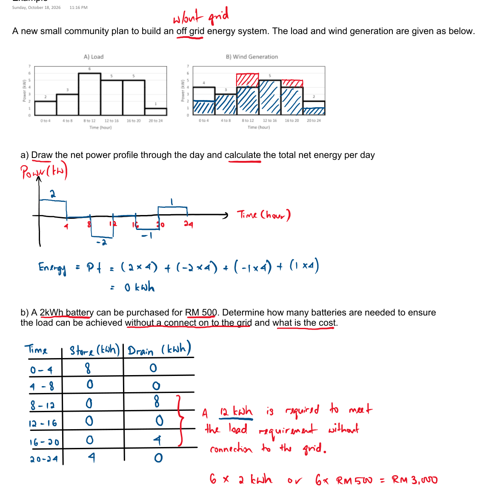
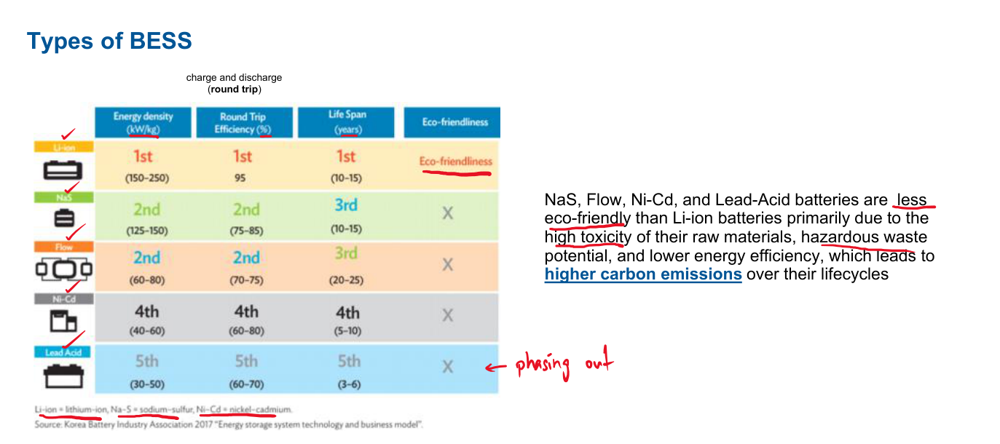
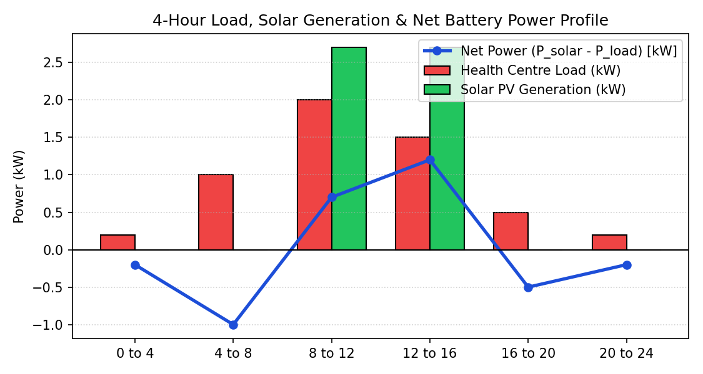

# Slide 7: Sizing the Battery Energy Storage System (BESS)

---

## 1. Off-Grid `Store vs. Drain` Method & Battery Chemistry Comparison

| Off-Grid 4-Hour `Store vs. Drain` Method | Comparison of Battery Technologies |
| :---: | :---: |
|  |  |

*Figure 10: Off-grid 4-hour battery sizing method (left) and battery technology comparison ranking Lithium-Ion #1 (right).*

---

## 2. Our 4-Hour Net Power Profile & `Store vs. Drain` Table

*Figure 11: Four-hour load demand, solar generation, and net power profile ($P_{\text{net}} = P_{\text{solar}} - P_{\text{load}}$).*

| Time (Hour) | Load Power (kW) | Solar Power (kW) | Load Energy (kWh) | Solar Energy (kWh) | **Store (kWh)** *(Day Excess)* | **Drain (kWh)** *(Night Use)* |
| :---: | :---: | :---: | :---: | :---: | :---: | :---: |
| **0 to 4** | $0.2$ | $0$ | $0.8$ | $0$ | $0$ | **$0.8$** |
| **4 to 8** | $1.0$ | $0$ | $4.0$ | $0$ | $0$ | **$4.0$** |
| **8 to 12** | $2.0$ | $2.7$ | $8.0$ | $10.8$ | **$2.8$** | $0$ |
| **12 to 16** | $1.5$ | $2.7$ | $6.0$ | $10.8$ | **$4.8$** | $0$ |
| **16 to 20** | $0.5$ | $0$ | $2.0$ | $0$ | $0$ | **$2.0$** |
| **20 to 24** | $0.2$ | $0$ | $0.8$ | $0$ | $0$ | **$0.8$** |
| **Total (24h)** | **Peak = $2.0\text{ kW}$** | **Avg = $2.7\text{ kW}$** | **$21.6\text{ kWh}$** | **$21.6\text{ kWh}$** | **$7.6\text{ kWh}$ Stored** | **$7.6\text{ kWh}$ Drained** |

*Table 4: Four-hour `Store vs. Drain` energy balance table for the health centre.*

---

## 3. Battery Quantity Calculation
- **Why Lithium-Ion (Li-Ion)?** Ranked **1st** (Figure 10 right) with **$95\%$ round-trip efficiency**, **$10\text{–}15\text{ years}$ lifespan**, high energy density ($150\text{–}250\text{ kWh/kg}$), and eco-friendly compared to Lead-Acid (ranked 5th, $3\text{–}6\text{ yrs}$ life).
- **Energy Drained Every Night (from Table 4):**
  $$\text{Total Night Drain} = 0.8 + 4.0 + 2.0 + 0.8 = \mathbf{7.6\text{ kWh}}$$
- **Number of $2\text{ kWh}$ Battery Modules Needed:**
  - **Minimum for 1 Normal Night:** $\frac{7.6\text{ kWh}}{2\text{ kWh}} = 3.8 \rightarrow \mathbf{4\text{ batteries}} \quad (\mathbf{8\text{ kWh}})$
  - **With $2\times$ Safety Margin for Critical Health Centre (Dusty/Cloudy Day + avoiding $100\%$ deep discharge):**
    $$\text{Selected Battery Bank} = \mathbf{8 \times 2\text{ kWh Li-Ion Batteries}} = \mathbf{16\text{ kWh Total Capacity}}$$

---

### What to Say (Speaker Notes)
- **4-Hour Energy Balance:** Daytime generation (21.6 kWh) supplies 14.0 kWh clinic load + stores **7.6 kWh**.
- **Overnight Discharge:** Evening & night blocks draw exactly **7.6 kWh** from the battery.
- **Chemistry Selection:** Li-Ion chosen (Ranked #1, 95% round-trip efficiency, 10–15 yr life vs Lead-Acid 3–6 yr).
- **Storage Capacity:** Baseline 7.6 kWh / 2 kWh = 3.8 → 4 units. Selected **8 × 2 kWh = 16 kWh** (2× safety buffer for hospital reliability).
