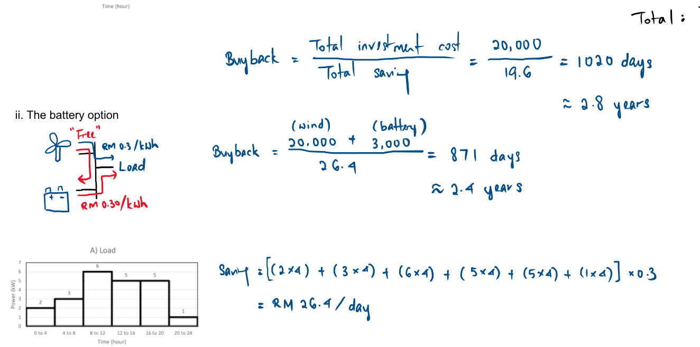

# Slide 8: System Cost Breakdown & Payback Time

## 1. Component Cost Breakdown (AI Estimate vs. Checked Prices)

| System Component | Quantity & Size | AI Initial Guess (USD) | Our Checked Cost (USD) | Expected Lifetime | Source / Reference |
| :--- | :--- | :---: | :---: | :---: | :--- |
| **1. Solar Panels (`SANYO 210W`)** | $21\text{ panels}$ ($4.41\text{ kWp}$) | $\$1,320$ ($\$0.30/\text{Wp}$) | **$\$1,500$** | **$20\text{–}25\text{ years}$** *(SANYO Datasheet)* | [[1] IRENA Solar Costs](../data/01_solar_panels_irena.md) |
| **2. Li-Ion Batteries ($2\text{ kWh}$ each)** | $8\text{ units}$ ($16\text{ kWh}$ total) | $\$2,400$ ($\$150/\text{kWh}$) | **$\$4,000$** ($\$250/\text{kWh}$) | **$10\text{–}15\text{ years}$** *(BESS Table)* | [[2] NREL Battery Projections](../data/02_battery_storage_nrel.md) |
| **3. `Fronius IG 40` Inverter + Controller** | $1\text{ unit}$ ($3.5\text{ kW}$ AC) | $\$900$ | **$\$1,200$** | **$10\text{–}12\text{ years}$** | [[3] Fronius & NREL Inverter](../data/03_inverter_controller_fronius_nrel.md) |
| **4. Cables, Mounting & Sudan Delivery** | Frame, wires, switches, shipping | $\$800$ | **$\$1,800$** | **$20\text{ years}$** | [[4] UNDP Sudan Delivery & BOS](../data/04_bos_cables_sudan_delivery_undp.md) |
| **Total Initial Start-Up Cost (CAPEX)** | Complete System | **$\$5,420$** *(Too Low)* | **$\$8,500$** | — | — |
| **Year 11 Replacement (1× Battery + Inverter)** | Needed once in 20 years | $\$0$ *(AI Forgot)* | **$\$5,200$** | At Year 11 | Based on $10\text{–}15\text{ yr}$ Li-Ion & Inverter lifespan |
| **Yearly Running Cost (OPEX)** | Wiping dust & basic checks | $\$100/\text{year}$ | **$\$200/\text{year}$** ($\$4,000$ / 20 yrs) | **$20\text{ years}$** | [[5] Desert O&M Benchmarks](../data/05_opex_maintenance_desert_soiling.md) |
| **Total 20-Year System Cost** | $157,680\text{ kWh}$ total | **$\$7,420$** | **$\$17,700$** | **20 Years** | — |

*Table 5: Cost breakdown showing component prices, expected lifetimes, running costs, and 20-year total.*

### References & Verification Proofs (Decoupled in `data/`)

1. **Solar Panels:** IRENA (2024) *Renewable Power Generation Costs in 2023* ($\$0.34/\text{Wp} \rightarrow \$1,500$). See detailed proof & screenshot in [`data/01_solar_panels_irena.md`](../data/01_solar_panels_irena.md).
2. **Li-Ion Batteries:** NREL / NLR (2025) *Cost Projections for Utility-Scale Battery Storage* ($\$250/\text{kWh} \rightarrow \$4,000$). See detailed proof & screenshot in [`data/02_battery_storage_nrel.md`](../data/02_battery_storage_nrel.md).
3. **Inverter & Controller:** Solar Top Store Quote & NREL Q1 2023 Inverter Hardware Benchmark ($\$0.25/\text{Wdc} \rightarrow \$1,200$). See detailed proof & screenshot in [`data/03_inverter_controller_fronius_nrel.md`](../data/03_inverter_controller_fronius_nrel.md).
4. **Cables, Mounting & Sudan Delivery:** UNDP Sudan (May 2024) *Solar Energy Value Chains in Sudan* (Port bottlenecks & remote transit $\rightarrow \$1,800$). See detailed proof & 8 screenshots in [`data/04_bos_cables_sudan_delivery_undp.md`](../data/04_bos_cables_sudan_delivery_undp.md).
5. **Yearly Running Cost (OPEX):** PV-Maps 1.5%–3% CAPEX & QEERI Qatar $22^\circ$ Tilt Desert Soiling Loss ($\$200/\text{year}$). See detailed proof & screenshots in [`data/05_opex_maintenance_desert_soiling.md`](../data/05_opex_maintenance_desert_soiling.md).
6. **Diesel Baseline Electricity Cost:** Power for All / World Bank / ESMAP Mini-Grid Benchmark ($\$0.35\text{–}\$0.70/\text{kWh} \rightarrow \$0.40/\text{kWh}$). See detailed proof & screenshots in [`data/06_diesel_baseline_cost_esmap_undp.md`](../data/06_diesel_baseline_cost_esmap_undp.md).

---

## 2. Buyback / Payback Calculation

*Figure 12: Reference buyback (payback) calculation method.*

- **Comparing against Diesel Generator Power at $\$0.40/\text{kWh}$ ([[6] Diesel Baseline Proof](../data/06_diesel_baseline_cost_esmap_undp.md)):**
  - **Daily Saving:** $21.6\text{ kWh/day} \times \$0.40/\text{kWh} = \mathbf{\$8.64/\text{day}}$ (or **$\$3,154/\text{year}$**, minus $\$200/\text{yr}$ solar maintenance $= \mathbf{\$2,954/\text{year}}$ net saving).
- **Buyback Time:**
  $$\text{Buyback} = \frac{\text{Total Initial Investment Cost}}{\text{Annual Saving}} = \frac{\$8,500}{\$2,954/\text{year}} = \mathbf{2.88\text{ years}} \quad (\approx \mathbf{1,050\text{ days}})$$

---

### What to Say (Speaker Notes)
- "Slide 8 shows the cost of every major component, its expected lifetime, and the running cost."
- "Our verified initial start-up cost is **\$8,500**: **\$1,500** for the 21 solar panels, **\$4,000** for the 16 kWh Lithium-Ion battery bank, **\$1,200** for the inverter and charge controller, and **\$1,800** for mounting frames, cables, and shipping to Sudan."
- "Because Lithium-Ion batteries have a **10 to 15 year lifespan**, over a 20-year project we also include **one battery and inverter replacement at Year 11 (\$5,200)** plus **\$200/year** for panel cleaning and maintenance, giving a 20-year total cost of **\$17,700**."
- "Using the buyback equation in Figure 12, compared to paying \$0.40/kWh for diesel generator power (saving \$2,954/year), our \$8,500 initial investment pays for itself in just **2.9 years**."
