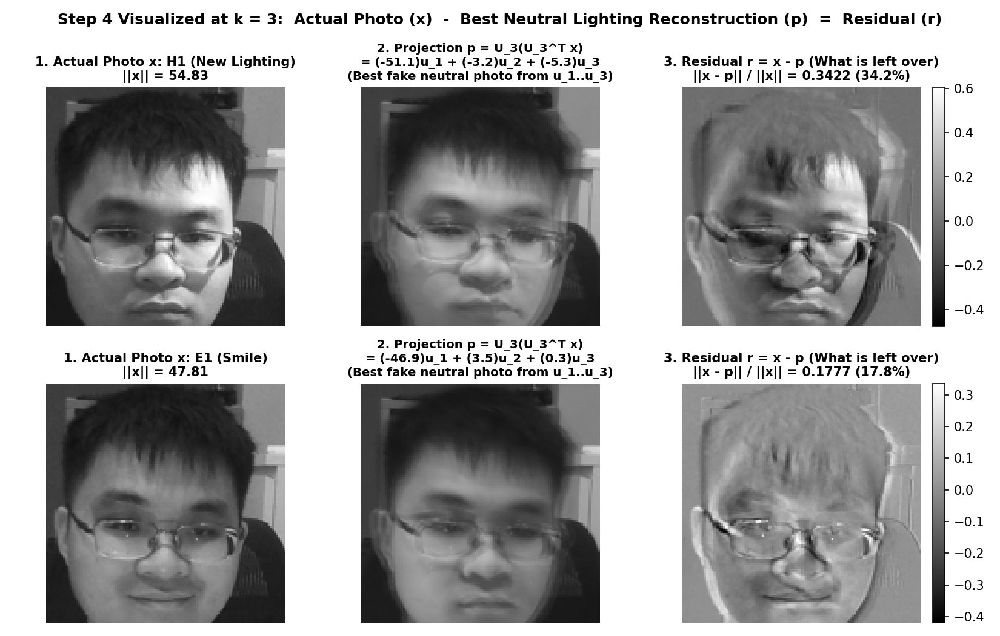

# EEEE3116 Coursework 1: Line-by-Line Code, Math & Integrated Analysis Guide

**Student ID:** `20617556` | **Code Word:** `JDNW` | **Energy Target $T$:** `99.0%` | **Threshold Rank $k_T$:** `5`

---

## Overview: What the Whole Pipeline Actually Does

At a high level, this coursework tests a famous computer vision hypothesis (**Basri & Jacobs / Belhumeur & Kriegman**):
> *If your head stays still and only the lighting direction changes, do you really get infinitely many different images—or is every new lighting image just a linear combination of 3 (or a few) basic "lighting basis images"?*

To test this, the code:
1. Converts each $128 \times 128$ photo of your face into a single column vector of $16,384$ brightness numbers (`prepare_photos.m` $\to$ `load_faces.m`).
2. Stacks your 6 neutral lighting photos (`N1`–`N6`) into a $16384 \times 6$ matrix $A$ and runs the **Singular Value Decomposition (SVD)** to extract the orthogonal "lighting basis images" $\mathbf{u}_1, \dots, \mathbf{u}_6$ and their strengths $\sigma_1, \dots, \sigma_6$ (`cw1_main.m` Steps 1–3).
3. Tests whether a brand-new lighting photo (`H1`) and a smiling photo (`E1`) can be built out of those neutral lighting basis images using **orthogonal projection** (`cw1_main.m` Step 4 & `cw1_figures.m`).

---

## Stage 0: From Raw Photos to Column Vectors (`prepare_photos.m` & `load_faces.m`)

### 1. Cropping & Standardizing (`prepare_photos.m`, lines 54–57)
```matlab
for i = 1:12
    g = rgb2gray(imresize(imcrop(I{i}, r), [128 128]));
    imwrite(g, fullfile('faces', [L{i} '.png']));
end
```
* **What it does:** Takes the **exact same square bounding box `r`** that you dragged on `N1` and crops all 12 photos (`N1`–`N6`, `E1`–`E4`, `H1`, `S2`) at those identical pixel coordinates, resizes each square to $128 \times 128$ pixels, and converts RGB colour to grayscale (`uint8` integers $0\text{–}255$).
* **Why the identical crop `r` matters:** Linear algebra compares matrices **entry-by-entry (pixel-by-pixel)**. Row $i$ of every column vector must correspond to the **exact same physical point on your face** (e.g., the bridge of your glasses or corner of your mouth). If your head shifts between shots, the same row index suddenly compares skin in one photo against eyeglass frames or background in another!

---

### 2. Unrolling 2D Images into 1D Column Vectors (`load_faces.m`, lines 5–10)
```matlab
A = zeros(128*128, numel(labels));
for i = 1:numel(labels)
    x = im2double(imread(fullfile(folder, [labels{i} '.png'])));
    if size(x,3) == 3, x = rgb2gray(x); end
    A(:, i) = x(:);
end
```
* **`im2double(...)`:** Rescales pixel integers $[0, 255]$ to floating-point numbers in $[0, 1]$ (where $0 = \text{black}$, $1 = \text{white}$).
* **`x(:)` (The Colon Unrolling Operator):** Takes the $128 \times 128$ 2D grid of pixels and stacks its columns top-to-bottom into one tall column vector $\mathbf{x} \in \mathbb{R}^{16384 \times 1}$ ($128 \times 128 = 16,384$).
  * Pixels $1\text{–}128$ are the leftmost vertical strip of the image; pixels $129\text{–}256$ are the second vertical strip, and so on.
  * Later, in `cw1_figures.m`, `reshape(v, 128, 128)` does the exact inverse: it folds a $16384 \times 1$ column vector back into a $128 \times 128$ picture so you can view it.
* **`A(:, i) = x(:)`:** Places the $i$-th photo into column $i$ of matrix $A$.

---

## Stage 1: Line-by-Line Walkthrough of `cw1_main.m` (With Integrated Study & Analysis)

### Lines 8–11: Loading Parameters & Building the Neutral Lighting Matrix $A$
```matlab
P = cw_params(studentID);
A = load_faces({'N1','N2','N3','N4','N5','N6'});    % 16384 x 6, one photo per column
R = struct('studentID', studentID, 'T', P.cw1.T);
```
* **What it does:**
  1. `cw_params(20617556)` seeds MATLAB's Mersenne Twister random number generator with your ID `20617556` so your parameters are reproducible: `P.code = 'JDNW'` and `P.cw1.T = 99.0` ($99.0\%$ energy target).
  2. `load_faces({'N1','N2','N3','N4','N5','N6'})` builds the data matrix $A \in \mathbb{R}^{16384 \times 6}$:
     $$A = \begin{bmatrix} | & | & | & | & | & | \\ \mathbf{n}_1 & \mathbf{n}_2 & \mathbf{n}_3 & \mathbf{n}_4 & \mathbf{n}_5 & \mathbf{n}_6 \\ | & | & | & | & | & | \end{bmatrix}_{16384 \times 6}$$
     Each column is your neutral face under a different lamp position: Left (`N1`), Right (`N2`), Above (`N3`), Below (`N4`), Front (`N5`), and Room Light Only (`N6`).

> ### 💡 Integrated Study Point (Q3 Part 2): Notice What Is *NOT* Done to $A$!
> Look closely at line 9: **we do NOT subtract the mean face from $A$** (unlike PCA in Coursework 2).
> * Every single entry of $A$ is a brightness value $A_{ij} \in [0, 1]$ (strictly non-negative, with an average pixel value around $0.35$).
> * Moreover, all 6 columns show the **same person, glasses, hair, and background** in the same frame, meaning the 6 column vectors $\mathbf{n}_1, \dots, \mathbf{n}_6 \in \mathbb{R}^{16384}$ point in almost the same direction in the positive orthant of $\mathbb{R}^{16384}$.
> * **Why this answers Q3 ("Why is $\sigma_1$ much larger than the other singular values?"):** Because the data is un-centred and non-negative, the first singular mode $\sigma_1 \mathbf{u}_1 \mathbf{v}_1^T$ has to carry the entire **mean ("DC component") average face and background brightness**, while $\sigma_2, \dots, \sigma_6$ only capture zero-mean directional lighting differences (shadows/highlights) around that average face. That is why your $\sigma_1 = 121.846$ is **$5.00\times$ larger** than $\sigma_2 = 24.3895$ and accounts for **$91.88\%$** of the total squared energy!

---

### Lines 14–16: Step 1 — Economy SVD of $A$
```matlab
% Step 1: economy SVD  A = U*S*V'   (U: 16384x6, S: 6x6, V: 6x6)
[U, S, V] = svd(A, 'econ');
sigma = diag(S)';                                  % singular values, largest first
R.sigma  = sigma;
```
* **Why `'econ'` (Economy SVD)?**
  A full SVD of a $16384 \times 6$ matrix would create a massive $U \in \mathbb{R}^{16384 \times 16384}$ matrix (over $2.1\text{ GB}$ of memory!), where columns $7$ through $16384$ are multiplied by zeros in $\Sigma$. Since $\text{rank}(A) \le 6$, `'econ'` computes only the 6 active columns:
  $$A = U \Sigma V^T = \sum_{i=1}^{6} \sigma_i \mathbf{u}_i \mathbf{v}_i^T$$
* **What the three matrices mean physically on your face:**
  1. **$U = [\mathbf{u}_1, \mathbf{u}_2, \dots, \mathbf{u}_6] \in \mathbb{R}^{16384 \times 6}$ (Left Singular Vectors / "Eigenfaces"):**
     * Orthonormal columns: $U^T U = I_6$ (each $\mathbf{u}_i$ has unit length $\|\mathbf{u}_i\|_2 = 1$ and is perpendicular to the others, $\mathbf{u}_i^T \mathbf{u}_j = 0$ for $i \neq j$).
     * Each column $\mathbf{u}_i$ is a $16384 \times 1$ **basis lighting image**. In `cw1_figures.m` (line 28):
       ```matlab
       imshow(reshape(U(:,i), 128, 128), []);   % [] rescales: u_i has negative values
       ```
       Because $\mathbf{u}_2, \mathbf{u}_3, \mathbf{u}_4$ are orthogonal to the all-positive $\mathbf{u}_1$, they must contain **both positive and negative numbers** (representing where light is added vs subtracted relative to the mean face). Passing `[]` to `imshow` maps the minimum negative value to black and the maximum positive value to white.
     * **In your Figure 1 (bottom row):**
       * $\mathbf{u}_1$: Average frontal face + background (DC mode).
       * $\mathbf{u}_2$: **Left–right (horizontal) lighting gradient** (bright on one cheek, dark on the other).
       * $\mathbf{u}_3$: **Top–bottom (vertical) lighting gradient** (forehead/cheeks vs chin/under-brow).
       * $\mathbf{u}_4$: Higher-order shadow/specular mode (captures glass frame shadows and head shift in `N1`).
  2. **$S = \Sigma = \text{diag}(\sigma_1, \dots, \sigma_6) \in \mathbb{R}^{6 \times 6}$ (Singular Values):**
     * `diag(S)'` extracts the diagonal entries into a $1 \times 6$ row vector ordered largest to smallest:
       $$\sigma = [121.846,\; 24.3895,\; 18.8741,\; 13.3354,\; 11.2873,\; 7.46808]$$
     * Each $\sigma_i = \|\sigma_i \mathbf{u}_i \mathbf{v}_i^T\|_F$ measures how much total image intensity ("importance") mode $i$ contributes to $A$.
  3. **$V = [\mathbf{v}_1, \dots, \mathbf{v}_6] \in \mathbb{R}^{6 \times 6}$ (Right Singular Vectors):**
     * Orthogonal matrix ($V^T V = V V^T = I_6$). Row $j$ of $V$ tells you the recipe of weights needed to mix the basis images $\sigma_1 \mathbf{u}_1, \dots, \sigma_6 \mathbf{u}_6$ to reconstruct photo $N_j$.

---

### Lines 19–20: Step 2 — Cumulative Energy & Finding $k_T$
```matlab
% Step 2: cumulative energy  sum_{i<=k} sigma_i^2 / sum_i sigma_i^2,  and k_T
R.energy = cumsum(sigma.^2) / sum(sigma.^2);
R.kT     = find(R.energy >= P.cw1.T/100, 1);
```
* **What each function does:**
  * `sigma.^2` squares each singular value: $[\sigma_1^2, \sigma_2^2, \dots, \sigma_6^2] = [14846.38,\; 594.85,\; 356.23,\; 177.83,\; 127.40,\; 55.77]$.
  * `sum(sigma.^2)` sums them to get the total squared Frobenius norm $\|A\|_F^2 = \sum_{i=1}^6 \sigma_i^2 = 16158.46$.
  * `cumsum(sigma.^2)` computes the running cumulative sum $\left[\sigma_1^2,\; \sigma_1^2+\sigma_2^2,\; \dots,\; \sum_{i=1}^6 \sigma_i^2\right]$.
  * Dividing by `sum(sigma.^2)` gives the **cumulative energy fraction** $E(k)$ for $k = 1, \dots, 6$:
    $$E(k) = \frac{\sum_{i=1}^{k} \sigma_i^2}{\sum_{i=1}^{6} \sigma_i^2} = [0.918799,\; 0.955612,\; 0.977658,\; 0.988664,\; \mathbf{0.996548},\; 1.000000]$$
  * `find(R.energy >= P.cw1.T/100, 1)` finds the **first index $k$** where $E(k) \ge 0.990$ ($99.0\%$). Since $E(4) = 0.988664 < 0.990$ and $E(5) = 0.996548 \ge 0.990$, MATLAB returns **`R.kT = 5`**.

> ### 💡 Integrated Study Point (Q1): Why Theory Says $k=3$, Why Your Face Gives $k_T=5$
> * **Why ideal physics predicts Rank 3:**
>   For a convex, matte (Lambertian) surface lit by a distant point source $\mathbf{s} = (s_x, s_y, s_z)^T$, the brightness at pixel $(x,y)$ with surface albedo $\rho(x,y)$ and unit normal vector $\mathbf{n}(x,y) = (n_x, n_y, n_z)^T$ is:
>   $$I(x,y) = \max\big(\rho(x,y)\,\mathbf{n}(x,y)^T \mathbf{s},\; 0\big)$$
>   If every point on the face is lit ($\mathbf{n}^T \mathbf{s} \ge 0$, no shadows), we can drop the $\max(\cdot, 0)$:
>   $$I(x,y) = s_x (\rho n_x) + s_y (\rho n_y) + s_z (\rho n_z)$$
>   That means **every possible lighting image is a linear combination of just 3 fixed images**: $\mathbf{b}_x = \rho n_x$ (horizontal gradient), $\mathbf{b}_y = \rho n_y$ (vertical gradient), and $\mathbf{b}_z = \rho n_z$ (frontal gradient). If this held exactly, $\sigma_4 = \sigma_5 = \sigma_6 = 0$ and $E(3) = 100\%$.
> * **What happens in your data:**
>   Your first 3 modes capture **$97.77\%$** of the energy ($E(3) = 0.977658$), and 4 modes capture **$98.87\%$** ($E(4) = 0.988664$), confirming that lighting on your face is **predominantly low-dimensional**.
>   However, $\sigma_4 = 13.3354, \sigma_5 = 11.2873, \sigma_6 = 7.46808$ are non-zero (requiring $k_T = 5$ to pass $99.0\%$) because **four real-world effects in your photos break the ideal 3D model**:
>   1. **Attached & Cast Shadows ($\max(\cdot,0)$ non-linearity):** Under oblique lighting (`N1`–`N4`), your nose, brow, and **eyeglass frames** cast hard shadows across your cheeks and eyes.
>   2. **Specular Reflections:** Your **glasses lenses/frames** and skin produce bright mirror-like glints that move non-linearly with lamp angle.
>   3. **Near-Field Point Source:** Holding the lamp at $\sim 0.5\text{–}1\text{ m}$ violates the "infinitely distant light" assumption ($1/r^2$ intensity falloff across the face).
>   4. **Slight Head Lean in `N1`:** In `N1` (left lamp), your head leaned slightly ($\sim 12\text{ px}$) compared to `N2`–`N6`, requiring extra SVD modes ($\mathbf{u}_4, \mathbf{u}_5$) to compensate for the shifted facial edges.

---

### Lines 24–29: Step 3 — Rank-$k$ Approximation $A_k$ & Relative Error (Measured vs Predicted)
```matlab
% Step 3: rank-k approximation A_k = U_k S_k V_k' and its relative error,
%         measured directly and predicted from the singular values alone
R.relerr = zeros(1, 6);  R.relerr_pred = zeros(1, 6);
for k = 1:6
    Ak = U(:,1:k) * S(1:k,1:k) * V(:,1:k)';
    R.relerr(k)      = norm(A - Ak, 'fro') / norm(A, 'fro');
    R.relerr_pred(k) = sqrt(sum(sigma(k+1:end).^2) / sum(sigma.^2));
end
```
* **Line 26 (`Ak = U(:,1:k) * S(1:k,1:k) * V(:,1:k)'`):**
  Constructs the **rank-$k$ truncated SVD approximation** $A_k \in \mathbb{R}^{16384 \times 6}$ by keeping only the first $k$ columns of $U$, the top-left $k \times k$ block of $S$, and the first $k$ columns of $V$:
  $$A_k = U_k \Sigma_k V_k^T = \sum_{i=1}^{k} \sigma_i \mathbf{u}_i \mathbf{v}_i^T$$
  Physically, column $j$ of $A_k$ is the reconstruction of photo $N_j$ using only the first $k$ eigenfaces $\mathbf{u}_1, \dots, \mathbf{u}_k$.
* **Line 27 (`R.relerr(k) = norm(A - Ak, 'fro') / norm(A, 'fro')`):**
  **Measured relative error.** Subtracts the $16384 \times 6$ reconstructed matrix $A_k$ from the original $16384 \times 6$ matrix $A$, sums the squares of all $16384 \times 6 = 98,304$ pixel errors, takes the square root ($\|A - A_k\|_F$), and divides by $\|A\|_F$.
* **Line 28 (`R.relerr_pred(k) = sqrt(sum(sigma(k+1:end).^2) / sum(sigma.^2))`):**
  **Predicted relative error from $\sigma$ alone.** Without touching any $16384 \times 6$ matrices, it simply adds up the squares of the **discarded singular values** ($\sigma_{k+1}^2 + \dots + \sigma_6^2$), divides by the total $\sum_{i=1}^6 \sigma_i^2$, and takes the square root.

> ### 💡 Integrated Study Point (Q3 Part 1): Why Lines 27 & 28 Must Agree (Simple Human Version + Worked Example + Short Proof)
>
> #### 1. The Simple Intuition ("The 6-Layer Cake & Pythagoras' Theorem")
> Think of the SVD equation $A = \sum_{i=1}^6 \sigma_i \mathbf{u}_i \mathbf{v}_i^T$ as splitting your $16384 \times 6$ photo matrix $A$ into **6 perpendicular (orthogonal) image layers**:
> $$A = \underbrace{\sigma_1 \mathbf{u}_1 \mathbf{v}_1^T}_{\text{Layer 1}} + \underbrace{\sigma_2 \mathbf{u}_2 \mathbf{v}_2^T}_{\text{Layer 2}} + \underbrace{\sigma_3 \mathbf{u}_3 \mathbf{v}_3^T}_{\text{Layer 3}} + \underbrace{\sigma_4 \mathbf{u}_4 \mathbf{v}_4^T}_{\text{Layer 4}} + \underbrace{\sigma_5 \mathbf{u}_5 \mathbf{v}_5^T}_{\text{Layer 5}} + \underbrace{\sigma_6 \mathbf{u}_6 \mathbf{v}_6^T}_{\text{Layer 6}}$$
> * Because every $\mathbf{u}_i$ and $\mathbf{v}_i$ is a unit vector (length $= 1$), the "size" (Frobenius norm) of Layer $i$ is literally just **$\sigma_i$**.
> * Because the layers are **mutually perpendicular ($90^\circ$)**, **Pythagoras' Theorem** ($c^2 = a^2 + b^2 + \dots$) says the total squared energy of $A$ is simply the sum of the squares of all 6 layers:
>   $$\|A\|_F^2 = \sigma_1^2 + \sigma_2^2 + \sigma_3^2 + \sigma_4^2 + \sigma_5^2 + \sigma_6^2$$
> * Now, what is the rank-$k$ approximation $A_k$? It just **keeps the first $k$ layers**!
>   When you subtract $A_k$ from $A$, **the first $k$ layers cancel out completely**, leaving **only the discarded layers $(k+1)$ to $6$**:
>   $$A - A_k = \sum_{i=k+1}^{6} \sigma_i \mathbf{u}_i \mathbf{v}_i^T$$
> * Applying Pythagoras' Theorem (or the fact that multiplying by orthonormal matrices $U$ and $V^T$ is just a rigid rotation that doesn't change lengths, $\|U D V^T\|_F = \|D\|_F$), the squared error of what is left over is simply the **sum of the squares of the discarded singular values**:
>   $$\|A - A_k\|_F^2 = \sigma_{k+1}^2 + \dots + \sigma_6^2 = \sum_{i=k+1}^{6} \sigma_i^2$$
>
> #### 2. Concrete Example Calculation Using Your Table 1 Numbers (at $k = 4$)
> Take your 6 singular values from **Table 1**:
> $$\sigma_1 = 121.846,\quad \sigma_2 = 24.3895,\quad \sigma_3 = 18.8741,\quad \sigma_4 = 13.3354,\quad \sigma_5 = 11.2873,\quad \sigma_6 = 7.46808$$
> * **Step A — Total Energy $\|A\|_F^2$ (square all 6 and add them up):**
>   $$\|A\|_F^2 = 121.846^2 + 24.3895^2 + 18.8741^2 + 13.3354^2 + 11.2873^2 + 7.46808^2$$
>   $$\|A\|_F^2 = 14846.45 + 594.85 + 356.23 + 177.83 + 127.40 + 55.77 = \mathbf{16158.5}$$
> * **Step B — Squared Error at $k = 4$, $\|A - A_4\|_F^2$ (we kept $\sigma_1\dots\sigma_4$, so only $\sigma_5$ and $\sigma_6$ are left over):**
>   $$\|A - A_4\|_F^2 = \sigma_5^2 + \sigma_6^2 = 11.2873^2 + 7.46808^2 = 127.40 + 55.77 = \mathbf{183.17}$$
> * **Step C — Relative Error at $k = 4$ (divide and take square root):**
>   $$\text{Relative Error}(k=4) = \frac{\|A - A_4\|_F}{\|A\|_F} = \sqrt{\frac{\sigma_5^2 + \sigma_6^2}{\sum_{i=1}^6 \sigma_i^2}} = \sqrt{\frac{183.17}{16158.5}} = \sqrt{0.011336} = \mathbf{0.106471}$$
>   Look at row $k=4$ of your **Table 1**: both `Relative Error (Measured)` and `Relative Error (from σ)` are **`0.106471`**!
>   *(And at $k=6$, no singular values are discarded so the formula gives `0`, while MATLAB's matrix subtraction gives `1.40514e-15` because of tiny computer floating-point rounding).*
>
> #### 3. Short 3-Line Algebra Proof (For Full Marks in Handwritten Q3)
> Since $A = U\Sigma V^T$ and $A_k = U_k \Sigma_k V_k^T$, subtracting gives $A - A_k = U \tilde{\Sigma}_k V^T$ where $\tilde{\Sigma}_k = \text{diag}(0, \dots, 0, \sigma_{k+1}, \dots, \sigma_6)$.
> Because $U$ and $V$ have orthonormal columns ($U^T U = I_6, V^T V = I_6$), they preserve the Frobenius norm ($\|X\|_F^2 = \text{tr}(X^T X)$):
> $$\|A - A_k\|_F^2 = \text{tr}\big((U \tilde{\Sigma}_k V^T)^T (U \tilde{\Sigma}_k V^T)\big) = \text{tr}\big(V \tilde{\Sigma}_k \underbrace{U^T U}_{I_6} \tilde{\Sigma}_k V^T\big) = \text{tr}(\tilde{\Sigma}_k^2) = \sum_{i=k+1}^{6} \sigma_i^2$$
>
> ---
>
> ### 💡 Integrated Study Point (Q3 Part 2): Why $\sigma_1 = 121.846$ Is Huge Compared to $\sigma_2 = 24.3895$ (Tiny 2-Pixel Example!)
> Suppose you have a tiny 2-pixel image under Left lighting and Right lighting, where the average pixel brightness is $0.50$ and the lamp only shifts brightness by $\pm 0.05$:
> $$A = \begin{bmatrix} 0.55 & 0.45 \\ 0.45 & 0.55 \end{bmatrix} = \underbrace{\begin{bmatrix} 0.50 & 0.50 \\ 0.50 & 0.50 \end{bmatrix}}_{\text{Mode 1: Average Brightness } (\sigma_1 = 1.00)} + \underbrace{\begin{bmatrix} +0.05 & -0.05 \\ -0.05 & +0.05 \end{bmatrix}}_{\text{Mode 2: Lighting Difference } (\sigma_2 = 0.10)}$$
> Why is $\sigma_1$ ($1.00$) ten times bigger than $\sigma_2$ ($0.10$)?
> 1. **Pixels are positive $[0, 1]$ and we did NOT subtract the mean face:** Every pixel brightness is $\ge 0$. Because we didn't centre the data before SVD, Mode 1 ($\sigma_1 \mathbf{u}_1 \mathbf{v}_1^T$) has to carry the **entire baseline brightness (average face + background)** of all 6 photos ($\sigma_1 = 121.846$, or $91.88\%$ of total energy).
> 2. **All 6 photos show the same stationary face and background:** Columns `N1`–`N6` are nearly identical (highly colinear vectors), while modes $\sigma_2 = 24.3895$ to $\sigma_6 = 7.46808$ only represent the small $+ / -$ shadow changes around that average face.

---

### Lines 33–39: Step 4 — Projecting Held-Out Photos `H1` and `E1` onto $\text{span}(U_k)$
```matlab
% Step 4: project the held-out photos onto span(U_k):  p = U_k*U_k'*x
%         relative residual = ||x - p|| / ||x||
X = load_faces({'H1', 'E1'});                      % new lighting, and a smile
R.res_H1 = zeros(1, 5);  R.res_E1 = zeros(1, 5);
for k = 1:5
    Uk = U(:, 1:k);
    x = X(:,1);  R.res_H1(k) = norm(x - Uk*(Uk'*x)) / norm(x);
    x = X(:,2);  R.res_E1(k) = norm(x - Uk*(Uk'*x)) / norm(x);
end
```

#### 🖼️ The Mental Picture of Step 4 (What `x`, `p`, and `r = x - p` Actually Look Like!)
The reason Step 4 feels abstract in `cw1_figures.m` is that **Figure 3 only plots the leftover residual `r = x - p`, and never shows you the projected face `p` itself!**

Here is what `x`, `p`, and `r = x - p` actually look like on your face at $k = 3$:



Think of $U_k = [\mathbf{u}_1, \dots, \mathbf{u}_k]$ as a **"Neutral-Face Stamp Kit"** containing $k$ transparent stamp templates learned **only** from your 6 neutral photos `N1`–`N6`:
* **$\mathbf{u}_1$** is the average neutral face stamp.
* **$\mathbf{u}_2$** is the left–right lighting stamp.
* **$\mathbf{u}_3$** is the top–bottom lighting stamp.
* Crucially, **every stamp in this kit has a closed, neutral mouth!** It has *never* seen you smile (`E1`), and it has *never* seen the diagonal upper-left lamp (`H1`).

Now we hand the computer a brand-new test photo **`x`** (`H1` or `E1`) and challenge it:
> *"Using ONLY a weighted mix of your first $k$ neutral stamps $\mathbf{u}_1, \dots, \mathbf{u}_k$, build the closest fake photo **`p`** that you possibly can to match **`x`**!"*

Here is how the single line `p = Uk * (Uk' * x)` does that in 3 steps:

1. **Step 4a — Find the Recipe Weights: `c = Uk' * x` ($k \times 1$ list of numbers)**
   * For each stamp $\mathbf{u}_i$, the dot product $c_i = \mathbf{u}_i^T \mathbf{x}$ measures how much of stamp $\mathbf{u}_i$ is present in test photo $\mathbf{x}$.
   * For your smile photo `E1` at $k = 3$, MATLAB computes the 3 recipe weights:
     $$c_1 = -46.9, \quad c_2 = +3.5, \quad c_3 = +0.3$$

2. **Step 4b — Build the Best Fake Neutral Photo: `p = Uk * c` ($16384 \times 1$ image)**
   * MATLAB mixes the $k$ stamps using those exact weights:
     $$\mathbf{p} = c_1 \mathbf{u}_1 + c_2 \mathbf{u}_2 + c_3 \mathbf{u}_3 = (-46.9)\mathbf{u}_1 + (3.5)\mathbf{u}_2 + (0.3)\mathbf{u}_3$$
   * **Look at the middle column (`2. Projection p`) in the picture above:**
     * For **`E1` (bottom middle)**: The computer successfully matches your forehead, hair, glasses, background, and front lighting—**but because its stamp kit only knows neutral faces, the fake photo `p` has a closed, neutral mouth!**
     * For **`H1` (top middle)**: The computer mixes $\mathbf{u}_1, \mathbf{u}_2, \mathbf{u}_3$ to imitate upper-left lighting, producing a neutral face lit from the upper-left (with a slight double-edge on the right cheek because `N1` had a slight head lean).

3. **Step 4c — Subtract to See What the Stamp Kit Couldn't Explain: `r = x - p` and `norm(r) / norm(x)`**
   * Now subtract the computer's fake neutral reconstruction **`p`** (Column 2) from your actual photo **`x`** (Column 1):
     $$\mathbf{r} = \mathbf{x} - \mathbf{p}$$
   * **Look at the right column (`3. Residual r = x - p`, which is Figure 3 in your coursework):**
     * **For `E1` (bottom right):**
       $$\text{(Your Smiling Photo }\mathbf{x}\text{)} - \text{(Reconstructed Neutral Photo }\mathbf{p}\text{)} = \text{Just the Smile!}$$
       Everywhere that didn't move (forehead, hair, background) cancels out to $0$ (flat grey), and the only thing left over in $\mathbf{r}$ is **your smiling mouth, raised cheeks, and lower glasses rim**!
     * **For `H1` (top right):**
       $$\text{(Actual Upper-Left Lit Photo }\mathbf{x}\text{)} - \text{(3-Stamp Lighting Approximation }\mathbf{p}\text{)} = \text{Unmodelled Shadows \& Head-Shift Edges!}$$
   * Finally, **`norm(x - p) / norm(x)`** (`R.res_H1(k)` and `R.res_E1(k)` in **Table 2**) condenses that entire leftover image $\mathbf{r}$ into **one percentage number**:
     $$\text{Relative Residual} = \frac{\|\mathbf{r}\|_2}{\|\mathbf{x}\|_2} = \frac{\|\mathbf{x} - \mathbf{p}\|_2}{\|\mathbf{x}\|_2}$$
     * At $k=3$, for `E1`: $\|\mathbf{r}\|_2 / \|\mathbf{x}\|_2 = 8.49 / 47.81 = \mathbf{0.1777}$ ($17.8\%$ of the image energy could not be explained by the 3 neutral stamps).
     * At $k=3$, for `H1`: $\|\mathbf{r}\|_2 / \|\mathbf{x}\|_2 = 18.76 / 54.83 = \mathbf{0.3422}$ ($34.2\%$ of the image energy could not be explained).
     * As $k$ increases from $1 \to 5$, you give the computer **more stamps** ($\mathbf{u}_1$ up to $\mathbf{u}_5$), so its fake photo $\mathbf{p}$ gets closer and closer to $\mathbf{x}$, and the relative residual $\|\mathbf{x} - \mathbf{p}\|_2 / \|\mathbf{x}\|_2$ **must decrease (or stay flat) at every step** (which is the curve plotted in **Figure 2 right**!).

> ### 💡 Integrated Study Point (Q2): Comparing `H1` (New Lighting) vs `E1` (Smile) in Your Results
> Look at your **Table 2**, **Figure 2 (right)**, and **Figure 3**:
> * **Your Numbers (Table 2):**
>   * `H1` (new upper-left lighting): $0.36046$ ($k=1$) $\to 0.355658$ ($k=2$) $\to 0.34220$ ($k=3$) $\to 0.327411$ ($k=4$) $\to 0.322855$ ($k=5$) (steady $10.4\%$ relative reduction across all modes).
>   * `E1` (smile, front lighting): $0.19214$ ($k=1$) $\to 0.177788$ ($k=2$) $\to 0.177693$ ($k=3$) $\to 0.144526$ ($k=4$) $\to 0.13118$ ($k=5$) ($31.7\%$ relative reduction, flat at $k=2\to 3$, sharp drop at $k=4$, floor at $\sim 13.1\%$).
> * **Why `E1` starts lower than `H1` and behaves differently with $k$:**
>   1. `E1` was photographed under **front lighting** (identical to training photos `N5` and `N6`) and with your head in the **exact same position** as `N2`–`N6`. Thus, all static regions of `E1` (forehead, hair, background) are already matched by the frontal modes $\mathbf{u}_1$ and $\mathbf{u}_4$. Adding $\mathbf{u}_2, \mathbf{u}_3$ (which model left/right and top/bottom directional shadows from `N1`–`N4`) gives virtually zero improvement for front-lit `E1` between $k=2$ ($0.177788$) and $k=3$ ($0.177693$), whereas $\mathbf{u}_4$ refines the frontal shading and drops `res_E1` to $0.144526$.
>   2. However, `E1` hits an **irreducible geometric floor ($0.13118$ at $k=5$)** because a smile physically moves facial features (mouth corners widen, teeth appear, cheeks push up), which is a **non-rigid 3D shape change** outside the span of neutral faces.
>   3. By contrast, `H1` decreases steadily with every directional mode $k=1 \to 5$ because it has genuine upper-left lighting (a combination of `N1` and `N3`), but its overall residual stays higher ($0.34220$ at $k=3$) because `N1` had a $\sim 12\text{ px}$ head lean relative to `H1` plus sharp diagonal cast shadows from your glasses frame.
> * **Where the `E1` residual is concentrated in Figure 3 ($k=3$):**
>   In **Figure 3 (right)**, the `E1` residual $\mathbf{x} - \mathbf{p}$ is zero (mid-grey) over the forehead, hair, and background, and is **tightly concentrated at the smiling mouth/lips, raised cheeks/nasolabial folds, and lower eyeglass frames** (pushed up slightly by your smiling cheeks). In contrast, `H1` (**Figure 3 left**) shows global residual errors across the right forehead/cheek highlight ($+0.5$), nose/glasses cast shadow ($-0.4$), and head/chair outline.
> * **What this means for face recognition under changing lighting:**
>   1. Projecting onto a low-dimensional lighting subspace $\text{span}(U_k)$ ($k \approx 3\text{–}5$) models and removes global lighting variations while keeping expression residuals (`E1`) spatially localized to the mouth/cheeks (where a classifier can ignore or mask them).
>   2. However, `H1` proves that subspace projection is **not invariant to spatial translation/pose shifts**: accurate **face alignment/registration** is essential before projecting onto $U_k$, otherwise small head movements create large global residuals across the entire face.

---

## Stage 2: Ready-to-Handwrite 1-Page A4 Template for Task 3 (`analysis.pdf`)

> **Instructions:** Write the section below in your own handwriting on **one side of A4 paper**, scan it as `analysis.pdf`, and include it in `20617556_CW1.zip`. Every number matches your updated `JDNW` run (`results_cw1.mat`, `table1_cw1.csv`, `table2_cw1.csv`, and `results.pdf`).

---

### [Start of 1-Page Handwritten Sheet]

**EEEE3116 Coursework 1 – Handwritten Analysis | Student ID: 20617556 ($T = 99.0\%, k_T = 5$)**

#### **Q1. Is lighting low-dimensional for your face?**
- **Low-dimensionality in `N1`–`N6`:** Yes, lighting across my six neutral photos (`N1`–`N6`) is strongly low-dimensional. In **Table 1** and **Figure 2 (left)**, $\sigma_1 = 121.846$ alone captures **$91.88\%$** ($0.918799$) of the total energy, and the first three singular values ($\sigma_1 = 121.846, \sigma_2 = 24.3895, \sigma_3 = 18.8741$) capture **$97.77\%$** ($0.977658$) of the energy, cutting the relative error from $0.284958$ ($k=1$) to $0.149472$ ($k=3$). By $k=4$ ($\sigma_4 = 13.3354$), cumulative energy reaches **$98.87\%$** ($0.988664$, just $0.13\%$ below $T=99.0\%$), and my threshold is reached at **$k_T = 5$** ($\sigma_5 = 11.2873$, cumulative energy **$99.65\%$**, relative error $0.0587501$). In **Figure 1**, $\mathbf{u}_1$ represents the average frontal illumination, $\mathbf{u}_2$ the left–right horizontal lighting gradient, and $\mathbf{u}_3$ the top–bottom vertical lighting gradient.
- **Why it is not *exactly* 3-dimensional ($\sigma_4 = 13.34, \sigma_5 = 11.29, \sigma_6 = 7.47 > 0$) and why `H1` residuals are large:**
  Theory states that a convex, perfectly matte (Lambertian) surface under distant point lighting has pixel intensity $I = \max(\rho \mathbf{n}^T \mathbf{s}, 0)$, which spans a 3D subspace ($\text{span}(\rho n_x, \rho n_y, \rho n_z)$) only when $\mathbf{n}^T \mathbf{s} \ge 0$ everywhere. In my photos (**Figure 1** and **Figure 3**), four physical effects break this ideal 3D model:
  1. **Attached and cast shadows:** Extreme lamp angles (`N1`–`N4`, `H1`) cause the nose, brow, and **eyeglass frames** to cast sharp shadows across my cheeks/eyes, introducing non-linear $\max(\cdot, 0)$ clipping.
  2. **Specular reflections:** My **eyeglasses** and skin produce bright non-Lambertian mirror glints that shift with lamp position.
  3. **Near-field light source:** The handheld lamp is close ($\sim 0.5\text{–}1\text{ m}$), causing non-uniform $1/r^2$ intensity falloff.
  4. **Head/posture shift in `N1` and `H1`:** In **Table 2**, my held-out `H1` residual decreases steadily as $k$ grows ($0.36046$ at $k=1 \to 0.34220$ at $k=3 \to 0.322855$ at $k=5$), confirming that adding lighting modes $\mathbf{u}_2\text{–}\mathbf{u}_5$ helps explain the new upper-left lighting direction. However, `res_H1` remains around $0.32\text{–}0.36$ because my head leaned slightly ($\sim 12\text{ px}$) during left-lit photo `N1` relative to `H1`, creating the edge-misalignment ghosting seen in **Figure 3 (left)**.

---

#### **Q2. Lighting versus expression (`E1` vs `H1`)**
- **Comparison of `E1` and `H1` residuals as $k$ grows (**Table 2** & **Figure 2 right**):**
  - `H1` (new upper-left lighting) starts at $0.36046$ ($k=1$) and decreases gradually across every mode: $0.355658$ ($k=2$), $0.34220$ ($k=3$), $0.327411$ ($k=4$), and $0.322855$ ($k=5$) (a $10.4\%$ relative reduction).
  - `E1` (smile, front lighting) starts much lower at $0.19214$ ($k=1$), drops to $0.177788$ ($k=2$), plateaus at $0.177693$ ($k=3$), drops sharply at $k=4$ to $0.144526$, and reaches $0.13118$ at $k=5$ (a $31.7\%$ relative reduction).
  - **Why they behave differently:** `E1` was captured under **front lighting** (matching training photos `N5` and `N6`) and with almost zero head movement relative to `N2`–`N6`. Thus, the upper face and background of `E1` are already well-spanned by the frontal lighting modes ($\mathbf{u}_1$ and $\mathbf{u}_4$), whereas modes $\mathbf{u}_2, \mathbf{u}_3$ capture side/vertical shadows (`N1`–`N4`) and therefore do not reduce `E1`'s residual between $k=2$ ($0.177788$) and $k=3$ ($0.177693$). However, `E1` hits an irreducible floor ($0.13118$ at $k=5$) because a **smile is a non-rigid 3D geometric deformation** that cannot be represented as a linear combination of neutral-face images. Meanwhile, `H1` has strong upper-left directional shadows and slight spatial misalignment with `N1`, keeping its global residual higher ($0.34220$ at $k=3$).
- **Where the `E1` residual is concentrated (**Figure 3 right**):**
  At $k=3$, the `E1` residual image $\mathbf{x} - \mathbf{p}$ is near $0$ (mid-grey) over the forehead, hair, and background, and is **tightly concentrated around the smiling mouth/lips, raised cheeks (nasolabial folds), and lower eyeglass rims** (pushed up by the cheeks). By contrast, `H1`'s residual (**Figure 3 left**) is spread globally across the right forehead/cheek highlight ($+0.5$), nose/glasses shadow ($-0.4$), and head/chair outline.
- **Implication for face recognition under changing lighting:**
  Projecting a face onto a low-dimensional lighting subspace $\text{span}(U_k)$ ($k \approx 3\text{–}5$) effectively removes global lighting changes while leaving expression changes (`E1`) localized to small regions (mouth/cheeks) that can be masked or tolerated. However, my `H1` result shows that subspace projection is highly sensitive to **spatial misalignment**: a face must be accurately aligned/registered before subspace projection, otherwise pose shifts masquerade as large global residuals.

---

#### **Q3. The mathematics behind Table 1**
- **Why measured and predicted relative errors in Table 1 agree ($\|A - A_k\|_F^2 = \sum_{i>k} \sigma_i^2$):**
  The economy SVD writes $A = U\Sigma V^T = \sum_{i=1}^6 \sigma_i \mathbf{u}_i \mathbf{v}_i^T$ as a sum of 6 mutually orthogonal rank-1 layers ($U^T U = I_6, V^T V = I_6$). Since $A_k = \sum_{i=1}^k \sigma_i \mathbf{u}_i \mathbf{v}_i^T$ keeps the first $k$ layers, subtracting cancels layers $1\dots k$ and leaves only the discarded layers $i > k$:
  $$A - A_k = \sum_{i=k+1}^{6} \sigma_i \mathbf{u}_i \mathbf{v}_i^T = U \tilde{\Sigma}_k V^T, \quad \tilde{\Sigma}_k = \text{diag}(0, \dots, 0, \sigma_{k+1}, \dots, \sigma_6)$$
  Because orthonormal matrices $U$ and $V$ preserve the Frobenius norm ($\|X\|_F^2 = \text{tr}(X^T X)$):
  $$\|A - A_k\|_F^2 = \text{tr}\big((U \tilde{\Sigma}_k V^T)^T (U \tilde{\Sigma}_k V^T)\big) = \text{tr}\big(V \tilde{\Sigma}_k \underbrace{U^T U}_{I_6} \tilde{\Sigma}_k V^T\big) = \text{tr}(\tilde{\Sigma}_k^2) = \sum_{i=k+1}^{6} \sigma_i^2$$
  Similarly, for $k=0$, $\|A\|_F^2 = \sum_{i=1}^6 \sigma_i^2 = 16158.5$. Taking the square root of their ratio gives:
  $$\frac{\|A - A_k\|_F}{\|A\|_F} = \sqrt{\frac{\sum_{i=k+1}^{6} \sigma_i^2}{\sum_{i=1}^{6} \sigma_i^2}}$$
  *Example check at $k=4$ (**Table 1**):* $\sqrt{(\sigma_5^2 + \sigma_6^2)/\sum_{i=1}^6 \sigma_i^2} = \sqrt{(11.2873^2 + 7.46808^2)/16158.5} = \sqrt{183.17/16158.5} = \mathbf{0.106471}$, matching the measured error $0.106471$ identically (at $k=6$, predicted is $0$ vs measured $1.405\times 10^{-15}$ from floating-point rounding).
- **Why $\sigma_1$ is much larger than the other singular values ($\sigma_1 = 121.846 \gg \sigma_2 = 24.3895$):**
  1. **No mean subtraction & non-negative pixels ($A_{ij} \in [0, 1]$):** Unlike PCA, the mean face is not subtracted before SVD. Because all pixel intensities are positive, the first mode $\sigma_1 \mathbf{u}_1 \mathbf{v}_1^T$ carries the entire **baseline average face and background brightness ("DC offset", Figure 1 $\mathbf{u}_1$)**, capturing $\sigma_1^2 / \sum \sigma_i^2 = 121.846^2 / 16158.5 = \mathbf{91.88\%}$ of total energy.
  2. **High similarity (colinearity) of the 6 photos:** All 6 columns of $A$ show the same stationary face, glasses, and room background, so vectors $\mathbf{a}_1, \dots, \mathbf{a}_6$ point in nearly the same direction ($\sigma_1 = 121.846$, $5.00\times$ larger than $\sigma_2 = 24.3895$), while $\sigma_2\text{–}\sigma_6$ only capture zero-mean $+ / -$ shadow changes around $\mathbf{u}_1$.

### [End of 1-Page Handwritten Sheet]
