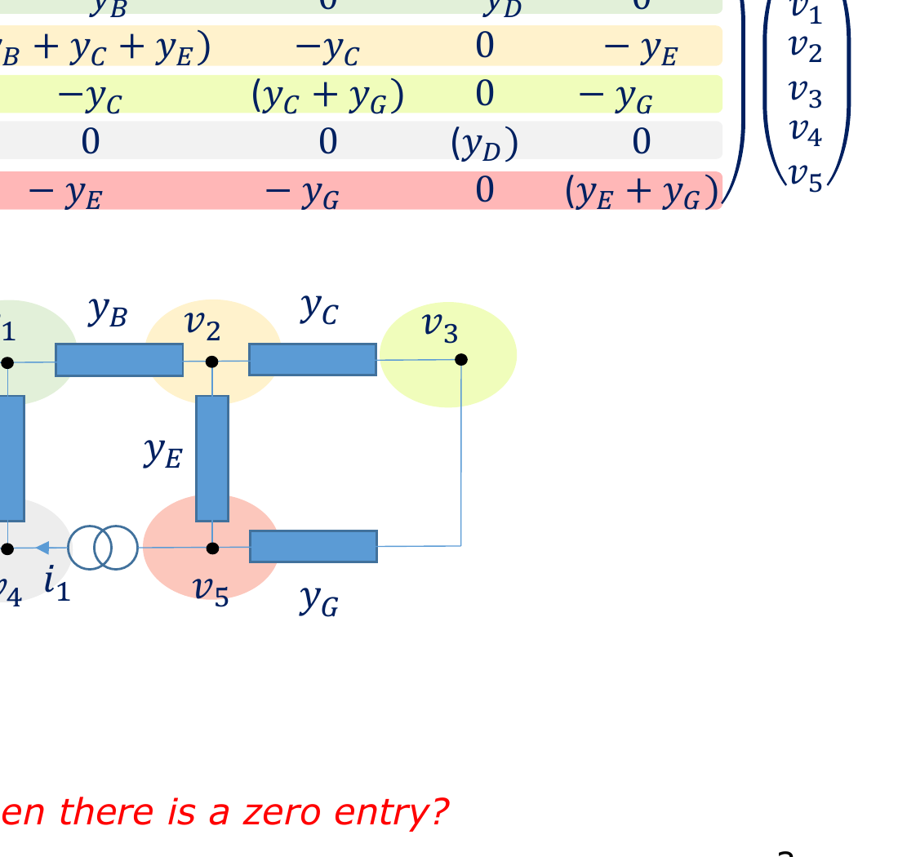

# Chapter 01: The Origin of Zeros (Physical Sparsity)

**Subject:** Physical Systems, Nodal Admittance Matrices, and Locality  
**Depends on:** [Kirchhoff's Current Law (KCL)], [Admittance Matrix], [Linear Systems $Ax = b$]  
**Lecture Reference:** Slides 1–7

---

## The Intuition: Nature is Local

* **The Fallacy of Full Coupling:** If you write down a generic $N \times N$ matrix on a whiteboard, every variable appears to influence every other variable. In a system of 6 variables, that implies $6 \times 6 = 36$ distinct cross-interactions.
* **The Reality of Physical Media:** In the real physical world, things only interact with what touches them. A resistor in a circuit only transfers charge between the two specific nodes it is soldered to. A particle in a heated metal block only exchanges thermal kinetic energy directly with the atoms immediately adjacent to it. A wavefront in space only perturbs the electromagnetic field in its immediate differential neighbourhood.
* **The Consequence:** Because each physical point only talks to a tiny handful of immediate neighbours, almost every equation you write down involves only those few neighbours. Every other variable in the universe receives a coefficient of **0**.
* **The Definition of Sparsity:** A matrix is called **sparse** when the overwhelming majority of its elements are zero. A matrix with few or no zeros is called **dense**.

```
    [Dense Matrix: Full Cross-Talk]             [Sparse Matrix: Local Coupling]
           All-to-All                                Nearest Neighbours Only
        (1) <=======> (2)                               (1) --- (2) --- (3)
         ^ \       / ^                                   |       |       |
         |   \   /   |                                  (4) --- (5) --- (6)
         |     X     |                                   |       |       |
         v   /   \   v                                  (7) --- (8) --- (9)
        (3) <=======> (4)
    Non-zeros: N x N = N²                             Non-zeros: ~ 4 x N
```

---

## The Detail: Nodal Analysis as the Archetype

Let us take the exact foundational example used in Dr. Sewell's lecture: **Nodal Analysis** of an electrical network.

### 1. The Circuit Setup

Consider the 6-node circuit shown in the lecture slides:
* Nodes: $v_0, v_1, v_2, v_3, v_4, v_5$.
* Passive branch admittances: $y_A, y_B, y_C, y_D, y_E, y_F, y_G$.
* Independent current sources injecting current at specific nodes: $i_0$ and $i_1$.



*(External current source $i_0$ injects into $v_2$; source $i_1$ injects between $v_4$ and $v_5$).*

### 2. Formulating the Equations via KCL

Kirchhoff's Current Law states that at any node $k$, the net current flowing out through connected branches must equal the external current injected into that node:

$$\sum (\text{currents leaving node } k) = i_{\text{injected}, k}$$

Let us write the equation for each node:

* **Node 0:** Connected only to $v_1$ through $y_A$ and GND through $y_F$:
  $$y_F v_0 + y_A (v_0 - v_1) = 0 \implies (y_A + y_F) v_0 - y_A v_1 = 0$$
* **Node 1:** Connected to $v_0$ (via $y_A$), $v_2$ (via $y_B$), and $v_4$ (via $y_D$):
  $$y_A (v_1 - v_0) + y_B (v_1 - v_2) + y_D (v_1 - v_4) = 0$$
  $$\implies -y_A v_0 + (y_A + y_B + y_D) v_1 - y_B v_2 - y_D v_4 = 0$$
* **Node 2:** Connected to $v_1$ (via $y_B$), $v_3$ (via $y_C$), and $v_5$ (via $y_E$):
  $$-y_B v_1 + (y_B + y_C + y_E) v_2 - y_C v_3 - y_E v_5 = -i_0$$
* **Node 3:** Connected to $v_2$ (via $y_C$) and GND (via $y_G$):
  $$-y_C v_2 + (y_C + y_G) v_3 = 0$$
* **Node 4:** Connected to $v_1$ (via $y_D$):
  $$-y_D v_1 + y_D v_4 = -i_1$$
* **Node 5:** Connected to $v_2$ (via $y_E$) and GND (via $y_G$):
  $$-y_E v_2 + (y_E + y_G) v_5 = i_1$$

### 3. The Matrix Form: $\mathbf{Y} \mathbf{v} = \mathbf{i}$

Putting these 6 linear equations into standard matrix form:

$$\begin{bmatrix}
0 \\
0 \\
-i_0 \\
0 \\
-i_1 \\
i_1
\end{bmatrix}
=
\begin{bmatrix}
(y_A + y_F) & -y_A & 0 & 0 & 0 & 0 \\
-y_A & (y_A + y_B + y_D) & -y_B & 0 & -y_D & 0 \\
0 & -y_B & (y_B + y_C + y_E) & -y_C & 0 & -y_E \\
0 & 0 & -y_C & (y_C + y_G) & 0 & 0 \\
0 & -y_D & 0 & 0 & y_D & 0 \\
0 & 0 & -y_E & 0 & 0 & (y_E + y_G)
\end{bmatrix}
\begin{bmatrix}
v_0 \\
v_1 \\
v_2 \\
v_3 \\
v_4 \\
v_5
\end{bmatrix}$$

### 4. What Does an Individual Entry $Y_{jk}$ Physically Mean?

Look closely at any entry in the matrix $Y$:
1. **Diagonal Elements ($Y_{kk}$):** 
   $$Y_{kk} = \sum \text{admittances connected directly to node } k$$
   This represents the self-admittance of node $k$. It is always strictly positive (non-zero).
2. **Off-Diagonal Elements ($Y_{jk}$ where $j \ne k$):**
   $$Y_{jk} = - (\text{admittance directly linking node } j \text{ and node } k)$$
3. **The Zero Entries ($Y_{jk} = 0$):**
   **There is NO physical branch connecting node $j$ directly to node $k$!**
   * Does Node 0 connect directly to Node 3? **No.** Therefore, $Y_{03} = 0$ and $Y_{30} = 0$.
   * Does Node 4 connect directly to Node 5? **No.** Therefore, $Y_{45} = 0$ and $Y_{54} = 0$.

> [!IMPORTANT]
> **A zero entry in an engineering matrix is not an accidental cancellation or an arbitrary algebraic artifact. It is a physical statement of topological disconnection: Node $j$ and Node $k$ do not directly touch.**

---

## Scaling Analysis: Why the Zeros Multiply as $N$ Grows

Why does this matter so profoundly when we scale up?

Consider what happens as a system grows from 6 nodes to 100,000,000 nodes:
* In a system of $N$ nodes, the complete matrix contains $N \times N = N^2$ possible entry slots.
* In physical three-dimensional space, how many immediate neighbours can a single point or component physically touch?
  * In a circuit layout, a typical junction connects to $3$ or $4$ components.
  * In a 2D finite-difference grid (Cartesian mesh), each point connects to its North, South, East, and West neighbours: **4 neighbours**.
  * In a 3D finite-difference volume, each point connects to $\pm x, \pm y, \pm z$: **6 neighbours** (plus self = 7 points).
  * In a 3D finite-element tetrahedral mesh, each node connects to approximately **10 to 14 neighbours**.

Notice the crucial mathematical fact:
* The number of non-zero entries per row **remains constant** ($k \approx 4 \text{ to } 14$), completely independent of how many total nodes exist in the universe!
* Therefore, the total number of non-zero entries in the entire $N \times N$ matrix is approximately:
  $$\text{NNZ} \approx k \cdot N$$

### The Density vs. Sparsity Ratio

Let us define the **matrix density** $\rho$ as the fraction of elements that are non-zero:

$$\rho = \frac{\text{Number of Non-Zeros}}{\text{Total Elements}} = \frac{k \cdot N}{N^2} = \frac{k}{N}$$

Now examine what happens as the system resolution increases:

| Total Unknowns ($N$) | Physical Coupling ($k$) | Total Elements ($N^2$) | Non-Zero Elements ($k \cdot N$) | Density $\rho = \frac{k}{N}$ | Sparsity ($1 - \rho$) |
| :--- | :--- | :--- | :--- | :--- | :--- |
| **10** (toy circuit) | 4 | 100 | 40 | 40% | 60% zero |
| **1,000** (small subcircuit) | 7 | $1,000,000$ ($10^6$) | 7,000 | 0.7% | 99.3% zero |
| **1,000,000** (IC chip level) | 7 | $10^{12}$ (1 Trillion) | $7 \times 10^6$ | $0.0007\%$ | **99.9993% zero** |
| **100,000,000** (Full 3D CAD) | 7 | $10^{16}$ (10,000 Trillion) | $7 \times 10^8$ (700 Million) | $0.000007\%$ | **99.999993% zero** |

> [!NOTE]
> As $N \to \infty$, the density $\rho \to 0$. In genuine industrial engineering problems, a matrix is not "mostly numbers with a few zeros sprinkled in." It is an ocean of pure zero, with a vanishingly thin thread of non-zero numbers holding the physical network together.

---

## Universal Physical Scope

This behaviour is not unique to electric circuits. It governs almost all classical engineering physics:

1. **Thermal Conduction / Heat Dissipation (Fourier's Law):**
   Heat flows proportionally to temperature difference between adjacent material cells:
   $$q = -k \nabla T \implies \frac{\partial T}{\partial t} = \alpha \nabla^2 T$$
   Discretizing $\nabla^2 T$ in space couples cell $(i,j)$ strictly to $(i\pm 1, j)$ and $(i, j\pm 1)$. Everything else is zero.
2. **Electromagnetics & RF (Maxwell's Equations):**
   Ampère's and Faraday's laws couple electric fields $\mathbf{E}$ to magnetic curls $\nabla \times \mathbf{B}$ in the immediate vicinity.
3. **Structural Mechanics / FEA:**
   Displacements in a turbine blade or bridge truss only exert direct tension or compression on the structural members immediately attached to that joint.

---

## Key Takeaways & Self-Check

1. **Why do zeros appear?** Because physical systems exhibit **locality**: components or spatial points only exchange energy, charge, or force with their immediate neighbours.
2. **How does non-zero count scale?** Linearly with $N$ ($\text{NNZ} \sim O(N)$), while total matrix slots scale quadratically ($O(N^2)$).
3. **What is the central engineering dilemma?** If we store and process an $N \times N$ matrix using standard textbook math, we will spend $99.9999\%$ of our computer's memory and CPU power doing $0 + 0 = 0$ and $0 \times 0 = 0$.

Next chapter: [**`02_sparse_storage_and_the_direct_solver_trap.md`**](file:///home/nicholas/projects/y4_ee/modules/EEEE3116_adv_eng_math/concepts/zeroes_lecture/02_sparse_storage_and_the_direct_solver_trap.md) — How do computers actually store these sparse matrices, and what catastrophic trap happens if you try to use standard Gaussian elimination or LU decomposition?

