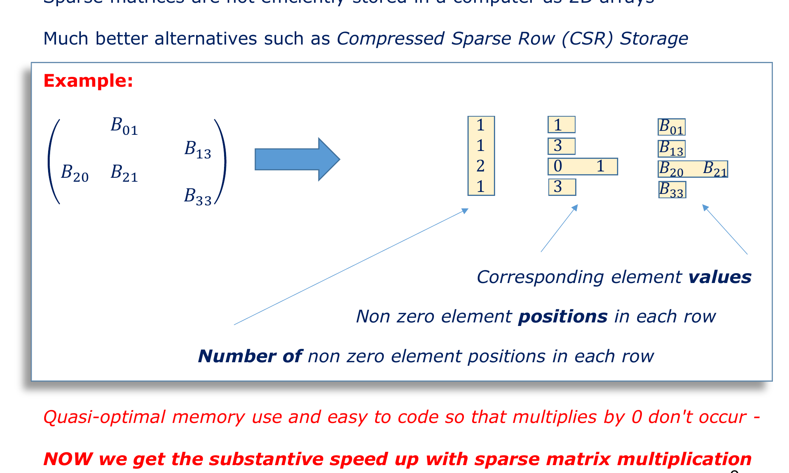

# Chapter 02: CSR Storage & The Direct Solver Trap

**Subject:** Sparse Matrix Representations, CPU Architecture, and the Catastrophe of Fill-In  
**Depends on:** [Chapter 01: The Origin of Zeros], [LU / QR Decompositions], [Computer Memory Architecture]  
**Lecture Reference:** Slides 7–13

---

## The Intuition: The Illusion of "Free" Zeros

* **The Naive Programmer's Intuition:** "If a matrix is 99.9% zeros, can't we just write an `if (A[i][j] != 0)` statement before doing our math? That way, we skip all the zero multiplications!"
* **The Hardware Reality:** Modern CPUs do not like branch statements (`if` checks) embedded in tight arithmetic loops. If a CPU has to check $10^{16}$ elements just to find the $7 \times 10^8$ non-zeros, the CPU spends $99.999\%$ of its clock cycles executing branch instructions, experiencing pipeline flushes and branch mispredictions. The checking time vastly exceeds the arithmetic time!
* **The Memory Reality:** You cannot even allocate a standard 2D array of size $10^8 \times 10^8$. It would demand **160 PetaBytes** of RAM. Your computer will experience an immediate Out-Of-Memory (OOM) kernel panic before executing a single instruction.
* **The Solution (CSR):** We do not store zeros at all. We store only the non-zero numbers alongside compact integer coordinates that describe where they live.
* **The Catastrophic Trap ("Sparse Input $\ne$ Sparse Processing"):** You might think: *"Great, now that we have sparse storage, let's just do LU or QR decomposition or invert the matrix!"* **Do not do this.** Direct elimination algorithms cause an effect called **fill-in**: eliminating variables injects new non-zero numbers into previously empty slots. By step 100, your sparse matrix has metastasized into a dense monster.

---

## The Detail: Compressed Sparse Row (CSR) Format

To eliminate both the 160 PetaByte memory requirement and the slow `if (val != 0)` CPU branching, numerical engineers use packed sparse formats. The most famous and computationally efficient of these is **Compressed Sparse Row (CSR)** (also known as the Yale format).

### 1. Concrete Example (From Slide 9)



Consider the following $4 \times 4$ sparse matrix:

$$\mathbf{B} = \begin{bmatrix}
0 & B_{01} & 0 & 0 \\
0 & 0 & 0 & B_{13} \\
B_{20} & B_{21} & 0 & 0 \\
0 & 0 & 0 & B_{33}
\end{bmatrix}$$

Notice:
* Total slots: $4 \times 4 = 16$.
* Non-zero elements ($\text{NNZ}$): exactly **5** ($B_{01}, B_{13}, B_{20}, B_{21}, B_{33}$).
* Zeros: **11**.

### 2. The Three CSR Arrays

Instead of a 2D grid, CSR stores the matrix as **three flat 1D arrays**:

```
1. Values Array (Floating-Point Numbers):
   Contains all non-zero entries read in row-major order:
   values = [ B01,   B13,   B20,   B21,   B33 ]
   Length = NNZ = 5

2. Column Indices Array (Integers):
   Stores the column index (0-indexed) for each corresponding value:
   col_indices = [ 1,   3,   0,   1,   3 ]
   Length = NNZ = 5

3. Row Pointer Array (Integers):
   Stores the index in 'values' where each row starts, plus one final entry for NNZ:
   row_ptr = [ 0,   1,   2,   4,   5 ]
   Length = N + 1 = 5
```

#### How to Read `row_ptr`:
* **Row 0** elements are stored between index `row_ptr[0] = 0` and `row_ptr[1] = 1`:
  * Value: `values[0] = B01`, located at column `col_indices[0] = 1`. (Matches position `(0, 1)`).
* **Row 1** elements are between `row_ptr[1] = 1` and `row_ptr[2] = 2`:
  * Value: `values[1] = B13`, located at column `col_indices[1] = 3`. (Matches position `(1, 3)`).
* **Row 2** elements are between `row_ptr[2] = 2` and `row_ptr[3] = 4`:
  * Values: `values[2] = B20` at column `0`, and `values[3] = B21` at column `1`. (Matches positions `(2, 0)` and `(2, 1)`).
* **Row 3** elements are between `row_ptr[3] = 4` and `row_ptr[4] = 5`:
  * Value: `values[4] = B33` at column `3`. (Matches position `(3, 3)`).

---

## Memory Comparison: Dense vs. CSR at Scale

Let us verify the dramatic real-world numbers presented on **Slide 11**:
* Problem size: $N = 100,000,000 = 10^8$ unknowns.
* Physical connectivity: $k = 7$ non-zero elements per row.
* Total non-zeros: $\text{NNZ} = 7 \times 10^8$.
* Precision: 64-bit IEEE double precision float (8 bytes per value).
* Indices: 32-bit unsigned integers (4 bytes per index).

### Dense Matrix Storage
$$\text{Total Elements} = N \times N = 10^8 \times 10^8 = 10^{16} \text{ elements}$$
$$\text{Memory} = 10^{16} \times 8 \text{ bytes} = 8 \times 10^{16} \text{ bytes} \approx 80,000 \text{ TB} = \mathbf{80 \text{ PetaBytes}}$$
*(Slide 11 notes that if 128-bit/16-byte doubles or complex values are used, this balloons to **160 PetaBytes**).*

### CSR Matrix Storage
1. **Values Array:** $\text{NNZ}$ floats = $7 \times 10^8 \times 8 \text{ bytes} = 5.6 \text{ GB}$.
2. **Column Indices:** $\text{NNZ}$ integers = $7 \times 10^8 \times 4 \text{ bytes} = 2.8 \text{ GB}$.
3. **Row Pointers:** $(N + 1)$ integers = $10^8 \times 4 \text{ bytes} = 0.4 \text{ GB}$.

$$\text{Total CSR Memory} = 5.6 + 2.8 + 0.4 = \mathbf{8.8 \text{ GB RAM!}}$$
*(With 16-byte complex numbers, this is only **$\sim 13.4 \text{ GB}$**).*

> [!TIP]
> **The Takeaway:** A problem that is physically impossible to load into the memory of the largest supercomputer on Earth ($80 \text{ PB}$) collapses into **$8.8 \text{ GB}$**, which fits comfortably inside a standard \$800 consumer laptop!

---

## Sparse Matrix-Vector Multiplication (SpMV): Why It Is Fast

Why is CSR so celebrated? Because multiplying a sparse matrix by a vector ($\mathbf{y} = \mathbf{A}\mathbf{x}$) requires **zero branch tests and zero redundant operations**:

```c
// Ultra-fast Sparse Matrix-Vector Multiplication (SpMV) in CSR
for (int i = 0; i < N; i++) {
    double sum = 0.0;
    int row_start = row_ptr[i];
    int row_end   = row_ptr[i + 1];
    
    for (int idx = row_start; idx < row_end; idx++) {
        sum += values[idx] * x[col_indices[idx]];
    }
    y[i] = sum;
}
```

* **Computational Complexity:** Exactly $\text{NNZ}$ multiplications and additions:
  $$\text{FLOPs} = 2 \times \text{NNZ} = 2 \times (7 \times 10^8) = 1.4 \times 10^9 \text{ operations}$$
  On a modern CPU (capable of $\sim 50 \text{ GFLOPs}$), this multiplication executes in **a few hundredths of a second!**
* **Memory Access:** Completely linear through `values` and `col_indices`, maximizing CPU L1/L2 cache prefetching.

---

## The Direct Solver Trap: "Sparse Input $\ne$ Sparse Processing"

Now comes the critical heartbreak of classical linear algebra (Slides 10 & 12).

Suppose you want to solve:
$$\mathbf{A}\mathbf{x} = \mathbf{b}$$
where $\mathbf{A}$ is stored sparsely in CSR format. You decide to apply standard textbook methods:
1. **Matrix Inversion:** $\mathbf{x} = \mathbf{A}^{-1} \mathbf{b}$.
2. **LU Decomposition:** $\mathbf{A} = \mathbf{L} \mathbf{U}$, then forward/backward solve.
3. **QR Decomposition:** $\mathbf{A} = \mathbf{Q} \mathbf{R}$, then $\mathbf{R}\mathbf{x} = \mathbf{Q}^T \mathbf{b}$.

### The Phenomenon of "Fill-In"

What happens mathematically during Gaussian Elimination or LU Decomposition?
To eliminate the element $A_{ji}$ below the diagonal, we perform a row operation:

$$\text{Row}_j \leftarrow \text{Row}_j - \left(\frac{A_{ji}}{A_{ii}}\right) \times \text{Row}_i$$

For every column $k$:
$$A_{jk}^{\text{new}} = A_{jk}^{\text{old}} - \left(\frac{A_{ji}}{A_{ii}}\right) A_{ik}$$

Look at this equation carefully:
* Suppose $A_{jk}^{\text{old}} = 0$ (meaning node $j$ and node $k$ were originally disconnected).
* But if $A_{ji} \ne 0$ AND $A_{ik} \ne 0$, then:
  $$A_{jk}^{\text{new}} = 0 - (\text{non-zero}) \ne \mathbf{0}!$$

A slot that was originally zero has now become non-zero! This is called **Fill-In**.

```
Original Sparse Matrix A:                   After LU Decomposition (L + U):
[ *   *   .   .   .   . ]                   [ *   *   .   .   .   . ]
[ *   *   *   .   .   . ]                   [ *   *   *   .   .   . ]
[ .   *   *   *   .   . ]    =========>     [ .   *   *   *   #   # ]   <-- '#' are Fill-Ins!
[ .   .   *   *   *   . ]     Gaussian      [ .   .   *   *   *   # ]
[ .   .   .   *   *   * ]   Elimination     [ .   .   #   *   *   * ]
[ .   .   .   .   *   * ]                   [ .   .   #   #   *   * ]
(Sparsity preserved)                        (Rapidly becoming DENSE)
```

### The Inversion Paradox
Even worse: **the inverse of a sparse matrix is almost always $100\%$ dense!**
* If a network is connected (there exists a path from any node to any other node), then changing the current at Node 0 will theoretically cause a tiny, non-zero potential change at Node 100,000,000.
* Therefore, in $\mathbf{A}^{-1}$, every single one of the $10^{16}$ entries is non-zero!
* If an algorithm tries to compute $\mathbf{A}^{-1}$ or factorize $\mathbf{A}$ directly without extreme care, the computer immediately runs out of RAM.

```
       Input Matrix A: Sparse (~8.8 GB)
              |
              |   [Standard LU / QR / Inverse]
              v
       Output L, U, Q, or A⁻¹: DENSE (80 PetaBytes!)
              |
              v
       *** KERNEL CRASH: OUT OF MEMORY ***
```

---

## The Fundamental Dilemma (Slide 13)

We are left with a striking paradox:
1. **Multiplication is EASY:** Given a sparse matrix $\mathbf{A}$ and a vector $\mathbf{x}$, computing the product $\mathbf{y} = \mathbf{A}\mathbf{x}$ takes $O(N)$ time, requires zero extra memory, and takes milliseconds.
2. **Solving is IMPOSSIBLE directly:** Computing $\mathbf{x} = \mathbf{A}^{-1}\mathbf{b}$ via standard direct elimination causes fill-in, requiring $O(N^3)$ operations and petabytes of RAM.

This leads to the golden question that defines modern numerical engineering:

> [!IMPORTANT]
> **Can we take advantage of what is EASY (Sparse Matrix-Vector Multiplication $\mathbf{A}\mathbf{x}$) to do what is HARD (Solving $\mathbf{A}\mathbf{x} = \mathbf{b}$)?**

The answer is **YES**. It is achieved by abandoning direct solves entirely and adopting **Iterative Methods**.

---

## Key Takeaways & Self-Check

1. **Why does naive 2D array storage fail?** Because storing $10^8 \times 10^8$ numbers requires 80–160 PetaBytes of RAM.
2. **Why can't we just use `if (A[i][j] != 0)`?** Because checking $10^{16}$ slots destroys CPU throughput with instruction overhead and branch mispredictions.
3. **What is CSR?** A storage format using three 1D arrays (`values`, `col_indices`, `row_ptr`) that stores only non-zero entries and executes SpMV in $O(\text{NNZ})$ time.
4. **What is Fill-In?** During Gaussian elimination, row subtractions turn original zeros into non-zero numbers, destroying sparsity and blowing up memory.

Next chapter: [**`03_the_iterative_revolution.md`**](file:///home/nicholas/projects/y4_ee/modules/EEEE3116_adv_eng_math/concepts/zeroes_lecture/03_the_iterative_revolution.md) — How do iterative methods turn the impossible task of matrix division into an elegant feedback loop of pure multiplications?

