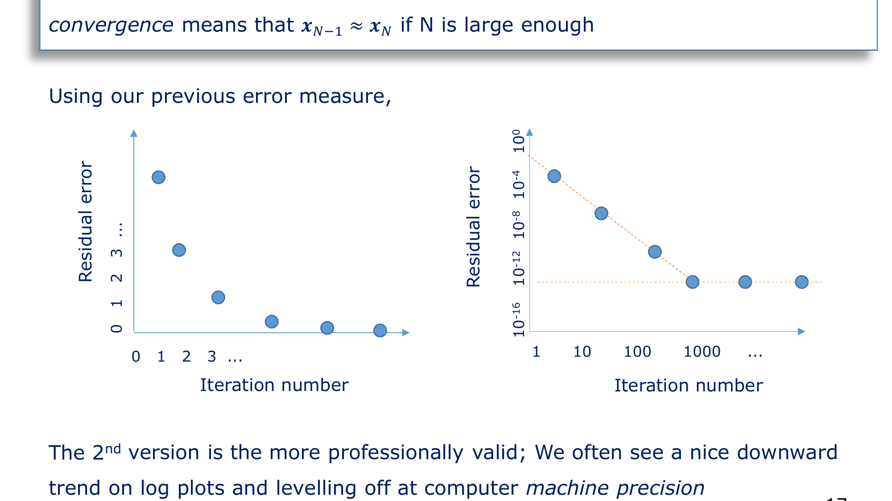
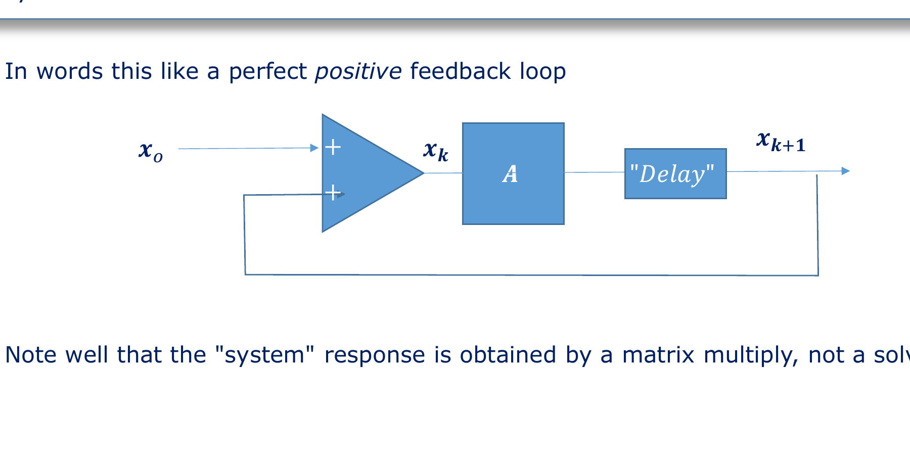
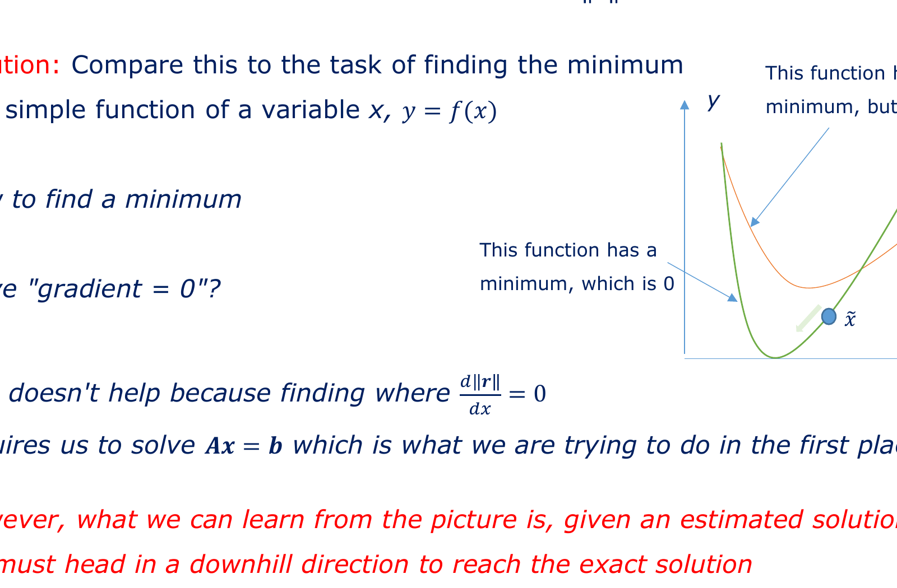

# Chapter 03: The Iterative Revolution & Eigenspaces

**Subject:** Iterative Solvers, Residuals, Power Iteration, and Energy Landscapes  
**Depends on:** [Chapter 02: CSR Storage], [Eigenvalues & Eigenvectors], [Matrix-Vector Multiplication]  
**Lecture Reference:** Slides 14–24

---

## The Intuition: Guess, Check, and Steer

* **The Classical Trap (Direct Inversion):** If someone gives you an equation $A x = b$, your immediate mathematical impulse is to divide: $x = A^{-1} b$. But as we proved in Chapter 02, inverting an $N \times N$ sparse matrix requires $80 \text{ PetaBytes}$ of RAM and causes catastrophic fill-in.
* **The Engineering Alternative:** What if we never divide? What if we only **multiply**?
  * Make a guess $x_0$.
  * Check how wrong we are by evaluating $b - A x_0$. Notice that $A x_0$ is a **sparse matrix-vector multiply**—which takes milliseconds in CSR format!
  * Nudge the guess in a direction that reduces the error: $x_1 = x_0 + \Delta x$.
  * Repeat until the error drops below machine tolerance ($10^{-16}$).
* **Why Does This Work?** Because a matrix acts as a directional filter. When you multiply a vector by a matrix repeatedly, the vector does not wander aimlessly: the matrix's internal eigenstructure pulls and steers the vector toward the true solution.

```
                  +--------------------------------+
                  |  Initial Guess: x₀             |
                  |  (Random numbers or all zeros) |
                  +---------------+----------------+
                                  |
                                  v
                       [ Iteration Loop k ]
                  +--------------------------------+
                  |  Compute Residual:             |  <-- Only requires fast
                  |  rₖ = b - A xₖ                 |      SpMV (milliseconds!)
                  +---------------+----------------+
                                  |
                   Is ||rₖ|| < tolerance?
                         /         \
                      YES           NO
                      /               \
        +------------v---+       +-----v--------------------------+
        | Solved! (Done) |       | Compute step direction pₖ      |
        +----------------+       | and step length αₖ             |
                                 | Update: xₖ₊₁ = xₖ + αₖ pₖ      |
                                 +---------------+----------------+
                                                 |
                                                 +----> (Next iteration)
```

---

## The Detail: The Four Pillars of Iterative Methods

As Dr. Sewell outlines on **Slides 14–16**, every iterative method rests on four fundamental pillars:

### 1. The Initial Guess ($x_0$)
You might assume that guessing the right starting point is the hardest part. In practice, for well-behaved linear systems, an initial guess of all zeros ($\mathbf{x}_0 = \mathbf{0}$) or random values is perfectly acceptable.

### 2. Quantifying the Error: The Residual Vector ($\mathbf{r}$)
If $\hat{\mathbf{x}}$ is our estimated solution to $\mathbf{A}\mathbf{x} = \mathbf{b}$, the exact equation would yield $\mathbf{A}\hat{\mathbf{x}} = \mathbf{b}$.
Because our guess is imperfect, the difference is the **residual error vector** $\mathbf{r}$:

$$\mathbf{r} = \mathbf{b} - \mathbf{A}\hat{\mathbf{x}}$$

* **Variables & Dimensions:**
  * $\mathbf{b} \in \mathbb{R}^{N \times 1}$: The known excitation vector (e.g., injected currents $[A]$).
  * $\mathbf{A}\hat{\mathbf{x}} \in \mathbb{R}^{N \times 1}$: The response generated by our estimate (using fast CSR SpMV).
  * $\mathbf{r} \in \mathbb{R}^{N \times 1}$: A vector of mismatch errors at every node.
* **Scalar Error Metric (The 2-Norm):**
  We cannot monitor $10^8$ separate node errors simultaneously. We compute the dot product:
  $$\|\mathbf{r}\|^2 = \mathbf{r}^T \mathbf{r} = \sum_{i=1}^N r_i^2$$
  Since every term $r_i^2 \ge 0$, the scalar quantity $\mathbf{r}^T \mathbf{r} = 0$ **if and only if** the residual is zero at every single node in the entire universe!

### 3. The Adjustment Strategy: Direction and Step Length
How do we update $\mathbf{x}_k$ to get $\mathbf{x}_{k+1}$?
We express the change as a **search direction vector** $\mathbf{p}_k$ scaled by a **step length** $\alpha_k$ (or $d_k$):

$$\mathbf{x}_{k+1} = \mathbf{x}_k + \alpha_k \mathbf{p}_k$$

* Determining $\mathbf{p}_k$ (where to point) and $\alpha_k$ (how far to walk) is the core intellectual achievement of numerical linear algebra.
* Different choices of $\mathbf{p}_k$ and $\alpha_k$ define **Steepest Descent**, **MINRES**, and **Conjugate Gradients**.

### 4. Convergence: Knowing When to Stop
On **Slide 17**, we observe the convergence behavior:
* If the sequence of estimates satisfies $\mathbf{x}_{k+1} \approx \mathbf{x}_k$, the algorithm is settling down.
* In professional engineering codes, we plot the logarithm of the relative residual error $\log_{10} \left(\frac{\|\mathbf{r}_k\|}{\|\mathbf{b}\|}\right)$ versus iteration number $k$.
* A well-behaved iterative solver produces a steep, steady downward line on a semilog plot, descending into computer machine precision ($\sim 10^{-16}$ for IEEE 64-bit doubles).



---

## Pedagogical Experiment: Why Repeated Multiplies Converge (Power Iteration)

Why should repeatedly multiplying vectors by a matrix ever produce a sensible answer?
Dr. Sewell presents an experiment on **Slides 18–22**:
Suppose we create a simple positive feedback loop:

$$\mathbf{x}_k = \mathbf{A} \mathbf{x}_{k-1}$$

with an initial guess $\mathbf{x}_0$, where $\mathbf{A}$ is real, symmetric, and square ($N \times N$).



### 1. Expanding the Initial Guess in the Eigenbasis
From spectral theory, any real symmetric matrix $\mathbf{A}$ possesses $N$ orthogonal eigenvectors $\mathbf{y}_0, \mathbf{y}_1, \dots, \mathbf{y}_{N-1}$ with corresponding real eigenvalues $\lambda_0, \lambda_1, \dots, \lambda_{N-1}$ (written in the slides as $\{ \mathbf{Y}, \mathbf{k} \}$):

$$\mathbf{A} \mathbf{y}_i = \lambda_i \mathbf{y}_i$$

Because these eigenvectors form a complete basis for $\mathbb{R}^N$, our arbitrary initial guess $\mathbf{x}_0$ can be written uniquely as a linear combination of them:

$$\mathbf{x}_0 = \sum_{i=0}^{N-1} c_i \mathbf{y}_i = c_0 \mathbf{y}_0 + c_1 \mathbf{y}_1 + c_2 \mathbf{y}_2 + \dots$$

### 2. Tracing the Iterations
Now multiply by $\mathbf{A}$:

$$\mathbf{x}_1 = \mathbf{A}\mathbf{x}_0 = c_0 (\mathbf{A}\mathbf{y}_0) + c_1 (\mathbf{A}\mathbf{y}_1) + \dots = c_0 \lambda_0 \mathbf{y}_0 + c_1 \lambda_1 \mathbf{y}_1 + \dots$$

Multiply again to get $\mathbf{x}_2$:

$$\mathbf{x}_2 = \mathbf{A}\mathbf{x}_1 = c_0 \lambda_0^2 \mathbf{y}_0 + c_1 \lambda_1^2 \mathbf{y}_1 + \dots$$

After $M$ iterations:

$$\mathbf{x}_M = \mathbf{A}^M \mathbf{x}_0 = c_0 \lambda_0^M \mathbf{y}_0 + c_1 \lambda_1^M \mathbf{y}_1 + c_2 \lambda_2^M \mathbf{y}_2 + \dots$$

### 3. The Dominant Eigenvalue Filter
Now assume that the eigenvalues are sorted such that one eigenvalue is strictly dominant in magnitude:

$$|\lambda_0| > |\lambda_1| \ge |\lambda_2| \ge \dots$$

Factor out $\lambda_0^M$:

$$\mathbf{x}_M = \lambda_0^M \left[ c_0 \mathbf{y}_0 + c_1 \left(\frac{\lambda_1}{\lambda_0}\right)^M \mathbf{y}_0 + c_2 \left(\frac{\lambda_2}{\lambda_0}\right)^M \mathbf{y}_2 + \dots \right]$$

Since $|\lambda_1 / \lambda_0| < 1$, as $M$ increases:
$$\lim_{M \to \infty} \left(\frac{\lambda_i}{\lambda_0}\right)^M = 0 \quad (\text{for all } i \ge 1)$$

Therefore, after a sufficient number of matrix-vector multiplications:

$$\mathbf{x}_M \approx c_0 \lambda_0^M \mathbf{y}_0$$

> [!NOTE]
> **The Profound Insight (Slide 22):** The repeated application of a matrix multiplication acts as an **eigenmode filter**. It naturally amplifies certain structural modes while crushing all competing modes to zero. Iterative solvers harness this exact algebraic filtering property to drive error components to zero without ever factorizing or inverting the matrix!

---

## Viewing $Ax = b$ as an Optimization Landscape

On **Slides 23–24**, Dr. Sewell shifts perspective:
Instead of viewing $\mathbf{A}\mathbf{x} = \mathbf{b}$ as a system of algebraic equations to be solved, view it as **finding the bottom of a high-dimensional bowl**.

### 1. The 1D Calculus Analogy
Suppose you want to find the minimum of a 1D function $y = f(x)$.
You know from calculus that the minimum occurs where the derivative is zero:
$$\frac{df}{dx} = 0$$

If computing the derivative directly is too hard, you stand at your current estimate $\hat{x}$ and look at the slope:
* If the slope is positive, the minimum is to the left $\to$ step left!
* If the slope is negative, the minimum is to the right $\to$ step right!
* **Rule:** Always step in the **downhill** direction!



### 2. The $N$-Dimensional Energy Bowl
When $\mathbf{A}$ is a Symmetric Positive Definite (SPD) matrix, solving $\mathbf{A}\mathbf{x} = \mathbf{b}$ is mathematically identical to finding the vector $\mathbf{x}$ that minimizes the quadratic function:

$$\phi(\mathbf{x}) = \frac{1}{2} \mathbf{x}^T \mathbf{A} \mathbf{x} - \mathbf{b}^T \mathbf{x}$$

Let us compute the gradient vector $\nabla \phi(\mathbf{x})$:

$$\nabla \phi(\mathbf{x}) = \mathbf{A}\mathbf{x} - \mathbf{b} = - (\mathbf{b} - \mathbf{A}\mathbf{x}) = -\mathbf{r}$$

Look at that extraordinary result:
$$\text{Downhill Direction} = - \nabla \phi(\mathbf{x}) = \mathbf{r}$$

> [!IMPORTANT]
> **The residual vector $\mathbf{r} = \mathbf{b} - \mathbf{A}\mathbf{x}$ is literally the steepest downhill vector on the energy surface of the physical system!**  
> Every time you calculate the residual error, you are calculating the exact physical direction in which the system's energy decreases fastest!

---

## Key Takeaways & Self-Check

1. **What is an iterative method?** A cyclic loop that starts from a guess $\mathbf{x}_0$, evaluates the mismatch $\mathbf{r} = \mathbf{b} - \mathbf{A}\mathbf{x}$ via fast SpMV, and steers the guess downhill toward the solution.
2. **What does Power Iteration teach us?** Repeated matrix multiplications naturally filter out components, allowing the system's dominant spectral modes to emerge organically.
3. **What is the geometric meaning of the residual $\mathbf{r}$?** The residual $\mathbf{r}$ is the negative gradient ($-\nabla \phi$) of the quadratic energy bowl. Following $\mathbf{r}$ means walking downhill towards the true physical solution.

Next chapter: [**`04_gradient_methods_and_conjugate_gradients.md`**](file:///home/nicholas/projects/y4_ee/modules/EEEE3116_adv_eng_math/concepts/zeroes_lecture/04_gradient_methods_and_conjugate_gradients.md) — How do Steepest Descent, Minimal Residual (MINRES), and the breakthrough Conjugate Gradient (CG) algorithm choose their step directions and lengths?

