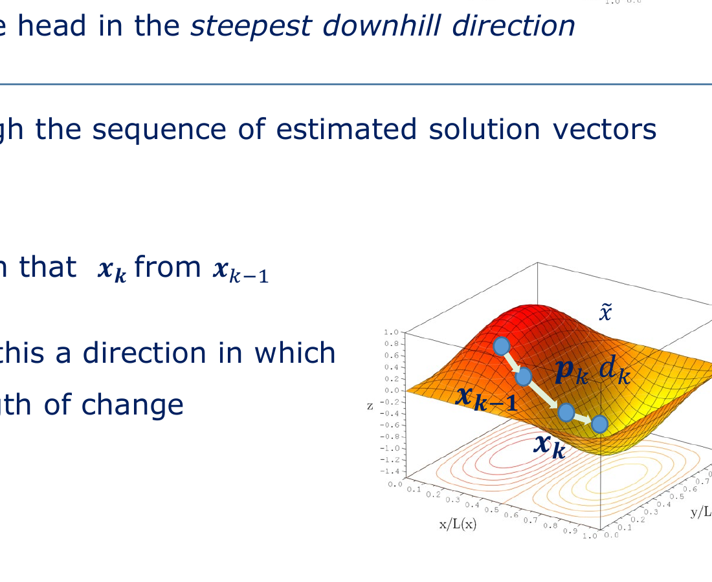
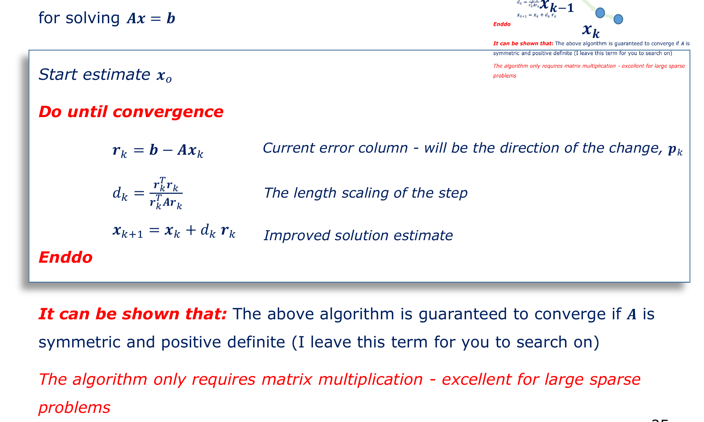
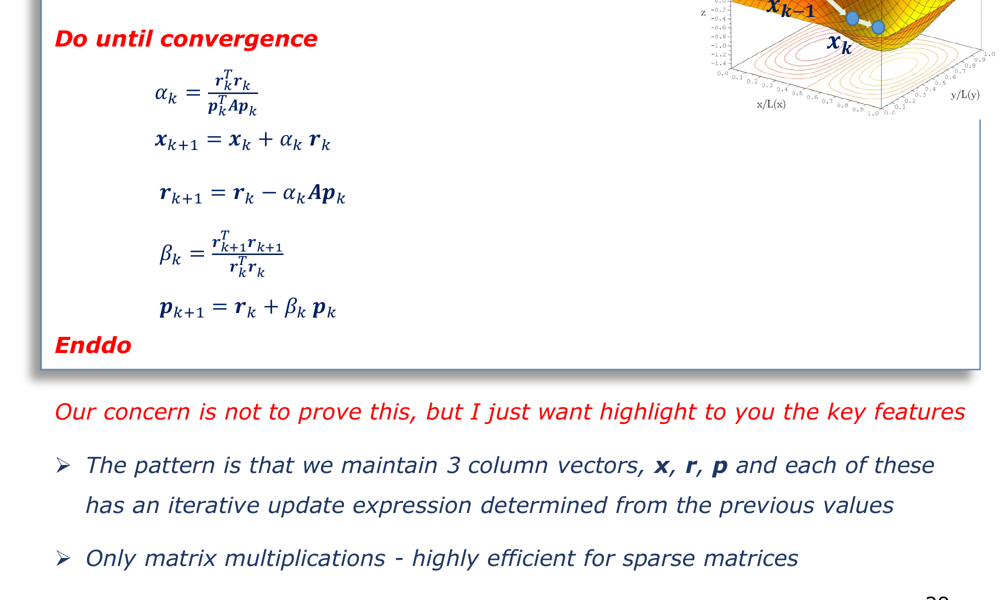

# Chapter 04: From Steepest Descent to Conjugate Gradients

**Subject:** Optimization-Based Solvers, Residual Minimization, and Krylov Subspaces  
**Depends on:** [Chapter 03: The Iterative Revolution], [Quadratic Forms], [Orthogonality]  
**Lecture Reference:** Slides 25–31

---

## The Intuition: Escaping the Valley of Zig-Zag

* **The Intuitive Strategy (Steepest Descent):** You are standing on the side of a mountain in dense fog, trying to reach the bottom of the valley. What do you do? You look down at your boots, find the direction of steepest downward slope, and walk in that direction until you start going uphill again. Then you stop, turn to the new steepest downhill direction, and walk again.
* **The Fatal Flaw (The Narrow Canyon):** If the valley is circular like a soup bowl, you walk straight to the center in one step. But physical engineering systems are **stiff**: some modes (e.g., fast electrical transients) change rapidly, while other modes (e.g., slow thermal drift) change glacially. The energy bowl is an extremely stretched, narrow elliptical canyon!
* **The Zig-Zag Pathology:** On a narrow canyon, the steepest downhill direction points almost directly across the canyon walls rather than down the floor toward the exit. You waste thousands of iterations bouncing back and forth from one side to the other, making microscopic forward progress.
* **The Breakthrough (Conjugate Gradients):** In 1952, Magnus Hestenes and Eduard Stiefel proved that by steering slightly away from the steepest gradient—enforcing that each new search direction is **$A$-orthogonal (conjugate)** to all previous directions—you will never undo progress made in previous directions. You walk down the canyon in one clean sweep.



```
      [Steepest Descent: Zig-Zagging]             [Conjugate Gradients: Direct Path]
           (Bounces across steep walls)                  (Each direction is A-orthogonal)
             \                                              \
              \   /|  /|                                     \
               \ / | / |                                      \
                X  |/  |                                       \
               / \ |   |                                        \
              /   \|   v                                         v
            (Hundreds of steps)                              x* (Solution in few steps)
```

---

## The Detail: Algorithm Walkthroughs

### 1. The Steepest Descent Algorithm (Slide 25)



To solve $\mathbf{A}\mathbf{x} = \mathbf{b}$ where $\mathbf{A}$ is Symmetric Positive Definite (SPD):

1. **Initialize:** Choose initial guess $\mathbf{x}_0$. Compute initial residual:
   $$\mathbf{r}_0 = \mathbf{b} - \mathbf{A}\mathbf{x}_0$$
2. **Loop for $k = 0, 1, 2, \dots$ until converged:**
   * **Search Direction:** Set the direction along the current steepest downhill gradient:
     $$\mathbf{p}_k = \mathbf{r}_k$$
   * **Optimal Step Length ($d_k$):** How far along $\mathbf{r}_k$ should we step?  
     We want to minimize the quadratic energy $\phi(\mathbf{x}_k + d_k \mathbf{r}_k)$ along the line:
     $$\frac{d}{d(d_k)} \phi(\mathbf{x}_k + d_k \mathbf{r}_k) = 0 \implies d_k = \frac{\mathbf{r}_k^T \mathbf{r}_k}{\mathbf{r}_k^T \mathbf{A} \mathbf{r}_k}$$
   * **Update State:**
     $$\mathbf{x}_{k+1} = \mathbf{x}_k + d_k \mathbf{r}_k$$
   * **Update Residual:**
     $$\mathbf{r}_{k+1} = \mathbf{b} - \mathbf{A}\mathbf{x}_{k+1}$$

#### Mathematical Guarantee vs. Practical Performance
* **Guarantee:** Guaranteed to converge for any SPD matrix $\mathbf{A}$.
* **Cost per iteration:** Exactly one sparse matrix-vector multiplication ($\mathbf{A}\mathbf{r}_k$).
* **Weakness:** As condition number $\kappa(\mathbf{A}) = \frac{\lambda_{\max}}{\lambda_{\min}}$ increases, the convergence rate slows to:
  $$\|\mathbf{e}_{k+1}\|_A \le \left(\frac{\kappa - 1}{\kappa + 1}\right) \|\mathbf{e}_k\|_A$$
  For a typical circuit or finite-element mesh where $\kappa \approx 10^5$, $\frac{\kappa - 1}{\kappa + 1} \approx 0.99998$. The solver takes tens of thousands of iterations to advance even a single decimal place of accuracy.

---

### 2. The Minimal Residual Algorithm (MINRES) (Slide 27)

What if $\mathbf{A}$ is symmetric but **not** positive definite (e.g., indefinite matrices with both positive and negative eigenvalues, common in coupled circuit-electromagnetic formulations)?
Instead of minimizing the energy functional $\phi(\mathbf{x})$, MINRES directly minimizes the **residual 2-norm** $\|\mathbf{r}_{k+1}\|^2 = \|\mathbf{b} - \mathbf{A}\mathbf{x}_{k+1}\|^2$:

1. Search direction remains along the residual $\mathbf{p}_k = \mathbf{r}_k$.
2. The step length $d_k$ is derived by minimizing $\|\mathbf{r}_k - d_k \mathbf{A}\mathbf{r}_k\|^2$:
   $$d_k = \frac{\mathbf{r}_k^T \mathbf{A} \mathbf{r}_k}{(\mathbf{A}\mathbf{r}_k)^T (\mathbf{A}\mathbf{r}_k)}$$
3. Update estimate:
   $$\mathbf{x}_{k+1} = \mathbf{x}_k + d_k \mathbf{r}_k$$

* **Advantage:** Functions reliably on symmetric indefinite matrices where Steepest Descent breaks down.

---

### 3. The Conjugate Gradient (CG) Algorithm (Slides 28–30)

Published by Hestenes and Stiefel in 1952, Conjugate Gradients is considered one of the top 10 algorithms of the 20th century.



#### The Core Principle: $A$-Conjugacy
Instead of searching along the raw gradient $\mathbf{r}_k$, CG constructs a sequence of search directions $\mathbf{p}_0, \mathbf{p}_1, \mathbf{p}_2, \dots$ that are mutually **$A$-orthogonal**:

$$\mathbf{p}_i^T \mathbf{A} \mathbf{p}_j = 0 \quad \text{for all } i \ne j$$

Because the directions are orthogonal with respect to the system matrix $\mathbf{A}$, minimizing the error along direction $\mathbf{p}_k$ **never disturbs the minimization already achieved along $\mathbf{p}_0, \dots, \mathbf{p}_{k-1}$**.

#### The Full CG Algorithm (Slide 29)

```c
// Conjugate Gradient (CG) Algorithm for Ax = b (SPD Matrix A)
x = x0;                     // Initial guess
r = b - A * x;              // Initial residual
p = r;                      // Initial search direction
rsold = r^T * r;

for (k = 0; k < N; k++) {
    Ap = A * p;             // Single Sparse Matrix-Vector Multiply (SpMV)
    
    alpha = rsold / (p^T * Ap);   // Step length along conjugate direction
    x = x + alpha * p;            // Update solution vector
    r = r - alpha * Ap;           // Update residual vector (cheap: no extra SpMV!)
    
    rsnew = r^T * r;
    if (sqrt(rsnew) < tolerance) {
        break;              // Converged!
    }
    
    beta = rsnew / rsold;   // Gram-Schmidt orthogonalization factor
    p = r + beta * p;       // Next A-conjugate search direction
    rsold = rsnew;
}
```

#### Key Architectural Features of CG:
1. **Three Vector Registers:** The algorithm only needs to store vectors $\mathbf{x}, \mathbf{r}, \mathbf{p}$ (plus temporary $\mathbf{A}\mathbf{p}$). Total memory is $O(N)$—completely independent of the number of iterations!
2. **Exactly ONE SpMV per step:** The heavy operation $\mathbf{A}\mathbf{p}$ is computed once per loop. The residual is updated algebraically via $\mathbf{r}_{k+1} = \mathbf{r}_k - \alpha_k \mathbf{A}\mathbf{p}_k$ without re-evaluating $\mathbf{b} - \mathbf{A}\mathbf{x}_{k+1}$.
3. **No Matrix Inversion:** No divisions by matrices, no row eliminations, zero fill-in.

---

## Theory vs. Engineering Reality (Slide 30)

### The Mathematical Theorem
> *For any $N \times N$ symmetric positive definite matrix $\mathbf{A}$, the Conjugate Gradient algorithm in exact arithmetic is guaranteed to converge to the exact mathematical solution in **at most $N$ iterations**.*

### The Real-World Engineering Reality
> *"Except that in practice this never even vaguely happens for a real problem — sorry! Welcome to my world."* — Dr. Phil Sewell (Slide 30)

Why does this magnificent mathematical theorem break down in engineering?
* **Accumulation of Rounding Errors:** In standard floating-point arithmetic (IEEE 754 64-bit double precision), each dot product and SpMV incurs a rounding error of order $\epsilon_{\text{mach}} \approx 10^{-16}$.
* **Loss of Orthogonality:** After 50 to 100 iterations on a matrix with millions of variables, these small roundoff errors accumulate. The calculated vectors $\mathbf{p}_k$ gradually lose their mutual $A$-orthogonality!
* **Result:** The algorithm forgets where it has already searched and begins re-visiting previous directions. If $N = 10^7$, waiting for $10^7$ iterations would take days—and numerical noise would cause it to stall completely long before getting there.

---

## The Special Case: Diagonally Dominant Matrices (Slide 31)

Dr. Sewell points out on **Slide 31** that there is one special class of matrices where CG performs like absolute magic: **Diagonally Dominant Matrices**.

A matrix is strictly diagonally dominant if the magnitude of the diagonal element in every row is greater than the sum of all other elements in that row:

$$|A_{ii}| > \sum_{j \ne i} |A_{ij}|$$

$$\mathbf{A}_{\text{diag-dominant}} = \begin{bmatrix}
\mathbf{5} & 10^{-2} & 10^{-4} & 10^{-6} \\
10^{-2} & \mathbf{1} & 10^{-2} & 10^{-4} \\
10^{-4} & 10^{-2} & \mathbf{2} & 10^{-2} \\
10^{-6} & 10^{-4} & 10^{-2} & \mathbf{1}
\end{bmatrix}$$

* In such matrices, the condition number $\kappa(\mathbf{A}) \approx 1$. The elliptical canyon is almost a perfect spherical bowl!
* CG converges to machine precision in **1 or 2 iterations**, regardless of whether $N = 10$ or $N = 10^8$!

### The Catch
What are the chances that a raw, unvarnished physical engineering problem from an electromagnetic solver or IC circuit layout is naturally diagonally dominant?

$$\mathbf{P}(\text{Naturally Diagonally Dominant}) \approx \mathbf{0\%}$$

This sets up the single most important technique in modern computational science: **Preconditioning**. If nature will not give us a diagonally dominant matrix, we must mathematically forge one ourselves.

---

## Key Takeaways & Self-Check

1. **Why does Steepest Descent fail in practice?** Because in stiff physical systems with elongated elliptical energy contours (high condition numbers), it wastes energy zig-zagging between canyon walls.
2. **What does Conjugate Gradients do differently?** It enforces $A$-conjugacy ($\mathbf{p}_i^T \mathbf{A} \mathbf{p}_j = 0$), ensuring that each step minimizes error in a completely new subspace without undoing previous progress.
3. **Why doesn't CG finish in $N$ steps on real computers?** Finite-precision floating-point rounding errors destroy the mutual orthogonality of search vectors over many iterations.
4. **Why are diagonally dominant matrices ideal?** Their condition number is close to 1, collapsing the iteration count from thousands down to 1–2 steps.

Next chapter: [**`05_preconditioning_and_splitting_methods.md`**](file:///home/nicholas/projects/y4_ee/modules/EEEE3116_adv_eng_math/concepts/zeroes_lecture/05_preconditioning_and_splitting_methods.md) — How do we transform a horrible, slow-converging matrix into an ideal near-identity matrix using Preconditioning and Matrix Splitting?

