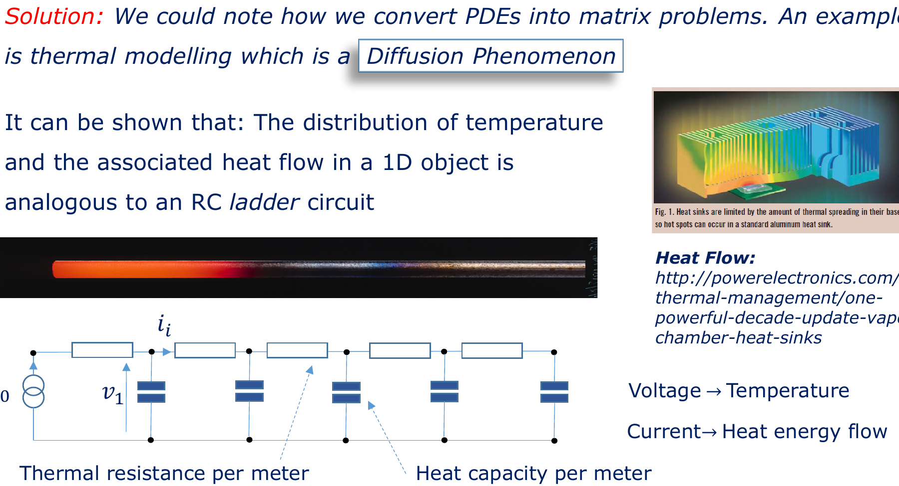
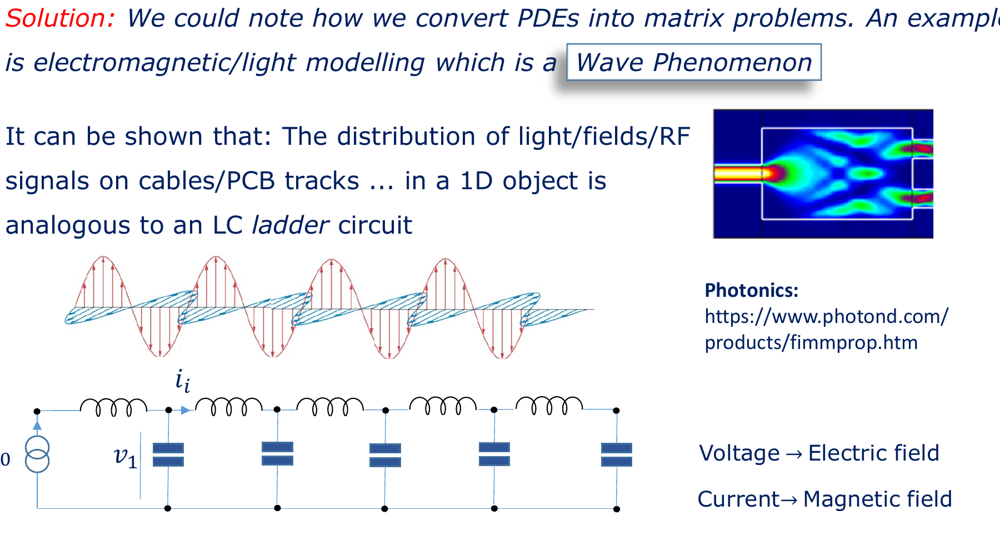
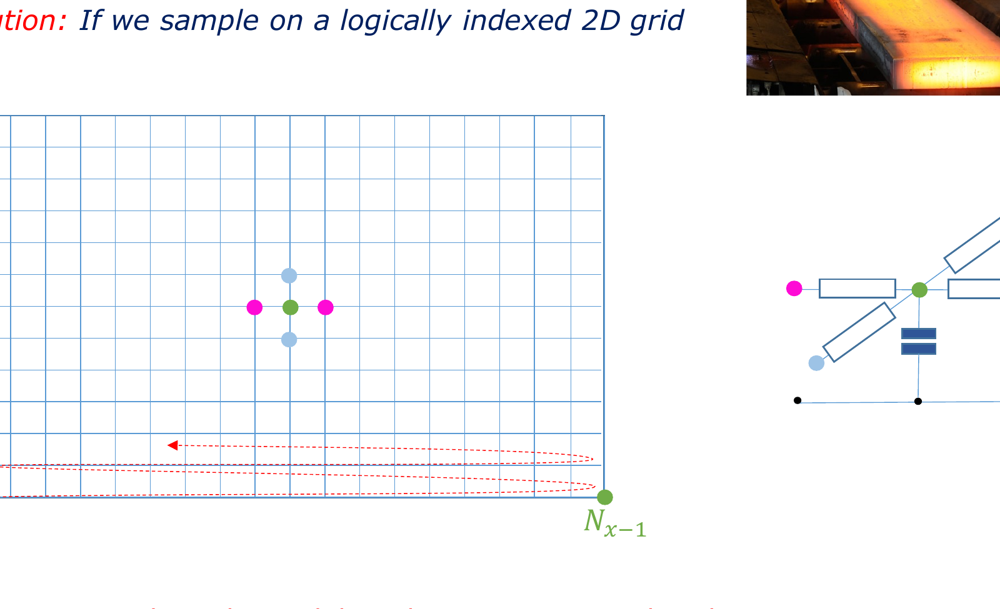
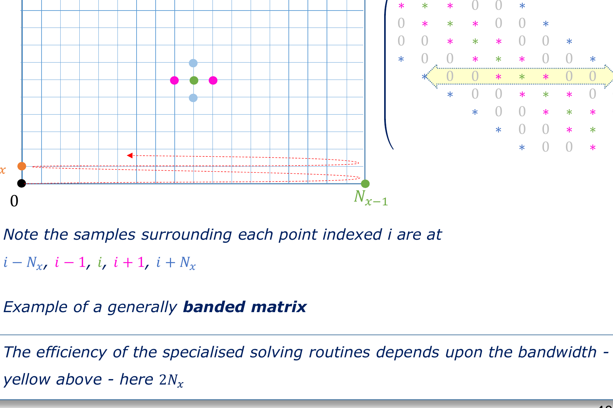
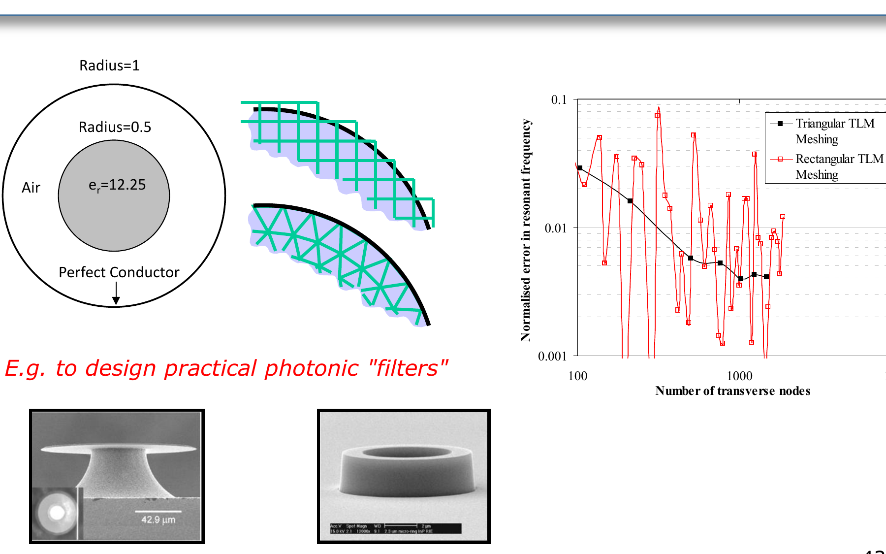

# Chapter 06: Matrix Topology, Bandwidth & Node Ordering

**Subject:** Physical Topologies, 1D/2D Mesh Discretization, Banded Matrices, and Indexing Strategies  
**Depends on:** [Chapter 01: Physical Sparsity], [Nodal Analysis], [RC/LC Transmission Lines]  
**Lecture Reference:** Slides 35–44

---

## The Intuition: Geometry Becomes Matrix Structure

* **The Fallacy of the Abstract Matrix:** In pure linear algebra, an $N \times N$ matrix is just an abstract array of numbers. The rows can be permuted arbitrarily without changing the underlying mathematical vector space.
* **The Engineering Reality:** In computational engineering, the rows and columns represent physical points in space. The physical layout directly determines where the non-zero numbers appear in the matrix:
  * A 1D string of components creates a **Tridiagonal Matrix**.
  * A 2D rectangular surface creates a **Pentadiagonal Banded Matrix**.
* **The Danger of Bad Indexing:** If you number your physical nodes along the short edge of a grid, the non-zeros stay huddled close to the main diagonal. If you number them haphazardly, the non-zeros explode across the far corners of the matrix, turning an ultra-fast $O(N)$ banded solve into a sluggish, memory-choking nightmare.
* **The Mesh Dilemma:** Structured grids give neat, predictable matrix bands, but produce jagged "staircase" errors on curved surfaces. Unstructured triangular meshes fit smooth curves perfectly, but destroy simple banding patterns.

```
       [Structured 1D Grid]                       [Structured 2D Grid (Nx = 4)]
   (0) --- (1) --- (2) --- (3)                      (0) --- (1) --- (2) --- (3)
                                                     |       |       |       |
     Tridiagonal Matrix:                            (4) --- (5) --- (6) --- (7)
    [ *  *  .  . ]                                   |       |       |       |
    [ *  *  *  . ]                                  (8) --- (9) -- (10) -- (11)
    [ .  *  *  * ]
    [ .  .  *  * ]                                Banded Matrix (Bandwidth = 2Nx = 8):
  (Bandwidth = 1: FASTEST)                        Non-zeros at: k-Nx, k-1, k, k+1, k+Nx
```

---

## The Detail: Physical Discretization Patterns

### 1. 1D Diffusion Phenomena (Slide 36–37)

Consider heat conduction along a 1D rod (thermal dissipation in a heat sink or semiconductor substrate).
The governing partial differential equation (PDE) is the heat diffusion equation:

$$\frac{\partial T}{\partial t} = \frac{\kappa}{C_v} \frac{\partial^2 T}{\partial x^2}$$

In electrical engineering, this spatial diffusion is physically equivalent to an **infinite RC ladder network**:
* **Voltage ($v$)** $\longleftrightarrow$ **Temperature ($T$)** [$^\circ\text{C}$ or $\text{K}$]
* **Current ($i$)** $\longleftrightarrow$ **Heat energy flow ($q$)** [$\text{Watts}$]
* **Resistor per meter ($R$)** $\longleftrightarrow$ **Thermal resistance** [$\text{K}/\text{W}$]
* **Capacitor per meter ($C$)** $\longleftrightarrow$ **Heat capacity** [$\text{J}/\text{K}$]



#### The Matrix Pattern: Tridiagonal
Applying nodal analysis (KCL) to node $k$:
$$\frac{v_k - v_{k-1}}{R} + \frac{v_k - v_{k+1}}{R} + C \frac{dv_k}{dt} = 0$$

Every equation connects node $k$ **strictly to its left neighbour ($k-1$) and right neighbour ($k+1$)**:

$$\begin{bmatrix}
* & * & 0 & 0 & 0 \\
* & * & * & 0 & 0 \\
0 & * & * & * & 0 \\
0 & 0 & * & * & * \\
0 & 0 & 0 & * & *
\end{bmatrix}
\begin{bmatrix}
v_0 \\
v_1 \\
v_2 \\
v_3 \\
v_4
\end{bmatrix}
=
\begin{bmatrix}
b_0 \\
b_1 \\
b_2 \\
b_3 \\
b_4
\end{bmatrix}$$

> [!IMPORTANT]
> **The Miracle of Tridiagonal Matrices:**  
> A tridiagonal matrix can be solved using the specialized **Thomas Algorithm** (a streamlined form of Gaussian elimination) in **exactly $O(N)$ time and $O(N)$ storage with ZERO fill-in!**  
> For 1D problems, you never need iterative solvers or supercomputers; direct solving is instantaneous!

---

### 2. 1D Wave Phenomena (Slide 38)

Now examine high-frequency electromagnetic propagation: RF signals traveling on microstrip lines, coaxial cables, or optical modes in photonics waveguides.
The wave equation is governed by Maxwell's curl equations:

$$\frac{\partial^2 E}{\partial x^2} = \mu \epsilon \frac{\partial^2 E}{\partial t^2}$$

This is physically equivalent to a **lossless LC transmission line**:
* **Voltage ($v$)** $\longleftrightarrow$ **Electric field ($E$)**
* **Current ($i$)** $\longleftrightarrow$ **Magnetic field ($H$)**
* **Inductor per meter ($L$)** $\longleftrightarrow$ **Magnetic permeability ($\mu$)**
* **Capacitor per meter ($C$)** $\longleftrightarrow$ **Permittivity ($\epsilon$)**



Because each differential segment only connects to the segment directly ahead and behind it, **it yields the EXACT same tridiagonal matrix structure!**

---

### 3. 2D Diffusion and Wave Phenomena (Slides 39–40)

What happens when we move from a 1D wire to a 2D surface (e.g., heat spreading across a silicon die, or RF fields inside a waveguide cross-section)?

We discretize the 2D plane into a grid of $N_x \times N_y$ nodes, numbered row by row:



```
Row 2:   (8)  ---  (9)  --- (10)  --- (11)
          |         |         |         |
Row 1:   (4)  ---  (5)  ---  (6)  ---  (7)
          |         |         |         |
Row 0:   (0)  ---  (1)  ---  (2)  ---  (3)
         <-------- Nx = 4 -------->
```

Look at interior node $k = 5$:
* Its **West** neighbour is $k - 1 = 4$.
* Its **East** neighbour is $k + 1 = 6$.
* Its **South** neighbour is $k - N_x = 5 - 4 = 1$.
* Its **North** neighbour is $k + N_x = 5 + 4 = 9$.

#### The Resulting Banded Pentadiagonal Matrix (Slide 40)



Every row in the matrix has non-zero entries at exactly five positions:

$$[ k - N_x, \quad k - 1, \quad k, \quad k + 1, \quad k + N_x ]$$

$$\mathbf{A} = \begin{bmatrix}
* & * & \cdot & \cdot & * & \cdot & \cdot & \cdot \\
* & * & * & \cdot & \cdot & * & \cdot & \cdot \\
\cdot & * & * & * & \cdot & \cdot & * & \cdot \\
\cdot & \cdot & * & * & \cdot & \cdot & \cdot & * \\
* & \cdot & \cdot & \cdot & * & * & \cdot & \cdot \\
\cdot & * & \cdot & \cdot & * & * & * & \cdot \\
\cdot & \cdot & * & \cdot & \cdot & * & * & * \\
\cdot & \cdot & \cdot & * & \cdot & \cdot & * & *
\end{bmatrix}$$

* **Matrix Bandwidth:** The maximum distance of any non-zero element from the main diagonal is:
  $$\text{Half-Bandwidth} = B = N_x$$
* **Why Bandwidth Matters:** If you perform a direct banded LU solve, fill-in **only occurs inside the band**. The computational cost of solving a banded matrix is:
  $$\text{FLOPs} \approx O(N \cdot B^2) = O(N \cdot N_x^2)$$
  Notice that the cost scales with the **square of the bandwidth**!

---

## Why Node Ordering Matters (Slide 41)

In Lecture 1, Dr. Sewell asked:
> *"Did it matter in which order I wrote the nodal equations down in the matrix?"*

Mathematically, swapping two rows in a linear system does not change the physical voltages at all.  
**Computationally, it is the difference between an instant solution and an out-of-memory crash!**

### The Aspect Ratio Rule: Index Along the Short Dimension!
Suppose you have a rectangular PCB trace or heat pipe with $N_x = 10$ and $N_y = 1,000$ (total nodes $N = 10,000$):

1. **Option A (Index along short edge first):**
   * Rows have length $N_x = 10$.
   * Bandwidth $B = N_x = 10$.
   * Banded solve cost $\sim N \cdot B^2 = 10,000 \times 10^2 = \mathbf{10^6 \text{ FLOPs}}$ (Milliseconds!).
   * Banded memory storage: $N \times (2B + 1) = 10,000 \times 21 = \mathbf{210,000 \text{ numbers}}$.
2. **Option B (Index along long edge first):**
   * Rows have length $N_y = 1,000$.
   * Bandwidth $B = N_y = 1,000$.
   * Banded solve cost $\sim N \cdot B^2 = 10,000 \times 1,000^2 = \mathbf{10^{10} \text{ FLOPs}}$ ($10,000 \times$ slower!).
   * Banded memory storage: $10,000 \times 2,001 = \mathbf{20,000,000 \text{ numbers}}$ ($100 \times$ more RAM!).
3. **Option C (Random / Silly Indexing):**
   * Bandwidth $B \approx N = 10,000$.
   * The matrix becomes completely unbanded. Direct LU decomposition creates total fill-in, requiring $O(N^3) = 10^{12} \text{ FLOPs}$ and causing chronic accumulation of rounding errors!

---

## Structured vs. Unstructured Meshes (Slides 42–44)

In practical engineering, CAD models have complex, curved physical boundaries (e.g., a circular microwave dielectric resonator or an airplane wing).



```
   [Structured Cartesian Grid]                   [Unstructured Triangular Mesh]
    +---+---+---+---+---+                         /\  /\  /\  /\
    |   | # | # | # |   |                        /__\/__\/__\/__\
    | # | # | # | # | # |                        \  /\  /\  /\  /
    |   | # | # | # |   |                         \/__\/__\/__\/
   (Staircase Error on Curves)               (Smooth Boundary Conformation)
   - Clean pentadiagonal matrix              - Irregular, non-banded matrix
   - Trivial O(N) indexing logic             - Requires graph coloring / CSR
```

### The Engineering Trade-off (Slide 44):
1. **Structured Rectangular Grids:**
   * **Pro:** Beautiful banded matrices; predictable $k \pm N_x$ memory layouts; highly efficient cache reuse.
   * **Con:** Severe geometric "staircase" errors when approximating curved surfaces. To get accurate resonant frequencies, you must make the grid insanely fine, driving $N$ to astronomical numbers.
2. **Unstructured Triangular / Tetrahedral Meshes:**
   * **Pro:** Conforms smoothly to curved geometry with far fewer total nodes.
   * **Con:** Each triangle connects to 3 neighbours, but there is no uniform $N_x$ offset. The matrix is an irregular sparse graph. Banded solvers cannot be used directly; we must rely on CSR storage, iterative solvers (PCG/GMRES), and graph re-ordering algorithms (like Reverse Cuthill-McKee).

---

## Key Takeaways & Self-Check

1. **Why do 1D systems yield tridiagonal matrices?** Because in 1D RC ladders or LC transmission lines, energy only transfers between immediate left and right neighbours.
2. **Why does 2D grid solve time depend on $N_x$?** The distance between vertical neighbours in the indexing sequence is $N_x$, creating a banded matrix with half-bandwidth $B = N_x$. Direct banded solve cost scales as $O(N \cdot N_x^2)$.
3. **What is the golden rule of node numbering?** Always number along the shortest spatial dimension first to minimize bandwidth and eliminate fill-in.
4. **Why use unstructured meshes if their matrices are harder to solve?** Because they capture complex curved physics with drastically fewer total elements than rigid rectangular grids.

Next chapter: [**`07_parallelisation_and_domain_decomposition.md`**](file:///home/nicholas/projects/y4_ee/modules/EEEE3116_adv_eng_math/concepts/zeroes_lecture/07_parallelisation_and_domain_decomposition.md) — Why can't we just click a "parallel" button on a 10,000-core supercomputer, and how does Domain Decomposition split physics across CPU clusters?

