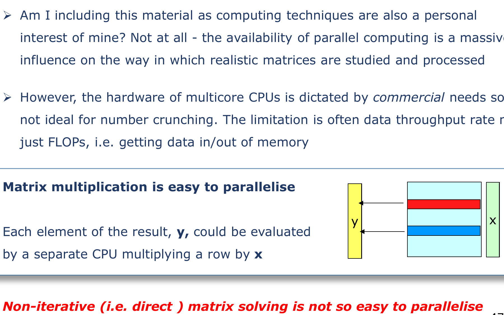
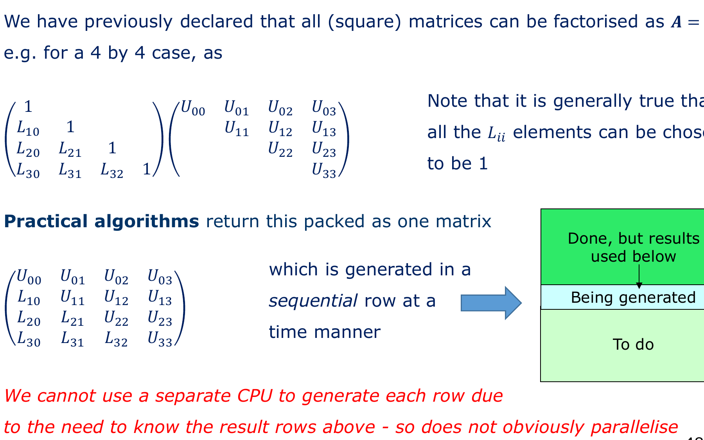
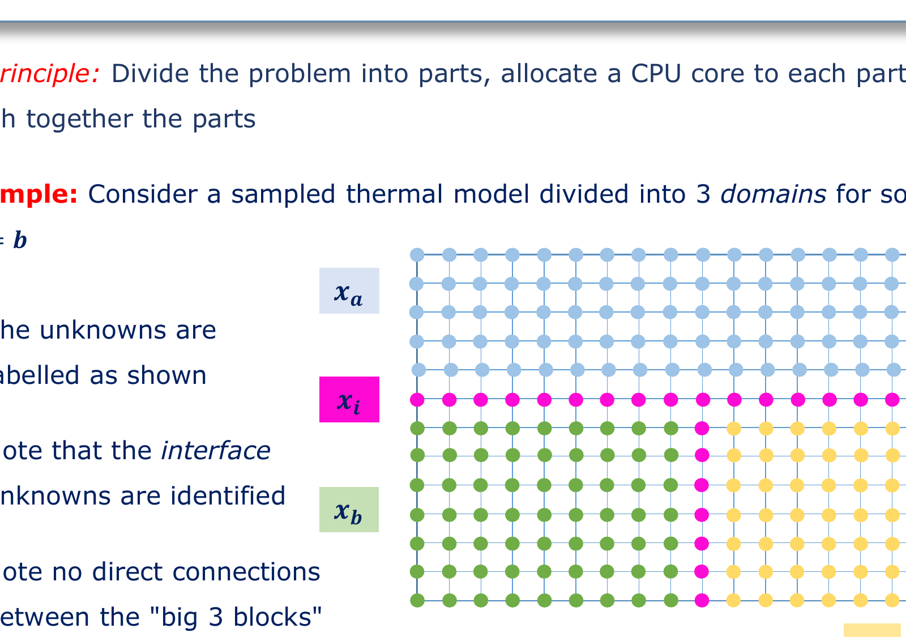
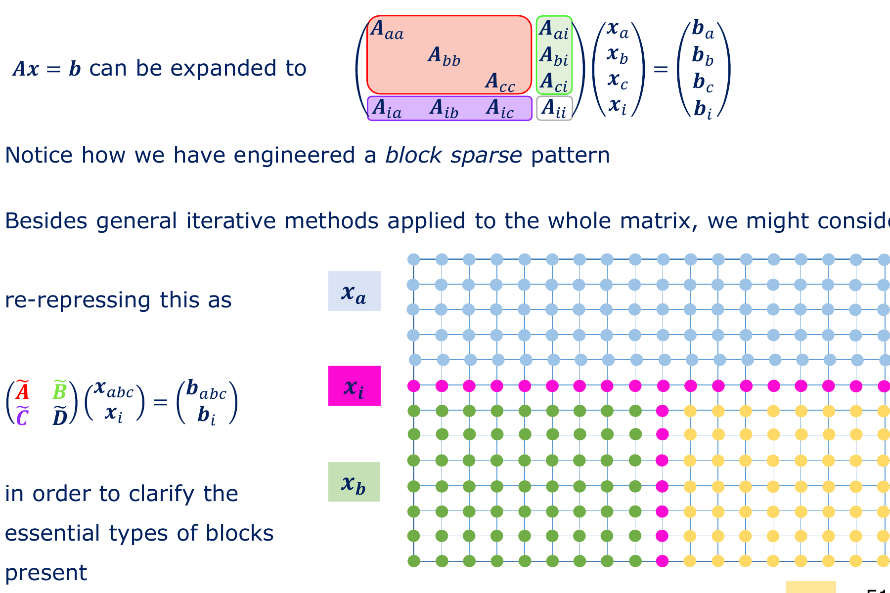
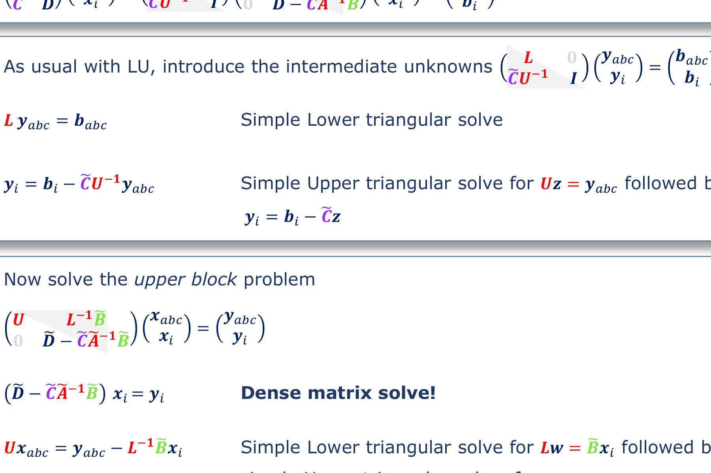

# Chapter 07: Parallel Computing & Domain Decomposition

**Subject:** Multicore Limitations, Low-Level vs High-Level Parallelisation, Block Bordered Matrices, and the Schur Complement  
**Depends on:** [Chapter 02: The Direct Solver Trap], [Chapter 06: Banded Matrices], [Block LU Decompositions]  
**Lecture Reference:** Slides 45–55

---

## The Intuition: The Supercomputer Fantasy Land

* **The Seductive Fantasy (Slide 45–46):** "If our linear system has 100 million unknowns and takes 10 hours to solve, let's just upload it to a university cluster with 10,000 CPU cores and 100 TB of RAM. Surely the compiler has a `--parallel` flag that makes it run 10,000 times faster?"
* **The Reality (Dr. Phil Sewell):** *"If you believe that... then I hope you like this other nice fantasy land."* There is no magic button. In fact, if you take a standard textbook algorithm and run it across 10,000 cores, it will frequently run **slower** than on a single core because the cores spend all their time waiting on memory bus synchronization and network latency.
* **The Hardware Bottleneck:** Modern computer chips are not limited by arithmetic calculation speed (FLOPs). They are choked by **Memory Bandwidth** (the speed at which bytes can be fetched from RAM into the CPU cache). This is known in computer architecture as the **Memory Wall**.
* **The Two Philosophies:**
  1. **Low-Level Parallelisation:** Taking an existing algorithm (like matrix-vector multiply) and slicing the loop across threads.
  2. **High-Level Parallelisation (Domain Decomposition):** Slicing the physical geometry into decoupled spatial domains, assigning one CPU core to each domain, and solving only the thin interface between them.

```
                         [Physical Thermal / EM Domain]
         +-------------------------------------------------------------+
         |                     |                 |                     |
         |      Domain A       |    Domain B     |      Domain C       |
         |      (CPU Core 0)   |    (CPU Core 1) |      (CPU Core 2)   |
         |                     |                 |                     |
         +---------------------+-----------------+---------------------+
                               ^                 ^
                               |                 |
                         Interface Nodes (Core 3: Master)
```

---

## The Detail: Low-Level vs. High-Level Parallelisation

### 1. Low-Level Parallelisation: Matrix-Vector Multiply vs. LU Solve

Let us contrast the two foundational operations of linear algebra:

#### Why Sparse Matrix-Vector Multiply ($\mathbf{y} = \mathbf{A}\mathbf{x}$) Parallelizes Trivially (Slide 47)



Recall the SpMV formula for row $i$:
$$y_i = \sum_{j} A_{ij} x_j$$
* Computing $y_0$ does **not** depend on $y_1, y_2, \dots$
* Each row computation is completely independent.
* If you have 64 CPU cores, you assign rows $0 \dots \frac{N}{64}$ to Core 0, the next block to Core 1, and so forth.
* There are zero data dependencies and zero locks.

#### Why Direct LU Decomposition Resists Parallelisation (Slide 48)



Recall standard Gaussian elimination / LU factorization. The packed matrix elements are computed sequentially row by row:

$$\begin{bmatrix}
U_{00} & U_{01} & U_{02} & U_{03} \\
L_{10} & U_{11} & U_{12} & U_{13} \\
L_{20} & L_{21} & U_{22} & U_{23} \\
L_{30} & L_{31} & L_{32} & U_{33}
\end{bmatrix}$$

* To compute row 2, you **must already know** the completed values of row 0 and row 1.
* To compute row 3, you must wait for row 2 to finish.
* You cannot assign row 0 to Core 0 and row 1 to Core 1 simultaneously! Core 1 would sit idle waiting for Core 0. The serial dependency pipeline kills parallel scaling.

---

## High-Level Parallelisation: Domain Decomposition (Slides 50–54)

Because low-level parallelization of direct solves fails, numerical engineers invented **Domain Decomposition Methods (DDM)** (known as **Block Methods** in applied mathematics).

### 1. Physical Partitioning (Slide 50)



Suppose we have a large thermal or electromagnetic domain. We physically slice the geometry into three separate subdomains:
* $\mathbf{x}_a$: Unknowns entirely inside Domain $A$.
* $\mathbf{x}_b$: Unknowns entirely inside Domain $B$.
* $\mathbf{x}_c$: Unknowns entirely inside Domain $C$.
* $\mathbf{x}_i$: Unknowns lying strictly on the **interfaces / boundaries** between domains.

```
       +-------------------+-------------------+-------------------+
       |                   |                   |                   |
       |       x_a         |       x_b         |       x_c         |
       |                   |                   |                   |
       +---------+---------+---------+---------+---------+---------+
                 |                   |                   |
                 +-------- x_i ------+-------- x_i ------+
```

### 2. The Block-Bordered Arrow Matrix (Slide 51)



Because physics exhibits **nearest-neighbour locality** (Chapter 01), note a fundamental physical fact:
* A point deep inside Domain $A$ **cannot touch** a point inside Domain $B$ without going through the interface $\mathbf{x}_i$!
* Therefore:
  $$\mathbf{A}_{ab} = \mathbf{0}, \quad \mathbf{A}_{ba} = \mathbf{0}, \quad \mathbf{A}_{ac} = \mathbf{0}, \quad \mathbf{A}_{bc} = \mathbf{0}$$

When we assemble the global system $\mathbf{A}\mathbf{x} = \mathbf{b}$, the matrix naturally forms a **Block-Bordered System**:

$$\begin{bmatrix}
\mathbf{A}_{aa} & \mathbf{0} & \mathbf{0} & \mathbf{A}_{ai} \\
\mathbf{0} & \mathbf{A}_{bb} & \mathbf{0} & \mathbf{A}_{bi} \\
\mathbf{0} & \mathbf{0} & \mathbf{A}_{cc} & \mathbf{A}_{ci} \\
\mathbf{A}_{ia} & \mathbf{A}_{ib} & \mathbf{A}_{ic} & \mathbf{A}_{ii}
\end{bmatrix}
\begin{bmatrix}
\mathbf{x}_a \\
\mathbf{x}_b \\
\mathbf{x}_c \\
\mathbf{x}_i
\end{bmatrix}
=
\begin{bmatrix}
\mathbf{b}_a \\
\mathbf{b}_b \\
\mathbf{b}_c \\
\mathbf{b}_i
\end{bmatrix}$$

Notice the extraordinary structure:
1. The subdomain interior blocks $\mathbf{A}_{aa}, \mathbf{A}_{bb}, \mathbf{A}_{cc}$ sit along the diagonal.
2. They have **zero coupling to each other**.
3. All interactions are routed exclusively through the interface rows/columns ($\mathbf{A}_{ai}, \mathbf{A}_{ia}$, etc.).

---

## The Block LU Factorisation & The Schur Complement (Slides 52–54)

To see the mathematical magic, condense the subdomains into a single compound block $\widetilde{\mathbf{A}}$:

$$\widetilde{\mathbf{A}} = \begin{bmatrix} \mathbf{A}_{aa} & \mathbf{0} & \mathbf{0} \\ \mathbf{0} & \mathbf{A}_{bb} & \mathbf{0} \\ \mathbf{0} & \mathbf{0} & \mathbf{A}_{cc} \end{bmatrix}, \quad
\mathbf{B} = \begin{bmatrix} \mathbf{A}_{ai} \\ \mathbf{A}_{bi} \\ \mathbf{A}_{ci} \end{bmatrix}, \quad
\mathbf{C} = \begin{bmatrix} \mathbf{A}_{ia} & \mathbf{A}_{ib} & \mathbf{A}_{ic} \end{bmatrix}, \quad
\mathbf{D} = \mathbf{A}_{ii}$$

The whole system reduces to a $2 \times 2$ block system:

$$\begin{bmatrix}
\widetilde{\mathbf{A}} & \mathbf{B} \\
\mathbf{C} & \mathbf{D}
\end{bmatrix}
\begin{bmatrix}
\mathbf{x}_{abc} \\
\mathbf{x}_i
\end{bmatrix}
=
\begin{bmatrix}
\mathbf{b}_{abc} \\
\mathbf{b}_i
\end{bmatrix}$$

Since each subdomain block $\mathbf{A}_{kk}$ is a local banded grid, it can be decomposed independently via fast banded LU:

$$\widetilde{\mathbf{A}} = \mathbf{L}\mathbf{U} = \begin{bmatrix}
\mathbf{L}_{aa} \mathbf{U}_{aa} & \mathbf{0} & \mathbf{0} \\
\mathbf{0} & \mathbf{L}_{bb} \mathbf{U}_{bb} & \mathbf{0} \\
\mathbf{0} & \mathbf{0} & \mathbf{L}_{cc} \mathbf{U}_{cc}
\end{bmatrix}$$

### Deriving the Block LU Decomposition (Slide 52)

We can factorize the global block matrix into lower- and upper-block triangular matrices:

$$\begin{bmatrix}
\widetilde{\mathbf{A}} & \mathbf{B} \\
\mathbf{C} & \mathbf{D}
\end{bmatrix}
=
\begin{bmatrix}
\mathbf{L} & \mathbf{0} \\
\mathbf{C}\mathbf{U}^{-1} & \mathbf{I}
\end{bmatrix}
\begin{bmatrix}
\mathbf{U} & \mathbf{L}^{-1}\mathbf{B} \\
\mathbf{0} & \mathbf{S}
\end{bmatrix}$$

Multiply the bottom row to verify:
$$(\mathbf{C}\mathbf{U}^{-1})(\mathbf{L}^{-1}\mathbf{B}) + (\mathbf{I})(\mathbf{S}) = \mathbf{C}(\mathbf{L}\mathbf{U})^{-1}\mathbf{B} + \mathbf{S} = \mathbf{C}\widetilde{\mathbf{A}}^{-1}\mathbf{B} + \mathbf{S} = \mathbf{D}$$

$$\implies \mathbf{S} = \mathbf{D} - \mathbf{C}\widetilde{\mathbf{A}}^{-1}\mathbf{B}$$

> [!IMPORTANT]
> **The Schur Complement ($\mathbf{S}$):**  
> The matrix $\mathbf{S} = \mathbf{D} - \mathbf{C}\widetilde{\mathbf{A}}^{-1}\mathbf{B}$ is called the **Schur Complement**.  
> In physical terms, $\mathbf{S}$ represents the **effective condensed impedance of the interface**, with all internal subdomain physics mathematically eliminated ("condensed out")!

Expanding $\mathbf{S}$ across the individual subdomains reveals why it is parallel:

$$\mathbf{S} = \mathbf{A}_{ii} - \sum_{k \in \{a,b,c\}} \mathbf{A}_{ik} \mathbf{A}_{kk}^{-1} \mathbf{A}_{ki}$$

Each term $\mathbf{A}_{ik} \mathbf{A}_{kk}^{-1} \mathbf{A}_{ki}$ can be evaluated **100% in parallel on a separate CPU core**!

---

## Step-by-Step Parallel Solution Pipeline (Slide 53)



Here is how a real engineering supercomputer cluster executes this solve without ever communicating during the heavy calculations:

```
        CPU Core 0 (Domain A)     CPU Core 1 (Domain B)     CPU Core 2 (Domain C)
        +-------------------+     +-------------------+     +-------------------+
Step 1: | Local Solve:      |     | Local Solve:      |     | Local Solve:      |
        | L_aa y_a = b_a    |     | L_bb y_b = b_b    |     | L_cc y_c = b_c    |
        +---------+---------+     +---------+---------+     +---------+---------+
                  |                         |                         |
                  +--------------------+----+-------------------------+
                                       |
                                       v  [Send boundary fluxes to Master Core]
Step 2:                    CPU Core 3 (Interface Master)
                           +----------------------------------------+
                           | Assemble interface RHS: y_i            |
                           | Solve Schur System: S x_i = y_i        |
                           | (Dense solve, but size is tiny!)       |
                           +-------------------+--------------------+
                                               |
                  +----------------------------+----------------------+
                  | [Broadcast interface solution x_i back to cores]  |
                  v                                                   v
        +---------+---------+     +---------+---------+     +---------+---------+
Step 3: | Back Substitution:|     | Back Substitution:|     | Back Substitution:|
        | U_aa x_a = ...    |     | U_bb x_b = ...    |     | U_cc x_c = ...    |
        +-------------------+     +-------------------+     +-------------------+
```

### Detailed Three-Step Walkthrough:

#### Step 1: Forward Subdomain Solve (100% Parallel)
$$\mathbf{L}_{aa}\mathbf{y}_a = \mathbf{b}_a, \quad \mathbf{L}_{bb}\mathbf{y}_b = \mathbf{b}_b, \quad \mathbf{L}_{cc}\mathbf{y}_c = \mathbf{b}_c$$
* Core 0, Core 1, and Core 2 solve their own local triangular systems simultaneously.
* Zero network traffic. Zero cross-talk. Perfect linear speedup.

#### Step 2: The Interface Solve (The Only Coupled Step)
Assemble the interface right-hand side:
$$\mathbf{y}_i = \mathbf{b}_i - \sum_{k \in \{a,b,c\}} \mathbf{A}_{ik} \mathbf{U}_{kk}^{-1} \mathbf{y}_k$$
Solve the Schur complement system:
$$\mathbf{S} \mathbf{x}_i = \mathbf{y}_i$$
* **Why is this fast?** Although $\mathbf{S}$ is dense, the number of interface nodes $\mathbf{x}_i$ is tiny compared to the volume of the entire mesh (surface-to-volume ratio: e.g., 2,000 interface nodes vs. 100,000,000 interior nodes). A dense solve on 2,000 variables takes fractions of a second!

#### Step 3: Subdomain Back-Substitution (100% Parallel)
Broadcast $\mathbf{x}_i$ back to all subdomains. Each core computes its interior voltages/temperatures independently:
$$\mathbf{U}_{kk} \mathbf{x}_k = \mathbf{y}_k - \mathbf{L}_{kk}^{-1} \mathbf{A}_{ki} \mathbf{x}_i$$

---

## Grand Conclusion of the Lecture (Slide 55)

1. **Why are zeros good?**  
   Because without zeros, storing an engineering system of $10^8$ nodes would require 160 PetaBytes of RAM and take 31 years of supercomputing time to solve. Zeros compress memory to 8.8 GB and let us compute matrix-vector products in milliseconds.
2. **Why are there so many of them?**  
   Because nature is local: physical equations (Maxwell, Fourier, Kirchhoff) only connect nearest neighbours.
3. **How do we win?**  
   * We do not invert matrices or use naive Gaussian elimination.
   * We use **CSR storage** to eliminate wasted memory and branch tests.
   * We use **Iterative Solvers (Conjugate Gradients)** to convert impossible matrix solves into fast, repeated matrix multiplications.
   * We use **Preconditioning** to cluster eigenvalues and guarantee convergence in under 100 iterations.
   * We use **Domain Decomposition and the Schur Complement** to chop colossal physical geometries into decoupled blocks that execute across parallel CPU clusters.

---

## Key Takeaways & Self-Check

1. **Why can't we just click a parallel button on direct LU?** Because standard LU has strict sequential row dependencies where each row requires the completed results of prior rows.
2. **What creates the block-bordered structure in Domain Decomposition?** Interior points of Subdomain $A$ have zero physical coupling to Subdomain $B$; all interaction must pass through the physical interface boundary $\mathbf{x}_i$.
3. **What is the Schur Complement?** The condensed impedance matrix $\mathbf{S} = \mathbf{D} - \mathbf{C}\widetilde{\mathbf{A}}^{-1}\mathbf{B}$ describing only the interface degrees of freedom.
4. **Why is Domain Decomposition so scalable?** All interior subdomain operations are completely uncoupled and run in parallel on separate processor cores.

