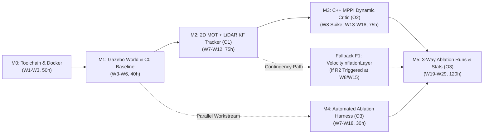
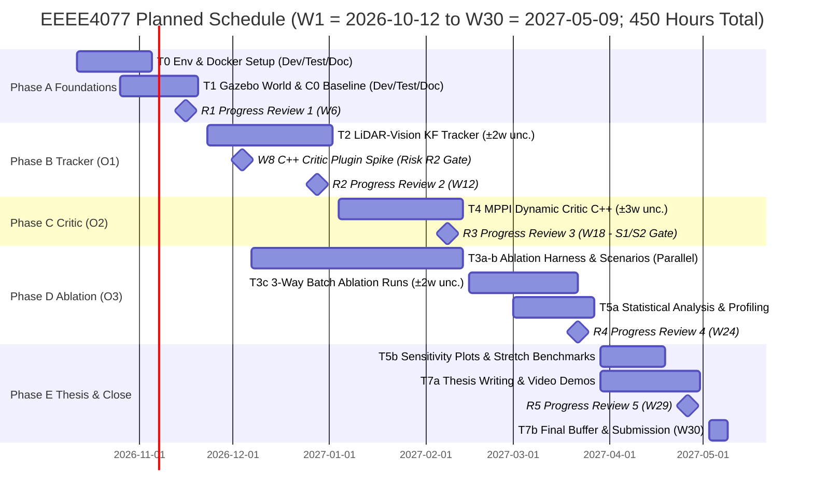

# Project Outline and Planning Report

**Project Title:** Vision-Augmented Mobile Robot Navigation in Dynamic Environments  
**Project Code:** SD-MEng-26-01  

| Field | Details |
|---|---|
| **Author** | Nicholas Khor Han Le |
| **Student ID** | 20617556 |
| **Supervisor** | Dr. Shalini Darmaraju |
| **Moderator** | Ir Dr. Daniel Pu |
| **Module** | EEEE4077 Mechatronics Project (MEng) |
| **Date** | 28 October 2026 |

> **Formatting Specification:** Compiled using the official Moodle Title Page Template (`raw/general/Title Page Template for Project Outline and Planning Report.docx`). Body formatted in A4 (`21.0 cm × 29.7 cm`), Times New Roman 12 pt, single-spaced, `2.54 cm` margins all around. Sections 1–6 occupy strictly **7–8 pages** (excluding Cover Page, Table of Contents, References, and Appendix A).

---

## 1. Overview of the Project

### 1.1 Commercial Context and Operational Bottleneck
According to the International Federation of Robotics (IFR), transportation and logistics represented the largest commercial application class for professional service robots in 2024, recording 102,900 unit deployments globally—a 14% year-on-year expansion [1]. The majority of these Autonomous Mobile Robots (AMRs) operate in *brownfield* industrial environments: pre-existing warehouses, distribution centres, and manufacturing shop floors that cannot be redesigned around segregated automated infrastructure. Instead, AMRs must share narrow transit corridors with moving human workers, manual pallet jacks, and forklifts.

To maintain commercial cost viability and comply with industrial functional safety standards (ISO 3691-4 / SIL-2), brownfield AMRs predominantly pair a single-plane (2D) safety laser scanner with the open-source Robot Operating System 2 (ROS 2) Navigation stack, Nav2 [2], [3]. While planar 2D LiDAR provides millimetre-accurate Time-of-Flight (ToF) ranging over wide horizontal fields of view ($270^\circ\text{--}360^\circ$ at $20\text{--}40\text{ Hz}$), coupling planar range sensing with standard 2D occupancy grids (`nav2_costmap_2d`) creates a severe operational bottleneck in dynamic environments: the **Freezing Robot Problem** [4].

Formally identified by Trautman and Krause [4], the *freezing robot problem* occurs when an autonomous mobile robot navigating amidst moving traffic halts, oscillates, or executes erratic recovery rotations because the planner perceives all forward trajectories as unsafe:
1. **Planar Point Fragmentation and Semantic Blindness:** A 2D LiDAR mounted $10\text{--}20\text{ cm}$ above the floor intersects a walking pedestrian as two sparse, oscillating point clusters corresponding to lower-limb cross-sections. These returns carry no semantic class identity, volumetric bounding geometry, or velocity vector.
2. **Time-Invariant Occupancy Representation ($t = 0$):** Standard Nav2 pipelines insert laser scans directly into `nav2_costmap_2d` [2], modeling every occupied cell as an immovable static barrier fixed at time $t = 0$.
3. **Paralyzed Trajectory Rollouts:** When a pedestrian crosses a corridor $3\text{ m}$ ahead at a nominal walking speed of $1.2\text{--}1.4\text{ m/s}$ [9], the local trajectory controller evaluates candidate trajectories against static costmap cells blocking the aisle. Because the controller cannot project that the pedestrian will vacate the intersection within $1.0\text{--}1.5\text{ s}$, all forward rollouts incur lethal or near-lethal obstacle penalties, collapsing the optimal velocity command to zero ($\mathbf{u}^* = [0, 0]^T$).
4. **Pitfall of Direct Costmap Injection:** Projecting 3D camera or depth points directly into the 2D costmap worsens freezing. Because occupancy grids update via raycasting and lack velocity state storage, moving obstacles leave lingering "phantom clearing trails" that artificially block corridors and trigger unnecessary stops.

### 1.2 Project Aim and Core Objectives
> **Project Aim:** To design, implement, and systematically evaluate in simulation an open-source ROS 2 navigation framework that fuses monocular camera visual tracking with planar 2D LiDAR range measurements to estimate moving obstacle positions and velocities, and incorporates short-term motion predictions into a native Nav2 Model Predictive Path Integral (MPPI) trajectory critic to eliminate robot freezing in dynamic environments.

To achieve this aim in strict alignment with supervisor specification `SD-MEng-26-01` (Hardware 0% / Software 60% / Research 40%), the project focuses on three core engineering objectives:
- **Objective O1 (Multi-Modal Dynamic Obstacle Tracker):** Adapt lightweight 2D visual object detection (YOLOv8n) and two-stage multi-object tracking (ByteTrack [8]) in image space, fused with planar 2D LiDAR range measurements via camera–laser extrinsic calibration [6] and frustum median depth gating, feeding a per-track discrete-time Linear Kalman Filter [7] to estimate continuous Cartesian states $\mathbf{x} = [x, y, v_x, v_y]^T$.
- **Objective O2 (Predictive Dynamic MPPI Controller):** Develop and integrate a native C++ `pluginlib` trajectory critic (`DynamicObstaclesCriticPlugin`) inside `nav2_mppi_controller` [5], [10] that forward-projects tracked obstacle states across the lookahead horizon ($\tau \in [0, 2.0]\text{ s}$) with time-expanding Gaussian safety buffers, enabling proactive yielding and smooth wake-passing on standard CPU hardware.
- **Objective O3 (Systematic 3-Way Comparative Ablation Benchmark):** Evaluate the framework in Gazebo Harmonic across standardized indoor scenarios with varying obstacle speeds ($0.5\text{--}2.0\text{ m/s}$), crossing geometries, and agent densities ($1\text{--}4$ dynamic agents), executing a controlled 3-way ablation (**C0** Range-only baseline, **C1** Vision detection only at $t=0$, **C2** Full predictive MPPI) to statistically isolate the effect of visual identification from temporal motion prediction.

### 1.3 System Architecture and Component Interrelationships
Figure 1 illustrates the end-to-end runtime architecture, separating the system into four functional subsystems: (1) Sensor Ingestion, (2) Multi-Modal Tracking & State Estimation (**O1**), (3) Predictive Local Trajectory Control (**O2**), and (4) the Automated Ablation Evaluation Harness (**O3**). Static structural infrastructure (walls, racking) remains segregated within `nav2_costmap_2d`, while moving agents are routed exclusively through the metric state-space tracker and predictive MPPI critic, preventing costmap corruption and raycasting clearing latency.

```mermaid
flowchart LR
  subgraph SEN["1. Sensor Ingestion (Gazebo Harmonic)"]
    CAM["Monocular RGB Camera<br>/camera/image_raw (30 Hz)"]
    LID["Planar 2D LiDAR<br>/scan (20-40 Hz)"]
  end
  subgraph PER["2. Multi-Modal Perception & Tracking Subsystem (O1)"]
    DET["YOLOv8n Detector<br>2D Boxes + Scores"]
    MOT["ByteTrack 2D MOT<br>Persistent track_id"]
    GATE["Extrinsic Frustum Gating<br>K[R|t] & Median Depth"]
    KF["Per-Track Linear KF (CV)<br>State: [x, y, vx, vy]^T"]
  end
  subgraph CTL["3. Nav2 Predictive MPPI Control Subsystem (O2)"]
    CRIT["DynamicObstaclesCriticPlugin<br>p_obs(tau) = p0 + v_obs * tau"]
    MPPI["nav2_mppi_controller<br>20 Hz, M=2000 Rollouts"]
    LCM["nav2_costmap_2d<br>Static Walls & Infrastructure"]
    BASE["Simulated Mobile Base<br>cmd_vel (geometry_msgs/Twist)"]
  end
  subgraph EVAL["4. Ablation Benchmark Harness (O3)"]
    HARNESS["Automated Scenario Runner<br>Scenarios A-E (C0, C1, C2)"]
    GT["Ground-Truth Metric Logger<br>RMSE, Freezes, Time, Hz"]
  end

  CAM --> DET
  DET --> MOT
  MOT -->|"2D Bounding Boxes"| GATE
  LID -->|"LaserScan"| GATE
  LID -->|"LaserScan"| LCM
  GATE -->|"Metric Cartesian z_k"| KF
  KF -->|"/tracked_obstacles (30 Hz)"| CRIT
  CRIT -->|"Spatio-Temporal Cost"| MPPI
  LCM -->|"Static Cost (t=0)"| MPPI
  MPPI -->|"cmd_vel"| BASE
  HARNESS -.->|"Scripted Actors"| SEN
  BASE -.->|"Odometry & Contacts"| GT
```

*Figure 1. System architecture block diagram showing subsystem boundaries, ROS 2 interfaces, operating rates, and data dependencies.*

Table 1 specifies the critical component-level design requirements, API/data interfaces, execution time budgets, and physical/algorithmic limitations across the pipeline. Dependencies flow sequentially from left to right: the MPPI dynamic critic depends on low-jitter velocity vectors from the Kalman filter, which in turn requires accurate frustum depth association anchored to persistent 2D ByteTrack identities.

**Table 1. Component-level design requirements, interfaces, execution budgets, and limitations.**

| Subsystem Component | Input $\to$ Output Interface & Data Type | Execution Rate / Latency Budget | Critical Design Requirement & Algorithmic Limitation |
|---|---|---|---|
| **2D Object Detector (YOLOv8n)** | `sensor_msgs/Image` ($1280\times720$) $\to$ 2D boxes $B_i = [u_{\min}, v_{\min}, u_{\max}, v_{\max}]$, score $s_i$, class | $\ge 30\text{ Hz}$ ($12\text{--}18\text{ ms}$ FP16/INT8 TensorRT) | Must exceed LiDAR scan frequency. Limited to trained semantic classes (`Pedestrian`, `Forklift`, `Cart`); confidence drops under motion blur. |
| **2D Multi-Object Tracker (ByteTrack [8])** | 2D detections $(B_i, s_i)$ $\to$ active tracks with persistent integer `track_id` | $\ge 30\text{ Hz}$ ($1\text{--}2\text{ ms}$ CPU Hungarian IoU) | Two-stage association ($\theta_{\text{high}}=0.6, \theta_{\text{low}}=0.1$) bridges partial occlusions up to $N_{\text{lost}}=30$ frames ($1.0\text{ s}$). |
| **Extrinsic Frustum Gating [6]** | Active 2D tracks + `sensor_msgs/LaserScan` $\to$ metric observation $\mathbf{z}_k = [x_m, y_m]^T$ | Per scan ($20\text{--}40\text{ Hz}$, $1\text{--}2\text{ ms}$ vectorized) | Projects planar scan via $\lambda[u, v, 1]^T = \mathbf{K}[\mathbf{R}\mid\mathbf{t}][X_L, Y_L, 0, 1]^T$. Median filter rejects background wall bleed-through; limited to overlapping camera–LiDAR horizontal FOV ($\approx 80^\circ$). |
| **Per-Track Linear Kalman Filter [7]** | Metric cluster $\mathbf{z}_k$ $\to$ `/tracked_obstacles` ($\mathbf{x}_k = [x, y, v_x, v_y]^T$, covariance $\mathbf{P}_k$) | $30\text{ Hz}$ ($<0.2\text{ ms}$ Eigen3 C++ matrix ops) | Constant-Velocity (CV) model with Mahalanobis gate ($d_M^2 < \gamma_{\text{gate}}$). Valid over short horizons ($T \le 2.0\text{ s}$) [9]; lags during sudden high-acceleration turns. |
| **MPPI Dynamic Critic Plugin [5], [10]** | `/tracked_obstacles` + $M=2000$ rollouts ($N=40$ steps, $\Delta t=0.05\text{ s}$) $\to$ trajectory cost tensor | $\ge 20\text{ Hz}$ controller loop ($<0.3\text{ ms}$ SIMD C++17) | Evaluates $\mathbf{p}_{\text{obs}}(\tau_k) = \mathbf{p}_0 + \mathbf{v}_{\text{obs}}\tau_k$ with expanding Gaussian buffer $\sigma_i(\tau_k) = R_{\text{rob}} + R_{\text{obs}} + \alpha\tau_k$. Leaves static walls to `nav2_costmap_2d`. |

---

## 2. Specification

All project requirements are formulated as **SMART quantitative hypotheses** evaluated in software simulation, directly fulfilling the supervisor project brief (`SD-MEng-26-01`). To avoid binary pass/fail fragility, each numerical metric specifies a **Minimum** threshold (baseline pass criterion) and an aspirational **Target** (research goal).

### 2.1 Experimental Protocol and 3-Way Ablation Design
Evaluation is conducted in Gazebo Harmonic across five standardized indoor warehouse scenarios: **(A)** perpendicular corridor pedestrian crossing, **(B)** head-on oncoming pedestrian in a constrained aisle, **(C)** higher-speed manual cart/vehicle crossing, **(D)** multi-agent intersection ($2\text{--}4$ simultaneous pedestrians), and **(E)** static obstacle control baseline. Obstacle speeds are varied across $0.5\text{--}2.0\text{ m/s}$. To fulfill the supervisor requirement of distinguishing the isolated effects of visual detection versus motion prediction, three controller configurations are benchmarked across $\ge 30$ paired trials per scenario using shared pseudo-random seeds:
- **Configuration C0 (Range-Only Baseline):** Stock Nav2 with 2D LiDAR and default static costmap MPPI critics.
- **Configuration C1 (Vision Detection Only, $t=0$):** 2D LiDAR + Monocular Camera tracking, injecting detected obstacles as instantaneous static clearance zones ($\mathbf{v}_{\text{obs}} = \mathbf{0}$) without temporal projection.
- **Configuration C2 (Full Proposed Predictive MPPI):** 2D LiDAR + Monocular Camera tracking + Kalman velocity estimation + custom `DynamicObstaclesCriticPlugin` projecting trajectories over $\tau \in [0, 2.0]\text{ s}$.

**Table 2. Project specification, quantitative hypotheses, literature justification, test criteria, and challenge level.** *(Challenge: L = Low, M = Medium, H = High).*

| ID | Specification Requirement | Minimum | Target | Engineering & Literature Justification | Test Method & Success Criterion | Chal. |
|---|---|---|---|---|---|---|
| **O1-a** | Tracked obstacle velocity RMSE ($\le 8\text{ m}$ range) | $< 0.25\text{ m/s}$ | **$< 0.15\text{ m/s}$** | $\approx 10\%$ of nominal $1.4\text{ m/s}$ human walking speed [9]; prevents horizon projection drift over $T=2.0\text{ s}$. | Compute velocity RMSE of `/tracked_obstacles` against Gazebo actor ground-truth `/tf` over $\ge 30$ runs. | M |
| **O1-b** | Camera–LiDAR frustum association accuracy | $\ge 85\%$ | **$\ge 95\%$** | Accurate ray gating [6] prevents background wall range spikes from corrupting Kalman covariance [7]. | Percentage of active visual detections assigned a gated laser cluster within $0.3\text{ m}$ of ground-truth centroid. | M |
| **O2-a** | Controller freezing events per 10 crossings | $\ge 50\%$ below C0 | **$0$ freezes** | Directly resolves the freezing robot pathology [4] where static costmap critics halt or trigger recoveries. | Count `controller_server` timeouts, recovery rotations, and stationary halts ($|v| < 0.05\text{ m/s}$ for $> 2.0\text{ s}$). | H |
| **O2-b** | Mean route completion time reduction vs. C0 | $\ge 10\%$ shorter | **$15\text{--}25\%$ shorter** | Proactive speed modulation and wake-passing eliminate stop-and-restart delays at intersections. | Paired comparison of mean goal transit time $\pm 95\%$ confidence interval across $\ge 30$ seeded runs. | M |
| **O2-c** | Collision-free navigation (Hard Constraint) | $0$ collisions | **$0$ collisions** | Predictive yielding must never compromise physical collision safety under ISO 3691-4 operational principles. | Monitored continuously via Gazebo physics contact sensors; any robot–actor contact fails the trial. | M |
| **O3-a** | Statistical separation in 3-way ablation (C0 vs C1 vs C2) | $p < 0.05$ | **$p < 0.01$** | Isolates whether performance gains derive from visual identification (C1) or motion prediction (C2). | Paired Welch's *t*-test and one-way ANOVA across 30 runs per scenario across speeds ($0.5\text{--}2.0\text{ m/s}$). | M |
| **O3-b** | Cumulative waiting time per navigation run | $\ge 50\%$ reduction | **$\le 5.0\text{ s}$** | Quantifies reduction in intersection deadlocks during dynamic cross-traffic encounters. | Integrate total duration where base linear speed $|v| < 0.05\text{ m/s}$ while a navigation goal is active. | M |
| **O3-c** | End-to-end perception and control loop rates | $\ge 15\text{ Hz}$ | **$\ge 20\text{ Hz}$** | Controller must match or exceed planar LiDAR scan rate ($20\text{ Hz}$) for real-time trajectory generation [10]. | Measure sustained execution frequency of tracker node ($\ge 30\text{ Hz}$) and MPPI loop ($\ge 20\text{ Hz}$) over 5-min runs. | L |
| **NF1** | Containerized single-launch reproducibility | Pass | **Pass** | Enables moderator and future researchers to deterministically reproduce all benchmark tables. | Execute single ROS 2 launch file inside a pinned Docker container to regenerate raw logs and plots. | L |

### 2.2 Prioritized Stretch Goals and Deliverable Mapping
To provide structured flexibility if core milestones proceed ahead of schedule, Table 3 defines three prioritized stretch goals (**S1–S3**), and Table 4 maps each objective to concrete software deliverables and assessment criteria.

**Table 3. Prioritized stretch goals and activation triggers.**

| ID | Stretch Goal Description | Technical Scope & Value Added | Trigger Condition |
|---|---|---|---|
| **S1** | **Dense Crowd Stress Benchmark** | Expand intersection density from $1\text{--}4$ up to $6$ simultaneous interacting agents to stress-test ByteTrack occlusion recovery and MPPI cost landscape non-convexity. | Triggered if O1 and O2 meet Target metrics by Progress Review 3 (Week 18). |
| **S2** | **High-Speed & Oblique Crossing Angles** | Evaluate obstacle speeds up to $2.5\text{ m/s}$ and non-orthogonal crossing angles ($30^\circ, 45^\circ, 135^\circ$) to quantify the kinematic limits of the Constant Velocity (CV) filter. | Triggered if core Scenarios A–E ablation runs complete ahead of Week 22. |
| **S3** | **Embedded CPU-Only Resource Profiling** | Constrain container compute via Linux `cgroups` (4 CPU cores) to verify real-time execution ($20\text{ Hz}$) on low-cost industrial edge computers without discrete GPUs. | Triggered if workstation benchmarking completes with spare margin in Phase D. |

**Table 4. Mapping of project objectives to tangible deliverables and assessment methods.**

| Objective | Tangible Deliverable & Software Artifact | Assessment Method & Validation Criterion |
|---|---|---|
| **O1 (Perception)** | `lidar_vision_tracker` ROS 2 package: YOLOv8n + ByteTrack wrapper, Zhang–Pless extrinsic projection, frustum median filter, and per-track Linear Kalman Filter. | Quantitative evaluation against Gazebo `/tf` ground truth across $\ge 30$ runs verifying O1-a (velocity RMSE $<0.15\text{ m/s}$) and O1-b ($\ge 95\%$ association). |
| **O2 (Control)** | `nav2_mppi_dynamic_critic` C++17 `pluginlib` package (`DynamicObstaclesCriticPlugin`) + Fallback F1 `VelocityInflationLayer` costmap plugin. | Closed-loop dynamic navigation trials verifying O2-a ($0$ freezes), O2-b ($15\text{--}25\%$ faster transit), and O2-c ($0$ collisions). |
| **O3 (Evaluation)** | Automated Gazebo Harmonic scenario generator (Scenarios A–E), `rosbag2` batch evaluator, and Python statistical analysis suite (`scipy`/`matplotlib`). | Paired Welch's *t*-tests and ANOVA ($p < 0.01$) across C0, C1, and C2, plus loop-rate latency profiling ($\ge 20\text{ Hz}$) and video demonstrations. |

**Attainability and Ambition:** All development executes in simulation on an existing workstation equipped with an NVIDIA RTX 4070 Ti Super GPU and multi-core CPU, requiring zero hardware procurement lead time and fitting the 450-hour schedule (Section 6). The specification is ambitious beyond commercial off-the-shelf (COTS) 2D LiDAR AMRs—which rely on reactive safety zone stops or static costmaps—by achieving proactive spatio-temporal trajectory shaping on a standard CPU compute budget.

---

## 3. Methodology

### 3.1 Development Process, Student Skill Assessment, and Limitations
The project follows an iterative, model-based systems engineering workflow partitioned into six sequential steps (**M0–M5**, Table 5). Each step is assessed against the student's current experience (established foundations in Python, C/C++, linear control theory, and basic ROS 2 workspaces, with Nav2 `pluginlib` internals representing a new domain) and explicitly accounts for tool limitations and familiarization tasks.

**Table 5. Development methodology steps, tools, student skill challenges, additional tasks, and tool limitations.**

| Step | Core Process & Selected Tools | Tool Limitations & Project Impact | Student Challenge & Additional Familiarization Tasks |
|---|---|---|---|
| **M0: Toolchain & Environment** | Ubuntu 24.04 LTS, ROS 2 Jazzy Jalisco, Gazebo Harmonic, Docker with NVIDIA Container Toolkit. | ROS 2 Iron is EOL (Dec 2024) and Humble reaches EOL in May 2027. WSL2 can introduce GUI/GPU latency compared to native Linux. | **Challenge: Medium.** Student has ROS 2 CLI/node foundations (`concepts/ROS2_notes`). *Extra task:* Complete 1-week environment spike (W1) comparing native dual-boot vs. WSL2 GPU passthrough and freeze a Dockerfile. |
| **M1: Simulation & C0 Baseline** | Gazebo Harmonic indoor corridor world, differential-drive AMR URDF, scripted actor plugins, `nav2_bringup`. | Scripted Gazebo actors follow deterministic piece-wise trajectories unless randomized; physics contact detection requires explicit collision sensors. | **Challenge: Medium.** *Extra task:* Build modular SDF actor spawners with randomized speed ($0.5\text{--}2.0\text{ m/s}$) and phase offsets; freeze and log C0 baseline metrics before writing custom plugins. |
| **M2: Multi-Modal Tracker (O1)** | Python/C++ node, Ultralytics YOLOv8n, `boxmot` (ByteTrack [8]), OpenCV/Eigen3 extrinsic projection [6], Linear KF [7]. | Camera horizontal FOV ($\approx 80^\circ$) is narrower than 2D LiDAR ($360^\circ$); laser rays can bleed past narrow legs onto background walls. | **Challenge: Medium.** *Extra task:* Implement median range clustering within bounding frustums and Chi-square Mahalanobis gating ($d_M^2 < \gamma_{\text{gate}}$) to reject background multipath returns; run extrinsic sensitivity sweeps. |
| **M3: Dynamic MPPI Critic (O2)** | Native C++17 `mppi::critics::CriticFunction` plugin (`pluginlib`, `ament_cmake`) inside `nav2_mppi_controller` [10]. | **Highest technical risk:** C++ tensor batch manipulation in Nav2 MPPI can cause memory faults or exceed the $50\text{ ms}$ ($20\text{ Hz}$) controller cycle if unvectorized. | **Challenge: High** (first custom Nav2 C++ plugin). *Extra task:* Build a minimal "Hello-Critic" pass-through plugin in Week 8 to master `pluginlib` exports and SIMD tensor APIs before encoding dynamic cost logic in W13. |
| **M4: Ablation Harness (O3)** | Automated Python launch orchestrator, Gazebo service triggers, `rosbag2` recorder, ground-truth `/tf` comparator. | Unattended batch runs (3 configs $\times$ 5 scenarios $\times$ 30 trials = 450 runs) can hang if Gazebo physics or Nav2 lifecycle nodes fail to reset cleanly. | **Challenge: Medium.** *Extra task:* Implement automated watchdog timeouts, deterministic seed injection, and headless Gazebo execution (`-s` server mode) to accelerate batch testing. |
| **M5: Statistical Synthesis (O3)** | Python post-processing pipeline (`numpy`, `scipy.stats`, `matplotlib`). | Unpaired or under-powered sample sizes ($N < 30$) yield inconclusive $p$-values under high scenario variance. | **Challenge: Low.** *Extra task:* Automate paired Welch's *t*-test, one-way ANOVA, and 95% confidence interval generation directly from recorded SQLite3/MCAP bag files. |

### 3.2 Algorithmic Synthesis and Parametric Trade-Off Justification
Rather than selecting algorithms heuristically, candidate methods across perception, motion prediction, and local trajectory control were evaluated against computational complexity, valid temporal horizons, and hardware resource constraints (Table 6).

**Table 6. Parametric trade-off synthesis across tracking, motion prediction, and local trajectory optimization.**

| Subsystem | Selected Method | Evaluated Alternatives | Quantitative & Architectural Justification for Selection |
|---|---|---|---|
| **1. Obstacle Association & Depth (O1)** | **2D ByteTrack [8] + Zhang–Pless Frustum Gating [6]** $\mathcal{O}(N\cdot M)$ IoU + $\mathcal{O}(M^3)$ Hungarian; $<3\text{ ms}$ on CPU. | • *2D Laser Euclidean Clustering:* $\mathcal{O}(P\log P)$ • *DeepSORT:* CNN ReID per box • *PointPillars 3D:* Voxel CNN ($>30\text{ ms}$ GPU) | Planar laser clustering fragments when pedestrian legs cross, causing severe velocity spikes. PointPillars and DeepSORT require heavy GPU memory/compute. ByteTrack solves occlusion-resilient association in 2D pixel space ($<2\text{ ms}$ CPU), while frustum median gating extracts exact ToF metric depth without stereo disparity noise ($\Delta Z \propto Z^2$). |
| **2. Motion Prediction Model (O1/O2)** | **Discrete Linear Kalman Filter (Constant Velocity [7], [9])** $\mathbf{p}_{\text{obs}}(\tau) = \mathbf{p}_0 + \mathbf{v}_{\text{obs}}\tau$; $\mathcal{O}(1)$ per track ($<0.01\text{ ms}$). | • *Social Force Model (SFM) [9]:* $\mathcal{O}(K^2)$ • *Interactive GP (IGP) [4]:* $\mathcal{O}(K^3)$ • *Trajectory Transformers:* $\mathcal{O}(L^2)$ GPU | Helbing & Molnar [9] showed pedestrian velocities ($1.2\text{--}1.4\text{ m/s}$) exhibit strong directional inertia over short intervals. Inside a $20\text{ Hz}$ MPPI loop evaluating $M=2000$ rollouts $\times N=40$ steps ($80,000$ queries/cycle), SFM, IGP, or neural models are intractable. Linear CV propagation is closed-form, SIMD-vectorizable, and physically valid for $T \le 2.0\text{ s}$. |
| **3. Local Trajectory Control (O2)** | **Nav2 MPPI + Custom Dynamic Critic [5], [10]** $M=2000$ rollouts, $T=2.0\text{ s}$, $\Delta t=0.05\text{ s}$; $<15\text{ ms}$ total CPU loop. | • *Dynamic Window (DWA):* $T \le 1.0\text{ s}$ • *Timed Elastic Band (TEB):* g2o graph • *SE-MPPI QP-CBF [11]:* reactive filter | DWA samples only constant $(v,\omega)$ arcs and freezes at crossings. TEB suffers local minima and $\mathcal{O}(K)$ solver scaling with multiple dynamic obstacles. Injecting a spatio-temporal Gaussian cost $\mathcal{L}_{\text{dyn}}(\mathbf{p}_{\text{rob}}(\tau_k), \tau_k) = \sum_i w_{\text{dyn}}\exp(-\|\mathbf{p}_{\text{rob}}(\tau_k)-\mathbf{p}_{\text{obs},i}(\tau_k)\|^2 / 2\sigma_i^2(\tau_k))$ into MPPI reshapes the entire rollout distribution in $<0.3\text{ ms}$ on CPU. |

### 3.3 Interdependencies and Critical Path Analysis
Figure 2 depicts the methodological dependency graph. The **critical path** follows $\text{M0} \to \text{M1} \to \text{M2} \to \text{M3} \to \text{M5}$: the predictive MPPI critic (M3) cannot be tuned in closed loop until the multi-modal tracker (M2) outputs calibrated metric velocity vectors `/tracked_obstacles`, and both depend on a frozen simulation world and baseline (M1). To prevent schedule bottlenecks, the automated ablation test harness (**M4**) branches in parallel immediately after M1, allowing scenario scripts and metric loggers to be validated against the C0 baseline while M2 and M3 are under active development. Furthermore, if M3 encounters unexpected C++ integration delays during the Week 8 spike, **Fallback F1** (injecting velocity-inflated anisotropic ellipses into a custom `nav2_costmap_2d::Layer`) decouples M5 evaluation from internal MPPI critic compilation.

*Figure 2. Methodology dependency graph showing the critical path (solid arrows), parallel test-harness branch (dashed arrow), and technical contingency path (Fallback F1).*

---

## 4. Originality

### 4.1 Multifaceted Novelty in Deliverable and Development Approach
While planar camera–laser calibration [6], 2D ByteTrack association [8], Kalman filtering [7], and path-integral control [5] are individually established, existing literature and commercial deployments leave a critical gap between **low-cost brownfield warehouse AMRs** and **compute-heavy academic SOTA navigation**. This project demonstrates multifaceted originality across both its final engineering deliverable and its experimental methodology:
1. **Idiomatic Open-Source Architectural Extension (New Technique in Production Stack):** Inspection of the production ROS 2 `nav2_mppi_controller` source tree confirms that all 11 shipped trajectory critics (`ObstaclesCritic`, `CostCritic`, etc.) query `nav2_costmap_2d` strictly at time $t=0$ [10]. By formulating a native C++17 `mppi::critics::CriticFunction` plugin that forward-projects obstacle states ($\mathbf{p}_{\text{obs}}(\tau_k) = \mathbf{p}_0 + \mathbf{v}_{\text{obs}}\tau_k$) with time-expanding uncertainty radii ($\sigma_i(\tau_k) = R_{\text{rob}} + R_{\text{obs}} + \alpha\tau_k$), the project resolves the freezing robot pathology without altering Nav2 core libraries or breaking standard Behavior Tree recovery pipelines.
2. **Low-Cost Brownfield Sensor Complementarity (Translational Engineering):** Replacing existing 2D safety LiDARs on warehouse fleets with 3D multi-channel LiDARs ($>\$3,000$) is economically unviable for brownfield retrofits [1], while stereo depth cameras suffer quadratic depth variance ($\Delta Z \propto Z^2$) beyond $4\text{ m}$. Combining an existing 2D LiDAR with a $\$30\text{--}\$50$ monocular camera ($\approx \$450$ total sensor cost) translates 2D vision tracking and planar ToF laser ranging into a complementary late-fusion observer running entirely within a standard onboard CPU budget.
3. **Differentiation from 2024–2025 Academic MPPI Frontiers:** Contemporary MPPI research targets orthogonal failure modes using heavy compute:
   - *SE-MPPI* (Kang, 2024 [11]) appends a Quadratic Programming (QP) Control Barrier Function (CBF) safety post-filter to the immediate control output $\mathbf{u}_0^*$, acting reactively at the boundary rather than reshaping multi-second rollout distributions to yield early.
   - *EXACT-MPPI* (Peng et al., 2024 [12]) computes continuous Signed Distance Functions (SDF) from raw point clouds using JAX CUDA kernels on a dedicated GPU, treating obstacles as instantaneous static geometry rather than tracking velocity vectors.
   - *CSC-MPPI* (RCILab, 2025 [13]) uses GPU cuML DBSCAN clustering to prevent symmetric mode-averaging collapse. In human cross-traffic, however, the pedestrian's velocity vector $\mathbf{v}_{\text{obs}}$ naturally breaks spatial symmetry—penalizing future positions automatically skews rollouts into the pedestrian's trailing wake in $<0.3\text{ ms}$ on CPU without GPU clustering.
4. **Originality in Evaluation Methodology (Systematic 3-Way Ablation):** Published navigation papers predominantly report monolithic end-to-end success rates, conflating improved obstacle detection with predictive control. Our 3-way comparative ablation (**C0** vs. **C1** vs. **C2**) rigorously isolates spatial visual bounding ($t=0$) from temporal velocity extrapolation ($\tau \in [0, 2.0]\text{ s}$).

**Table 7. Comparative positioning against current industrial practice and state-of-the-art research frontiers.**

| Dimension | Industrial Baseline (Stock Nav2 + 2D LiDAR [2]) | 2D/3D Vision–LiDAR Trackers (Without Predictive Critic) | Academic SOTA MPPI (SE-MPPI [11], EXACT [12], CSC [13]) | **This Project (Proposed Framework)** |
|---|---|---|---|---|
| **Sensor Suite & Cost** | Planar 2D LiDAR ($\approx \$400$) | 2D/3D LiDAR + RGB/Stereo ($\approx \$500\text{--}\$4,000$) | 3D LiDAR / Depth Point Clouds ($>\$3,000$) | **2D LiDAR + Monocular RGB Retrofit ($\approx \$450$)** |
| **Obstacle Representation** | Unclassified 2D costmap cells fixed at $t=0$ | Tracked bounding boxes injected into static costmap | Unsegmented SDF point clouds [12] or instantaneous barriers [11] | **Decoupled: Static costmap + metric tracks $[x,y,v_x,v_y]^T$** |
| **Trajectory Evaluation** | 11 static costmap critics ($t=0$) $\to$ **Freezes** | Static clearance inflation ($t=0$) + raycast trails | JAX GPU SDF rollouts [12], cuML DBSCAN [13], or QP-CBF [11] | **Native C++ MPPI Critic ($\mathbf{p}_0 + \mathbf{v}_{\text{obs}}\tau_k$, time-expanding $\sigma$)** |
| **Compute Requirement** | Standard onboard CPU | CPU + Edge GPU | Dedicated CUDA GPU VRAM (JAX / RAPIDS cuML) | **Standard CPU for control ($<0.3\text{ ms}$ SIMD); light edge inference** |
| **Validation Methodology** | Ad-hoc static obstacle tests | Isolated MOTA / tracking RMSE metrics | Monolithic benchmark against legacy DWA/TEB | **Controlled 3-way ablation (C0 vs C1 vs C2) across speeds/densities** |

### 4.2 Acknowledged Project Limitations and Quantified Impact on Specification
1. **Simulation-Only Validation and Scripted Actor Dynamics:** Because no physical AMR hardware or laboratory arena is used (`SD-MEng-26-01`: 0% HW), Gazebo actors lack subtle human micro-accelerations and optical lighting artifacts (motion blur, specular floor glare). *Quantified impact on specification:* Real-world association accuracy would likely drop by $5\text{--}8\%$ from the simulated Target ($\ge 95\%$), motivating the conservative **Minimum** specification threshold of $\ge 85\%$ (**O1-b**) and randomized actor speeds/angles.
2. **Planar Sensor Intersection Geometry & Narrow Camera FOV:** Metric depth anchoring requires the obstacle to intersect the horizontal laser scan plane ($10\text{--}20\text{ cm}$ height) within the camera's $\approx 80^\circ$ horizontal FOV. *Quantified impact on specification:* Overhanging obstacles (e.g. elevated forklift tines) or agents approaching from $>40^\circ$ off-axis cannot be velocity-tracked until entering the camera frustum; outside this frustum, the robot safely defaults to the $360^\circ$ static 2D LiDAR costmap (**C0** behavior), preserving the zero-collision hard constraint (**O2-c**).
3. **Constant-Velocity Horizon Breakdown ($T > 2.0\text{ s}$):** For an abrupt pedestrian direction reversal ($a \approx 1.5\text{ m/s}^2$), linear CV position error grows quadratically as $\Delta p = \frac{1}{2}a\tau^2$, reaching $0.38\text{ m}$ at $\tau = 1.0\text{ s}$ and $1.50\text{ m}$ at $\tau = 2.0\text{ s}$. *Quantified impact on specification:* Lookahead is strictly bounded to $T = 2.0\text{ s}$ with linear covariance inflation $\sigma_i(\tau_k) = R_{\text{rob}} + R_{\text{obs}} + \alpha\tau_k$, trading overly aggressive long-range swerving for guaranteed stability on **O1-a** ($<0.15\text{ m/s}$ RMSE) and **O2-c** ($0$ collisions).
4. **Lack of Functional Safety Certification:** The software critic does not replace certified hardware safety laser scanner E-stop fields (ISO 3691-4).

---

## 5. Risk Management

Project delivery risks (excluding generic laboratory health and safety) are evaluated using Likelihood ($L \in [1, 5]$) and Impact ($I \in [1, 5]$), sorted by composite score $S = L \times I$ and quantified schedule/specification impact (Table 8). Any risk scoring $S \ge 15$ is classified as **Critical** and linked to an explicit pre-scheduled stage gate and technical fallback.

**Table 8. Quantified project risk register sorted by risk score and impact, showing pre- and post-mitigation ratings.**

| ID | Risk Description (Methodology Link) | When | L | I | Pre Score | Quantified Unmitigated Impact | Realistic Mitigation Strategy & Fallback Action | Post ($L\times I$) |
|---|---|---|---|---|---|---|---|---|
| **R2** | Custom C++ MPPI critic plugin (`M3`) suffers compilation, memory, or real-time latency faults | W8 spike; W13–W18 | 4 | 5 | **20 (Crit)** | **3–4 weeks slip;** threatens Objective O2 delivery | Execute early "Hello-Critic" C++ `pluginlib` spike in W8. **Fallback F1:** Implement `VelocityInflationLayer` costmap plugin projecting anisotropic velocity ellipses into `nav2_costmap_2d`, preserving O2-a/b/c via stock critics. | $3\times 3 = \mathbf{9}$ |
| **R1** | Host OS, ROS 2 Jazzy, Gazebo Harmonic, or GPU driver drift breaks simulation pipeline (`M0`) | W1–W3 | 4 | 4 | **16 (Crit)** | **2–3 weeks slip** at project start | Dedicate W1 to host environment benchmarking (Ubuntu 24.04 dual-boot vs. WSL2); encapsulate entire ROS 2 + Gazebo + `boxmot` stack in a version-pinned Docker image (**NF1**). | $2\times 3 = \mathbf{6}$ |
| **R3** | Scope creep across perception, control, and 450-run ablation exceeds 450-hour budget (`M2–M5`) | All phases (R1–R5) | 4 | 4 | **16 (Crit)** | **3–6 weeks slip;** incomplete statistical testing | Enforce strict adherence to simulation-only scope (`SD-MEng-26-01`); gate Stretch Goals S1–S3 behind Review 3 (W18); shed 4-agent crowd density scenarios first if behind at R3. | $3\times 3 = \mathbf{9}$ |
| **R4** | Extrinsic calibration error or laser bleed-through onto walls corrupts KF velocity (`M2`) | W7–W12 | 3 | 4 | **12** | **2 weeks slip;** O1-a RMSE degrades $>0.25\text{ m/s}$ | Use exact simulator TF extrinsics initially; apply frustum median depth clustering and Chi-square Mahalanobis gating ($d_M^2 < \gamma_{\text{gate}}$) to reject background wall hits. | $2\times 3 = \mathbf{6}$ |
| **R7** | Competing MEng coursework deadlines and January/April exam periods reduce weekly hours | W10–W14 (Jan), W23–W26 (Apr) | 4 | 3 | **12** | **2–3 weeks slip** during assessment windows | Schedule lighter weekly FYP loads ($8\text{--}10\text{ h/wk}$) during exam periods offset by $18\text{ h/wk}$ in Nov/Feb; preserve an unallocated 15-hour buffer in Week 30. | $3\times 2 = \mathbf{6}$ |
| **R5** | Multi-actor visual occlusions in Scenario D cause ID switches and velocity spikes (`M2`) | W9–W14 | 3 | 3 | **9** | **1–2 weeks slip;** O1-b drops $<85\%$ | Utilize ByteTrack [8] two-stage low-confidence box association ($\theta_{\text{low}}=0.1$); enforce track coasting limit ($1.0\text{ s}$) and covariance reset on re-identification. | $2\times 2 = \mathbf{4}$ |
| **R6** | Deterministic Gazebo actor trajectories cause controller overfitting (`M1`, `M4`) | W19–W24 | 4 | 2 | **8** | **Spec change:** weakened generality claims in O3 | Inject seeded uniform random perturbations into actor spawn times, walking speeds ($0.5\text{--}2.0\text{ m/s}$), and crossing angles across all 30 paired runs. | $3\times 2 = \mathbf{6}$ |
| **R8** | Source code corruption, accidental deletion, or loss of raw `rosbag2` ablation datasets | All phases | 2 | 4 | **8** | **1–2 weeks lost** re-running batch simulations | Maintain Git repository with remote backup, weekly semantic tags at each milestone, and automated cloud sync of compressed CSV summary metrics. | $1\times 4 = \mathbf{4}$ |
| **R9** | Aspirational Target hypotheses (e.g., $0$ freezes in O2-a) prove unattainable in dense crossings | W19–W24 | 3 | 2 | **6** | **Spec change:** Target missed in high-density runs | Two-tier specification structure (**Minimum** vs. **Target**) ensures baseline pass ($\ge 50\%$ freeze reduction) while transparently reporting kinematic failure boundaries. | $2\times 2 = \mathbf{4}$ |

---

## 6. Planned Work Schedule

The project is planned over **30 weeks** from **Week 1 (12 October 2026)** to **Week 30 (3 May 2027)** at a realistic nominal workload of **15 hours per week**, totaling **450 hours** (Table 9). Every phase follows an explicit **Develop (60%) – Test (25%) – Document (15%)** cycle concluding with a formal supervisor **Progress Review (R1–R5)**.

**Table 9. Phased work breakdown, task hours, links to methodology/specification, uncertainty bounds, and review expectations.**

| Phase & Weeks | Major Tasks, Specification/Method Links & Hour Split (Develop / Test / Doc) | Hours (Weekly) | Uncertainty & Buffer Impact | Progress Review Milestone & Expected Project Status |
|---|---|---|---|---|
| **Phase A: Foundations** W1–W6 (12 Oct – 22 Nov) | • **T0 (`M0`, NF1):** Host Ubuntu 24.04 + ROS 2 Jazzy + Docker setup (50 h: 30D/12T/8Doc) • **T1 (`M1`, C0):** Gazebo corridor world, actors & C0 baseline logging (40 h: 24D/10T/6Doc) | **90 h** (15 h/wk) | $\pm 1\text{ wk}$ on T0/T1. Absorbed before R1. | **Review 1 (W6, $\approx$ 16 Nov 2026):** Toolchain container frozen (**NF1**); Gazebo world operational; C0 baseline freezing rate measured across Scenarios A–E. |
| **Phase B: Perception** W7–W12 (23 Nov – 3 Jan) | • **T2 (`M2`, O1-a/b):** YOLOv8n + ByteTrack + Zhang–Pless frustum gating + Linear KF (75 h: 45D/19T/11Doc) • **T3a (`M4`, O3):** Automated scenario spawner & W8 C++ critic spike (15 h: 9D/4T/2Doc) | **90 h** (15 h/wk) | **$\pm 2\text{ wk}$ on T2.** W8 spike decides R2 critic vs. F1 fallback. | **Review 2 (W12, $\approx$ 28 Dec 2026):** `/tracked_obstacles` publishing at $\ge 30\text{ Hz}$; O1-a velocity RMSE ($<0.25\text{ m/s}$) and O1-b association ($\ge 85\%$) verified; W8 C++ plugin spike passed. |
| **Phase C: Control** W13–W18 (4 Jan – 14 Feb) | • **T4 (`M3`, O2-a/b/c):** `DynamicObstaclesCriticPlugin` C++ implementation & tuning (75 h: 45D/19T/11Doc) • **T3b (`M4`, O3):** Automated `rosbag2` batch evaluator & C1 config (15 h: 9D/4T/2Doc) | **90 h** (15 h/wk; lighter in Jan exams) | **$\pm 3\text{ wk}$ on T4** (Highest risk). If slipped past W16, activate Fallback F1. | **Review 3 (W18, $\approx$ 8 Feb 2027):** Custom MPPI dynamic critic (C2) and static vision config (C1) running closed-loop at $\ge 20\text{ Hz}$ (**O3-c**) with $0$ collisions (**O2-c**); decision gate for Stretch Goals S1–S3. |
| **Phase D: Ablation** W19–W24 (15 Feb – 28 Mar) | • **T3c (`M4`, O3-a/b/c):** Batch execution of 3-way ablation (C0, C1, C2 $\times$ 30 runs) (55 h: 30D/17T/8Doc) • **T5a (`M5`, O3-a):** Paired Welch's *t*-test, ANOVA & latency profiling (35 h: 20D/9T/6Doc) | **90 h** (15 h/wk) | **$\pm 2\text{ wk}$ on T3c.** Absorbed by reallocating T5b stretch time. | **Review 4 (W24, $\approx$ 22 Mar 2027):** All 450 paired simulation runs completed; statistically significant separation ($p < 0.05$) verified across C0, C1, and C2 (**O3-a**); draft results chapters compiled. |
| **Phase E: Thesis & Demo** W25–W29 (29 Mar – 2 May) | • **T5b (`M5`, S1–S3):** Extended sensitivity plots, stretch benchmarks & video demos (30 h: 15D/8T/7Doc) • **T7a (Core):** Full MEng thesis drafting & internal review (45 h: 0D/10T/35Doc) | **75 h** (15 h/wk; lighter in Apr exams) | $\pm 1\text{ wk}$ on T5b. Protected by W30 buffer. | **Review 5 (W29, $\approx$ 26 Apr 2027):** Complete thesis draft reviewed with supervisor; demonstration videos rendered; reproducibility container verified (**NF1**). |
| **Close & Buffer** W30 (3 May – 9 May) | • **T7b (Core):** Final thesis proofreading, formatting & Moodle submission buffer (15 h: 0D/3T/12Doc) | **15 h** (15 h/wk) | **15 h contingency reserve** absorbs residual slip. | **Final Submission (W30, $\approx$ 7 May 2027):** Final MEng dissertation, source code repository, and video deliverables submitted. |

*Figure 3. Project Gantt chart illustrating task durations, parallel execution of T3a–b with T2/T4, uncertainty bounds (±2–3 weeks), and supervisor Progress Reviews R1–R5.*

**Schedule Coherence, Parallelisation, and Uncertainty Management:**
- **Task Dependencies and Parallelisation:** The critical path runs sequentially through `T0 → T1 → T2 → T4 → T3c → T5a → T7a`. Developing the automated scenario generator and logging harness (`T3a–b`) in parallel with `T2` and `T4` (Weeks 9–18) ensures that as soon as the C++ dynamic critic (`T4`) passes closed-loop verification at **R3**, batch ablation trials (`T3c`) can launch immediately without infrastructure delay.
- **Develop–Test–Document Cycle:** Rather than deferring testing and writing to April, every task embeds a 60% development, 25% unit/integration testing, and 15% documentation split, producing incremental draft sections ahead of each review gate (**R1–R5**).
- **Impact of Uncertainty Error Bars:** `T2` (Tracker, $\pm 2\text{ weeks}$), `T4` (MPPI Critic, $\pm 3\text{ weeks}$), and `T3c` (Ablation runs, $\pm 2\text{ weeks}$) carry the primary schedule uncertainty. A slip in `T2` delays the calibrated input to `T4`; this is mitigated by testing `T4` against synthetic ground-truth `/tracked_obstacles` messages published directly from Gazebo `/tf`. If `T4` slips by $+2\text{ weeks}$ into Phase D, `T5b` (extended sensitivity/stretch analysis, 30 h) acts as the primary internal shock absorber, followed by the dedicated 15-hour **Week 30 buffer (`T7b`)**, protecting the final submission deadline without silently dropping core objectives **O1–O3**.

---

## References

[1] International Federation of Robotics (IFR), "World Robotics 2025 – Service Robots," Frankfurt, Germany, Press Release, 2025. [Online]. Available: https://ifr.org/ifr-press-releases/news/service-robots-see-global-growth-boom

[2] S. Macenski, F. Martín, R. White, and J. Ginés Clavero, "The Marathon 2: A Navigation System," in *Proc. IEEE/RSJ Int. Conf. Intelligent Robots and Systems (IROS)*, Las Vegas, NV, USA, 2020, pp. 2718–2725, arXiv:2003.00368.

[3] S. Macenski, T. Foote, B. Gerkey, C. Lalancette, and W. Woodall, "From the Desks of ROS Maintainers: A Survey of Modern & Capable Mobile Robotics Algorithms in the Robot Operating System 2," *Robotics and Autonomous Systems*, vol. 168, p. 104496, 2023, arXiv:2307.15236.

[4] P. Trautman and A. Krause, "Unfreezing the robot: Navigation in dense, interacting crowds," in *Proc. IEEE/RSJ Int. Conf. Intelligent Robots and Systems (IROS)*, Taipei, Taiwan, 2010, pp. 797–803, doi:10.1109/IROS.2010.5654369.

[5] G. Williams, N. Wagener, B. Goldfain, P. Drews, J. M. Rehg, B. Boots, and E. A. Theodorou, "Information theoretic MPC for model-based reinforcement learning," in *Proc. IEEE Int. Conf. Robotics and Automation (ICRA)*, Singapore, 2017, pp. 1714–1721, doi:10.1109/ICRA.2017.7989202.

[6] Q. Zhang and R. Pless, "Extrinsic calibration of a camera and laser range finder (improves camera calibration)," in *Proc. IEEE/RSJ Int. Conf. Intelligent Robots and Systems (IROS)*, Sendai, Japan, 2004, pp. 2301–2306, doi:10.1109/IROS.2004.1389752.

[7] S. Thrun, W. Burgard, and D. Fox, *Probabilistic Robotics*. Cambridge, MA, USA: MIT Press, 2005.

[8] Y. Zhang, P. Sun, Y. Jiang, D. Yu, F. Weng, Z. Yuan, P. Luo, W. Liu, and X. Wang, "ByteTrack: Multi-Object Tracking by Associating Every Detection Box," in *Proc. European Conf. Computer Vision (ECCV)*, Tel Aviv, Israel, 2022, pp. 1–21, arXiv:2110.06864.

[9] D. Helbing and P. Molnár, "Social force model for pedestrian dynamics," *Physical Review E*, vol. 51, no. 5, pp. 4282–4286, 1995, doi:10.1103/PhysRevE.51.4282.

[10] S. Macenski and Nav2 Development Team, "Nav2 MPPI Controller: Model Predictive Path Integral Trajectory Optimization," ROS 2 Navigation Stack Documentation, 2024. [Online]. Available: https://github.com/ros-navigation/navigation2/tree/main/nav2_mppi_controller

[11] J. M. Kang, "SE-MPPI: Safe-Escape Nav2-Native MPPI Controller with Control Barrier Functions," GitHub Repository / Technical Preprint, 2024. [Online]. Available: https://github.com/kjungmo/se-mppi-nav2

[12] C. Peng et al., "EXACT-MPPI: Exact Signed-Distance Navigation for Arbitrary-Footprint Robots from Point Clouds via Path Integral Control," Technical Preprint / GitHub Repository, 2024. [Online]. Available: https://github.com/caseypen/EXACT-mppi

[13] Robot Control and Intelligence Lab (RCILab), "Constrained Sampling MPPI Framework with DBSCAN for Reliable Obstacle Avoidance," in *Proc. IEEE/RSJ Int. Conf. Intelligent Robots and Systems (IROS)*, 2025.

---

## Appendix A: Supervisor-Provided Project Specification

**Project Title:** Vision-Augmented Mobile Robot Navigation in Dynamic Environments  
**Project Code:** SD-MEng-26-01  
**Supervisor:** Dr Shalini Darmaraju  
**Moderator:** Ir Dr Daniel Pu  
**Date:** 19 October 2026  

### Project Description
Autonomous mobile robots need to navigate safely and efficiently in environments containing moving obstacles. Planar range sensors provide distance measurements, while cameras provide visual information that can help identify relevant obstacles. Combining these inputs with obstacle motion estimation can support navigation decisions when obstacles cross or approach the robot’s planned route.

This project aims to develop a simulation-based navigation framework that combines camera information with planar range measurements for obstacle tracking and motion-aware navigation. A mobile robot equipped with simulated sensors will operate in a known indoor environment containing selected types of moving obstacles. Existing visual detection and tracking methods will be adapted and combined with range measurements to estimate obstacle positions and velocities. A simple motion model will predict their short-term positions, which will be incorporated into local path planning and collision avoidance using an existing navigation framework.

The proposed system will be evaluated against range-sensor-based navigation, with additional comparisons to distinguish the effects of visual information and motion prediction. Experiments will vary obstacle speeds, movement patterns and density. Evaluation will assess tracking accuracy, navigation success, collisions, travel time, waiting time and computational efficiency. All development and evaluation will be conducted in simulation, with images and range measurements generated by simulated sensors.

### Target SDG(s)
- **SDG 9:** Industry, Innovation and Infrastructure
- **SDG 8:** Decent Work and Economic Growth

### Project Objectives
1. To review existing methods for vision-augmented mobile robot navigation, camera and range-sensor integration, obstacle tracking and motion prediction.
2. To develop an indoor robot simulation and adapt existing detection and tracking methods to combine simulated camera and planar range measurements for obstacle position and velocity estimation.
3. To develop a navigation framework that incorporates short-term obstacle motion predictions into local path planning and collision avoidance.
4. To evaluate the proposed framework against range-sensor-based navigation under varying obstacle movements and densities, assessing tracking accuracy, navigation performance and computational efficiency.

### Project Deliverables
1. A literature review of vision-augmented mobile robot navigation, camera and range-sensor integration, obstacle tracking and motion prediction methods.
2. A configurable indoor robot simulation and an implemented obstacle detection and tracking system using simulated camera and range measurements, with documented source code.
3. A navigation prototype integrating short-term obstacle motion prediction with local path planning and collision avoidance.
4. Comparative experimental results and analysis of tracking accuracy, navigation success, collisions, travel time, waiting time and computation time, supported by reproducible simulation scenarios and video demonstrations.
5. A final project report documenting the literature review, methodology, system development, evaluation results and conclusions.

### Resource & Effort Breakdown
- **Hardware / Software / Research Ratio:** HW 0% | SW 60% | Research/Investigation/Design 40%
- **Lab Space Requirements:** No dedicated laboratory space; computer workstation only.
- **Supported Software:** Ubuntu Linux with ROS 2, Nav2 and Gazebo; Python or C++ for development; and NumPy and Matplotlib for analysis and visualisation.
