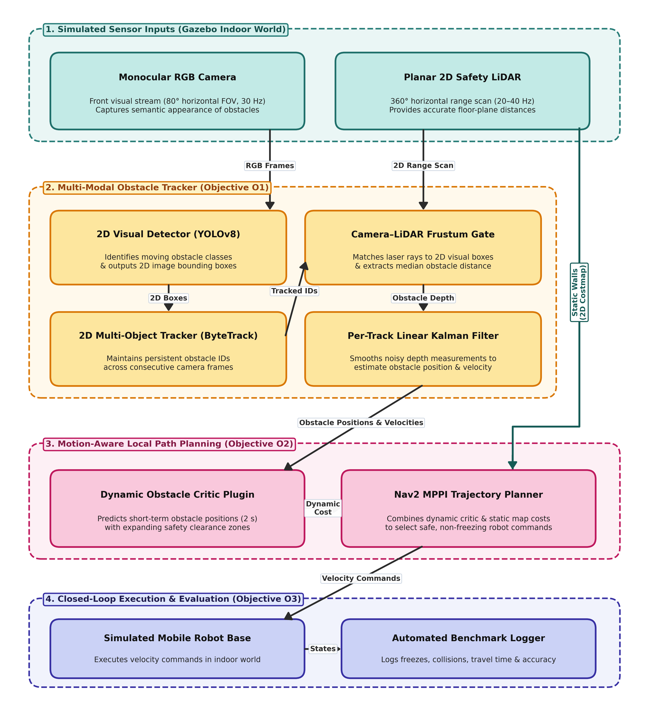
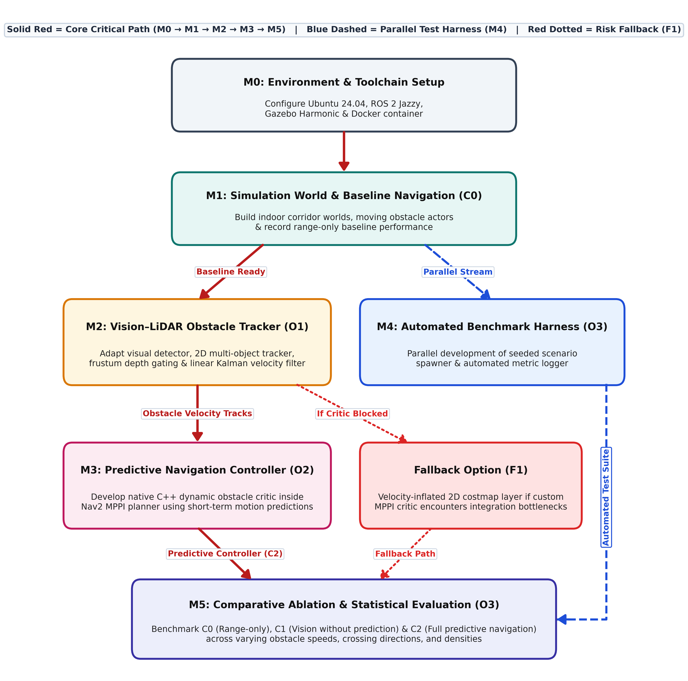
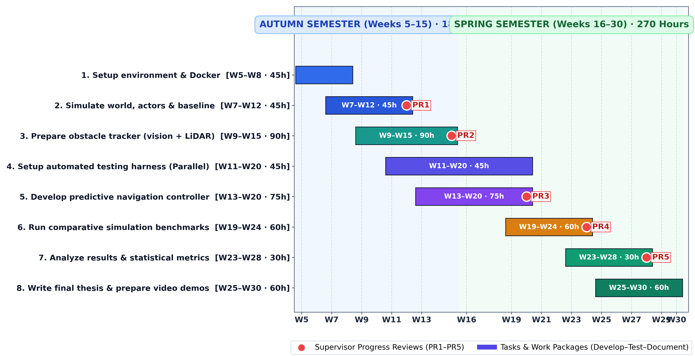

<!-- Slide 1 -->

University of Nottingham &middot; EEEE4077 Mechatronics Project

# Vision-Augmented Mobile Robot Navigation in Dynamic Environments

  Author: <strong>Nicholas Khor Han Le</strong> (ID: 20617556) 
  Supervisor: Dr. Shalini Darmaraju &nbsp;|&nbsp; Moderator: Ir Dr. Daniel Pu

  <strong>The Freezing Problem:</strong> 2D LiDAR treats walking people as static obstacles, causing autonomous mobile robots to freeze or spin erratically in corridors.

  <strong>Vision-LiDAR Fusion:</strong> Monocular camera (YOLOv8 + ByteTrack) + laser depth gating tracks obstacles and calculates real-time velocities via Kalman filter.

  <strong>Predictive MPPI:</strong> Dynamic critic projects obstacle motion 2.0s forward, allowing the robot to steer smoothly behind pedestrians on standard CPU.

---

<!-- Slide 2 -->

6-Step Lifecycle &amp; Fallback Architecture

# Methods and Approach

  <strong style="color: #B91C1C;">Critical Path (Solid Red):</strong> 
  M0 (Docker Setup) &rarr; M1 (Sim &amp; C0 Baseline) &rarr; M2 (Tracker O1) &rarr; M3 (MPPI Critic O2) &rarr; M5 (Statistical Analysis). Builds and verifies core objectives sequentially.

  <strong style="color: #1E40AF;">Parallel Test Harness (Blue):</strong> 
  M4 automated scenario runner built concurrently (W11&ndash;20). Automates Gazebo world resets and rosbag2 logging for unattended 450 batch trials.

  <strong style="color: #B45309;">Fallback Architecture (F1, Dotted Red):</strong> 
  De-risks C++ plugin development: if MPPI critic encounters bottlenecks, dynamic velocity bubbles are injected directly into standard 2D costmaps.

---

<!-- Slide 3 -->
<!-- _class: risk-slide -->

Quantitative Risk Register &middot; Pre- vs Post-Mitigation Ratings

# Risk Management and Mitigation

| ID | Technical Risk Description | Timing | Pre-Score | Mitigation Actions &amp; Fallback Strategy | Post-Score | Shift |
|:--:|:---------------------------|:------:|:---------:|:-------------------------------------------|:----------:|:-----:|
| **R1** | **C++ MPPI critic plugin integration fault or CPU budget overrun** (loop &lt; 20 Hz) | W13–20 | 20 (L4, I5) | • Early minimal C++ prototype in Week 13. • Bounded 2.0s horizon + vectorised rollout scoring. • **Fallback F1:** Velocity bubbles in 2D costmap. | 6 (L2, I3) | **-70%** (Low) |
| **R2** | **Camera–LiDAR projection error or laser ray bleeding on background walls** | W9–15 | 12 (L3, I4) | • Exact sensor transforms from Gazebo SDF. • Median depth filtering inside 2D frustum. • Kalman chi-square innovation outlier rejection. | 4 (L1, I4) | **-67%** (Low) |
| **R3** | **Simulation instability or process crash during 450-trial batch evaluation** | W19–24 | 12 (L3, I4) | • Pinned Docker container for ROS 2 &amp; Gazebo. • Headless Gazebo execution (cuts RAM by 60%). • Automated Python watchdog reset wrappers. | 4 (L1, I4) | **-67%** (Low) |
| **R4** | **Visual occlusion between crossing obstacles causes track ID switching** | W11–15 &amp; W21–24 | 9 (L3, I3) | • ByteTrack two-stage association matches low-confidence occluded boxes. • Kalman velocity coasting up to 1.0s. | 3 (L1, I3) | **-67%** (Low) |

  <strong>Governance Takeaway:</strong> All 4 technical risks mitigated to "Low" residual rating. Pure simulation scope (0% hardware) eliminates all physical Health &amp; Safety hazards.

---

<!-- Slide 4 -->
<!-- _class: gantt-slide -->

Project Timeline &middot; 26 Weeks &middot; 450 Planned Hours &middot; 5 Supervisory Reviews

# Planned Work Schedule (Weeks 5–30)

  

  

    <strong>Workload: 450 Hours Total</strong> 
    Autumn (W5–15): 180h (16.4 h/wk) &middot; Spring (W16–30): 270h (18.0 h/wk)
  

  

    <strong>5 Progress Reviews (PR1–PR5):</strong> 
    PR1 (W11): C0 Baseline &middot; PR2 (W14): Tracker &middot; PR3 (W19): MPPI Critic &middot; PR4 (W23): Batch Runs &middot; PR5 (W27): Thesis Draft
  

  

    <strong>Final Safety Buffer:</strong> 
    Tests finish by W28; final 2 weeks reserved for thesis polishing
  

