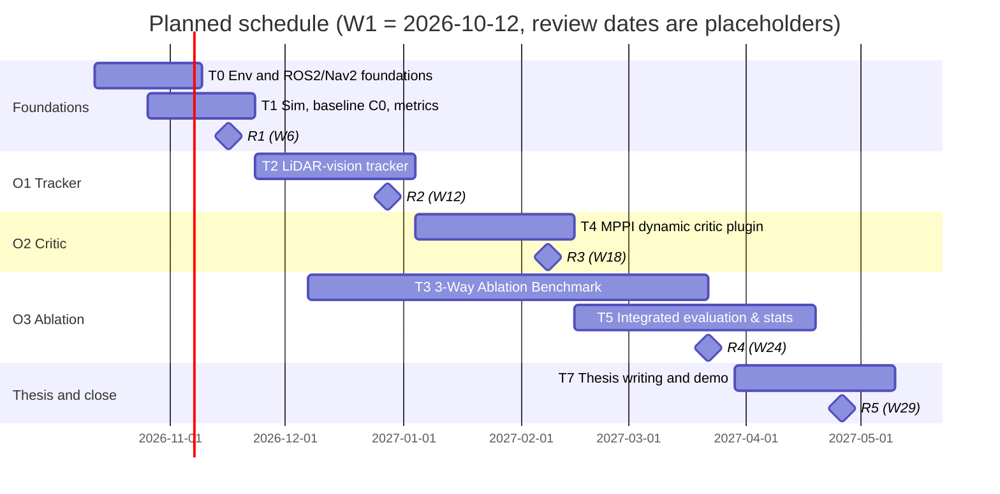

# Project Planning Report

> [!WARNING]
> **OUTDATED DRAFT — UNDER ACTIVE REWORK**  
> This compiled proposal document is currently outdated and is being actively reworked. The authoritative drafting workspace is located in chapters/proposals/. Do not export or submit this file until the rework is finalized and compiled.

**Project title:** Vision-Augmented Mobile Robot Navigation in Dynamic Environments  
**Project code:** SD-MEng-26-01  

| | |
|---|---|
| **Student** | Nicholas Khor Han Le |
| **Student ID** | 20617556 |
| **Supervisor** | Dr. Shalini Darmaraju |
| **Moderator** | Ir Dr. Daniel Pu |
| **Module** | EEEE4077 Mechatronics Project (MEng) |
| **Date** | [submission date] |

> **Formatting note for the Word/PDF export:** use the Moodle title-page template (`raw/Title Page Template for Project Outline and Planning Report.docx`). Body in A4, 12 pt, single-spaced, 2.54 cm margins. The body of Sections 1–6 should come to 7–8 pages. The title page, contents, references and appendix are excluded from that count.

---

## 1. Overview of the Project

### 1.1 Context and need

Transport and logistics was the largest application class for professional service robots in 2024, with 102,900 units sold (+14% on 2023), most of them mobile robots that move goods [1]. Many deployments are *brownfield*. The robot is introduced into an existing plant or warehouse, and people and manual vehicles share the floor with it. To keep cost low, such robots commonly pair a single-plane (2D) LiDAR with the open-source ROS 2 Navigation stack, Nav2 [2], [3]. The stack builds a 2D *costmap*, a grid in which each cell records how dangerous it is to occupy.

This low-cost configuration has two weaknesses.

1. **Freezing around moving traffic.** A 2D LiDAR sees a walking person as two small clusters of points. It cannot report what an object is, which way it is heading or how fast it is moving, so the costmap treats the points as fixed obstacles. The robot halts, backs off or spins in place. This behaviour is documented in the literature as the *freezing robot problem* [4].
2. **Blindness to non-geometric surface hazards.** Reflectivity and 2D ranging alone cannot separate clean floor from a fluid spill, or read painted forklift transit lanes where elevation is zero ($Z \approx 0$). While permanent structural walls and machinery are safely handled with deterministic, hand-drawn CAD maps (Costmap Filters: keepout and speed zones) [5], static CAD maps cannot anticipate transient, unplanned fluid spills (e.g. hydraulic leaks, wash water) that occur during active operations. Laser pulses either disperse via specular reflection or return flat ground reflections, causing the robot to drive across slippery spills and hydroplane.

### 1.2 Aim

> To design, implement and evaluate, in simulation, an open-source ROS 2 navigation framework that combines camera visual information with planar range measurements to track moving obstacles, predict their short-term motion, and avoid robot freezing through predictive local trajectory control, evaluated against range-sensor-based navigation across varying obstacle speeds, patterns, and densities.

The expected outcome is a set of ROS 2 packages, a reproducible evaluation against a measured baseline, and an honest account of where the approach works and where it does not. The project integrates and validates published techniques. It does not claim a new fusion or learning algorithm.

### 1.3 System overview

The online runtime architecture couples a multi-modal tracker and a predictive trajectory critic within Nav2 (Figure 1). 2D multi-object tracking (ByteTrack [9]) associates detections directly in image space, resolving identity persistence across visual occlusions. Extrinsic calibration [10] projects planar LiDAR beams into visual bounding frustums to extract crisp metric range without stereo disparity noise. A per-track linear Kalman filter [11] estimates dynamic obstacle positions and velocities ($x, y, v_x, v_y$), which are propagated across candidate rollout horizons inside a custom dynamic MPPI critic plugin [12], [13].

```mermaid
flowchart LR
  subgraph SEN["Sensors (Gazebo Simulation)"]
    CAM["Monocular RGB Camera (30 FPS)"]
    LID["Planar 2D LiDAR (20 Hz)"]
  end
  subgraph PER["O1 Perception & Tracking Subsystem"]
    DET["2D Object Detector (YOLO)"]
    MOT["2D MOT Tracker (ByteTrack)"]
    GATE["Frustum Gating & Laser Projection"]
    EKF["Per-Track Linear Kalman Filter"]
  end
  subgraph CTL["O2 Nav2 MPPI Predictive Control"]
    CRIT["Dynamic Obstacles Critic Plugin"]
    MPPI["nav2_mppi_controller (20 Hz)"]
    LCM["nav2_costmap_2d (Static Costmap)"]
    BASE["Simulated Mobile Base (cmd_vel)"]
  end
  subgraph EVAL["O3 Ablation Harness"]
    HARNESS["Scenario Runner (Scenarios A–E)"]
    GT["Ground-Truth Metric Logger"]
  end

  CAM --> DET
  DET --> MOT
  MOT -->|"2D Bounding Boxes"| GATE
  LID -->|"LaserScan"| GATE
  LID -->|"LaserScan"| LCM
  GATE -->|"Gated Range Depth"| EKF
  EKF -->|"/tracked_obstacles"| CRIT
  CRIT --> MPPI
  LCM --> MPPI
  MPPI -->|"cmd_vel"| BASE
  BASE -.-> HARNESS
  HARNESS --> GT

  classDef sen fill:#e0f2f1,stroke:#00796b,color:#000;
  classDef per fill:#fff8e1,stroke:#f9a825,color:#000;
  classDef ctl fill:#fce4ec,stroke:#c2185b,color:#000;
  classDef evl fill:#e8eaf6,stroke:#3949ab,color:#000;
  class CAM,LID sen;
  class DET,MOT,GATE,EKF per;
  class CRIT,MPPI,LCM,BASE ctl;
  class HARNESS,GT evl;
```

*Figure 1. System block diagram. Teal indicates sensing, amber indicates perception and tracking, magenta indicates local MPPI control, and blue indicates the evaluation harness.*

**Table 1. Component-level requirements and interfaces.** Dependencies run left to right in Figure 1. Rates are design targets, and sensor rates are verified against simulator parameters.

| Component | Input → output | Rate / latency requirement | Key limitation |
|---|---|---|---|
| Segmenter & 2D Tracker [9] | image → tracked boxes (with IDs), class | ≥ 25 FPS (must exceed LiDAR rate) | Quality depends on detection confidence; ByteTrack handles occlusions in 2D |
| Calibration and gating [10] | tracked boxes + `LaserScan` → metric clusters | Per LiDAR scan (~20 Hz) | Extrinsic error mis-assigns clusters. Camera and LiDAR share the same field of view partly ($80^\circ$ vs $360^\circ$). |
| Per-track Kalman filter [11] | metric clusters → (x, y, vx, vy) per ID | Per scan. Bridges visual dropouts per track. | Constant-velocity assumption fails during aggressive manoeuvres |
| MPPI critic [12], [13] | tracks → dynamic trajectory cost | Inside the controller loop (≥ 20 Hz) | Evaluates forward motion over lookahead horizon ($T \le 2.0\text{ s}$) |

The MPPI controller samples about a thousand candidate trajectories each cycle and scores them with plug-in *critic* functions [13]. Nav2 ships 11 default critics, all of which evaluate obstacles against a static 2D costmap without forward velocity propagation [13], creating the freezing robot pathology.

---

## 2. Specification

The project strictly focuses on three core objectives (**O1–O3**) in software simulation, in direct compliance with the supervisor specification (`SD-MEng-26-01`: HW 0% / SW 60% / Research 40%). Every numeric target is a *hypothesis* with a *minimum* (baseline pass) and an aspirational *target*.

**Test protocol.** Gazebo scenarios with scripted actors provide exact ground truth across varying obstacle speeds ($0.5–2.0\text{ m/s}$), crossing trajectories, and obstacle densities ($1–4$ dynamic agents): (A) a pedestrian crossing a corridor, (B) an oncoming pedestrian, (C) an automated/manual vehicle crossing, (D) multiple crossing pedestrians, (E) a static control. To distinguish the isolated effects of visual information and motion prediction as mandated by the project specification, three configurations are compared in a systematic ablation study: **C0** (Range-only baseline: Nav2 + 2D LiDAR + default static MPPI), **C1** (Vision-augmented detection: 2D LiDAR + Camera detection without velocity prediction), and **C2** (Full proposed framework: 2D LiDAR + Camera + Motion prediction via custom dynamic MPPI critic). Each scenario is run at least 30 times with randomised timing and speeds. Shared random seeds guarantee paired comparisons, with metrics reported as mean $\pm$ 95% confidence intervals.

**Table 2. Specification, justification and test.** Challenge: L = low, M = medium, H = high.

| ID | Requirement | Minimum | Target | Justification | Test and success criterion | Challenge |
|---|---|---|---|---|---|---|
| **O1-a** | Obstacle velocity RMSE at ≤ 8 m | < 0.25 m/s | **< 0.15 m/s** | About 10% of a nominal 1.4 m/s walking speed [14] | RMSE against Gazebo ground truth, ≥ 30 runs per scenario | M |
| **O1-b** | Correct LiDAR–detection association | ≥ 85% | ≥ 95% | Wrong gating gives wrong velocity | Assigned cluster within 0.3 m of ground-truth agent | M |
| **O2-a** | Freezes per 10 crossings | ≥ 50% below C0 | **0** | Freezing is a known failure [4]. C0 baseline hypothesis > 5 per 10, to be measured. | Count controller failures, recovery behaviours and stops > 2 s | H |
| **O2-b** | Route completion time | ≥ 10% shorter | **15–25% shorter** | Time lost to halts and recoveries | Mean ± CI vs C0 baseline | M |
| **O2-c** | Collisions (hard constraint) | 0 | 0 | An improvement that adds collisions is unacceptable | Gazebo contact sensor, any contact fails the run | M |
| **O3-a** | 3-Way Ablation: Statistically significant separation between C0, C1, C2 | $p < 0.05$ | **$p < 0.01$** | Proves isolated contributions of (1) visual identification vs. (2) motion prediction over range-only baseline | Paired Welch's t-test / ANOVA across 30 runs per scenario across speeds ($0.5–2.0\text{ m/s}$) and densities | M |
| **O3-b** | Waiting time: cumulative duration robot remains stationary ($v < 0.05\text{ m/s}$) | ≥ 50% reduction | **≤ 5 s per run** | Quantifies reduction in freezing delays at intersections | Log total seconds with near-zero base velocity during active navigation goals | M |
| **O3-c** | Computational efficiency: end-to-end control loop rate | ≥ 15 Hz | **≥ 20 Hz** | Must exceed LiDAR scan rate (~10 Hz) to guarantee real-time MPPI trajectory generation | Sustained mean execution frequency of perception-to-critic loop over 5-minute runs | L |
| **NF1** | Reproducibility from one launch file in a pinned container | Yes | Yes | Marker and future work can repeat results | Fresh-container run reproduces the headline table | L |

**Attainability and realism.** All work is simulation-based and runs on the available workstation with NVIDIA RTX 4070 Ti Super GPU, matching the supervisor's 0% HW / 60% SW / 40% Research specification. The plan encompasses 450 working hours (Section 6). The specification is ambitious relative to stock Nav2 because it targets zero freezes and statistically validated predictive avoidance using low-cost sensor modalities.

---

## 3. Methodology

**Table 3. Development process.** Each step lists tools, the limitation or challenge, and the extra work it creates for the student.

| Step | Method and tools | Limitation / challenge, and extra work |
|---|---|---|
| **M0 Environment** | Ubuntu 24.04 (dual-boot or WSL2), ROS 2 Jazzy, Gazebo Harmonic, Docker with pinned versions | Host environment setup and GPU drivers. ROS 2 foundations are established. Allow the first four weeks. Jazzy is chosen because Iron is EOL and Humble support ends in May 2027. |
| **M1 Simulation and baseline** | Gazebo world with a corridor and scripted actors, differential-drive robot, `nav2_bringup`, metric logging with `rosbag2` | Building worlds and actors is time-consuming. Keep geometry clean and modular. The baseline C0 must be frozen before any change is judged. |
| **M2 Tracker (O1)** | 2D MOT (ByteTrack [9] via `boxmot`), camera–LiDAR extrinsics (checkerboard method [10]), frustum gating, per-track linear Kalman filter (CV) [11] | Estimator tuning. Calibrate in simulation first, then sweep calibration error to quantify sensitivity. Decoupling 2D MOT eliminates custom combinatorial data association risk. |
| **M3 Critic (O2)** | Custom MPPI critic as a C++ plugin (`pluginlib`), predicted obstacle positions over the preview horizon | **Highest-risk step**: first Nav2 plugin. A small test plugin is written in week 8, ahead of the real work. Fallback: inject predicted positions into the local costmap through a custom layer. |
| **M4 Ablation Test Harness (O3)** | Automated Gazebo scenario generator varying obstacle speeds ($0.5–2.0\text{ m/s}$), crossing angles, and agent densities ($1–4$ dynamic agents) | Orchestrating multi-agent scripted runs with synchronized logging requires robust test harness scripts. |
| **M5 Comparative Analysis (O3)** | `rosbag2`, Python analysis scripts, paired statistics (Welch's t-test / ANOVA), compute latency profiling | Statistical hygiene. Requires systematic data management across hundreds of simulation runs. |

**Interdependencies.** M0 → M1 → M2 → M3 → M5 forms the critical path, because the critic needs tracks and the ablation evaluation needs the critic and test harness. M4 runs in parallel once M1 is complete to prepare the testing infrastructure before controller integration.

**Synthesis.** The method combines well-established parts (calibration, EKF, MPPI, Nav2 plugins) in a way that fits the constraints: simulation only, zero hardware overhead, and standard Nav2 safety layers left intact.

---

## 4. Originality

**Position.** Existing work covers isolated components separately. Camera–LiDAR planar extrinsic calibration [10], 2D multi-object tracking [9], and Bayesian state filtering [11] are established techniques. Recent robotics literature explores advanced MPPI controllers, but primarily focuses on heavy GPU-accelerated continuous Signed Distance Functions for non-convex footprints (EXACT-MPPI), multi-modal rollout clustering via RAPIDS cuML (CSC-MPPI), or analytical Control Barrier Function safety post-filters solved via Quadratic Programming (SE-MPPI). Stock ROS 2 Nav2 offers an extensible MPPI controller [13], yet all shipped critics evaluate time-invariant 2D costmaps at $t=0$, causing controller freezing or blind cross-traffic collisions around dynamic obstacles.

**Table 4. Differentiation from current practice and academic frontiers.**

| Dimension | Stock Nav2 + 2D LiDAR | Academic Research SOTA (GPU / SOTA MPPI) | LiDAR–Camera Tracking | **This Project** |
|---|---|---|---|---|
| Sensors | 2D LiDAR | Multi-channel 3D LiDAR or Stereo rigs ($>\$3,000$) | 2D LiDAR + monocular camera | 2D LiDAR + monocular camera ($\approx \$450$) |
| Dynamic-obstacle tracking | None (Costmap marking at $t=0$) | Raw point clouds or continuous SDFs | 2D/3D tracking without predictive critic | ByteTrack + 2D LiDAR linear Kalman filter |
| Avoidance / Control | Static costmap critics (freezing) | JAX/cuML GPU rollouts or QP-CBF post-filters | Static clearance inflation | Native Nav2 C++ MPPI dynamic critic plugin ($\mathbf{p}_0 + \mathbf{v}\tau$) |
| Compute envelope | Low-power x86 / ARM CPU | Dedicated GPU VRAM / CUDA kernels | CPU or edge GPU | **Standard onboard CPU** ($<0.3\text{ ms}$ SIMD batch evaluation) |
| Empirical validation | Ad-hoc obstacle tests | Monolithic benchmark scores | Isolated tracking accuracy | **Systematic 3-way comparative ablation (C0 vs C1 vs C2)** |

**Types of novelty** (more than one applies): translational systems engineering across domains, open-source architectural extension of Nav2 MPPI without altering core internals, low-cost brownfield sensor complementarity, and rigorous empirical decoupling via 3-way comparative ablation isolating detection from motion prediction.

**Limitations and their effect.**
- **Simulation-first.** Scripted actors move more regularly than real people. Randomised timing, speed ($0.5\text{--}2.0\text{ m/s}$), and crossing offsets reduce this effect, and S2 would test it. The size of the sim-to-real gap is unknown and is not claimed.
- **One camera.** Metric scale comes from planar LiDAR, so tracking operates reliably for targets intersecting the laser scan plane ($10\text{--}20\text{ cm}$ height).
- **Short-term kinematic assumption.** Obstacle prediction relies on a Constant Velocity model valid over preview horizons $\tau \le 2.0\text{ s}$. Complex social intent inference is explicitly out of scope.
- **No safety certification.** Certified functional safety interlocks and safety laser scanner E-stops (ISO 3691-4) remain untouched. Zero collisions is maintained as a hard constraint (O2-c).
---

## 5. Risk Management

Likelihood (L) and impact (I) are scored 1–5, and the score is L×I. A risk is **critical** if its score is ≥ 15. Critical risks are scored before and after mitigation. The table is sorted by score. Impact in weeks is the expected slip without mitigation.

**Table 5. Risk register.**

| ID | Risk | L | I | Score | When | Impact | Mitigation | After |
|---|---|---|---|---|---|---|---|---|
| R2 | First custom MPPI critic (C++) takes much longer than planned | 4 | 5 | **20** | W8 test, W13–W18 | 3–4 wk | Small test plugin in W8. **Fallback:** inject predicted positions via a costmap layer, keeping O2-a/b/c with a different mechanism. | 9 |
| R1 | Toolchain, OS or GPU set-up fails or drifts | 4 | 4 | **16** | W1–W3 | 2–3 wk | Environment spike in W1, dual-boot vs WSL2 decided by end of W1, pinned Docker image | 6 |
| R3 | Scope exceeds time (three core objectives in software simulation) | 4 | 4 | **16** | All | 3–6 wk | Strict focus on software simulation (O1–O3), review gates R1–R5, drop dense crowd scenarios first | 9 |
| R4 | Calibration or association error degrades tracking | 3 | 4 | 12 | W7–W12 | 2 wk | Calibrate in simulation with known extrinsics, sensitivity sweep | 6 |
| R7 | Other modules and exams reduce available hours | 4 | 3 | 12 | Jan, Apr | 2–3 wk | Lighter plan in exam weeks, W30 buffer | 6 |
| R5 | Multi-agent occlusions cause track swapping or ghost tracks | 3 | 3 | 9 | W9–W14 | 1–2 wk | Use ByteTrack two-stage association; enforce strict 0.5s track termination threshold | 4 |
| R6 | Simulation fidelity limits generalisation | 4 | 2 | 8 | W19–W24 | Weaker claims | Randomised scenarios ($0.5\text{--}2.0\text{ m/s}$), arrival offsets, crossing angles | 6 |
| R8 | Code or data loss, results not reproducible | 2 | 4 | 8 | All | 1–2 wk | Git with remote, weekly tags, container image | 4 |
| R9 | Numeric target hypotheses overly ambitious | 3 | 2 | 6 | W19–W24 | Spec failure | Two-tier specification (Minimum vs Target). Transparent reporting of negative results. | 4 |

R2 and R3 are the most likely to change the *specification*, so each is tied to a review gate (Section 6) where the response is decided.

---

## 6. Planned Work Schedule

**Assumptions** (to confirm with the supervisor): week 1 begins Monday 12 October 2026, the plan runs 30 weeks to the week of 3 May 2027, and the workload is about 15 hours per week (about 450 hours). Review dates are placeholders.

**Table 6. Phases, workload and progress reviews.**

| Phase | Weeks | Tasks (hours) | Hours | Expected status at the review |
|---|---|---|---|---|
| A Foundations and baseline | W1–W6 | T0 Environment and ROS 2/Nav2 foundations (50), T1 Simulation world, baseline C0, metric harness (40) | 90 | **R1 (W6, ≈16 Nov):** C0 measured on scenarios A–E, toolchain frozen |
| B Tracker | W7–W12 | T2 O1 tracker (75), T3a O3 benchmark scenario design & scripted actor generator (15) | 90 | **R2 (W12, ≈28 Dec):** velocity RMSE measured, scenario framework ready |
| C Critic and controller | W13–W18 | T4 O2 MPPI dynamic critic C++ plugin (75), T3b O3 ablation logging & metrics (15) | 90 | **R3 (W18, ≈8 Feb):** critic running against C0, ablation harness ready |
| D Multi-scenario ablation | W19–W24 | T3c O3 multi-scenario ablation runs (55), T5 integrated comparative analysis (35) | 90 | **R4 (W24, ≈22 Mar):** 3-way ablation results compiled, statistical tests complete |
| E Synthesis and thesis | W25–W29 | T5b Extended statistical analysis & charts (30), T7 thesis writing and demonstration (45) | 75 | **R5 (W29, ≈26 Apr):** final results, thesis draft complete |
| Close | W30 | T7 final thesis polishing and submission buffer (15) | 15 | Submission |

*Figure 2. Gantt chart.*

- **Dependencies.** T0 → T1 → T2 → T4 → T5 is the critical path. T3 runs in parallel from W9 and joins at T5. Parallel work on T2 and T3 follows from the interdependency analysis in Section 3, and it limits the damage from risks R2 and R5.
- **Links to the specification.** T2 delivers O1-a/b, T4 delivers O2-a/b/c, T3 delivers O3-a/b/c, and T5 checks all of them together.
- **Develop–test–document.** Every task is split about 60% build, 25% test and 15% write-up, and each phase ends with a test and documentation week before its review.
- **Uncertainty.** T4 carries ±3 weeks, T2 and T3 ±2 weeks each. Slips are absorbed first by reallocating effort within T5b, then by the W30 buffer. Core scope is never dropped silently. Any change is raised at the next review.
- **Workload.** Each phase is planned at or near 15 hours per week. Phase E is lighter at 15 hours per week or less for the final thesis.

---

## References

[1] International Federation of Robotics, "World Robotics 2025 – Service Robots," press release, 2025. [Online]. Available: https://ifr.org/ifr-press-releases/news/service-robots-see-global-growth-boom

[2] S. Macenski, F. Martín, R. White and J. Ginés Clavero, "The Marathon 2: A Navigation System," in *Proc. IEEE/RSJ Int. Conf. Intelligent Robots and Systems (IROS)*, 2020. arXiv:2003.00368.

[3] S. Macenski *et al.*, "From the Desks of ROS Maintainers: A Survey of Modern & Capable Mobile Robotics Algorithms in the Robot Operating System 2," *Robotics and Autonomous Systems*, 2023. arXiv:2307.15236.

[4] P. Trautman and A. Krause, "Unfreezing the robot: Navigation in dense, interacting crowds," in *Proc. IEEE/RSJ IROS*, 2010, pp. 797–803, doi:10.1109/IROS.2010.5654369.

[5] G. Williams *et al.*, "Information theoretic MPC for model-based reinforcement learning," in *Proc. IEEE ICRA*, 2017, pp. 1714–1721, doi:10.1109/ICRA.2017.7989202.

[6] Q. Zhang and R. Pless, "Extrinsic calibration of a camera and laser range finder (improves camera calibration)," in *Proc. IEEE/RSJ IROS*, 2004.

[7] S. Thrun, W. Burgard and D. Fox, *Probabilistic Robotics*. Cambridge, MA, USA: MIT Press, 2005.

[8] Y. Zhang *et al.*, "ByteTrack: Multi-Object Tracking by Associating Every Detection Box," in *Proc. European Conference on Computer Vision (ECCV)*, 2022. arXiv:2110.06864.

[9] D. Helbing and P. Molnar, "Social force model for pedestrian dynamics," *Physical Review E*, vol. 51, no. 5, pp. 4282–4286, 1995.

[10] Nav2 Development Team, "Nav2 MPPI Controller: Model Predictive Path Integral Trajectory Optimization," ROS 2 Navigation Stack, 2024. [Online]. Available: https://github.com/ros-navigation/navigation2/tree/main/nav2_mppi_controller

[11] J. M. Kang, "SE-MPPI: Nav2-Native Safe-Escape MPPI Controller with Control Barrier Functions," 2024. [Online]. Available: https://github.com/kjungmo/se-mppi-nav2

[12] C. Peng, "EXACT-MPPI: Exact Signed-Distance Navigation for Arbitrary-Footprint Robots from Point Clouds via Path Integral Control," 2024. [Online]. Available: https://github.com/caseypen/EXACT-mppi

[13] Robot Control and Intelligence Lab (RCILab), "Constrained Sampling MPPI Framework with DBSCAN for Reliable Obstacle Avoidance," in *Proc. IEEE/RSJ IROS*, 2025.

---

## Appendix A: Supervisor-provided project specification

**Project Title:** Vision-Augmented Mobile Robot Navigation in Dynamic Environments  
**Project Code:** SD-MEng-26-01  
**Supervisor:** Dr Shalini Darmaraju  
**Moderator:** Ir Dr Daniel Pu  
**Date:** 19 October 2026  

### Project Description
Autonomous mobile robots need to navigate safely and efficiently in environments containing moving obstacles. Planar range sensors provide distance measurements, while cameras provide visual information that can help identify relevant obstacles. Combining these inputs with obstacle motion estimation can support navigation decisions when obstacles cross or approach the robot’s planned route.

This project aims to develop a simulation-based navigation framework that combines camera information with planar range measurements for obstacle tracking and motion-aware navigation. A mobile robot equipped with simulated sensors will operate in a known indoor environment containing selected types of moving obstacles. Existing visual detection and tracking methods will be adapted and combined with range measurements to estimate obstacle positions and velocities. A simple motion model will predict their short-term positions, which will be incorporated into local path planning and collision avoidance using an existing navigation framework.

The proposed system will be evaluated against range-sensor-based navigation, with additional comparisons to distinguish the effects of visual information and motion prediction. Experiments will vary obstacle speeds, movement patterns and density. Evaluation will assess tracking accuracy, navigation success, collisions, travel time, waiting time and computational efficiency. All development and evaluation will be conducted in simulation, with images and range measurements generated by simulated sensors.

### Target SDG(s)
- **SDG 9:** Industry, Innovation and Infrastructure
- **SDG 8:** Decent Work and Economic Growth

### Project Objectives
1. To review existing methods for vision-augmented mobile robot navigation, camera and range-sensor integration, obstacle tracking and motion prediction.
2. To develop an indoor robot simulation and adapt existing detection and tracking methods to combine simulated camera and planar range measurements for obstacle position and velocity estimation.
3. To develop a navigation framework that incorporates short-term obstacle motion predictions into local path planning and collision avoidance.
4. To evaluate the proposed framework against range-sensor-based navigation under varying obstacle movements and densities, assessing tracking accuracy, navigation performance and computational efficiency.

### Project Deliverables
1. A literature review of vision-augmented mobile robot navigation, camera and range-sensor integration, obstacle tracking and motion prediction methods.
2. A configurable indoor robot simulation and an implemented obstacle detection and tracking system using simulated camera and range measurements, with documented source code.
3. A navigation prototype integrating short-term obstacle motion prediction with local path planning and collision avoidance.
4. Comparative experimental results and analysis of tracking accuracy, navigation success, collisions, travel time, waiting time and computation time, supported by reproducible simulation scenarios and video demonstrations.
5. A final project report documenting the literature review, methodology, system development, evaluation results and conclusions.

### Resource & Effort Breakdown
- **Hardware / Software / Research Ratio:** HW 0% | SW 60% | Research/Investigation/Design 40%
- **Lab Space Requirements:** No dedicated laboratory space; computer workstation only.
- **Supported Software:** Ubuntu Linux with ROS 2, Nav2 and Gazebo; Python or C++ for development; and NumPy and Matplotlib for analysis and visualisation.

