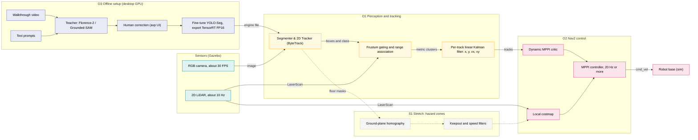
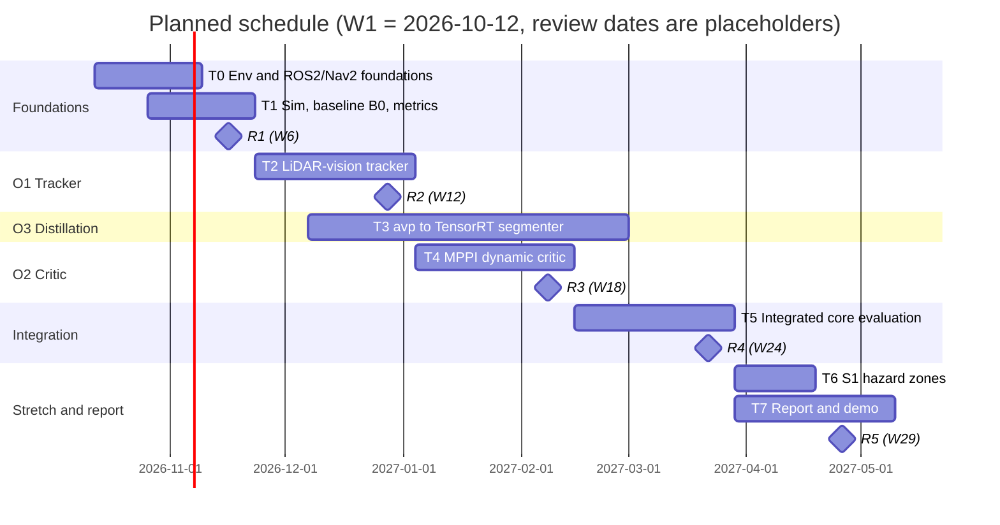

# Project Planning Report

**Project title:** A Rapid-Deployment Visual Context and Dynamic Tracking Pipeline for Cost-Constrained Autonomous Mobile Robots in Brownfield Logistics

| | |
|---|---|
| **Student** | Nicholas Khor Han Le |
| **Student ID** | 20617556 |
| **Supervisor** | Dr. Shalini Darmaraju |
| **Module** | EEEE4077 Mechatronics Project (MEng) |
| **Date** | [submission date] |

> **Formatting note for the Word/PDF export:** use the Moodle title-page template (`raw/Title Page Template for Project Outline and Planning Report.docx`). Body in A4, 12 pt, single-spaced, 2.54 cm margins. The body of Sections 1–6 should come to 7–8 pages. The title page, contents, references and appendix are excluded from that count.

---

## 1. Overview of the Project

### 1.1 Context and need

Transport and logistics was the largest application class for professional service robots in 2024, with 102,900 units sold (+14% on 2023), most of them mobile robots that move goods [1]. Many deployments are *brownfield*. The robot is introduced into an existing plant or warehouse, and people and manual vehicles share the floor with it. To keep cost low, such robots commonly pair a single-plane (2D) LiDAR with the open-source ROS 2 Navigation stack, Nav2 [2], [3]. The stack builds a 2D *costmap*, a grid in which each cell records how dangerous it is to occupy.

This low-cost configuration has two weaknesses.

1. **Freezing around moving traffic.** A 2D LiDAR sees a walking person as two small clusters of points. It cannot report what an object is, which way it is heading or how fast it is moving, so the costmap treats the points as fixed obstacles. The robot halts, backs off or spins in place. This behaviour is documented in the literature as the *freezing robot problem* [4].
2. **Blindness to what the floor means.** Reflectivity alone cannot separate clean floor from a spill, or a forklift lane from a staging bay. Nav2 provides *Costmap Filters* (keepout and speed zones) [5], but the zones have to be authored, which means a site survey and a manual mask, and redone whenever the layout changes.

### 1.2 Aim

> To design, implement and evaluate, in simulation, an open-source ROS 2 pipeline that lets a low-cost 2D-LiDAR robot (a) track moving obstacles with velocity and avoid freezing around them, and (b) learn site-specific floor hazards from a walkthrough video and text prompts in minutes rather than days, compared with standard Nav2 using 2D LiDAR alone.

The expected outcome is a set of ROS 2 packages, a reproducible evaluation against a measured baseline, and an honest account of where the approach works and where it does not. The project integrates and validates published techniques. It does not claim a new fusion or learning algorithm.

### 1.3 System overview

Heavy foundation models run **offline only**, to create training labels. Only a small distilled model, a tracker and a Nav2 plugin run in the control loop (Figure 1). Foundation models such as Florence-2 [6] and Grounded-SAM [7] label images from text prompts without manual annotation. Distilling them into compact navigation components has been shown for social navigation [8]. Here the same idea targets floor hazards and standard Nav2 components.

*Figure 1. System block diagram. Solid arrows are core, dashed are stretch. Colours group sub-systems (blue offline, teal sensing, amber perception, magenta control).*

**Table 1. Component-level requirements and interfaces.** Dependencies run left to right in Figure 1. Rates are design targets, and sensor rates are assumed and will be confirmed against datasheets.

| Component | Input → output | Rate / latency requirement | Key limitation |
|---|---|---|---|
| Segmenter & 2D Tracker [9] | image → tracked boxes (with IDs), class, masks | ≥ 25 FPS (must exceed LiDAR rate) | Quality depends on label quality; ByteTrack handles occlusions in 2D |
| Calibration and gating | tracked boxes + `LaserScan` → metric clusters | Per LiDAR scan (~10 Hz) | Extrinsic error mis-assigns clusters. Camera [10] and LiDAR share the same field of view only partly. |
| Per-track Kalman filter [11] | metric clusters → (x, y, vx, vy) per ID | Per scan. Bridges visual dropouts per track. | Constant-velocity assumption fails during aggressive manoeuvres |
| MPPI critic [12], [13] | tracks → trajectory cost | Inside the controller loop (≥ 20 Hz) | Needs predicted motion over the horizon, which assumes constant velocity |
| Homography → filters (S1) | masks → keepout/speed zones | Event-driven | Valid on planar floor only |

The MPPI controller samples about a thousand candidate trajectories each cycle and scores them with plug-in *critic* functions [13]. This is where velocity information can influence control. Nav2 ships 11 critics (constraint, cost, goal, goal-angle, obstacles, path-align, path-angle, path-follow, prefer-forward, twirling and velocity-deadband), all of which evaluate obstacles against a static 2D costmap without forward velocity propagation [13].

---

## 2. Specification

Requirements are grouped by priority. The **core** objectives (O1–O3) define success. **Stretch** goals (S1, S2) are attempted only if the schedule allows. Every numeric target is a *hypothesis*. Each has a *minimum* (still counts as success) and a *target*. Baselines are measured in the first phase, so none of the targets is assumed from literature.

**Test protocol.** Gazebo scenarios with scripted actors provide exact ground truth: (A) a pedestrian crossing a corridor at 1.0–1.5 m/s, (B) an oncoming pedestrian, (C) a vehicle-like object crossing at 1.5–2.0 m/s, (D) two crossing pedestrians, (E) a control with no dynamic agents. Three configurations are compared: **B0** (Nav2 + 2D LiDAR + default MPPI), **P1** (B0 + O1 + O2) and **P2** (P1 + S1). Each scenario is run at least 30 times with randomised timing and speed. Seeds are shared across configurations for a paired comparison, and results are reported as mean ± 95% confidence interval. The O3 data (training and held-out frames) comes from a real walkthrough video, so segmentation quality is not a simulation-only result.

**Table 2. Specification, justification and test.** Challenge: L = low, M = medium, H = high.

| ID | Requirement | Minimum | Target | Justification | Test and success criterion | Challenge |
|---|---|---|---|---|---|---|
| **O1-a** | Obstacle velocity RMSE at ≤ 8 m | < 0.25 m/s | **< 0.15 m/s** | About 10% of a nominal 1.4 m/s walking speed [citation to be added] | RMSE against Gazebo ground truth, ≥ 30 runs per scenario | M |
| **O1-b** | Correct LiDAR–detection association | ≥ 85% | ≥ 95% | Wrong gating gives wrong velocity | Assigned cluster within 0.3 m of ground-truth agent | M |
| **O2-a** | Freezes per 10 crossings | ≥ 50% below B0 | **0** | Freezing is a known failure [4]. B0 baseline hypothesis > 5 per 10, to be measured. | Count controller failures, recovery behaviours and stops > 2 s | H |
| **O2-b** | Route completion time | ≥ 10% shorter | **15–25% shorter** | Time lost to halts and recoveries | Mean ± CI vs B0 | M |
| **O2-c** | Collisions (hard constraint) | 0 | 0 | An improvement that adds collisions is unacceptable | Gazebo contact sensor, any contact fails the run | M |
| **O3-a** | Video → deployed TensorRT engine, wall-clock | < 60 min | **< 30 min** | Replaces a manual survey and CAD zoning that takes hours to days | Scripted run with per-stage timer on the desktop GPU | M |
| **O3-b** | Segmentation mIoU on held-out real frames | ≥ 0.60 | **≥ 0.70** | Hypothesis, recalibrated after the first label audit | ≥ 200 hand-checked unseen frames | H |
| **O3-c** | Inference rate (TensorRT FP16, RTX 4070 Ti Super) | ≥ 15 FPS | **≥ 25 FPS** | Must exceed the ~10 Hz LiDAR so vision never limits the loop | 5-minute sustained mean | L |
| **S1** | Entries into detected hazard polygons | ≤ 10% of runs | **0%** | This is the purpose of keepout | Runs with spawned hazards, logged polygon entry | H |
| **S2** | Replicate a subset of O1/O2 on a real robot (personal-budget hardware, outside committed scope) | Qualitative | Quantitative | Checks sim-to-real transfer | Repeated crossings on hardware | H |
| **NF1** | Reproducibility from one launch file in a pinned container | Yes | Yes | Marker and future work can repeat results | Fresh-container run reproduces the headline table | L |

**Attainability and realism.** All core work needs only the simulator and the RTX 4070 Ti Super already available. The plan is about 450 working hours (Section 6). The specification is ambitious relative to stock Nav2 because it targets zero freezes and sub-30-minute site adaptation using only a 2D LiDAR, a single camera and a consumer GPU. The tiering means a partial result is still reportable.

---

## 3. Methodology

**Table 3. Development process.** Each step lists tools, the limitation or challenge, and the extra work it creates for the student.

| Step | Method and tools | Limitation / challenge, and extra work |
|---|---|---|
| **M0 Environment** | Ubuntu 24.04 (dual-boot or WSL2), ROS 2 Jazzy, Gazebo Harmonic, Docker with pinned versions | Windows host and GPU drivers. ROS 2 foundations are still being learned. Allow the first four weeks. Jazzy is chosen because Iron is end-of-life and Humble's support ends in May 2027, as the project ends [distribution dates to be confirmed against the ROS 2 release documentation]. |
| **M1 Simulation and baseline** | Gazebo world with a corridor and scripted actors, differential-drive robot, `nav2_bringup`, metric logging with `rosbag2` | Building worlds and actors is time-consuming. Keep geometry simple. The baseline B0 must be frozen before any change is judged. |
| **M2 Tracker (O1)** | 2D MOT (ByteTrack [9] via `boxmot`), camera–LiDAR extrinsics (checkerboard method [10] for real hardware), frustum gating, per-track linear Kalman filter (CV) [11] | Estimator tuning. Calibrate in simulation first, then sweep calibration error to quantify sensitivity. Decoupling 2D MOT eliminates custom combinatorial data association risk. |
| **M3 Critic (O2)** | Custom MPPI critic as a C++ plugin (`pluginlib`), predicted obstacle positions over the horizon | **Highest-risk step**: first Nav2 plugin. A small test plugin is written in week 8, ahead of the real work. Fallback: inject predicted positions into the local costmap through a custom layer so existing critics react. |
| **M4 Distillation (O3)** | Frame sampling, Florence-2 / Grounded-SAM pseudo-labels, human correction in the `avp` interface, YOLO-Seg fine-tune, TensorRT FP16 export | `avp` is an incomplete personal prototype, not yet connected to ROS 2. Environment conflicts are likely, so each stage is a separate script. |
| **M5 Evaluation** | `rosbag2`, Python analysis, paired statistics | Statistical hygiene. Low challenge, but it needs time reserved. |
| **M6 Hazard zones (S1)** | Inverse perspective mapping from camera pose, polygons into `CostmapFilterInfo`, Keepout and Speed filters [5] | Accuracy depends on calibration. Attempted only after M2 and M4. |

**Interdependencies.** M0 → M1 → M2 → M3 → M5 is the critical path, because the critic needs tracks and the evaluation needs the critic. M4 depends only on M0 and joins at M5 and M6. A delay in M3 therefore does not block M4, and the reverse also holds. O2 is evaluated first with the stock detector. Replacing it with the distilled model is one configuration change and is tested again in M5.

**Synthesis.** The method combines well-established parts (calibration, EKF, MPPI, foundation-model labelling) in a way that fits the constraints: simulation first, no foundation model in the loop, and the Nav2 safety layer left unchanged.

---

## 4. Originality

**Position.** Existing work covers the pieces separately. Camera–LiDAR planar extrinsic calibration [10], 2D multi-object tracking [9], and Bayesian state filtering [11] are established techniques. Foundation-model labelling and distillation are active [6]–[8], but the cited navigation example targets social navigation through learned attention maps, not site-specific floor hazards through standard Nav2 components [8]. Nav2 offers keepout and speed filters with authored masks [5] and a plug-in MPPI controller [13] with no velocity-aware critic.

**Table 4. Differentiation from current practice.**

| | Stock Nav2 + 2D LiDAR | Foundation-model navigation research [8] | LiDAR–camera tracking | **This project** |
|---|---|---|---|---|
| Sensors | 2D LiDAR | Camera (richer sensing) | LiDAR + camera | 2D LiDAR + one camera |
| Dynamic-obstacle velocity | No | Implicit in a learned policy | Yes | Yes (ByteTrack + 2D LiDAR linear Kalman filter for MPPI) |
| Site-specific hazard learning | Manual masks | Social cues | No | From a walkthrough video and text prompts |
| Integration with standard Nav2 | Native | Custom planner | Not integrated | Plugin and costmap filters |
| Adaptation effort | Hours to days (hypothesis) | Training run | Re-labelling | Target < 30 min (measured) |

**Types of novelty** (more than one applies): translation of a technique between domains, a new integration technique (velocity-aware critic), a low-cost solution, and a new development approach (prompt-to-deploy, with its cost measured as O3-a). To the best of my knowledge these claims hold for the sources reviewed to date, and a systematic search in the first two weeks will test them.

**Limitations and their effect.**
- **Simulation-first.** Scripted actors move more regularly than real people. Randomised timing and speed reduce this effect, and S2 would test it. The size of the sim-to-real gap is unknown and is not claimed.
- **One camera.** Metric scale comes from the LiDAR, so tracking works only for targets that cross the LiDAR plane.
- **No safety certification.** The Nav2 safety behaviours stay active, and zero collisions is a hard constraint (O2-c).
- **Incomplete prototype.** `avp` reduces effort on O3 but does not remove engineering work.

---

## 5. Risk Management

Likelihood (L) and impact (I) are scored 1–5, and the score is L×I. A risk is **critical** if its score is ≥ 15. Critical risks are scored before and after mitigation. The table is sorted by score. Impact in weeks is the expected slip without mitigation.

**Table 5. Risk register.**

| ID | Risk | L | I | Score | When | Impact | Mitigation | After |
|---|---|---|---|---|---|---|---|---|
| R2 | First custom MPPI critic (C++) takes much longer than planned | 4 | 5 | **20** | W8 test, W13–W18 | 3–4 wk | Small test plugin in W8. **Fallback:** inject predicted positions via a costmap layer, keeping O2-a/b/c with a different mechanism. | 9 |
| R1 | Toolchain, OS or GPU set-up fails or drifts | 4 | 4 | **16** | W1–W3 | 2–3 wk | Environment spike in W1, dual-boot vs WSL2 decided by end of W1, pinned Docker image | 6 |
| R3 | Scope exceeds time (three core objectives plus stretch) | 4 | 4 | **16** | All | 3–6 wk | Core/stretch tiers, review gates, S1 and S2 dropped first, hours logged weekly | 9 |
| R4 | Calibration or association error degrades tracking | 3 | 4 | 12 | W7–W12 | 2 wk | Calibrate in simulation with known extrinsics, sensitivity sweep | 6 |
| R8 | Other modules and exams reduce available hours | 4 | 3 | 12 | Jan, Apr–May (to confirm) | 2–3 wk | Lighter plan in exam weeks, W30 buffer | 6 |
| R5 | Foundation-model label noise lowers segmenter quality | 3 | 3 | 9 | W9–W20 | 1–2 wk | Human correction pass, confidence filtering, hand-labelled held-out set | 4 |
| R6 | Jetson hardware unavailable, so FPS is a desktop figure | 4 | 2 | 8 | W20 | Wording of O3-c | State the platform in every FPS claim. Jetson becomes S2. | 4 |
| R7 | Simulation fidelity limits generalisation | 4 | 2 | 8 | W19–W24 | Weaker claims | Randomised scenarios, real-video evaluation for O3, state the limit | 6 |
| R9 | Hardware ordering delay (S2 only) | 4 | 2 | 8 | W16–W24 | S2 slips | Order by W16. S2 is off the critical path. | 3 |
| R10 | Code or data loss, results not reproducible | 2 | 4 | 8 | All | 1–2 wk | Git with remote, weekly tags, container image | 4 |

R2 and R3 are the most likely to change the *specification*, so each is tied to a review gate (Section 6) where the response is decided.

---

## 6. Planned Work Schedule

**Assumptions** (to confirm with the supervisor): week 1 begins Monday 12 October 2026, the plan runs 30 weeks to the week of 3 May 2027, and the workload is about 15 hours per week (about 450 hours). Review dates are placeholders.

**Table 6. Phases, workload and progress reviews.**

| Phase | Weeks | Tasks (hours) | Hours | Expected status at the review |
|---|---|---|---|---|
| A Foundations and baseline | W1–W6 | T0 Environment and ROS 2/Nav2 foundations (50), T1 Simulation world, baseline B0, metric harness (40) | 90 | **R1 (W6, ≈16 Nov):** B0 measured on scenarios A–D, toolchain frozen |
| B Tracker | W7–W12 | T2 O1 tracker (75), T3a O3 set-up and first labels (15) | 90 | **R2 (W12, ≈28 Dec):** velocity RMSE measured, label audit started |
| C Critic and model | W13–W18 | T4 O2 critic (65), T3b O3 train and export (25) | 90 | **R3 (W18, ≈8 Feb):** critic running against B0, first TensorRT model |
| D Integration and evaluation | W19–W24 | T3c O3 finish and benchmark (30), T5 integrated evaluation of all core objectives (60) | 90 | **R4 (W24, ≈22 Mar):** all core results, S1/S2 go or no-go |
| E Stretch and report | W25–W29 | T6 S1 hazard zones (30), T7 report and demonstration (45) | 75 | **R5 (W29, ≈26 Apr):** final results, report draft |
| Close | W30 | T7 final report, demonstration (15) | 15 | Submission |

*Figure 2. Gantt chart.*

- **Dependencies.** T0 → T1 → T2 → T4 → T5 is the critical path. T3 runs in parallel from W9 and joins at T5 and T6. Parallel work on T2 and T3 follows from the interdependency analysis in Section 3, and it limits the damage from risks R2 and R5.
- **Links to the specification.** T2 delivers O1-a/b, T4 delivers O2-a/b/c, T3 delivers O3-a/b/c, T5 checks all of them together, and T6 delivers S1.
- **Develop–test–document.** Every task is split about 60% build, 25% test and 15% write-up, and each phase ends with a test and documentation week before its review.
- **Uncertainty.** T4 carries ±3 weeks, T2 and T3 ±2 weeks each. Slips are absorbed first by T6 (S1), then by S2, then by the W30 buffer. Core scope is never dropped silently. Any change is raised at the next review.
- **Workload.** Each phase is planned at or near 15 hours per week. Phase E is lighter at 15 hours per week or less for the final report.

---

## References

[1] International Federation of Robotics, "World Robotics 2025 – Service Robots," press release. [Online]. Available: https://ifr.org/ifr-press-releases/news/service-robots-see-global-growth-boom

[2] S. Macenski, F. Martín, R. White and J. Ginés Clavero, "The Marathon 2: A Navigation System," in *Proc. IEEE/RSJ Int. Conf. Intelligent Robots and Systems (IROS)*, 2020. arXiv:2003.00368.

[3] S. Macenski *et al.*, "From the Desks of ROS Maintainers: A Survey of Modern & Capable Mobile Robotics Algorithms in the Robot Operating System 2," *Robotics and Autonomous Systems*, 2023. arXiv:2307.15236.

[4] P. Trautman and A. Krause, "Unfreezing the robot: Navigation in dense, interacting crowds," in *Proc. IEEE/RSJ IROS*, 2010, pp. 797–803, doi:10.1109/IROS.2010.5654369.

[5] Nav2 Documentation, "Navigating with Keepout Zones" and "Navigating with Speed Limits." [Online]. Available: https://docs.nav2.org/rolling/tutorials/general_tutorials/navigation2_with_keepout_filter/navigation2_with_keepout_filter/

[6] B. Xiao *et al.*, "Florence-2: Advancing a Unified Representation for a Variety of Vision Tasks," in *Proc. IEEE/CVF CVPR*, 2024. arXiv:2311.06242.

[7] T. Ren *et al.*, "Grounded SAM: Assembling Open-World Models for Diverse Visual Tasks," arXiv:2401.14159, 2024.

[8] "ViLAM: Distilling Vision-Language Reasoning into Attention Maps for Social Robot Navigation," arXiv:2503.09820, 2025. [authors to be added]

[9] Y. Zhang *et al.*, "ByteTrack: Multi-Object Tracking by Associating Every Detection Box," in *Proc. European Conference on Computer Vision (ECCV)*, 2022. arXiv:2110.06864.

[10] Q. Zhang and R. Pless, "Extrinsic calibration of a camera and laser range finder (improves camera calibration)," in *Proc. IEEE/RSJ IROS*, 2004.

[11] S. Thrun, W. Burgard and D. Fox, *Probabilistic Robotics*. Cambridge, MA, USA: MIT Press, 2005.

[12] G. Williams *et al.*, "Information theoretic MPC for model-based reinforcement learning," in *Proc. IEEE ICRA*, 2017, pp. 1714–1721, doi:10.1109/ICRA.2017.7989202.

[13] Nav2, "Model Predictive Path Integral Controller" (`nav2_mppi_controller`), README and source. [Online]. Available: https://github.com/ros-navigation/navigation2/tree/main/nav2_mppi_controller. Accessed 11 Oct 2026.

---

## Appendix A: Supervisor-provided project specification

**Supervisor:** Dr. Shalini Darmaraju

**Main field:** Autonomous Systems

**Sub-field / keywords:** Path Planning, Robot Navigation, Localization, Obstacle Avoidance

*[Paste the full project description supplied by the supervisor here. Only the field and keywords were available when this draft was prepared.]*

