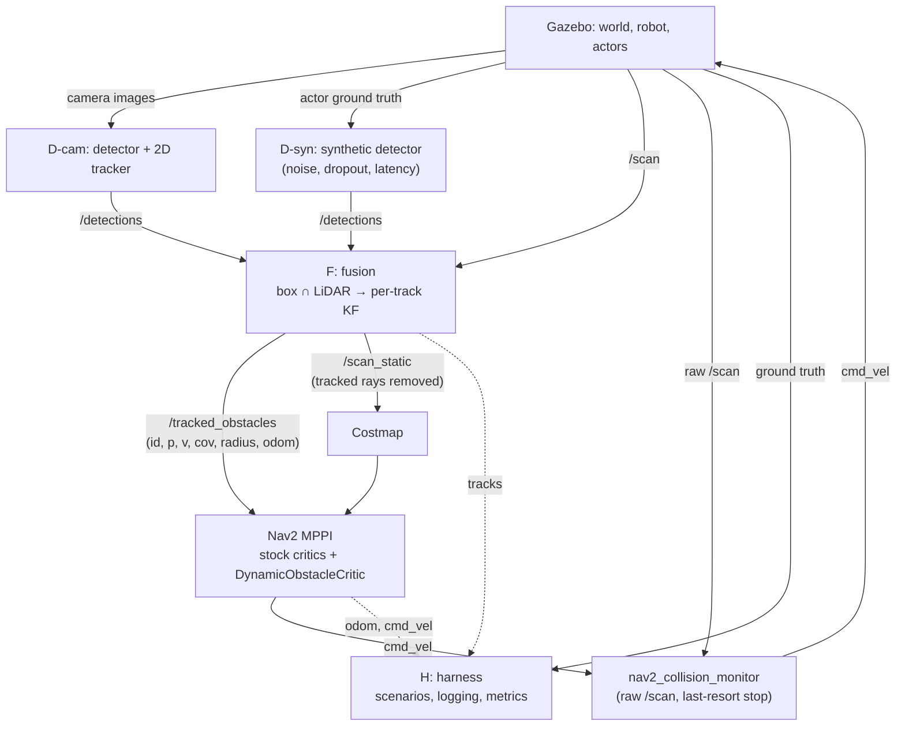

# Design

## 1. Goal (one sentence)

A diff-drive robot following a Nav2 path through narrow, aisle-like space avoids moving people **by reasoning about where they will be**, using LiDAR+camera tracks fed into the MPPI controller — and we can show, with a fair harness, when that beats a properly tuned stock Nav2 MPPI and when it doesn't.

Personal extension (unassessed): the same stack on a real Pi-class robot with a 2D LiDAR and USB camera.

## 2. Premise — what's actually established

| Claim | Status |
|---|---|
| Nav2 MPPI's shipped critics (13 on `main`) read the costmap / path only; none consumes tracked or predicted obstacles | [L1] (Jazzy branch to confirm — Q2) |
| Default MPPI horizon is `time_steps 56 × model_dt 0.05` = 2.8 s; `batch_size` 1000 | [L1] |
| Stock MPPI already reacts to moving obstacles "fluidly" without modelling them | Claimed by Nav2 maintainers [L1][L3]. **Threatens the premise** — the baseline may be good. Q1 |
| Costmap obstacle layers can leave stale marks behind moved obstacles | Community reports only (debt D1). Will be visible in our own baseline runs (Q1) |
| Prediction-aware sampling MPC for dynamic obstacles exists in research | Yes: DRA-MPPI, chance-constrained sampling MPC, a VAR-prediction MPC for Nav2 [L4–L6, leads]. Our angle is not "first", it's **a Nav2-native, measured, deployable version** |

Consequence: the project is not "fix freezing". It's "**does giving MPPI predicted obstacle states help, by how much, under realistic perception error — measured against a tuned baseline**". A partly negative result is a valid result.

**If Q1 shows B0 rarely fails** (decided at M2, not later): (1) look for the regimes where it does — narrow aisles, fast crossers, people entering from outside camera FoV, several agents — and say so openly; (2) shift the headline metrics from "freezes" to efficiency and margin (time to goal, waiting time, minimum separation, smoothness); (3) if P still doesn't beat a tuned B0, that *is* the finding, and the thesis is the harness + an honest analysis of why.

## 3. Assumptions (stated so they can be broken on purpose)

| # | Assumption | Why OK | Tag |
|---|---|---|---|
| A1 | A tuned detector + 2D tracker exists (boxes, IDs, class, confidence) | User's specialty; out of scope | [E] |
| A2 | Obstacles ≈ discs on the floor plane, constant velocity over the horizon | Standard first model; error grows with horizon, so prediction uncertainty must grow too | [E] |
| A3 | Planar world, flat floor, camera–LiDAR extrinsics known | True in sim; calibration is a hardware-track task | [E] |
| A4 | Robot localisation is good enough (AMCL or sim odom) | Not what we're testing; use GT in early runs | [E] |
| A5 | People don't react to the robot (scripted actors) | Makes runs repeatable; reactive humans are a later stress test | [E] |

## 4. Modules and interfaces

| Module | Language | Notes |
|---|---|---|
| **H — harness** | Python | Scenario spec (YAML) → spawn actors → send goal → log GT + robot + tracks → metrics. Built *first*. Everything else is judged by it |
| **D — detector front-end** (two interchangeable implementations, same output topic) | Python | **D-cam**: existing detector + 2D tracker on rendered Gazebo camera images — satisfies the spec, used for tracking-accuracy evaluation and a subset of runs. **D-syn**: projects GT actors through a pinhole model into boxes with noise, dropouts, ID switches, latency **calibrated from D-cam's measured errors** — used for big batches and sweeps on the laptop. Real detector replaces both on hardware |
| **F — fusion** | Python | Box columns → LiDAR bearing window → cluster → range; per-track linear KF `[x y vx vy]` with covariance; publishes tracks in `odom`, extrapolated to stamp. Also publishes `/scan_static` with tracked rays removed; untracked returns pass through (fail-safe) |
| **C — DynamicObstacleCritic** | C++ (pluginlib, `mppi::critics::CriticFunction`) | Per rollout, per step τ: predicted mean `p + vτ`, covariance grows with τ; hard cost if inside `r_robot + r_obs`, soft cost from distance scaled by uncertainty. v1 is minimal; additions only when a measured failure demands them |
| **S — safety** | config | `nav2_collision_monitor` on raw `/scan`, never masked [L2] |

Interface message: custom `TrackedObstacleArray` unless an existing standard message fits (Q6).

### Key design choices and why

Carried over from the proposal phase as reasoning only; any supporting numbers must be re-sourced or measured before they appear in the thesis.

| Choice | Over | Why | Tag |
|---|---|---|---|
| 2D LiDAR + monocular camera | Stereo/RGB-D camera; 3D LiDAR | LiDAR: wide FoV, accurate range, lighting-independent, already on most AMRs. Camera adds identity/semantics cheaply. Stereo depth degrades with distance and on textureless/shiny surfaces; 3D LiDAR costs far more | [E] (degradation/cost figures → debt) |
| Box-gated LiDAR range (project box edges to a bearing window, take LiDAR returns inside it) | Monocular depth networks | Deterministic, cheap on CPU, metric range straight from the sensor; learned depth adds latency, scale drift, domain shift | [E] |
| Track in image space first (detector + 2D tracker), then fuse | Clustering LiDAR points and associating clusters | Image trackers keep identity through partial occlusion and are the student's specialty; avoids building a fragile metric-space association engine | [E] |
| Linear KF, constant velocity, per track | IMM, learned predictors | Simplest model that gives velocity + covariance; upgrade only if measured prediction error demands it | [E] |
| Native Nav2 MPPI critic plugin | Rewriting/forking the controller, external GPU MPPI | Keeps all of Nav2 (costmaps, recoveries, BT) working; one variable changes between B0 and P | [E] |
| Tracked rays removed from costmap; untracked pass through | Leaving people in the costmap too | Otherwise stock critics still treat people as static walls and cancel the critic's effect; pass-through + collision monitor keep a safety floor | [E] |

Sensor and robot parameters (FoV, scan rate, range, footprint, speed limits) are set in M1 from the actual sim config and recorded there, not assumed here.

## 5. Comparison set (what gets measured)

| ID | Configuration | Answers |
|---|---|---|
| **B0** | Stock Nav2 MPPI, raw `/scan`, **tuned** (tuning effort logged) | How good is the honest baseline? |
| **P-GT** | Critic fed ground-truth tracks | Upper bound: is the controller idea worth anything with perfect perception? |
| **P** | Critic fed D-syn → F pipeline (large batches) | Real-ish performance |
| **P-cam** | Critic fed D-cam → F (smaller batches) | Spec-faithful check that P results transfer to image-based perception |
| **P-v0** | P with velocities zeroed (one parameter) | How much comes from *prediction* vs. just *knowing it's a tracked object* |
| **P-sweep** | P under increasing noise / dropout / latency | Where does it break? The edge-case map |
| B1 *(optional)* | Predicted tracks painted into the costmap, stock critics | Would an industry-style costmap-only approach do as well? |

Proposal names map as C0 → B0, C1 → P-v0, C2 → P (names only; old targets are not goals).

Metrics (per run, logged automatically), covering the spec's list:
- **Navigation:** success, collision (GT distance < r_robot + r_obs), minimum separation, time to goal, waiting/freeze time (|v| < threshold while goal active), path length.
- **Tracking accuracy:** position and velocity error vs GT, box↔LiDAR matching rate (P, P-cam).
- **Computation:** critic time per control cycle, controller rate, fusion latency.

Many seeded runs per scenario; report distributions, not single runs [E]. Video recorded for a representative run per configuration (spec deliverable).

## 6. Deliberately out of scope

Detector training/domain adaptation (A1) · 3D perception · new MPPI samplers (only if a measured failure, e.g. mode-averaging head-on, demands it) · SLAM research · anything done only to impress a marker.
