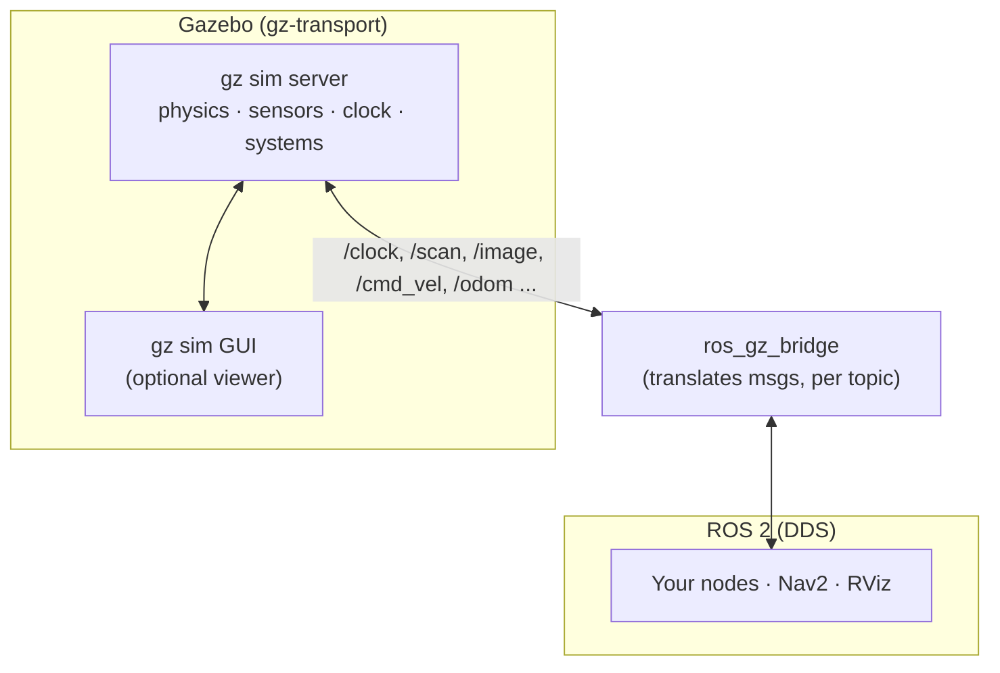

# M1.1 — Gazebo Harmonic, ros_gz_bridge, sim time

Part A is the idea (read once, ~10 min). Part B is the setup you run yourself. Part C is what to bring back.
Facts here are from Gazebo/ROS docs as the agent knows them, tagged `[E]` until we confirm them on your machine. Anything that looks wrong when you run it: note it, that's a finding.

---

## Part A — Concept

### A1. Gazebo is not a ROS program

Gazebo (Harmonic = `gz-sim` 8, the release paired with Jazzy [E]) is a separate simulator with its **own** middleware, `gz-transport`. It doesn't speak DDS, so ROS nodes can't see its topics directly.

It runs as two processes:
- **Server**: physics, sensors, the clock. This is the simulation.
- **GUI client**: only a viewer. You can run the server alone, headless (`gz sim -s`), which is how the M2 harness will run batches.



### A2. Worlds, models, systems

- **World** (`.sdf` file): the scene, meaning ground, walls, lights, actors and robots.
- **Model**: a thing in the world, made of links (with visual + collision shapes) and joints. Your URDF becomes a model when it's spawned.
- **System**: a plugin that gives a world or model behaviour. Physics, the sensor renderer, the diff-drive controller and the joint-state publisher are all systems. A world without the `Sensors` system has sensors that silently publish nothing. That's a classic first bug [E].
- **Actor**: an animated person that walks a scripted trajectory. Actors have visuals but **no collision shape**, so the robot can drive through them [E]. That's why our collision metric will come from ground-truth distance, not from contacts (Q3 tests the LiDAR side).

### A3. ros_gz_bridge

The bridge translates topics one by one. You list each one, with its ROS type, its Gazebo type and a direction:

```
/clock@rosgraph_msgs/msg/Clock[gz.msgs.Clock
^^^^^^ ^^^^^^^^^^^^^^^^^^^^^^^ ^^^^^^^^^^^^^
topic  ROS type                Gazebo type

The character between ROS type and Gazebo type sets the direction:
  [ = gz→ROS     ] = ROS→gz     @ = both
```

If you forget a topic, the data just doesn't appear in ROS. No error. When a topic is "missing", check the bridge config first.

### A4. Sim time: why `/clock` matters

The simulator rarely runs at exactly wall-clock speed. The **real-time factor (RTF)** is sim seconds per wall second: 0.5 means sim runs at half speed. On a weak GPU it will often be below 1.

- Gazebo publishes its own time on `/clock`. Nodes with `use_sim_time:=true` read their clock from that topic instead of the wall clock.
- **Every** node in the system must agree. If one node uses wall time and another uses sim time, timestamps differ by decades. TF then complains about "extrapolation into the future/past" and Nav2 times out.
- If `use_sim_time` is true but `/clock` isn't bridged, the node's time stays at 0 and it waits forever [E].

Rule for the project: **every launch file passes `use_sim_time: true` to every node, and the bridge always carries `/clock`.**

### A5. What you should be able to say after this step

1. Why can't `ros2 topic list` see Gazebo topics without the bridge?
2. What does `[` vs `]` mean in a bridge spec?
3. What breaks if one node has `use_sim_time` false?
4. What is RTF, and what does yours look like on this laptop?

### A6. Symptom → cause (added after the step-1 check)

Two clock problems that look alike:

| Situation | Node's "now" | Symptom |
|---|---|---|
| `use_sim_time: true`, **no `/clock` bridged** | Stuck at **0** (no time source) | Node waits forever: timers don't fire, "waiting for transform", nothing moves. `q3_check.py` prints *"sim time is 0"* for exactly this |
| `/clock` bridged, **one node `use_sim_time: false`** | Wall time (~1.79e9 s since 1970) vs everyone else's sim time (~100 s) | TF "extrapolation" errors, data dropped as too old/new |

One tf2 lookup ("give me frame B in frame A at time t") fails in two ways:

| Failure | Missing | Error text | Typical cause here |
|---|---|---|---|
| **Which frames** | No chain of transforms connects B to A | *"Frame [x] does not exist"*, *"could not find a connection"*, RViz *"queue is full"* | `robot_state_publisher` not running (no `base_link → lidar_link`), or no odometry TF (`odom → base_link`) |
| **When** | Chain exists, but not at time t | *"extrapolation into the future/past"* | One node on wall time; sensor stamp newer than the last odom TF (TF published late or slowly) |

Bridge spec reminder: `topic @ ROS_type X gz_type`. The **first `@` is always just a separator**; only `X` (`[` `]` `@`) is the direction.

---

## Part B — Setup (laptop, Ubuntu 24.04, ROS 2 Jazzy already installed)

### B0. Pre-checks

```bash
# ROS apt repo already configured (it is, since Jazzy is installed). Check for a stray non-ROS Gazebo:
apt list --installed 2>/dev/null | grep -E '^(gz-|libgz|ignition)' || echo "clean"
# OpenGL: Gazebo's ogre2 renderer needs OpenGL >= 3.3
sudo apt install -y mesa-utils && glxinfo -B | grep -E 'renderer|core profile version'
df -h ~ | tail -1   # keep a few GB free
```

You don't need the osrfoundation Gazebo repo. `ros-jazzy-ros-gz` pulls Harmonic in as ROS vendor packages [E]. If B0 shows existing `gz-*` / `ignition` packages, tell me before installing.

### B1. Install

```bash
sudo apt update
sudo apt install -y \
  ros-jazzy-ros-gz \
  ros-jazzy-navigation2 ros-jazzy-nav2-bringup \
  ros-jazzy-xacro ros-jazzy-joint-state-publisher-gui
```

| Package | Why |
|---|---|
| `ros-jazzy-ros-gz` | Gazebo Harmonic + bridge + `ros_gz_sim` (spawn/launch helpers) |
| `ros-jazzy-navigation2`, `nav2-bringup` | Nav2 incl. MPPI controller (needed for Q2 and step 4) |
| `xacro`, `joint-state-publisher-gui` | Step 2 robot description |

Add to `~/.bashrc` if it isn't there already: `source /opt/ros/jazzy/setup.bash`. Open a new terminal afterwards.

### B2. Check Gazebo runs (GUI)

```bash
gz sim --version            # expect 8.x
gz sim -v4 -r shapes.sdf    # -r = start running, -v4 = verbose log
```

- The window shows a few shapes. **Note the RTF** in the bottom-right corner after ~20 s.
- If the window is black or it crashes: try `gz sim -v4 -r --render-engine ogre shapes.sdf` and save the terminal output.

### B3. Check headless + Gazebo's own topics

Terminal 1:
```bash
gz sim -s -r -v4 shapes.sdf          # server only, no GUI
```
Terminal 2:
```bash
gz topic -l                          # Gazebo topics: /clock, /stats, /world/...
gz topic -e -t /clock -n 3           # three clock messages
gz topic -l | grep stats             # then echo that topic once: it carries real_time_factor
```

Compare: is headless RTF higher than with the GUI? That's the first data point for Q4.

### B4. Check the bridge + sim time

Keep the server from B3 running. Terminal 2:
```bash
ros2 topic list                      # /clock is NOT there: no bridge yet
ros2 run ros_gz_bridge parameter_bridge /clock@rosgraph_msgs/msg/Clock[gz.msgs.Clock
```
Terminal 3:
```bash
ros2 topic list                      # now /clock exists
ros2 topic echo /clock --once
ros2 topic hz /clock
```
Then stop the server (Ctrl-C in terminal 1) and watch `/clock` stop. Sim time only exists while the server runs.

### B5. Check Nav2 + the MPPI critic header (Q2 groundwork)

```bash
ros2 pkg list | grep -E 'nav2_mppi_controller|nav2_bringup'
find /opt/ros/jazzy/include -name critic_function.hpp
```
Just confirm the file exists. We read it together at step 5 (Q2).

---

## Part C — Bring back (paste into chat or the milestone file)

1. `gz sim --version` output
2. `glxinfo -B` renderer line
3. RTF with GUI, and RTF headless (B2, B3)
4. Did the `/clock` bridge work first time? Anything that broke, with the error text
5. The path `find` printed in B5
6. Your answers to A5 (rough is fine)

Next step after this: Q3. A fixed LiDAR plus one walking actor in a world file. Does `/scan` see the person?
