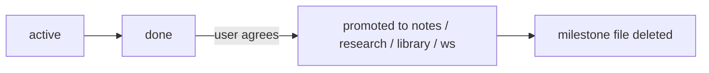

# milestones/ — shared work-in-progress (agent + user)

Half-done work lives here so the rest of `chapters/` and `ws/` only ever hold settled content.

## Lifecycle

- **One file per milestone**, named `<milestone>_<task>.md` (e.g. `M1_sim_nav2.md`). Header line: `status: active|done|planned`.
- Anything goes inside: half-ideas, failed attempts, command output, guesses. **Nothing here is citable or trusted.**
- **Promote** when the task is done and the user agrees:
  - measured numbers → the question's write-up in [`research/`](../../research/README.md) (`[M:<write-up>]`)
  - settled design changes → [`design.md`](../design.md)
  - answered questions → [`questions.md`](../questions.md) *Closed*, pointing to the write-up
  - sources actually read → [`library/register.md`](../../library/register.md)
  - shortcuts and caveats → [`plan.md`](../plan.md) *Parked debt* with a trigger (or *to fix* in the next milestone file if the next step will hit them)
  - concept notes worth keeping → [`lessons/`](../lessons/)
  - one dated line → [`ws/README.md`](../../../ws/README.md) log (this becomes the **logbook**, required at final submission)
- Then delete the milestone file. Git history keeps it if ever needed.

- **Never delete a milestone file that isn't committed.** The agent checks `git log -- <file>` first; git history is the archive, so a deleted-but-committed file is never lost.
- **Promote failures too.** "Tried X, broke because Y, switched to Z" goes into the logbook line, and into the write-up's verdict when it came from an experiment. That's the raw material for the thesis methodology/discussion, so it must survive the milestone file.

## Inboxes: `answer.md` and `assets/` (student → agent)

The student drops things here; the agent sorts them. Neither is a permanent store.

| Inbox | Student does | Agent does |
|---|---|---|
| `answer.md` | Paste answers, terminal output, errors for the current task. Overwrite freely | Reads it, saves anything worth keeping (below), then replaces the content with one line: `processed <date> → <where it went>` |
| `assets/` | Drop screenshots, videos, any media | Moves keepers to `research/<q#>_<name>/media/YYYY-MM-DD_<what>.<ext>`, deletes the rest, **says in chat which was kept/dropped and why** |

**What's worth keeping: tiered by importance.** Test: *would a future reader (you in 3 months, the examiner, or an agent) do something differently because of this?* No → drop it.

| Tier | What | Where it goes |
|---|---|---|
| **Keep** | Run output that produced a number or settled a question; errors/failures that changed a result, design or method; media showing a result | `research/<q#>_<name>/logs/YYYY-MM-DD_<run>.txt` (verbatim, 2-line header) or `media/`, + logbook line. The write-up links here |
| **One line** | Recurring setup/environment gotchas (e.g. conda shadowing ROS Python) | One line in the relevant README/setup note + agent memory. No log, no traceback |
| **Drop** | One-off slips (typo, wrong folder, forgot to source), Q&A / learning answers (clutter: corrected understanding lives in notes) | Nowhere |

Logs are trimmed to what matters: a traceback is kept only if the error itself is the finding.

Experiment folders (same name in both places): runnable code in `ws/experiments/<q#>_<name>/`; write-up, `logs/` and `media/` in `chapters/research/<q#>_<name>/`. Large videos (> ~20 MB): ask before committing; git keeps every version forever [E]. Final demo videos are a spec deliverable; decide their storage at M5.
