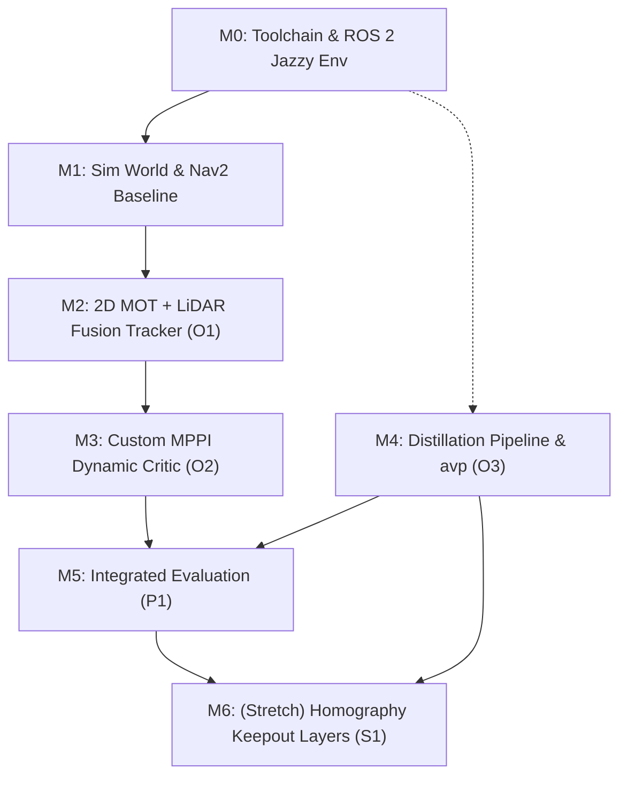

# Project Methodology & Toolchain

## 1. Development Lifecycle Steps

| Step | What | Tools | Limitation / Personal Challenge (Honest Appraisal) |
|---|---|---|---|
| **M0** | Environment setup: Ubuntu 24.04 (dual-boot/WSL2), ROS 2 Jazzy, Gazebo Harmonic, Docker, CUDA/TensorRT | `colcon`, Docker, NVIDIA drivers | Host environment setup; GPU driver passthrough. **Medium**: ROS 2 notes exist (`concepts/ROS2_notes`), but full Nav2 stack not previously deployed end-to-end. |
| **M1** | Simulation environment: differential-drive AMR (TurtleBot 4 / custom URDF), scripted actors, baseline Nav2 | Gazebo Harmonic, `nav2_bringup`, `slam_toolbox` | Constructing realistic warehouse worlds and actor trajectories. **Medium** |
| **M2** | Perception & Tracker: 2D MOT (ByteTrack via BoxMOT), camera-laser calibration, frustum gating, per-track linear Kalman filter (CV) | Python node (`rclpy`), `boxmot`, `tf2`, OpenCV | Estimator tuning across noisy depth reflections. Decoupling association via ByteTrack lowers algorithmic risk to **Medium-Low**. |
| **M3** | Predictive Controller: custom MPPI dynamic obstacle critic plugin | C++, `pluginlib`, `nav2_mppi_controller`, `ament_cmake` | **Highest Risk**: First C++ Nav2 plugin. Spike planned in W8. Fallback F1 defined in risk register. |
| **M4** | Context Distillation: video sampling → Florence-2 / SAM auto-labels → UI curation in `avp` → YOLO-Seg training → TensorRT export | `avp`, PyTorch, Ultralytics, TensorRT | Environment and package version conflicts. `avp` is currently incomplete. **Medium** |
| **M5** | Integration & Benchmarking: ROS 2 bags, automated test suites, metric plots | `rosbag2`, Python, `matplotlib`, `scipy` | Rigorous statistical data hygiene and paired hypothesis testing. **Low** |
| **M6** | (Stretch) Planar homography → polygons → `CostmapFilterInfo` Keepout/Speed layers | OpenCV, Nav2 Costmap Filters | Projection accuracy sensitive to pitch/roll variations. **High** |

---

## 2. Dependency Graph & Parallelism

- **Parallel Workstream:** M4 (Distillation) is decoupled from the runtime navigation pipeline (M1 → M2 → M3). A delay in the C++ MPPI critic (M3) does not block work on vision distillation (M4).
