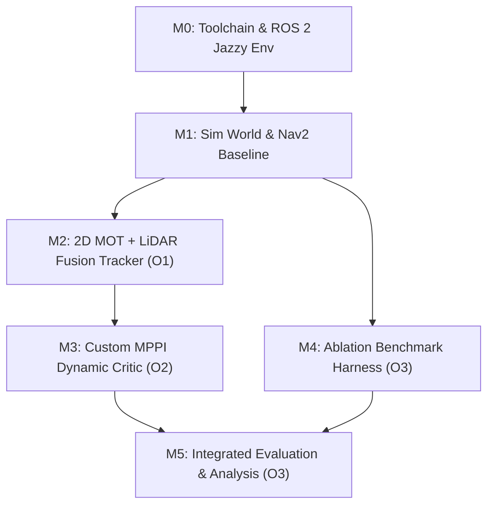

# Project Methodology & Toolchain

> **Purpose**: Development methodology for supervisor review, Project Planning Report (§3), and thesis methodology. Sourced from the technical design in `chapters/research/02_system_architecture.md` and `05_ablation_and_evaluation.md`.

---

## 1. Development Lifecycle Steps

| Step | Task Focus | Tools & Infrastructure | Limitation / Challenge (Honest Appraisal) |
|---|---|---|---|
| **M0** | Environment setup: Ubuntu 24.04 (desktop workstation with RTX 4070 Ti Super), ROS 2 Jazzy, Gazebo Harmonic, Docker | `colcon`, Docker, NVIDIA drivers | Host environment setup; GPU driver passthrough. **Medium**: ROS 2 fundamentals established, but full Nav2 stack not previously deployed end-to-end. |
| **M1** | Simulation environment: differential-drive AMR (TurtleBot 4 / custom URDF), scripted dynamic actors, baseline Nav2 | Gazebo Harmonic, `nav2_bringup`, `slam_toolbox` | Constructing realistic warehouse worlds and dynamic actor crossing trajectories. **Medium** |
| **M2** | Perception & Tracker (O1): 2D MOT (ByteTrack via BoxMOT), camera-laser calibration, frustum gating, per-track linear Kalman filter (CV) | Python / C++ node (`rclpy`), `boxmot`, `tf2`, OpenCV, Eigen3 | Estimator tuning across noisy depth reflections. Decoupling association via ByteTrack in image space lowers algorithmic risk to **Medium-Low**. |
| **M3** | Predictive Controller (O2): custom MPPI dynamic obstacle critic plugin | C++, `pluginlib`, `nav2_mppi_controller`, `ament_cmake` | **Highest Technical Risk**: Developing a native C++ Nav2 plugin. Spike planned in W8. Fallback F1 (velocity-inflated costmap layer) defined in risk register. |
| **M4** | Ablation Benchmark Harness (O3): automated scenario runner, ground-truth metric logger, C0/C1/C2 execution scripts | Python, Gazebo actor plugins, ROS 2 launch, NumPy | Automating batch simulation runs and ground truth logging across varying speeds ($0.5\text{--}2.0\text{ m/s}$) and densities. **Medium** |
| **M5** | Integrated Evaluation & Statistical Analysis (O3): paired hypothesis testing, ANOVA, metric plots, final thesis writing | `rosbag2`, Python, `matplotlib`, `scipy` | Rigorous statistical data hygiene and paired hypothesis testing ($N \ge 30$ runs). **Low** |

---

## 2. Dependency Graph & Parallelism

- **Critical Path:** M0 $\to$ M1 $\to$ M2 $\to$ M3 $\to$ M5.
- **Parallel Workstream:** M4 (Benchmark harness) runs concurrently with M2 and M3 once the simulation environment (M1) is established, ensuring testing infrastructure is ready before controller integration.
- **Strictly Scoped:** All engineering is 100% focused on software simulation in Gazebo Harmonic, eliminating physical hardware procurement delays and non-core research distractions.
