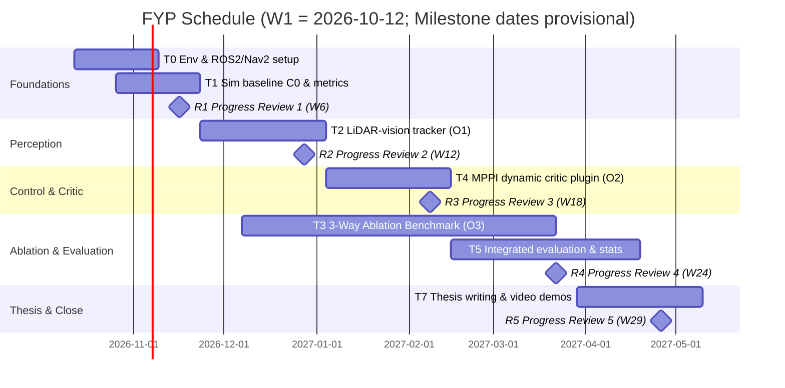

# Planned Work Schedule & Milestone Roadmap

> **Purpose**: Formal project schedule, workload budget, and progress review milestones for supervisor agreement, Project Planning Report (§6), and thesis timeline reflections.

---

## 1. Workload Budget & Phase Overview

- **Total Allocation:** 450 hours across 30 weeks (~15 hours/week).
- **Assumed Start:** Week 1 (Monday 2026-10-12).
- **Supervisor Reviews:** 5 formal review checkpoints agreed across the academic year.

| Phase | Weeks | Tasks & Allocation | Weekly Load | Review Checkpoint |
|---|---|---|---|---|
| **A: Foundations & Baseline** | W1–W6 | **T0:** Toolchain & ROS 2 / Nav2 setup (50 h) **T1:** Sim world, baseline C0, metrics (40 h) | 15 h/wk (90 h) | **R1 W6 (≈16 Nov):** Baseline C0 measured on Scenarios A–D; toolchain frozen. |
| **B: Dynamic Tracker** | W7–W12 | **T2:** O1 LiDAR-vision tracker (75 h) **T3a:** O3 benchmark scenario design & scripted actor generator (15 h) | 15 h/wk (90 h) | **R2 W12 (≈28 Dec):** O1 velocity RMSE measured; scenario framework ready. |
| **C: Controller & Critic** | W13–W18 | **T4:** O2 MPPI dynamic critic C++ plugin (75 h) **T3b:** O3 ablation logging & automated metrics pipeline (15 h) | 15 h/wk (90 h) | **R3 W18 (≈08 Feb):** Critic running vs C0; ablation harness operational. |
| **D: Multi-Scenario Ablation** | W19–W24 | **T3c:** O3 multi-speed, pattern & density ablation runs (55 h) **T5:** Integrated comparative analysis & statistical profiling (35 h) | 15 h/wk (90 h) | **R4 W24 (≈22 Mar):** 3-way ablation results compiled; statistical tests complete. |
| **E: Synthesis & Thesis** | W25–W29 | **T5b:** Extended statistical cross-validation & visual charts (30 h) **T7:** Final thesis writing & demonstration video renders (45 h) | 15 h/wk (75 h) | **R5 W29 (≈26 Apr):** Final draft complete; presentation demo ready. |
| **Close** | W30 | **T7:** Final thesis polishing & submission buffer (15 h) | 15 h (15 h) | **Final Submission** |

**Total Hours:** T0 (50) + T1 (40) + T2 (75) + T3 (85) + T4 (75) + T5 (65) + T7 (60) = **450 hours**.

---

## 2. Gantt Schedule

---

## 3. Workload Management & Buffers

- **Exam & Coursework Windows:** Lighter workloads (5–8 h/wk) are scheduled during January and April exam periods, offset by higher productivity windows in November and February.
- **Contingency Reserve:** Week 30 provides an unallocated 15-hour buffer strictly reserved for document polishing, final proofreading, and submission checks.
