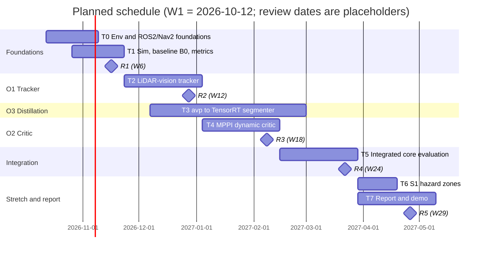

# Engineering Project Proposal

**Project Title:** A Rapid-Deployment Visual Context and Dynamic Tracking Pipeline for Cost-Constrained AMRs in Brownfield Logistics

**Target Domain:** Brownfield Industrial Logistics, Warehouse Automation, Low-Cost Autonomous Mobile Robots (AMRs)

**Core Stack:** ROS 2 (**Jazzy + Gazebo Harmonic proposed**; originally Humble/Iron. Iron is end-of-life, and Humble's support ends 2027-05-31, the same month the project ends. See §14 D1), Nav2 (`nav2_mppi_controller`, Costmap Filters), TensorRT, 2D Planar LiDAR, Monocular RGB Camera, Offline Foundation Models (Florence-2 / Grounded-SAM)

---

## 1. Executive Summary & Problem Statement

### 1.1 The Brownfield Deployment Bottleneck

In brownfield industrial environments (legacy manufacturing plants and mid-tier distribution centers), Autonomous Mobile Robots (AMRs) must operate alongside human foot traffic and manual material handling equipment without the benefit of facility redesigns. To remain economically viable, these platforms avoid multi-thousand-dollar 3D LiDAR arrays and instead rely on single-plane 2D safety LiDARs paired with classical 2D occupancy grids (Nav2 costmaps).

While 2D LiDAR SLAM and static localization (e.g., AMCL, Cartographer) are mature, this architecture exhibits severe operational bottlenecks when deployed in active brownfield environments:

1. **Dynamic Deadlock ("Freezing Robot Problem"):** 2D LiDAR observes dynamic cross-traffic (pedestrians, forklifts, tuggers) only as sparse, disconnected planar point clusters (e.g., two leg cross-sections or isolated wheel hubs). Lacking visual features, the sensor cannot infer object class, heading angle ($\psi$), or velocity vectors. Standard local costmaps mark these points as static obstacles, triggering abrupt emergency halts, recovery rotations, and severe throughput bottlenecks.
2. **Semantic Blindness ("Stuff" vs. Geometry):** Standard 2D occupancy grids evaluate traversability purely through physical reflection. They cannot differentiate between clear epoxy flooring, slick chemical/water puddles, preferred forklift transit corridors, or temporary staging bays. Mitigating this traditionally requires engineering teams to perform laborious site surveys and manually draw static CAD keepout vectors, a process that is fragile and requires complete re-engineering whenever floor layouts shift.

### 1.2 Proposed Solution: Rapidly Deployable Context Augmentation

Rather than replacing existing, robust 2D LiDAR hardware or attempting to solve general unconstrained navigation, this project introduces a **modular, prompt-distilled visual context and tracking pipeline** designed to retrofit low-cost 2D LiDAR AMRs:

* **Zero-Shot Prompt-to-Edge Distillation:** An offline pipeline ingests raw facility walkthrough video and utilizes large Vision-Language Models (VLMs) and segmentation foundation models to auto-label site-specific hazards and operational rules from text prompts (e.g., `"forklift transit lane"`, `"fluid spill"`). This knowledge is distilled into an edge-optimized instance segmenter running on TensorRT.
* **Metric Planar & Kinetic Augmentation:** The edge model feeds into two deterministic online modules:
1. *Semantic Costmap Filters:* Planar floor masks are mapped via homography into Nav2 Costmap Filters as keepout and speed zones without manual CAD drafting.
2. *Metric Sensor Fusion:* Monocular bounding boxes resolve 2D LiDAR identity fragmentation, while 2D LiDAR range gates resolve monocular scale ambiguity, supplying $(x, y, v_x, v_y, \psi)$ obstacle vectors directly into predictive trajectory control (`nav2_mppi_controller`).


---

## 2. System Architecture & Information Flow

The architecture enforces strict decoupling between high-capacity, zero-shot foundation models (offline/setup) and low-latency, deterministic execution on the edge robot (online runtime).

```
                             OFFLINE / ZERO-SHOT SETUP
  [Walkthrough Video] + [Text Prompts] ──► [VLM / Teacher Model (Florence-2 / SAM)]
                                                            │
                                                            ▼ Auto-Generated Pseudo-Labels
                                               [Distillation & Quantization]
                                                            │
════════════════════════════════════════════════════════════╪═════════════════════════════════
                                   ON-ROBOT RUNTIME         ▼
                                              [TensorRT Edge Model: YOLO-Seg]
                                                            │
                       ┌────────────────────────────────────┴───────────────────────────┐
                       ▼ Dynamic Agent BBoxes                                           ▼ Floor Hazard / Lane Masks
 [RGB Camera] ──► [Extrinsic Calib]                                                     │
                       │                                                                ▼
 [2D LiDAR]   ──► [Ray Gating & Depth Association]                             [Planar Homography (IPM)]
                       │                                                                │
                       ▼ Filtered Metric Clusters                                       ▼ Geometry Polygons
              [Multi-Target CTRV / CV EKF]                                     [Nav2 Costmap Filters]
                       │                                                       (Keepout / Speed Limit Zones)
                       ▼ Dynamic States [x, y, vx, vy, ψ]                               │
              [Nav2 MPPI Dynamic Obstacle Critic]                                       ▼
                       │                                                      [Nav2 Local Costmap]
                       └────────────────────────────────────┬───────────────────────────┘
                                                            ▼
                                                [cmd_vel (Base Actuation)]

```

---

## 3. Core Technical Modules

### Module 1: Prompt-Driven Semantic Context Distillation & Costmap Filtering

* **Objective:** Enable rapid, zero-manual-CAD adaptation to site-specific floor context and non-geometric hazards.
* **Offline Distillation Pipeline:**
* Facility operators record a continuous walkthrough video of the operational area.
* An offline pipeline prompts open-vocabulary foundation models (Florence-2 / Grounded-SAM) with domain-specific labels (e.g., `"forklift lane line"`, `"oil slick"`, `"pallet drop zone"`).
* Auto-generated mask annotations are filtered and distilled into a lightweight edge architecture (YOLOv8-Seg / YOLOv11-Seg) quantized to FP16 via TensorRT.


* **Planar Ground-Plane Projection:**
* Edge segmentation contours are projected onto the ground plane using planar Inverse Perspective Mapping (IPM) derived from the camera intrinsic matrix $K$ and extrinsic pose $[R \mid t]$:

$$\begin{bmatrix} X_w \\ Y_w \\ 1 \end{bmatrix} \sim H^{-1} \begin{bmatrix} u \\ v \\ 1 \end{bmatrix}$$


* Projected boundary polygons are converted into the global robot frame via the TF2 transform tree.


* **Nav2 Integration:**
* Polygons are streamed to ROS 2 `nav2_costmap_2d::CostmapFilterInfo` layers, modulating local and global costmaps dynamically as Keepout or Speed Restriction Zones.


### Module 2: Metric LiDAR-Vision Fusion & State Estimation

* **Objective:** Deliver robust metric dynamic obstacle tracking at ranges up to $8\text{ m}$ using existing 2D LiDAR scanners and a low-cost monocular camera.
* **Sensor Association & Depth Anchoring:**
* The camera network outputs 2D bounding boxes and semantic class labels (`Pedestrian`, `Forklift`, `Cart`).
* 2D LiDAR planar range points are mapped to pixel coordinates via camera-laser calibration:

$$\lambda \begin{bmatrix} u \\ v \\ 1 \end{bmatrix} = K \left( R \begin{bmatrix} X_{\text{lidar}} \\ Y_{\text{lidar}} \\ 0 \end{bmatrix} + t \right)$$


* Scan points falling outside the horizontal image span $[u_{\min}, u_{\max}]$ of detected dynamic boxes are eliminated.
* Within each bounding frustum, a median cluster distance filter extracts the primary obstacle reflection, eliminating background wall penetration and assigning an exact metric $(X, Y)$ coordinate to the detected agent.


* **Tracking & State Estimation:**
* An Extended Kalman Filter (EKF) tracks each target's state vector:

$$\mathbf{x}_k = [x, y, v_x, v_y, \psi]^T$$


* Constant Turn Rate and Velocity (CTRV) or Constant Velocity (CV) motion models smooth velocity estimates across visual dropouts and occlusions.


### Module 3: Dynamic Critic for Predictive MPPI Control

* **Objective:** Transform reactive emergency halts into proactive speed yielding and evasive path modifications.
* **MPPI Integration:**
* State estimates $(x, y, v_x, v_y, \psi)$ are fed directly to a custom trajectory evaluation critic inside `nav2_mppi_controller`.
* For each sampled trajectory rollout, the critic projects target obstacle positions forward across the preview horizon ($T = 2.0\text{ s}$):

$$\mathbf{x}_{\text{obs}}(t+\tau) = \mathbf{x}_{\text{obs}}(t) + \mathbf{v}_{\text{obs}} \cdot \tau, \quad \tau \in [0, T]$$


* The critic penalizes rollouts that intersect the forward-propagating collision covariance ellipse, driving the optimizer to proactively yield or swerve around crossing traffic while adhering to Nav2 Costmap Filter boundaries.


---

## 4. Hardware & Software Deliverables

### Hardware Specifications

* **Edge Compute:** NVIDIA Jetson Orin Nano (8GB) or Orin NX (or an equivalent x86 mini-PC with an entry-level mobile GPU).
* **Sensors:**
* 1x Low-cost 2D Planar Laser Scanner (e.g., Slamtec RPLiDAR S2/A3 or industrial safety single-layer scanner).
* 1x Global Shutter Monocular USB/MIPI Camera (1080p, $60^\circ\text{–}90^\circ$ horizontal FoV).


* **Mobile Base:** Differential drive or omnidirectional ROS 2 AMR base (TurtleBot4, custom industrial mobile platform, or Gazebo/Isaac Sim simulation model).

### Software Deliverables

1. **`semantic_context_layer` (ROS 2 Package):**
* Real-time TensorRT segmentation node.
* Planar homography projection node converting pixel masks to `geometry_msgs/msg/PolygonStamped`.
* ROS 2 Costmap Filter publisher for dynamic Keepout and Speed Limit zones.


2. **`lidar_vision_tracker` (ROS 2 Package):**
* Target association node filtering LiDAR ranges through visual bounding frustums.
* Multi-target EKF tracking node publishing dynamic agent state arrays.


3. **`nav2_mppi_dynamic_critic`:**
* Custom dynamic obstacle prediction critic plugin for Nav2 MPPI controller.


4. **Offline Distillation Toolkit:**
* Automated CLI scripts for video ingestion, zero-shot VLM prompting, dataset generation, and TensorRT model compilation.


---

## 5. Evaluation Metrics & Experimental Benchmarks

Validation will be conducted across structured simulation environments (Isaac Sim / Gazebo) and verified on physical hardware:

| Benchmark Category | Metric | Baseline (Standard Nav2 + 2D LiDAR) | Target (Proposed System) |
| --- | --- | --- | --- |
| **Dynamic Cross-Traffic** | Robot Recovery Count (Freezes) | High ($>5$ halts per 10 crossing encounters) | **0 freezes** (smooth yield or trajectory deflection) |
| **Mission Efficiency** | Average Route Completion Time | High variance due to sudden emergency halts | **15–25% reduction** in total route duration |
| **Hazard Compliance** | Keepout Zone Infraction Rate | 100% traversal (unaware of un-mapped floor hazards) | **0% traversal** through detected hazard polygons |
| **Setup & Adaptation** | New Zone Deployment Time | Hours/days (manual CAD drafting & site re-tuning) | **$<30$ minutes** (walkthrough video + text prompting) |
| **Edge Compute** | Real-Time Execution Frame Rate | N/A | **$\ge 25\text{ FPS}$** sustained on edge hardware |
| **State Estimation** | Velocity Vector RMSE | N/A (static costmap) | **$< 0.15\text{ m/s}$** linear velocity error |

---

## 6. Strategic Scope & Methodological Boundaries

* **Decoupling Foundation Models from the Safety Loop:** Running heavy VLMs (e.g., full SAM or multimodal LLMs) directly on an AMR edge computer introduces unacceptable latency ($>500\text{ ms}$). Limiting foundation models to an offline pseudo-labeling role preserves deterministic sub-30ms control loops on the physical robot.
* **Mutual Sensor Augmentation over Standalone Perception:** Pure monocular visual depth suffers from scale drift and optical noise, while 2D LiDAR suffers from identity loss and semantic blindness. Pairing them as mutual anchors (vision provides identity and angle; 2D LiDAR provides ground-truth metric scale) achieves high-fidelity dynamic tracking at minimal sensor cost.
* **Planar Costmap Filters vs. 3D Voxel Reconstruction:** Industrial warehouse floors are predominantly planar surfaces. Projecting segmented visual boundaries directly into 2D Costmap Filters via homography eliminates the high compute and memory overhead of 3D voxel back-projection, maintaining high frame rates on constrained edge compute.


---
---

# PART B: Planning layer (added 2026-10-11)

> **This part and §1–§6 above form the source of truth.** `abstract.md` (supervisor discussion) and `project_proposal.md` (assessed submission) are derived from them. Rubric: `raw/proposals/Project Planning Report MEng Rubric.pdf`. Guide: `raw/proposals/proj_proposal_guide.md`. Citations use the keys (L1…L12) in `literatures.md` §5.

## 7. Scope tiers

| Tier | ID | Item | Maps to §3 module | Depends on |
|---|---|---|---|---|
| **Core** | O1 | LiDAR–vision dynamic-obstacle tracker (`lidar_vision_tracker`) | Module 2 | Sim baseline (T1) |
| **Core** | O2 | Velocity-aware MPPI critic (`nav2_mppi_dynamic_critic`) | Module 3 | O1 |
| **Core** | O3 | Prompt-to-edge distillation toolkit and segmenter (extends own prototype `avp`, <https://github.com/cupcakes04/avp>) | Module 1 (offline half) | Independent of O1/O2 |
| Stretch | S1 | Planar homography → Nav2 Keepout/Speed filters (`semantic_context_layer`) | Module 1 (online half) | O3 |
| Stretch | S2 | Physical-robot / Jetson validation. Personal-budget hardware, outside committed scope. | All | O1–O3 |

Out of scope: fleet management, SLAM/localisation research, running foundation models on the robot, 3D reconstruction, safety certification.

## 8. Specification (SMART)

All numeric targets are **hypotheses**. "Minimum" is the lowest outcome that still counts as meeting the requirement. "Target" is the aim. Baselines are measured in Phase A (T1). Difficulty is the expected challenge: **L**ow, **M**edium or **H**igh.

| ID | Requirement | Minimum | Target | Why this number | Test and success criterion | Diff. |
|---|---|---|---|---|---|---|
| **O1-a** | Tracked-obstacle velocity RMSE at ≤ 8 m | < 0.25 m/s | **< 0.15 m/s** | About 10% of a nominal walking speed (~1.4 m/s, **citation pending**). Gazebo ground truth is exact. | ≥ 30 randomised crossings per scenario. RMSE of |v_est − v_true| over frames where the target is tracked. | M |
| **O1-b** | Association: fraction of dynamic-agent detections assigned the correct LiDAR range | ≥ 85% | ≥ 95% | Wrong gating gives wrong velocity. | Compare the assigned cluster with the ground-truth agent position (< 0.3 m). | M |
| **O2-a** | Freezes (Nav2 recovery or halt events) per 10 crossings | ≥ 50% below baseline | **0** | Baseline hypothesis > 5 per 10 (**unsourced; measure it**). L1 shows freezing is a known failure. | Count `controller_server` failures, recovery BT activations, and stops > 2 s. Paired runs, same seeds. | H |
| **O2-b** | Mean route completion time | ≥ 10% shorter | **15–25% shorter** | Freezing costs time. A 15–25% gain is the working hypothesis. | Mean ± 95% CI over ≥ 30 runs vs baseline B0. | M |
| **O2-c** | Safety: collisions (hard constraint) | 0 | 0 | An improvement that adds collisions is unacceptable. | Gazebo contact sensor. Any collision fails the run. | M |
| **O3-a** | Setup time: walkthrough video → deployed TensorRT engine (wall-clock, excluding recording) | < 60 min | **< 30 min** | Replaces hours or days of manual CAD zoning. Target is hypothesis-driven. | Scripted end-to-end run on the RTX 4070 Ti Super. Timer logs each stage. | M |
| **O3-b** | Segmentation agreement with human-corrected labels (mIoU) on held-out frames | ≥ 0.60 | **≥ 0.70** | **Hypothesis**. Recalibrate after the first label audit (W10). | ≥ 200 hand-checked frames, unseen during training. | H |
| **O3-c** | Inference rate on target GPU (TensorRT FP16) | ≥ 15 FPS | **≥ 25 FPS** | Must exceed the LiDAR rate (~10 Hz, typical for this scanner class) so vision is never the bottleneck. | Sustained mean over 5 min. | L |
| **S1** | Hazard-polygon infractions | ≤ 10% of runs | **0%** | Keepout is the point of the feature. | Runs in worlds with spawned hazards; log entry into the polygon. | H |
| **S2** | Hardware replication of a subset of O1/O2 | Qualitative | Quantitative | Best-effort. | A few repeated crossings on the real robot. | H |
| **NF1** | Reproducibility: one launch file + pinned container reproduces every result | Yes | Yes | Needed for the marker and for later work. | Fresh-container run reproduces the headline table within tolerance. | L |

## 9. Evaluation protocol

- **Scenarios (Gazebo Harmonic, scripted actors for ground truth):** A perpendicular pedestrian crossing in a corridor (1.0–1.5 m/s). B oncoming pedestrian. C vehicle-like object crossing (1.5–2.0 m/s). D two crossing pedestrians. E control with no dynamic agents, to check nothing regresses.
- **Configurations:** **B0** = Nav2 + 2D LiDAR + default MPPI critics (baseline, pinned parameters). **P1** = B0 + O1 + O2. **P2** = P1 + S1 (if delivered).
- **Randomisation:** crossing time ±, agent speed, start offsets. ≥ 30 runs per scenario per configuration. Fixed seeds are shared across configurations (paired comparison). Report mean ± 95% CI.
- **O3 data:** a real walkthrough video (phone or camera) for the dataset. Held-out frames are also real. Simulation is not used for O3 quality, which avoids a sim-only claim.
- **MPPI horizon:** the Nav2 default is 56 steps × 0.05 s = 2.8 s (L11). §3 Module 3 assumes T = 2.0 s. Choose and justify one value in T4.

## 10. Methodology and tools

| Step | What | Tools | Limitation / challenge for me (honest) |
|---|---|---|---|
| M0 | Environment: Ubuntu 24.04 (dual-boot or WSL2), ROS 2 Jazzy, Gazebo Harmonic, Docker, CUDA/TensorRT | `colcon`, Docker | Windows host; GPU passthrough and drivers. **Medium**: ROS 2 notes exist (`concepts/ROS2_notes`), but I haven't built a full Nav2 pipeline yet. |
| M1 | Sim world, differential-drive robot (TurtleBot 4 sim or custom URDF), scripted actors, baseline Nav2 | Gazebo, `nav2_bringup`, `slam_toolbox` (mapping only) | Building the world and actors takes time. Keep it simple (corridor + crossing). **Medium** |
| M2 | Calibration (known extrinsics in sim, checkerboard method for real), frustum gating, multi-target EKF (CV, then CTRV if justified) | Python or C++ node, `tf2`, OpenCV | Estimator tuning. **Medium** |
| M3 | Custom MPPI critic plugin (C++, pluginlib) | Nav2 source, `ament_cmake` | **Highest risk**: first C++ plugin. Spike in W8. Fallback in §12 R2. |
| M4 | Distillation: frame sampling → Florence-2/Grounded-SAM pseudo-labels → human correction (UI in `avp`) → YOLO-Seg fine-tune → TensorRT FP16 export | `avp`, PyTorch, Ultralytics, TensorRT | Environment conflicts. `avp` is incomplete and not ROS-aware. **Medium** |
| M5 | Integration and evaluation: ROS 2 bags, metric scripts, tables and plots | `rosbag2`, Python, matplotlib | Statistics hygiene. **Low** |
| M6 | (Stretch) IPM homography → polygons → `CostmapFilterInfo` + Keepout/Speed filters | OpenCV, Nav2 filters | Calibration quality dominates. **High** |

**Dependencies:** M1 → M2 → M3 → M5. M4 is independent until M5 and M6. This is the main source of parallelism. A slow M3 does not block M4.

## 11. Originality

Scoped to the best of my knowledge from `literatures.md`. A systematic search is planned for W1–W2, so these claims stay provisional until then.

1. **Translation:** foundation-model auto-labelling and distillation (L6, L7, L8) is moved from social-navigation or rich-sensor settings to **site-specific hazards on a 2D-LiDAR AMR using standard Nav2 components**.
2. **Technique and integration:** a **velocity-aware critic for Nav2 MPPI**. The 11 critics shipped on `main` do not use predicted obstacle motion (L11, checked by file names on 2026-10-11).
3. **Low-cost:** the pipeline needs only a 2D LiDAR, a monocular camera and a consumer GPU (L9 shows the commercial scale of the segment).
4. **Development approach:** a **prompt-to-deploy** workflow whose cost I will measure (O3-a). The originality is the process as well as the artefact.

**Acknowledged limitations** (rubric: limitations should be discussed and quantified where possible):
- Simulation-first, with scripted pedestrians that move more regularly than real people. Sim-to-real degradation is **not yet quantified**. S2 is the planned check. Randomised timing and speed limit the effect.
- Single camera, so no depth from vision. Metric scale comes from the LiDAR, which limits the system to targets inside the LiDAR plane.
- No safety certification. The Nav2 collision-avoidance layer stays in the loop.
- `avp` is incomplete, so O3 needs engineering work as well as research.

## 12. Risk register

Scales: L = likelihood 1–5, I = impact 1–5, score = L×I. **Critical** = score ≥ 15, so it is rated before and after mitigation. Impact in weeks is the expected slip with no mitigation.

| ID | Risk | L | I | Score | When | Impact if it happens | Mitigation | Post L×I |
|---|---|---|---|---|---|---|---|---|
| R1 | Toolchain/OS/GPU set-up fails or drifts (Ubuntu + ROS 2 Jazzy + Gazebo + TensorRT, Windows host) | 4 | 4 | **16** | W1–W3 | 2–3 wk | Environment spike in W1. Decide dual-boot vs WSL2 by end W1. Pinned Docker image. | 2×3 = 6 |
| R2 | Custom MPPI critic (first C++ Nav2 plugin) takes much longer than planned | 4 | 5 | **20** | W8 spike, W13–W18 | 3–4 wk | "Hello-critic" spike in W8. **Fallback F1:** feed predicted obstacle positions into the local costmap through a custom layer so the stock critics react, which keeps O2-a/b/c but changes the mechanism. | 3×3 = 9 |
| R3 | Scope exceeds the time (three core objectives + stretch) | 4 | 4 | **16** | Whole project | 3–6 wk | Core/stretch split. Stage gates R1–R5. Drop S1 then S2 first. Hours logged weekly. | 3×3 = 9 |
| R4 | Camera–LiDAR calibration/association error degrades tracking | 3 | 4 | 12 | W7–W12 | 2 wk | Calibrate in sim first (known extrinsics). Run an error-sweep experiment. Report sensitivity. | 2×3 = 6 |
| R5 | Foundation-model label noise lowers segmenter quality | 3 | 3 | 9 | W9–W20 | 1–2 wk | Human-correction pass in the `avp` UI. Confidence filtering. Hand-labelled held-out set. | 2×2 = 4 |
| R6 | Target edge hardware (Jetson) unavailable, so FPS is measured on the desktop GPU only | 4 | 2 | 8 | W20 | Spec wording | State clearly that FPS is measured on the RTX 4070 Ti Super. Jetson is S2. | 4×1 = 4 |
| R7 | Sim fidelity/generalisation (scripted agents) | 4 | 2 | 8 | W19–W24 | Weaker claims | Randomised scenarios. Real-footage O3 evaluation. State the limitation. | 3×2 = 6 |
| R8 | Competing workload (other modules, exams) | 4 | 3 | 12 | Jan, Apr–May (to confirm) | 2–3 wk | Lighter plan in exam weeks. Buffer in W30. | 3×2 = 6 |
| R9 | Hardware ordering delay (S2) | 4 | 2 | 8 | W16–W24 | S2 slips only | Order by W16. S2 is off the critical path. | 3×1 = 3 |
| R10 | Data/code loss or irreproducible results | 2 | 4 | 8 | Whole project | 1–2 wk | Git with a remote. Weekly tag. Container image. | 1×4 = 4 |
| R11 | Targets unrealistic (hypotheses) | 3 | 2 | 6 | W19–W24 | Spec wording | Minimum and Target tiers. Report honestly. | 2×2 = 4 |

## 13. Schedule and workload

**Assumptions (placeholders, confirm with the supervisor):** W1 = week of Mon 2026-10-12. 30 weeks, W30 = week of 2027-05-03. About 15 h/week, so about 450 h. Five progress reviews (dates are placeholders). Holidays and exam weeks are unknown and are handled by buffers.

| Phase | Weeks | Tasks (hours) | Load | Review at end |
|---|---|---|---|---|
| A: Foundations and baseline | W1–W6 | T0 Env + ROS 2/Nav2 foundations (50), T1 Sim world, baseline B0, metric harness (40) | 90 h (15/wk) | **R1 W6 (≈16 Nov)**: baseline B0 measured on A–D; toolchain frozen |
| B: Tracker | W7–W12 | T2 O1 tracker (75), T3a O3 setup + first labels (15) | 90 h | **R2 W12 (≈28 Dec)**: O1 RMSE measured; label audit started |
| C: Critic and model | W13–W18 | T4 O2 critic (65), T3b O3 train + export (25) | 90 h | **R3 W18 (≈8 Feb)**: critic running vs B0; first TensorRT model |
| D: Integration and evaluation | W19–W24 | T3c O3 finish and benchmark (30), T5 Integrated core evaluation (60) | 90 h | **R4 W24 (≈22 Mar)**: all core results; S1/S2 go/no-go |
| E: Stretch and report | W25–W29 | T6 S1 zones (30), T7 Report and demo (45) | 75 h | **R5 W29 (≈26 Apr)**: final results; report draft |
| Close | W30 | T7 Final report, demo (15) | 15 h | Submission |

- **Task totals:** T0 50, T1 40, T2 75, T3 70, T4 65, T5 60, T6 30, T7 60, so 450 h.
- **Develop–test–document cycle:** each task is split about 60% build, 25% test, 15% write-up.
- **Dependencies:** T0 → T1 → T2 → T4 → T5. T3 runs in parallel from W9 and joins at T5 and T6. T7 runs throughout.
- **Uncertainty:** T4 ±3 wk, T2 ±2 wk, T3 ±2 wk. Slips are absorbed first by T6 (S1), then by S2, then by the W30 buffer. Core scope is never reduced silently. Any drop is raised at the next review.



> Bars start on the Monday of their first week. Review milestones sit at the start of the review week (W6, W12, W18, W24, W29), as in the phase table. All dates are placeholders until agreed with the supervisor.

## 14. Decisions and open items

**Decisions taken in this revision (change if you disagree):**
- **D1 Stack:** propose ROS 2 **Jazzy + Gazebo Harmonic** (Iron is EOL, and Humble ends in May 2027, the same month the project ends). Primary-source dates still need verification (`literatures.md` §5).
- **D2 Simulator:** **Gazebo Harmonic is primary.** Isaac Sim is dropped from committed scope to reduce setup risk. It can return as stretch.
- **D3 Metrics:** each target now has a Minimum and a Target tier (§8). Your original numbers are kept as Targets.
- **D4 FPS target:** measured on the RTX 4070 Ti Super. "Edge" claims need S2 hardware.
- **D5 O3 data:** real walkthrough video, not simulation, so O3 quality is not a sim-only result.

- **D6 Detector dependency:** O1 starts with a stock COCO-trained detector (person, vehicle) so it does not wait for O3. Swapping in the distilled O3 model is a configuration change that is re-tested in T5.

**Open items before submission:**
1. Confirm real dates (start, five review dates, submission) and weekly hours with Dr. Shalini Darmaraju.
2. Paste the supervisor-provided project description into Appendix A.
3. Close the primary-source gaps in `literatures.md` §5, especially the citation for walking speed.
4. Decide Ubuntu dual-boot vs WSL2 (R1).
5. Check whether `avp` can run end to end on any dataset (needed for O3 planning). No result is cited yet.