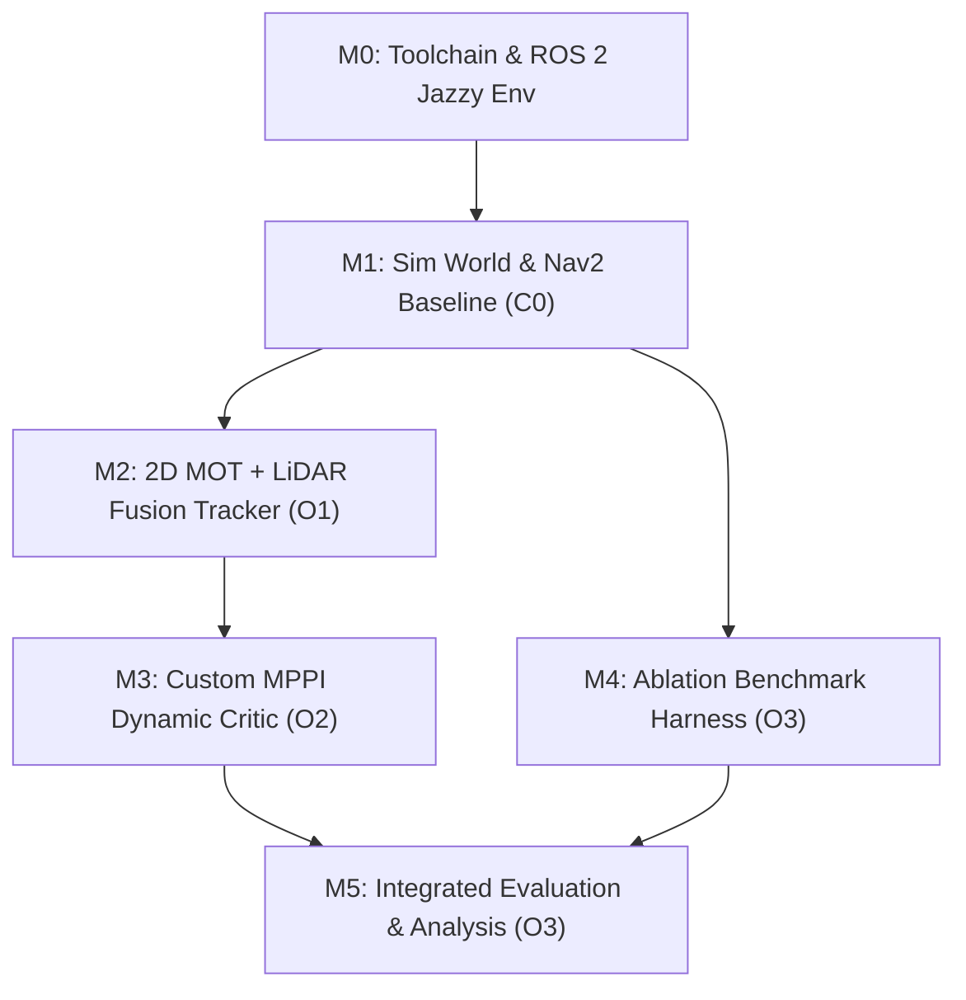

# Project Methodology & Toolchain

> **Purpose**: Development methodology for supervisor review, Project Planning Report (§3), and thesis methodology. Sourced from the technical design in `chapters/research/02_system_architecture.md`, `05_ablation_and_evaluation.md`, and module guidance in `raw/proposals/`.

---

## 1. Research Methodology & Experimental Approach

The project adopts a **quantitative, experimental simulation-based engineering methodology**:
- **Controlled Comparative Ablation:** Rather than evaluating the system on an isolated benchmark, the research systematically decouples visual object detection from temporal motion prediction through a 3-way comparative ablation:
  - **C0 (Baseline):** Stock Nav2 with 2D LiDAR and static costmap critics (Trautman & Krause [L1] baseline).
  - **C1 (Detection Only):** 2D LiDAR + Camera visual tracking, but treating obstacles as static clearance cylinders ($t = 0$) without forward velocity extrapolation.
  - **C2 (Full Predictive Framework):** 2D LiDAR + Camera visual tracking + predictive MPPI dynamic obstacle critic evaluating forward velocity projection ($\tau \in [0, 2.0]\text{ s}$).
- **Paired Randomized Trials:** Each evaluation scenario (crossing pedestrians, oncoming traffic, multi-agent density) is repeated $\ge 30$ times using identical pseudo-random seeds across C0, C1, and C2.
- **Statistical Rigor:** Hypotheses are evaluated using paired Welch's t-tests and one-way ANOVA, reporting 95% confidence intervals across all primary performance metrics.

---

## 2. Development Lifecycle Steps

| Step | Task Focus | Tools & Infrastructure | Limitation / Challenge & Risk Management |
|---|---|---|---|
| **M0** | Environment setup: Ubuntu 24.04 (desktop workstation with RTX 4070 Ti Super), ROS 2 Jazzy, Gazebo Harmonic, Docker | `colcon`, Docker, NVIDIA drivers | Host environment setup; GPU driver passthrough. **Medium**: ROS 2 fundamentals established; full Nav2 stack requires clean environment isolation. |
| **M1** | Simulation environment: differential-drive AMR (TurtleBot 4 / custom URDF), scripted dynamic actors, baseline Nav2 | Gazebo Harmonic, `nav2_bringup`, `slam_toolbox` | Constructing realistic warehouse worlds and dynamic actor crossing trajectories. Baseline C0 must be frozen and logged before introducing new code. **Medium** |
| **M2** | Perception & Tracker (O1): 2D MOT (ByteTrack via BoxMOT), camera-laser calibration, frustum gating, per-track linear Kalman filter (CV) | Python / C++ node (`rclpy`), `boxmot`, `tf2`, OpenCV, Eigen3 | Estimator tuning across noisy depth reflections. Decoupling association via ByteTrack in 2D image space eliminates fragile 3D point clustering risk. **Medium-Low** |
| **M3** | Predictive Controller (O2): custom MPPI dynamic obstacle critic plugin | C++, `pluginlib`, `nav2_mppi_controller`, `ament_cmake` | **Highest Technical Risk**: Developing a native C++ Nav2 plugin. Spike planned in W8. Fallback F1 (velocity-inflated costmap layer) defined in risk register. |
| **M4** | Ablation Benchmark Harness (O3): automated scenario runner, ground-truth metric logger, C0/C1/C2 execution scripts | Python, Gazebo actor plugins, ROS 2 launch, NumPy | Automating batch simulation runs and ground truth logging across varying speeds ($0.5\text{--}2.0\text{ m/s}$) and densities. **Medium** |
| **M5** | Integrated Evaluation & Statistical Analysis (O3): paired hypothesis testing, ANOVA, metric plots, final thesis writing | `rosbag2`, Python, `matplotlib`, `scipy` | Rigorous statistical data hygiene and paired hypothesis testing ($N \ge 30$ runs). **Low** |

---

## 3. Toolchain Selection & Trade-Off Analysis

In accordance with module rubric requirements, each core tool is justified against evaluated alternatives:

| Component | Selected Tool | Evaluated Alternatives | Engineering Justification & Trade-Off Rationale |
|---|---|---|---|
| **Operating System** | Ubuntu 24.04 LTS | Ubuntu 22.04 LTS / Windows WSL2 | Native host support for ROS 2 Jazzy and Gazebo Harmonic; maximum GPU compute driver efficiency. |
| **Robotics Middleware** | ROS 2 Jazzy Jalisco | ROS 2 Humble / Iron | Iron reached EOL (Dec 2024); Humble reaches EOL in May 2027 (coinciding with graduation). Jazzy offers long-term support and the latest Nav2 MPPI controller features. |
| **Simulation Testbed** | Gazebo Harmonic | Gazebo Classic / Isaac Sim | Gazebo Classic is EOL (Jan 2025). Isaac Sim has heavy proprietary RTX dependencies and higher sim-to-real divergence for basic 2D planar LiDAR pipelines. Gazebo Harmonic provides native ROS 2 Jazzy integration and fast headless physics. |
| **Local Trajectory Controller** | `nav2_mppi_controller` | DWB Local Planner / TEB Planner | DWB lacks dynamic lookahead and cannot evaluate complex trajectory rolls. TEB suffers from local minima instability in dense dynamic traffic. MPPI samples thousands of candidate rollouts and supports modular C++ plugin critics. |
| **Multi-Object Tracking (MOT)** | ByteTrack (`boxmot`) | DeepSORT / SORT / OC-SORT | DeepSORT requires heavy CNN appearance embedding extraction per frame ($>15\text{ ms}$). ByteTrack uses motion similarity and keeps low-score detection boxes, preserving track persistence across temporary visual occlusions in $<2\text{ ms}$. |
| **State Estimation** | Linear Kalman Filter (CV) | EKF (CTRV) / Social Force Model / Transformers | Deep social networks require GPU inference and introduce unpredictable $50\text{--}200\text{ ms}$ latencies. For short lookahead ($T \le 2.0\text{ s}$), linear constant-velocity Kalman filtering provides $<0.15\text{ m/s}$ velocity accuracy with $<0.2\text{ ms}$ CPU execution. |

---

## 4. Dependency Graph & Critical Path

- **Critical Path:** M0 $\to$ M1 $\to$ M2 $\to$ M3 $\to$ M5. Total critical path duration is directly gated by the custom MPPI critic plugin integration.
- **Parallel Workstream:** M4 (Ablation Benchmark Harness) is developed concurrently with M2 and M3 once the baseline simulation world (M1) is stabilized.
- **Simulation Discipline:** 100% of the workflow is committed to software simulation, removing physical hardware delivery and fabrication bottlenecks.

---

## 5. Methodological Literature Grounding

The engineering methods are validated by foundational literature:
- **MPPI Sampling & Optimization:** Williams et al. (2015, 2017) [L2, L3] established model predictive path integral trajectory optimization for agile real-time control.
- **Camera-Laser Frustum Association:** Zhang & Pless (2004) [L7] extrinsic calibration provides mathematical guarantees for projecting planar laser scans into optical bounding frustums.
- **Occlusion-Resilient MOT:** Zhang et al. (2022) [L10] ByteTrack demonstrated superior MOTA and ID-switch reduction on dynamic agents by associating low-confidence bounding boxes.
- **Kinematic Horizon Bounds:** Schulz et al. (2001) [L9] verified that short kinematic extrapolation horizons ($T \le 2.0\text{ s}$) maintain tracking consistency without non-linear divergence.
