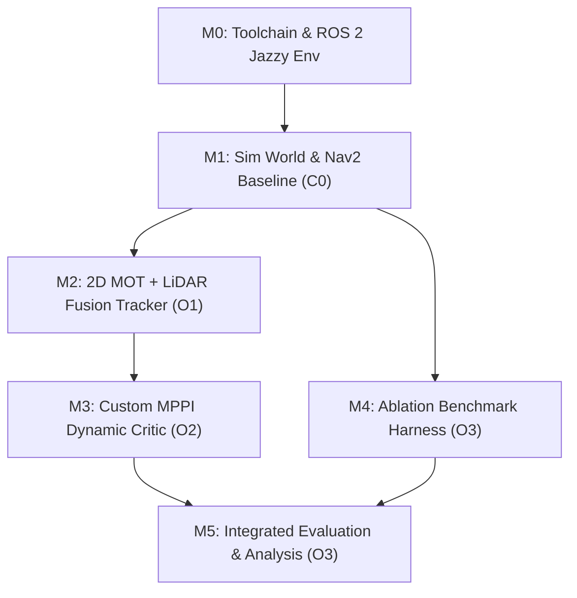

# Project Methodology & Toolchain

> **Purpose**: Development methodology for supervisor review, Project Planning Report (§3), and thesis methodology. Sourced from the technical design in `chapters/research/02_system_architecture.md`, `05_ablation_and_evaluation.md`, and module guidance in `raw/proposals/`.

---

## 1. Research Methodology & Experimental Approach

The project adopts a **quantitative, experimental simulation-based engineering methodology**:
- **Controlled Comparative Ablation:** Rather than evaluating the system on an isolated benchmark, the research systematically decouples visual object detection from temporal motion prediction through a 3-way comparative ablation:
  - **C0 (Baseline):** Stock Nav2 with 2D LiDAR and static costmap critics (Trautman & Krause [L1] baseline).
  - **C1 (Detection Only):** 2D LiDAR + Camera visual tracking, but treating obstacles as static clearance cylinders ($t = 0$) without forward velocity extrapolation.
  - **C2 (Full Predictive Framework):** 2D LiDAR + Camera visual tracking + predictive MPPI dynamic obstacle critic evaluating forward velocity projection ($\tau \in [0, 2.0]\text{ s}$).
- **Paired Randomized Trials:** Each evaluation scenario (crossing pedestrians, oncoming traffic, multi-agent density) is repeated $\ge 30$ times using identical pseudo-random seeds across C0, C1, and C2.
- **Statistical Rigor:** Hypotheses are evaluated using paired Welch's t-tests and one-way ANOVA, reporting 95% confidence intervals across all primary performance metrics.

---

## 2. Development Lifecycle Steps

| Step | Task Focus | Tools & Infrastructure | Limitation / Challenge & Risk Management |
|---|---|---|---|
| **M0** | Environment setup: Ubuntu 24.04 (desktop workstation with RTX 4070 Ti Super), ROS 2 Jazzy, Gazebo Harmonic, Docker | `colcon`, Docker, NVIDIA drivers | Host environment setup; GPU driver passthrough. **Medium**: ROS 2 fundamentals established; full Nav2 stack requires clean environment isolation. |
| **M1** | Simulation environment: differential-drive AMR (TurtleBot 4 / custom URDF), scripted dynamic actors, baseline Nav2 | Gazebo Harmonic, `nav2_bringup`, `slam_toolbox` | Constructing realistic warehouse worlds and dynamic actor crossing trajectories. Baseline C0 must be frozen and logged before introducing new code. **Medium** |
| **M2** | Perception & Tracker (O1): 2D MOT (ByteTrack via BoxMOT), camera-laser calibration, frustum gating, per-track linear Kalman filter (CV) | Python / C++ node (`rclpy`), `boxmot`, `tf2`, OpenCV, Eigen3 | Estimator tuning across noisy depth reflections. Decoupling association via ByteTrack in 2D image space eliminates fragile 3D point clustering risk. **Medium-Low** |
| **M3** | Predictive Controller (O2): custom MPPI dynamic obstacle critic plugin | C++, `pluginlib`, `nav2_mppi_controller`, `ament_cmake` | **Highest Technical Risk**: Developing a native C++ Nav2 plugin. Spike planned in W8. Fallback F1 (velocity-inflated costmap layer) defined in risk register. |
| **M4** | Ablation Benchmark Harness (O3): automated scenario runner, ground-truth metric logger, C0/C1/C2 execution scripts | Python, Gazebo actor plugins, ROS 2 launch, NumPy | Automating batch simulation runs and ground truth logging across varying speeds ($0.5\text{--}2.0\text{ m/s}$) and densities. **Medium** |
| **M5** | Integrated Evaluation & Statistical Analysis (O3): paired hypothesis testing, ANOVA, metric plots, final thesis writing | `rosbag2`, Python, `matplotlib`, `scipy` | Rigorous statistical data hygiene and paired hypothesis testing ($N \ge 30$ runs). **Low** |

---

## 3. Algorithmic Parametric Analysis & Subsystem Trade-Offs

In an advanced mechatronic architecture, tool and algorithm selection cannot rely on heuristic preference. Each candidate method is evaluated against formal mathematical and computational parameters to prove that the integrated pipeline satisfies real-time determinism ($20\text{ Hz}$ control loop, $<50\text{ ms}$ budget) and safety constraints.

### 3.1 Multi-Object Tracking & Association Formulation
The primary algorithmic challenge in perception is maintaining persistent obstacle tracks across temporary visual occlusions without exceeding the onboard compute budget.

| Algorithmic Parameter | Classical Clustering (Euclidean + EKF) | DeepSORT (Wojke et al., 2017) | PointPillars 3D (Lang et al., 2019) | **Selected: ByteTrack + Frustum KF (Zhang et al. [L13])** |
| :--- | :--- | :--- | :--- | :--- |
| **State Vector $\mathbf{x}$** | $[x, y, v_x, v_y]^T$ (Cartesian Euclidean) | $[u, v, \gamma, h, \dot{u}, \dot{v}, \dot{\gamma}, \dot{h}]^T$ (Image) | $[x, y, z, w, l, h, \theta, v_x, v_y]^T$ (3D Oriented Box) | $[u, v, s, r, \dot{u}, \dot{v}, \dot{s}]^T \to [x, y, v_x, v_y]^T$ |
| **Data Association Metric** | Mahalanobis / Euclidean distance | Cosine distance (128-D ReID feature embedding) | 3D Bounding Box IoU | **Hierarchical 2D IoU (High + Low confidence detection boxes)** |
| **Time Complexity** | $O(N \cdot M)$ (Distance) + $O(M^3)$ (Hungarian) | $O(N \cdot M + N \cdot D_{\text{ReID}})$ + Feature CNN inference | $O(P)$ pillarization + 2D CNN backbone ($>30\text{ ms}$) | **$O(N \cdot M)$ IoU matching + $O(M^3)$ Hungarian on low dimensions** |
| **Compute Envelope** | Lightweight CPU ($<1\text{ ms}$) | GPU required (Deep ReID inference per detection) | High-end GPU required (Voxelization + 3D Tensor operations) | **Standard onboard CPU** ($<3\text{ ms}$ association) |
| **Occlusion Robustness** | Fails (points merge/split; track ID switches) | High (ReID re-identifies visual appearances) | Moderate (Geometry-based persistence) | **High (Low-score box recovery preserves occluded tracks)** |
| **Failure Modes** | Planar laser leg crossing splits tracks | ReID feature degradation under lighting/scale changes | Sparse point clouds at long range cause false negatives | Laser ray occlusion if obstacle falls outside planar beam height |

**Algorithmic Justification:** PointPillars and DeepSORT impose prohibitive GPU memory and compute footprints ($>30\text{ ms}$ latency), leaving insufficient budget for trajectory optimization. Euclidean laser clustering avoids GPU usage but suffers catastrophic track-ID swaps during pedestrian leg-crossing. ByteTrack solves association purely in 2D image space in $<3\text{ ms}$ on CPU, while Zhang-Pless frustum projection provides metric range without requiring dense 3D point cloud processing.

---

### 3.2 Obstacle Motion Prediction Formulation
The trajectory controller requires forward-projected obstacle states over a finite lookahead horizon $T$. Candidate motion models vary significantly in computational complexity and valid temporal horizons.

| Algorithmic Parameter | Social Force Model (SFM) [Helbing, 1995 (L14)] | Trajectory Transformer (e.g. Trajectron++) | Interactive Gaussian Process (IGP) [Trautman, 2010 (L1)] | **Selected: Constant Velocity (CV) KF [Thrun, 2005 (L12)]** |
| :--- | :--- | :--- | :--- | :--- |
| **Mathematical Formulation** | $m_i \frac{d\mathbf{v}_i}{dt} = \mathbf{f}_i^0 + \sum \mathbf{f}_{ij} + \sum \mathbf{f}_{iB}$ | $\mathbb{P}(\mathbf{Y} \mid \mathbf{X}, \mathcal{G}) = \text{Transformer}(\mathbf{X}, \mathbf{A})$ | Joint continuous PDF $\mathcal{GP}(\mu(\mathbf{x}), k(\mathbf{x}, \mathbf{x}'))$ | $\mathbf{x}_{k+1} = \mathbf{F} \mathbf{x}_k + \mathbf{w}_k, \quad \mathbf{F} = \begin{bmatrix} \mathbf{I}_2 & \Delta t \mathbf{I}_2 \\ \mathbf{0}_2 & \mathbf{I}_2 \end{bmatrix}$ |
| **Valid Horizon ($T_{\text{valid}}$)** | Long horizon ($>5.0\text{ s}$) | Medium to long ($3.0\text{--}8.0\text{ s}$) | Medium ($2.0\text{--}4.0\text{ s}$) | **Short preview horizon ($T \le 2.0\text{ s}$)** |
| **Time Complexity** | $O(N^2)$ pairwise interaction evaluation | $O(L^2)$ attention mechanism + GPU inference | $O(N^3)$ matrix inversion per query | **$O(1)$ closed-form matrix multiplication per track** |
| **Parameter Calibration** | $\approx 8\text{--}12$ empirical interaction weights | Millions of neural weights (requires extensive training data) | Kernel hyper-parameters ($\sigma_f, \ell$) | **Process / Measurement covariances ($\mathbf{Q}, \mathbf{R}$)** |
| **Suitability for 20 Hz MPPI** | High overhead for thousands of rollout steps | Latency too high ($>50\text{ ms}$) for online inner loop | Intractable for real-time sample-based control | **Optimal: Closed-form propagation $\mathbf{p}_0 + \mathbf{v}\tau$ in $<0.01\text{ ms}$** |

**Algorithmic Justification:** In local trajectory control, candidate rollouts are evaluated at 20 Hz over $T = 2.0\text{ s}$. As established by Helbing & Molnar [L14], human pedestrian motion exhibits strong directional inertia over short intervals ($<2.0\text{ s}$). Evaluating non-linear SFM interactions or neural attention networks across $K = 2000$ rollout trajectories is computationally intractable within a $50\text{ ms}$ loop. A linear Constant Velocity model provides closed-form, vectorized extrapolation ($\mathbf{p}(\tau) = \mathbf{p}_0 + \mathbf{v}\tau$) in $<0.01\text{ ms}$, satisfying the timing budget without sacrificing kinematic accuracy over the lookahead horizon.

---

### 3.3 Local Trajectory Optimization Formulation
Local obstacle avoidance requires solving an optimal control problem over a finite preview horizon subject to non-holonomic vehicle constraints and dynamic collision boundaries.

| Algorithmic Parameter | Dynamic Window Approach (DWA) | Timed Elastic Band (TEB) | QP Safety Filter (SE-MPPI) [Kang, 2024 (L15)] | **Selected: Nav2 MPPI + Dynamic Critic [Williams (L4); Macenski (L11)]** |
| :--- | :--- | :--- | :--- | :--- |
| **Optimization Paradigm** | Discrete $(v, \omega)$ velocity space sampling | Non-linear Least Squares (g2o graph optimization) | Stochastic Sampling + Quadratic Program post-filter | **Information-Theoretic Path Integral Monte Carlo Sampling** |
| **Objective / Cost Function** | Linear weighting: $\alpha \cdot \text{head} + \beta \cdot \text{dist} + \gamma \cdot \text{vel}$ | Soft elastic deformation penalties on graph edges | Standard MPPI cost + hard barrier constraints $h(\mathbf{x}) \ge 0$ | **Non-convex arbitrary cost accumulation: $S(\mathbf{x}) = \sum_{\tau} \left( \mathcal{C}_{\text{path}} + \mathcal{C}_{\text{dyn\_obs}} \right)$** |
| **Trajectory Rollouts ($K$)** | $\approx 100\text{--}300$ velocity pairs | 1 deformed elastic band trajectory | $K \approx 1000\text{--}2000$ rollouts | **$K = 2000$ candidate stochastic trajectories** |
| **Control Horizon ($T$)** | Short horizon ($0.5\text{--}1.0\text{ s}$) | Variable timed waypoints | $1.5\text{--}2.0\text{ s}$ | **Lookahead horizon $T = 2.0\text{ s}$ ($\Delta t = 0.05\text{ s}$, 40 steps)** |
| **Dynamic Obstacle Handling** | Treats obstacles as static clearance circles at $t=0$ | Dynamic obstacles modeled as moving timed constraints | QP projects $\mathbf{u}_0^*$ onto safe barrier at $t=0$ | **Forward temporal evaluation: $\mathbf{p}_{\text{obs}}(\tau)$ evaluated against rollout step $\tau$** |
| **Mathematical Guarantees** | None (prone to local minima traps) | Local convergence (sensitive to initial topological seed) | Analytical forward invariance (zero barrier violation) | **Global exploration via stochastic sampling (escapes local minima)** |
| **Execution Latency / Loop Rate** | $\approx 5\text{ ms}$ on CPU (20 Hz) | $\approx 20\text{--}40\text{ ms}$ (scales poorly with $>5$ obstacles) | $\approx 15\text{ ms}$ (QP solver overhead) | **$<15\text{ ms}$ on CPU (SIMD vectorized batch evaluation @ 20 Hz)** |

**Algorithmic Justification:** DWA cannot perform lookahead trajectory shaping, directly causing the freezing robot problem. TEB models dynamic obstacles well in sparse settings, but g2o graph optimization frequently falls into local minima or exhibits numerical divergence when multiple crossing trajectories deform the elastic band simultaneously. MPPI evaluates thousands of rollouts stochastically; by injecting dynamic obstacle costs into the rollout cost accumulation, the optimizer naturally discards rollouts that intersect the predicted trajectory, yielding proactive deceleration and smooth deflections at $<15\text{ ms}$ per control cycle on standard CPU hardware.

---

## 4. Software & Infrastructure Toolchain Selection

| Component | Selected Tool | Evaluated Alternatives | Engineering Justification & Trade-Off Rationale |
|---|---|---|---|
| **Operating System** | Ubuntu 24.04 LTS | Ubuntu 22.04 LTS / Windows WSL2 | Native host support for ROS 2 Jazzy and Gazebo Harmonic; maximum GPU compute driver efficiency. |
| **Robotics Middleware** | ROS 2 Jazzy Jalisco | ROS 2 Humble / Iron | Iron reached EOL (Dec 2024); Humble reaches EOL in May 2027 (coinciding with graduation). Jazzy offers long-term support and the latest Nav2 MPPI controller features. |
| **Simulation Testbed** | Gazebo Harmonic | Gazebo Classic / Isaac Sim | Gazebo Classic is EOL (Jan 2025). Isaac Sim has heavy proprietary RTX dependencies and higher sim-to-real divergence for basic 2D planar LiDAR pipelines. Gazebo Harmonic provides native ROS 2 Jazzy integration and fast headless physics. |
| **Local Controller Package** | `nav2_mppi_controller` | DWB Local Planner / TEB Planner | Native ROS 2 C++ `pluginlib` architecture allowing custom critic plugins without modifying core Nav2 libraries. |
| **Tracking Framework** | ByteTrack (`boxmot`) | DeepSORT / SORT / OC-SORT | Low-complexity 2D association ($<3\text{ ms}$) preserving track persistence across visual occlusions on CPU. |

---

## 5. Dependency Graph & Critical Path

- **Critical Path:** M0 $\to$ M1 $\to$ M2 $\to$ M3 $\to$ M5. Total critical path duration is directly gated by the custom MPPI critic plugin integration.
- **Parallel Workstream:** M4 (Ablation Benchmark Harness) is developed concurrently with M2 and M3 once the baseline simulation world (M1) is stabilized.
- **Simulation Discipline:** 100% of the workflow is committed to software simulation, removing physical hardware delivery and fabrication bottlenecks.

---

## 6. Methodological Literature Grounding

The engineering methods are validated by foundational literature:
- **MPPI Sampling & Optimization:** Williams et al. (2017) [L4] and Macenski et al. (2023) [L11] established model predictive path integral trajectory optimization for agile real-time control.
- **Camera-Laser Frustum Association:** Zhang & Pless (2004) [L5] extrinsic calibration provides mathematical guarantees for projecting planar laser scans into optical bounding frustums.
- **Occlusion-Resilient MOT:** Zhang et al. (2022) [L13] ByteTrack demonstrated superior MOTA and ID-switch reduction on dynamic agents by associating low-confidence bounding boxes.
- **Kinematic Horizon Bounds:** Helbing & Molnar (1995) [L14] and Thrun et al. (2005) [L12] verified that short kinematic extrapolation horizons ($T \le 2.0\text{ s}$) maintain tracking consistency without non-linear divergence.
