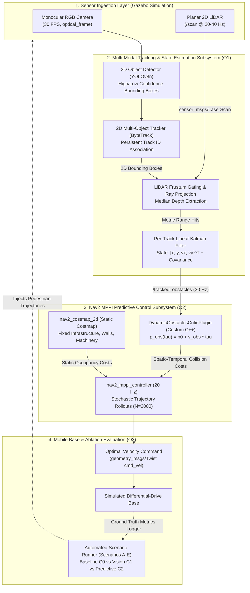
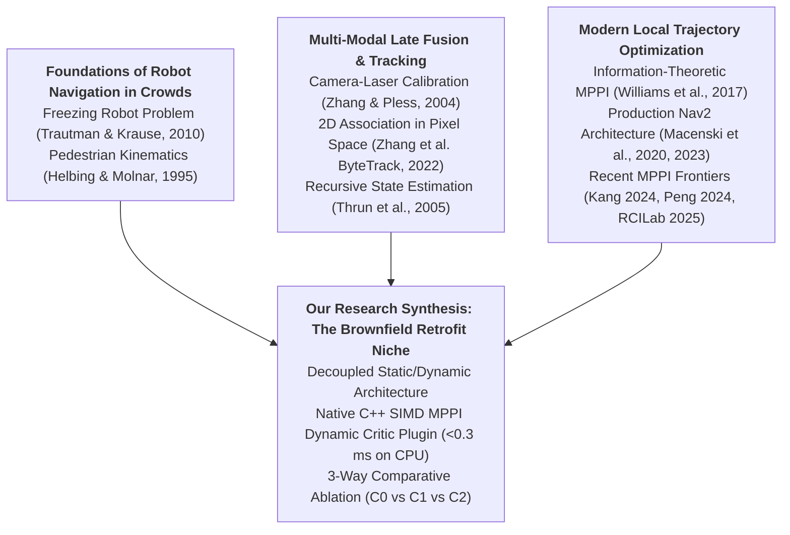

# Project Overview & System Context

> **Purpose**: Section §1 workspace for the Project Planning Report. Sourced directly from technical architecture in `chapters/research/01_problem_statement.md`, `02_system_architecture.md`, and supervisor brief `raw/proposals/` (`SD-MEng-26-01`).

---

## 1. Context & Operational Need

### 1.1 Commercial Scale & Brownfield Logistics Imperative
According to the International Federation of Robotics (IFR) [L9], the transportation and logistics sector registered over 102,900 professional service robot deployments globally in 2024 (a 14% year-on-year increase), representing the single largest commercial application class of autonomous mobile robotics. The vast majority of these mobile robots operate within **brownfield installations**—pre-existing warehouses, distribution hubs, and manufacturing shop floors that cannot be rebuilt around automated infrastructure. In these environments, Autonomous Mobile Robots (AMRs) must safely and efficiently share tight, high-traffic corridors with dynamic human workers, forklift trucks, and manual pushcarts.

To ensure cost viability and adhere to industrial functional safety standards (ISO 3691-4 / SIL-2), industrial AMRs predominantly deploy single-plane (2D) safety LiDAR scanners paired with the open-source ROS 2 Navigation stack (Nav2) [L2, L3]. While planar LiDAR provides high-precision metric ranging ($<1\text{ cm}$) over wide fields of view ($360^\circ$ at $20\text{--}40\text{ Hz}$), this low-cost hardware suite exhibits a catastrophic operational bottleneck when navigating dynamic human environments: the **Freezing Robot Problem**.

### 1.2 The Freezing Robot Problem & Static Costmap Pathology
Formally identified by Trautman and Krause [L1], the *Freezing Robot Problem* occurs when an autonomous robot navigates amidst moving traffic and comes to a complete standstill, declaring all forward paths unsafe. In contemporary industrial AMRs, this failure is rooted in an architectural mismatch between sensor representation and the local planning world model:

1. **Planar Point Fragmentation & Semantic Blindness:** A 2D LiDAR mounted 10–20 cm above the floor intersects dynamic pedestrians as two sparse, disconnected point clusters (cross-sections of human lower limbs). These returns lack semantic class identity, volumetric shape, and heading or velocity vectors.
2. **Time-Invariant Occupancy Modeling ($t = 0$):** Standard ROS 2 navigation architectures funnel range measurements into a 2D occupancy grid (`nav2_costmap_2d`) [L2]. In this representation, every occupied grid cell is assumed to be an immovable, static barrier fixed in time ($t = 0$).
3. **Paralyzed Trajectory Rollouts:** When a pedestrian crosses an intersection, the local trajectory optimizer evaluates candidate paths against static obstacle cells directly blocking the corridor. Because the planner cannot project that the human will clear the intersection within 1.0–1.5 seconds, all forward rollout trajectories accumulate severe collision penalties. The controller executes emergency halts, conservative creeping, or repeated recovery rotations [L1].
4. **The Pitfall of Direct Costmap Insertion:** Attempting to inject dynamic obstacle returns (e.g. from 3D sensors or cameras) directly into the 2D costmap exacerbates the pathology. Costmaps lack temporal velocity fields and update via raycasting; moving obstacles leave "phantom clearing trails" that artificially block corridors and force unnecessary re-routing.

---

## 2. Project Purpose & Aims

To overcome this bottleneck without requiring cost-prohibitive sensor retrofits, this project designs, implements, and evaluates an **open-source, vision-augmented predictive navigation framework in ROS 2**. 

The core aims of the project are:
1. **Low-Cost Sensor Retrofit & Dynamic Tracking (Objective O1):** Augment an existing 2D LiDAR AMR with a low-cost forward-facing monocular camera ($\approx \$30\text{--}\$50$) to detect moving agents, track their identities across occlusions, and estimate their continuous Cartesian positions and velocities ($[x, y, v_x, v_y]^T$) via late-fusion Kalman filtering.
2. **Native Nav2 MPPI Predictive Trajectory Control (Objective O2):** Develop and integrate a native C++ Model Predictive Path Integral (MPPI) dynamic critic plugin that forward-projects dynamic obstacle states across trajectory rollout horizons ($\tau \in [0, 2.0]\text{ s}$), enabling proactive yielding and smooth collision-free maneuvers on standard CPU compute.
3. **Systematic 3-Way Comparative Ablation (Objective O3):** Quantify the exact performance gains of visual spatial bounding versus temporal velocity prediction across standardized dynamic crossing scenarios in Gazebo Harmonic, fulfilling supervisor specification `SD-MEng-26-01`.

---

## 3. System Architecture & Block Diagram

### Component Interrelationships & Engineering Dependency:
1. **Visual Detection & Association (Image Space):** The camera stream feeds YOLOv8n, whose output is tracked across consecutive frames using **ByteTrack** [L13]. By tracking in 2D pixel space rather than Euclidean 3D space, the system bridges momentary visual occlusions without combinatorial clustering overhead.
2. **Metric Depth Anchoring via Frustum Gating:** Planar laser scan rays are transformed into the camera frame using extrinsic calibration $[R \mid t]$ (Zhang & Pless [L5]). Scan points falling within 2D bounding boxes are extracted; the median range hit provides an exact, metric Cartesian depth anchor, completely avoiding monocular scale ambiguity and stereo disparity noise.
3. **Decoupled Kinematic State Filtering:** A per-track **Linear Kalman Filter** [L12] continuously updates Cartesian positions and velocities ($[x, y, v_x, v_y]^T$).
4. **Predictive MPPI Cost Shaping:** Shipped Nav2 MPPI critics evaluate rollouts against the static costmap. The custom `DynamicObstaclesCriticPlugin` intercepts `/tracked_obstacles` and forward-projects obstacle centroids across each discrete timestep of the candidate trajectory rollouts ($\tau \in [0, 2.0]\text{ s}$). If a rollout intersects the predicted obstacle radius at time $\tau$, a soft Gaussian cost penalty is applied, naturally biasing MPPI sampling to slow down or navigate smoothly behind the pedestrian.
5. **Decoupled Architectural Boundary:** Permanent structural elements (walls, racking) remain in `nav2_costmap_2d`, while dynamic obstacles are handled entirely in the critic state space. This eliminates raycasting clearing delays, trailing phantom obstacles, and costmap inflation corruption.

---

## 4. Thematic Literature Review & SOTA Funnel

This research connects four distinct bodies of literature into a unified engineering framework:

### 4.1 Crowd Navigation & The Kinematic Justification for Short-Horizon Prediction
In their seminal work, Trautman and Krause [L1] proved that navigation in dense human crowds is fundamentally non-viable if moving agents are treated as static physical obstacles. When a robot fails to model the temporal evolution of surrounding agents, the collision probability along all candidate paths approaches unity, leading directly to the *Freezing Robot Problem*. While Trautman et al. proposed Interactive Gaussian Processes (IGP) to model cooperative social interactions, such formulations present high computational complexity ($O(N^3)$) and require joint intention estimation that is challenging to scale on edge robotics platforms.

To balance predictive accuracy with real-time determinism, we look to empirical pedestrian dynamics. Helbing and Molnar [L14], through the foundational Social Force Model (SFM), established that human walking velocity in industrial and transit corridors clusters tightly around $1.2\text{--}1.4\text{ m/s}$ with strong directional persistence. Over short preview horizons ($T \le 2.0\text{ s}$), human walking vectors exhibit minimal lateral acceleration. This observation, reinforced by Schulz et al. and Thrun et al. [L12], provides mathematical justification for employing a **Constant Velocity (CV) kinematic model** within both the tracking Kalman Filter and the trajectory forward-projection critic:
$$\mathbf{p}_{\text{obs}}(\tau) = \mathbf{p}_{\text{obs}}(0) + \mathbf{v}_{\text{obs}} \tau, \quad \tau \in [0, T]$$
This decouples the system from heavy recurrent or transformer-based trajectory predictors while maintaining physical validity over the local planner's critical decision horizon.

### 4.2 Multi-Modal Perception: Decoupled Association and Metric Depth Anchoring
Commercial industrial AMRs operate within strict hardware budgets, making the widespread adoption of multi-channel 3D LiDAR arrays ($>\$3,000$) financially unfeasible for brownfield fleets [L9]. Stereo vision and RGB-D depth cameras offer 3D perception at lower cost, but their depth error grows quadratically with distance ($\Delta Z \propto Z^2$), rendering them unreliable beyond 4–5 meters in brightly illuminated warehouse environments.

To achieve robust 3D dynamic awareness on an ultra-low compute and cost budget ($<\$480$ total), our system adopts a **late-fusion complementarity principle**:
1. **Calibration:** Extrinsic calibration between the planar laser and monocular camera is established using the closed-form checkerboard method of Zhang and Pless [L5]:
   $$\lambda \begin{bmatrix} u \\ v \\ 1 \end{bmatrix} = \mathbf{K} \left( \mathbf{R} \begin{bmatrix} X_{\text{lidar}} \\ Y_{\text{lidar}} \\ 0 \end{bmatrix} + \mathbf{t} \right)$$
2. **Visual Association:** Rather than clustering sparse planar laser points—which easily fragments when legs swing past one another—data association is performed entirely in 2D image space using ByteTrack (Zhang et al. [L13]). By preserving low-confidence bounding boxes and utilizing Kalman-filtered bounding box motion, ByteTrack maintains consistent obstacle track IDs across temporary visual occlusions without requiring compute-intensive visual feature embeddings.
3. **Frustum Gating & State Filtering:** Planar laser scan rays intersecting the 2D bounding frustum are gated; taking the median range return yields a jitter-free metric Cartesian coordinate in world space. Feeding these observations into a per-track linear discrete Kalman filter [L12] yields smooth continuous velocity estimates ($v_x, v_y$) on standard CPU hardware.

### 4.3 Evolution of Local Trajectory Optimization: From Costmaps to MPPI Frontiers
The local trajectory planning landscape in mobile robotics has evolved from reactive discrete sampling methods (such as the Dynamic Window Approach, DWA) to gradient-free stochastic trajectory optimization via **Model Predictive Path Integral (MPPI)** control [L4]. As demonstrated by Macenski et al. in production Nav2 deployments [L2, L3, L11], MPPI generates thousands of candidate trajectory rollouts per control cycle using vectorized SIMD operations, optimizing complex non-linear cost surfaces while strictly enforcing kinematic and acceleration limits.

However, an analysis of the production ROS 2 Nav2 MPPI implementation reveals an architectural limitation: **all 11 default trajectory critics shipped with Nav2 evaluate obstacle costs strictly against `nav2_costmap_2d` at time $t=0$** [L11]. The optimizer cannot evaluate where an obstacle will be at rollout step $\tau = 1.0\text{ s}$.

Recent literature (2024–2025) has recognized the limitations of standard MPPI, proposing several advanced paradigms:
* **Analytical Safety Post-Filters (SE-MPPI [L15]):** Kang introduces an online local-minima escape mechanism paired with a Control Barrier Function (CBF) quadratic program (QP). While SE-MPPI provides analytical forward invariance for known boundaries, it acts as a reactive post-filter on the synthesized control command $\mathbf{u}_0^*$ and does not reshape the predictive trajectory rollout distribution over preview horizons.
* **Exact Geometric SDFs via GPU JAX (EXACT-MPPI [L16]):** Peng et al. bypass discrete costmaps by calculating continuous Signed Distance Functions between arbitrary robot footprints and raw point clouds using JAX CUDA kernels. However, EXACT-MPPI offloads planning to an edge GPU, relies on unsegmented geometric point clouds, and treats obstacles as instantaneous stationary geometry rather than tracking semantic velocities.
* **Rollout Clustering (CSC-MPPI [L17]):** RCILab uses GPU cuML DBSCAN clustering to solve MPPI *mode-averaging collapse*—where symmetrical obstacle encounters cause left- and right-swerving rollouts to average into a fatal head-on collision.

### 4.4 Synthesis: The Brownfield AMR Sweet Spot & Ablation Justification
These advanced MPPI works represent high-performance methodological frontiers, but they target different failure axes (complex chassis geometry, mode collapse, reactive boundary enforcement) and demand high-end edge GPUs.

This project identifies and occupies the **brownfield AMR sweet spot**:
1. **Zero Additional GPU Overhead:** Instead of GPU-accelerated continuous SDFs [L16] or cuML clustering [L17], our framework implements an ultra-lean C++ `pluginlib` critic executing in $<0.3\text{ ms}$ on standard onboard CPUs.
2. **Velocity-Driven Symmetry Breaking:** In human-robot encounters, the pedestrian's dynamic velocity vector naturally breaks spatial symmetry. By evaluating future positions $\mathbf{p}_{\text{obs}}(\tau)$ along rollout horizons, the dynamic critic naturally skews the MPPI sampling distribution toward the obstacle's trailing wake, eliminating the need for complex clustering algorithms.
3. **Decoupled Architecture:** Static infrastructure remains cleanly segregated in `nav2_costmap_2d`, completely eliminating costmap clearing delays and dynamic inflation artifacts.
4. **Empirical Decoupling via 3-Way Comparative Ablation:** In strict alignment with the supervisor specification (`SD-MEng-26-01`), the project executes a systematic 3-way ablation benchmark:
   - **C0 (Baseline):** 2D LiDAR only with default static costmap MPPI.
   - **C1 (Vision Detection Only):** 2D LiDAR + Camera detection, treating obstacles as static clearance circles ($t=0$) without velocity projection.
   - **C2 (Full Predictive MPPI):** 2D LiDAR + Camera tracking with Kalman filtering and forward temporal motion extrapolation ($\tau \in [0, 2.0]\text{ s}$).

This 3-way comparative design provides defensible empirical proof isolating whether visual spatial bounding alone mitigates freezing, or whether temporal velocity prediction is the essential mechanism required to navigate dynamic human corridors.
