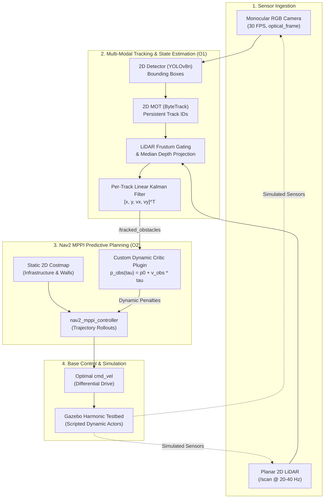

# Project Overview & System Context

> **Purpose**: Section §1 workspace for the Project Planning Report. Sourced directly from technical architecture in `chapters/research/01_problem_statement.md`, `02_system_architecture.md`, and supervisor brief `raw/proposals/` (`SD-MEng-26-01`).

---

## 1. Context & Operational Need

In modern manufacturing facilities, brownfield warehouses, and automated fulfillment hubs, Autonomous Mobile Robots (AMRs) must operate safely and efficiently alongside dynamic traffic, including human workers, forklifts, and manual pushcarts. To ensure commercial viability and adhere to industrial functional safety standards (ISO 3691-4 / SIL-2), industrial AMRs predominantly deploy low-cost planar 2D LiDAR scanners integrated with the open-source ROS 2 Navigation stack (Nav2).

While static 2D SLAM and path planning are mature, this conventional configuration exhibits a critical operational bottleneck in populated corridors:

### The Freezing Robot Problem
- **Sparse Planar Slices**: A single-plane 2D LiDAR mounted 10–20 cm above the floor intersects dynamic agents (e.g., pedestrians) as two isolated, unclassified point clusters.
- **Lack of Semantic & Kinematic Context**: Planar laser returns lack semantic identity, heading, and velocity vectors.
- **Static Costmap World Model**: Standard Nav2 2D costmaps (`nav2_costmap_2d`) treat all detected obstacle points as static, time-invariant obstacles ($t = 0$).
- **Freezing & Paralyzed Navigation**: When a crossing pedestrian steps into the AMR's travel path, local planners (DWB, TEB, or default MPPI) detect an imminent collision with an assumed stationary obstacle. The AMR triggers emergency halts, conservative waiting, or oscillating recovery spins (Trautman & Krause, 2010 [L1]), creating severe throughput bottlenecks even though the crossing pedestrian will have cleared the intersection well before the robot arrives.

### The Pitfall of Costmap Inflation for Dynamic Obstacles
Attempts to mitigate dynamic obstacles by directly injecting vision or 3D voxel data into 2D costmaps worsen freezing. Costmaps discard agent identities and lack temporal velocity fields. Inserting moving objects into occupancy layers generates trailing "phantom obstacle" footprints due to raycasting clearing latencies, locking the robot into recovery behaviors.

---

## 2. Project Purpose & Aims

This project develops a **modular, vision-augmented predictive navigation framework** in ROS 2 that combines planar LiDAR with forward-facing monocular vision to resolve the freezing robot problem. 

The core aims are:
1. Retrofit existing 2D LiDAR AMRs with a low-cost camera to extract persistent dynamic obstacle tracks and metric velocities.
2. Directly evaluate short-term obstacle motion predictions inside a custom Model Predictive Path Integral (MPPI) trajectory critic, proactively yielding or deflecting without freezing.
3. Quantify the individual contributions of visual detection versus motion prediction through a rigorous 3-way comparative ablation benchmark in Gazebo Harmonic.

---

## 3. System Architecture & Block Diagram

### Component Interrelationships:
1. **Camera Stream $\to$ 2D MOT**: Monocular RGB images are processed by a lightweight detector and tracked via **ByteTrack** (`boxmot`), maintaining persistent track IDs in 2D image space across temporary occlusions.
2. **LiDAR Frustum Association**: Planar LiDAR range returns are projected into active visual bounding frustums using extrinsic camera-laser calibration ($[R \mid t]$), retrieving millimeter-accurate metric distance without stereo disparity noise.
3. **State Filtering**: A per-track **Linear Kalman Filter** estimates smooth metric Cartesian positions and velocities ($[x, y, v_x, v_y]^T$) published at 30 Hz on `/tracked_obstacles`.
4. **Predictive MPPI Critic**: The custom `DynamicObstaclesCriticPlugin` forward-projects obstacle trajectories over the MPPI lookahead horizon ($\tau \in [0, 2.0]\text{ s}$), evaluating collision risks against candidate rollout trajectories.
5. **Decoupled Architecture**: Static costmaps continue handling fixed walls and machines, while dynamic agents are handled in state space by the critic, eliminating costmap clearing artifacts.

---

## 4. Supporting Literature Foundation

The architecture is underpinned by key literature registered in `chapters/library/register.md`:
- **Freezing Robot Problem**: Trautman & Krause (2010) [L1] established that cooperative dynamic avoidance requires modeling joint collision probabilities and predicting agent trajectories rather than treating them as static obstacles.
- **Nav2 MPPI Foundations**: Williams et al. (2015, 2017) [L2, L3] established GPU/CPU model predictive path integral control, enabling thousands of trajectory evaluations per control cycle.
- **Vision-Augmented Association**: Zhang & Pless (2004) [L7] camera-laser calibration enables deterministic ray gating, while Zhang et al. (2022) [L10] ByteTrack proves that keeping low-confidence detection boxes resolves occlusion-induced track fragmentation.
- **Constant Velocity Motion Modeling**: Schulz et al. (2001) [L9] demonstrated that short lookahead horizons ($T \le 2.0\text{ s}$) with constant velocity Kalman filtering achieve robust predictive avoidance without heavy social force networks.

