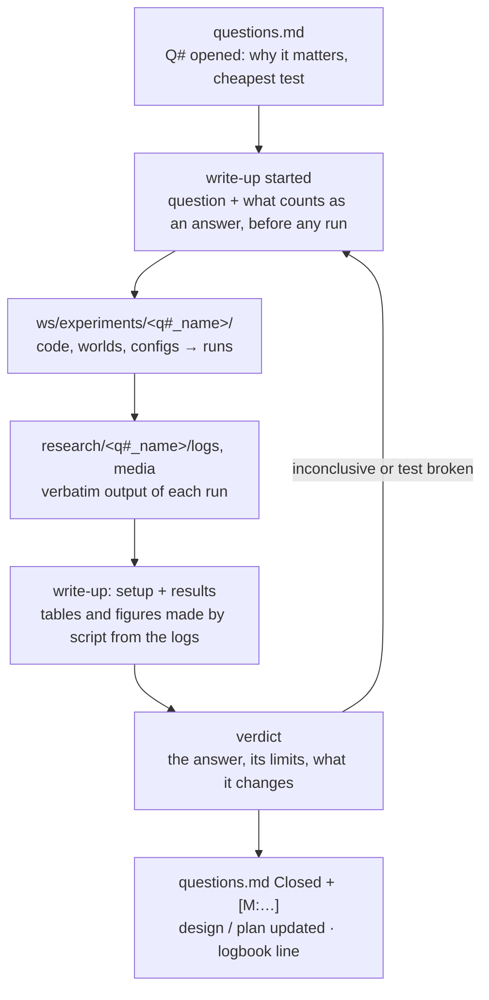

# research — experiment write-ups

One folder per question from [questions.md](../notes/questions.md), named `<q#>_<name>`: the same name as its experiment folder in [`ws/experiments/`](../../ws/experiments/). Measured numbers live here, and an `[M:<folder>]` tag points to one.

Split: **what runs** (worlds, configs, run scripts) lives in `ws/experiments/<q#>_<name>/`; **what happened** lives here:

```
research/<q#>_<name>/
├── README.md          the write-up
├── logs/              YYYY-MM-DD_<run>.txt: verbatim run output, 2-line header
├── media/             YYYY-MM-DD_<what>.<ext>: screenshots, plots, short clips
└── *.py               analysis scripts that turn logs into tables / figures (if any)
```

Bags, CSV dumps and videos over ~20 MB: ask before committing (git keeps every version) [E].

## How a question becomes an answer



## Each write-up holds

- **Question**, and **what counts as an answer**: written before the first run, including the outcomes that would mean "no" or "the test is broken". Deciding afterwards lets the data move the goalposts.
- **Setup**: enough to run it again: scripts and worlds (links into `ws/experiments/`), parameters, seeds, commit, date, machine, and which log in `logs/` each number came from.
- **Results**: small tables and figures, generated by a script from the logs. No number typed in from memory.
- **Verdict**: the answer, its limits (what this test can't tell), and what it changes: design, plan, the next question. "No", "inconclusive" and "the test was broken" are verdicts too. Keep them: they are thesis material.

## Doing it right

- **A control before a conclusion.** Show the measurement can see the effect (Q3's cylinder) before trusting a "not seen".
- **Smallest test that settles it.** Scope the run to the question. Side ideas become new questions, not extra knobs.
- **Fair comparisons.** Baselines tuned as hard as the method, same scenarios and seeds; report the spread over runs, not the best run.
- **Weaknesses on the page.** Known limits go in the verdict; any that matter later also go in [plan.md](../notes/plan.md) *Parked debt* with a trigger.
- **Don't rewrite history.** If a later run changes an answer, add a dated *Update* section and revise the verdict. The old result stays visible.

## Write-ups

| Write-up | Question | Status |
|---|---|---|
| [q3_lidar_actor](q3_lidar_actor/README.md) | Q3: does Gazebo Harmonic's `gpu_lidar` see actors? | Answered 2026-11-19 |
