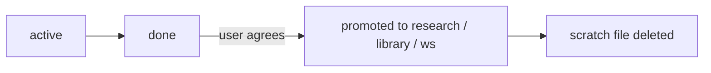

# scratch/ — shared work-in-progress (agent + user)

Half-done work lives here so `research/`, `library/` and `ws/` only ever hold settled content.

## Lifecycle

- **One file per task**, named `<milestone>_<task>.md` (e.g. `M1_sim_bringup.md`). Header line: `status: active|done`.
- Anything goes inside: half-ideas, failed attempts, command output, guesses. **Nothing here is citable or trusted.**
- **Promote** when the task is done and the user agrees:
  - measured numbers → `research/results.md` (`M#`)
  - settled design changes → `research/design.md`
  - answered questions → `research/questions.md` *Closed*
  - sources actually read → `library/register.md`
  - one dated line → `ws/README.md` log (this becomes the **logbook**, required at final submission)
- Then delete the scratch file. Git history keeps it if ever needed.
