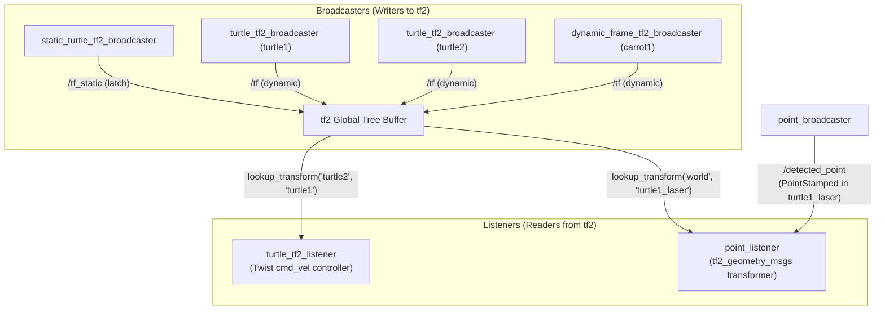

# learning_tf2_py: Practical ROS 2 tf2 Transform Library Samples

This package provides working practical implementations accompanying the `notes/06_tf2_coordinate_frames` concepts.

---

## 📁 Package Architecture

| Executable / File | Role | Key Concepts Covered |
| :--- | :--- | :--- |
| [`static_turtle_tf2_broadcaster.py`](learning_tf2_py/static_turtle_tf2_broadcaster.py) | Static Broadcaster | `StaticTransformBroadcaster`, `/tf_static` topic, Transient Local QoS, Euler to Quaternion |
| [`turtle_tf2_broadcaster.py`](learning_tf2_py/turtle_tf2_broadcaster.py) | Dynamic Broadcaster | `TransformBroadcaster`, `/tf` topic, publishing moving pose `world -> turtle` |
| [`dynamic_frame_tf2_broadcaster.py`](learning_tf2_py/dynamic_frame_tf2_broadcaster.py) | Sub-frame Broadcaster | Dynamic multi-link tf tree (`turtle1 -> carrot1`), orbiting target frames |
| [`turtle_tf2_listener.py`](learning_tf2_py/turtle_tf2_listener.py) | Transform Listener & Controller | `Buffer`, `TransformListener`, `lookup_transform()`, P-controller velocity commands |
| [`point_broadcaster.py`](learning_tf2_py/point_broadcaster.py) | Sensor Publisher | Simulates sensor detections (`PointStamped`) in `turtle1_laser` frame |
| [`point_listener.py`](learning_tf2_py/point_listener.py) | Sensor Point Transformer | `tf2_geometry_msgs`, `Buffer.transform()`, transforming points across frames |
| [`launch/turtle_tf2_demo.launch.py`](launch/turtle_tf2_demo.launch.py) | Follower Demo Launch | Launches turtlesim, 2 broadcasters, 1 static laser, 1 follower listener |
| [`launch/turtle_tf2_carrot.launch.py`](launch/turtle_tf2_carrot.launch.py) | Carrot Follower Launch | Spawns orbiting carrot subframe; turtle2 chases the carrot |

---

## 🚀 Quickstart & Hands-On Commands

### 1. Build and Source
```bash
cd ~/projects/y4_ee/modules/EEEE4077_mechatronics_proj/concepts/ROS2_notes/ros2_ws
colcon build --packages-select learning_tf2_py
source install/setup.bash
```

---

### 2. Demo A: Turtle Follower (Chaser)
Turtle 2 automatically tracks Turtle 1 using `lookup_transform`.

**Terminal 1 (Launch Demo):**
```bash
ros2 launch learning_tf2_py turtle_tf2_demo.launch.py
```

**Terminal 2 (Teleoperate Turtle 1):**
```bash
ros2 run turtlesim turtle_teleop_key
```
*Drive Turtle 1 around using the arrow keys. You will see Turtle 2 steer and follow behind it!*

---

### 3. Demo B: Dynamic "Carrot" Target Frame
Instead of following turtle1 directly, turtle2 follows an orbiting target (`carrot1`) 1.5m offset from turtle1.

**Terminal 1:**
```bash
ros2 launch learning_tf2_py turtle_tf2_carrot.launch.py
```

**Terminal 2:**
```bash
ros2 run turtlesim turtle_teleop_key
```
*Notice how Turtle 2 circles around Turtle 1 even when Turtle 1 is stationary!*

---

### 4. Demo C: Sensor Point Transformation (Stamped Data)
Demonstrates transforming a sensor reading (`PointStamped`) from `turtle1_laser` into `world` coordinates.

**While Demo A or B is running:**

**Terminal 3 (Publish sensor detection):**
```bash
ros2 run learning_tf2_py point_broadcaster
```

**Terminal 4 (Transform point to world frame):**
```bash
ros2 run learning_tf2_py point_listener
```
*Output will show point coordinates in the local laser frame transformed in real time to the world frame.*

---

## 🛠️ Essential tf2 Inspection CLI Tools

When either demo is running, practice using these essential debugging commands:

1. **Echo transform between two frames:**
   ```bash
   ros2 run tf2_ros tf2_echo turtle2 turtle1
   ```

2. **Generate a PDF of the current coordinate frame tree:**
   ```bash
   ros2 run tf2_tools view_frames
   evince frames.pdf
   ```

3. **Inspect tf publishing rates and delays:**
   ```bash
   ros2 run tf2_ros tf2_monitor
   ```

4. **Visual GUI Tree (if rqt is installed):**
   ```bash
   ros2 run rqt_tf_tree rqt_tf_tree
   ```

---

## 🧠 Step-by-Step Code Explanation & Chain-of-Thought (CoT)

This section details the architectural reasoning, mathematical underpinnings, and line-by-line mechanics behind each node in this package.



---

### Step 1: Static Broadcaster (`static_turtle_tf2_broadcaster.py`)

#### 💭 Chain of Thought:
* **The Problem:** The robot chassis has a LiDAR or camera permanently bolted $0.5\,\text{m}$ in front and $0.1\,\text{m}$ above the chassis center. How do we communicate this relationship to ROS?
* **Why NOT a regular dynamic publisher?** The sensor never moves relative to the robot. Publishing dynamic transforms at $50\,\text{Hz}$ wastes CPU cycles, network bandwidth, and message buffers.
* **The Solution:** Use `StaticTransformBroadcaster`. It publishes to `/tf_static` using `Transient Local` QoS (ROS 2's latching mechanism). Any node that starts later immediately receives the cached transform without re-querying.

#### 🔍 Code Walkthrough:
1. **Euler $\to$ Quaternion Conversion:**
   ROS 2 geometry messages represent 3D orientations as unit quaternions $(x, y, z, w)$ to eliminate gimbal lock. For 2D ground robots rotating strictly around the vertical $Z$-axis (yaw $\theta$):
   $$\begin{aligned} q_x &= 0,\quad q_y = 0 \\ q_z &= \sin(\theta / 2),\quad q_w = \cos(\theta / 2) \end{aligned}$$
2. **Populating `TransformStamped`:**
   ```python
   t = TransformStamped()
   t.header.stamp = self.get_clock().now().to_msg()
   t.header.frame_id = 'turtle1'          # Parent frame (robot body)
   t.child_frame_id = 'turtle1_laser'    # Child frame (sensor link)
   t.transform.translation.x = 0.5        # 0.5m ahead
   t.transform.translation.z = 0.1        # 0.1m above ground
   ```
3. **Broadcasting Once:**
   ```python
   self.tf_static_broadcaster = StaticTransformBroadcaster(self)
   self.tf_static_broadcaster.sendTransform(t)
   ```

---

### Step 2: Dynamic Broadcaster (`turtle_tf2_broadcaster.py`)

#### 💭 Chain of Thought:
* **The Problem:** Mobile robots navigate continuously across the environment. As the robot drives, the transformation from the reference world (`world`) to the robot chassis (`turtle1`) changes every millisecond.
* **The Architecture:** Subscribe to raw odometry/pose telemetry (`/turtle1/pose`), convert the planar $(x, y, \theta)$ coordinate into a 3D rigid body transform, and stream it onto `/tf` at high frequency.

#### 🔍 Code Walkthrough:
1. **Configurable via Parameter:**
   `self.declare_parameter('turtlename', 'turtle1')` allows reusing the exact same node binary for `turtle1`, `turtle2`, or any numbered swarm agent.
2. **Dynamic Broadcaster Setup:**
   ```python
   self.tf_broadcaster = TransformBroadcaster(self)
   self.pose_sub = self.create_subscription(Pose, f'/{self.turtlename}/pose', self.handle_turtle_pose, 10)
   ```
3. **Callback Execution on Every Pose Tick:**
   Every time Turtlesim sends a pose packet (~$62.5\,\text{Hz}$):
   * Sets `header.frame_id = 'world'` (the fixed origin).
   * Sets `child_frame_id = self.turtlename` (e.g. `'turtle1'`).
   * Copies $(x, y)$ into `translation` and translates yaw angle $\theta$ into quaternion rotation.
   * Calls `self.tf_broadcaster.sendTransform(t)`.

---

### Step 3: Dynamic Sub-Frame / The "Carrot" (`dynamic_frame_tf2_broadcaster.py`)

#### 💭 Chain of Thought:
* **The Problem:** In autonomous pursuit or camera tracking, you rarely want the follower to collide directly into the leader's center. Instead, you want to track a floating virtual target offset $1.5\,\text{m}$ in front or circling around the leader (like a "carrot on a stick").
* **Why tf2 Excels Here:** Without tf2, you would need complex trigonometry in global world coordinates:
  $$x_{\text{carrot}} = x_{\text{turtle1}} + r \cos(\theta_{\text{turtle1}} + \omega t)$$
  With tf2, you define `carrot1` **purely in `turtle1`'s local coordinate system**:
  $$x_{\text{local}} = r \cos(\omega t),\quad y_{\text{local}} = r \sin(\omega t)$$
  `tf2` automatically multiplies the transformation matrices across the tree:
  $$T_{\text{world}}^{\text{carrot1}} = T_{\text{world}}^{\text{turtle1}} \times T_{\text{turtle1}}^{\text{carrot1}}$$

#### 🔍 Code Walkthrough:
1. In `broadcast_timer_callback` (30 Hz):
   ```python
   t.header.frame_id = 'turtle1'  # Parent is moving turtle1
   t.child_frame_id = 'carrot1'   # Child is virtual subframe
   angle = self.orbit_speed * elapsed
   t.transform.translation.x = self.radius * math.cos(angle)
   t.transform.translation.y = self.radius * math.sin(angle)
   ```
2. Any listener in the ROS system can now request `lookup_transform('turtle2', 'carrot1')` with zero custom math required.

---

### Step 4: Transform Listener & Chaser Controller (`turtle_tf2_listener.py`)

#### 💭 Chain of Thought:
* **The Fundamental Rule of tf2:** **Never subscribe to `/tf` directly!**
  * `/tf` only contains single-hop edge updates ($A \to B$ and $B \to C$).
  * `/tf` packets arrive out of chronological order.
  * To get $A \to C$, you need a transform library that reconstructs the graph, calculates matrix inverses, and interpolates timestamps.
* **The Solution:** Create a `Buffer` to store a rolling 10-second history of transforms, and attach a `TransformListener` to populate it in the background.

#### 🔍 Code Walkthrough:
1. **Instantiate Buffer and Listener:**
   ```python
   self.tf_buffer = Buffer()
   self.tf_listener = TransformListener(self.tf_buffer, self)
   ```
2. **Periodic Control Loop (25 Hz):**
   ```python
   transform = self.tf_buffer.lookup_transform(
       target_frame=self.follower_turtle,  # 'turtle2' (our reference)
       source_frame=self.target_frame,      # 'turtle1' or 'carrot1'
       time=rclpy.time.Time(),              # Time(0) = latest available
       timeout=Duration(seconds=0.05)
   )
   ```
3. **Handling Startup Race Conditions (`TransformException`):**
   When nodes start concurrently, `turtle2_chaser` begins querying before the `/spawn` service finishes creating `turtle2`. Wrapping `lookup_transform` in a `try ... except TransformException` prevents node crashes during initialization.
4. **Proportional (P) Pursuit Controller:**
   The transform returns $dx$ and $dy$ of the target **expressed directly in the follower's reference frame**:
   $$\text{distance} = \sqrt{dx^2 + dy^2},\quad \text{bearing} = \text{atan2}(dy, dx)$$
   * Linear speed: $v = K_p \times \text{distance}$ (bounded by a safety deadband of $0.3\,\text{m}$ to prevent collision).
   * Angular speed: $\omega = K_{\theta} \times \text{bearing}$.
   * Published as `geometry_msgs/Twist` on `/{follower_turtle}/cmd_vel`.

---

### Step 5: Stamped Sensor Point Transformations (`point_broadcaster.py` & `point_listener.py`)

#### 💭 Chain of Thought:
* **The Robotic Use-Case:** A range sensor mounted on the front bumper detects an obstacle $1.2\,\text{m}$ ahead: $(x=1.2, y=0.0)$ in `turtle1_laser`. How does the navigation map find the global world coordinates of that obstacle?
* **The Challenge (Timing Sync):**
  Sensor measurements carry an exact microsecond timestamp (`msg.header.stamp`). If the sensor node publishes faster than the robot base pose updates, querying the exact timestamp causes `ExtrapolationException` ("Lookup would require extrapolation into the future").

#### 🔍 Code Walkthrough:
1. **Registering Geometric Types:**
   ```python
   import tf2_geometry_msgs  # CRITICAL: Registers PointStamped converters with Buffer
   ```
2. **Transforming Points with Latest vs Exact Time:**
   ```python
   # Query latest transform in buffer (avoids 10ms discrete time-gap errors)
   transform = self.tf_buffer.lookup_transform(
       target_frame='world',
       source_frame=msg.header.frame_id,
       time=rclpy.time.Time()
   )

   # Apply rotation & translation matrix to the 3D point
   transformed_point = tf2_geometry_msgs.do_transform_point(msg, transform)
   ```
   * Result: Obstacle at $(1.2, 0.0)$ on the sensor automatically maps to the correct $(x_{\text{world}}, y_{\text{world}})$ taking into account both sensor mounting offset and global robot pose.

---

### 🚨 Top 4 tf2 Pitfalls to Remember

| Pitfall | Symptoms | Root Cause | Solution |
| :--- | :--- | :--- | :--- |
| **Leading Slash** | `"Invalid frame ID '/base_link'"` | In ROS 2, frame names are not topics. Leading slashes are illegal. | Always use `base_link`, never `/base_link`. |
| **Extrapolation into Future** | `Lookup would require extrapolation into future` | Sensor message timestamp is slightly ahead of the latest odometry pose message in the buffer. | Use `time=rclpy.time.Time()` for instant display, or `tf2_ros.MessageFilter` for strict timestamp matching. |
| **Missing Type Conversions** | `Cannot transform type PointStamped` | `tf2_geometry_msgs` was not imported. | Always include `import tf2_geometry_msgs` in nodes doing geometric transformations. |
| **Direct Topic Subscription** | Custom subscriber to `/tf` fails to calculate chain offsets | `/tf` only contains isolated link pairs, not composite transforms. | Never subscribe to `/tf` manually; use `Buffer` + `TransformListener`. |


