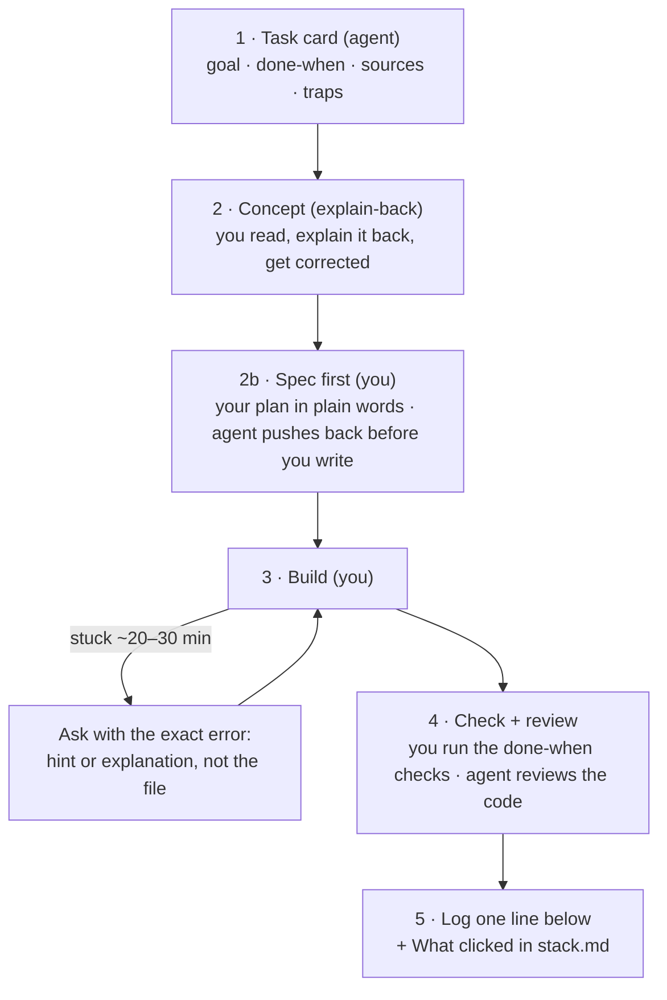

# ws — project colcon workspace

Build: `cd ws && colcon build --symlink-install && source install/setup.bash` (ROS 2 Jazzy, Ubuntu 24.04).
Tutorial drills stay in `concepts/ROS2_notes/ros2_ws`; this workspace holds project code only.

## Learn ↔ build loop

You build, the agent reviews (why: [brief §4](../chapters/notes/brief.md); who types what: `.agents/fyp/AGENTS.md` §4). For each step of a milestone in [plan.md](../chapters/notes/plan.md):

1. **Task card**: the agent writes it into the milestone file (`chapters/notes/milestones/`). Only the current step gets a full card.
2. **Concept**: you read the sources and explain the idea back (chat or `chapters/notes/milestones/answer.md`); the agent corrects until your concept map is right. Your own notes go in `concepts/`.
   - **Spec first**: before writing, say your plan in plain words (what, and why: frames, topics, parameters). The agent pushes back on anything wrong now, when it's cheap.
3. **Build**: you write it, starting from the official example and adapting it to your spec. Ask for syntax freely: the agent gives the *pattern* (the shape of the tag or call), and you place and wire it. It never dictates code blocks to type in. Pure boilerplate (package.xml, CMake, launch skeleton) it can hand over whole.
4. **Check + review**: you run the done-when checks; the agent reviews your code like a senior engineer (bugs, conventions, what it would do differently). A number that matters comes from an experiment (code in `experiments/<q#>_<name>/`); its logs, media and write-up go in [`chapters/research/`](../chapters/research/README.md).
5. **Log**: one line below (learned, broke). Anything that clicked: one line in [stack.md](../chapters/notes/stack.md) *What clicked*. The agent does this bookkeeping at session end (AGENTS.md §0).

## Less friction when running

- `--symlink-install` links Python, launch, URDF/xacro, YAML and world files instead of copying them: after editing one, just relaunch, **no rebuild** [E]. Rebuild only after adding a new file, or changing C++, `CMakeLists.txt` or `package.xml`.
- One alias in `~/.bashrc` instead of sourcing by hand in every terminal (adjust the path):
  `alias fyp='conda deactivate 2>/dev/null; source /opt/ros/jazzy/setup.bash; cd <path>/ws && source install/setup.bash'`

## Packages (planned — created when their milestone starts)

| Package | Milestone | Lang |
|---|---|---|
| `fyp_description` | M1 | xacro/URDF (+ Gazebo sensors) |
| `fyp_bringup` | M1 | launch, Nav2 params, worlds |
| `fyp_harness` | M2 | Python |
| `fyp_msgs` | M3 | msg (unless Q6 finds a standard one) |
| `fyp_dynamic_critic` | M1 hello → M3 | C++ |
| `fyp_fusion` | M4 | Python |

## Log

| Date | Step | Learned / broke |
|---|---|---|
| 2026-11-19 | M1 step 1: Gazebo Harmonic + ros_gz_bridge + sim time; Q3 test | Learned: Gazebo uses gz-transport not DDS, bridge per topic, sim vs wall time, RTF; TF needed between any two frames RViz must relate. Q3 = actors visible to gpu_lidar; RTF ≈ 1.0 with 2 lidars [M:q3_lidar_actor]. Broke: conda Python 3.11 shadowing ROS Python 3.12 (`conda deactivate`); RViz dropped `/scan_high` with no TF to the fixed frame |
