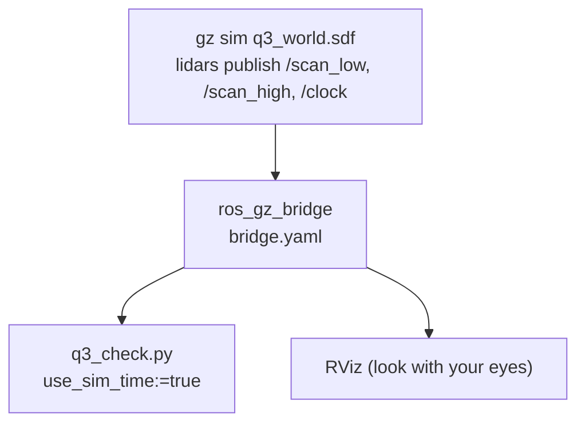

# Q3 — does gpu_lidar see Gazebo actors?

Throwaway experiment (not a colcon package; colcon ignores folders without `package.xml`).
Settles **Q3**; also gives the first RTF number with real sensors (**Q4**). This folder is how to run it; the run logs, media and the answer are in the write-up: [`chapters/research/q3_lidar_actor`](../../../chapters/research/q3_lidar_actor/README.md).

## What's here

| File | What |
|---|---|
| `q3_world.sdf` | Lidar post at origin (0.3 m + 1.0 m lidars), actor walking along x = 2 m, control cylinder at x = -2 m |
| `bridge.yaml` | Bridge config: `/clock` + both scans, Gazebo → ROS (YAML form of the `topic@ROS[GZ` spec) |
| `q3_check.py` | Counts hits in the actor lane and on the control for 28 sim-seconds (2 walking loops), prints a summary |



The control matters: if the **control** gets no hits, the lidar or bridge is broken, and "actor not seen" would mean nothing.

## Run (from this folder, every terminal: `conda deactivate` then `source /opt/ros/jazzy/setup.bash`)

Conda's Python (3.11) breaks `rclpy`, which is built for the system Python 3.12. Check: `which python3` → `/usr/bin/python3`.

**Run 1: with GUI (look first)**

Terminal 1: the sim. The first start downloads the actor mesh from Fuel, so wait for it.
```bash
gz sim -v4 -r q3_world.sdf
```
In the GUI: ⋮ menu (top right) → search **Visualize Lidar** → pick topic `/scan_low`. Watch the rays as the person walks through.

Terminal 2: the bridge
```bash
ros2 run ros_gz_bridge parameter_bridge --ros-args -p config_file:=$PWD/bridge.yaml
```

Terminal 3: checks
```bash
ros2 topic echo /scan_low --once --field header      # frame_id should read lidar_low
python3 q3_check.py --ros-args -p use_sim_time:=true   # ~30 s, prints 2 lines
gz topic -e -t /stats -n 1 | grep real_time_factor    # RTF with GUI
```

Optional, RViz (terminal 4, sim + bridge still running): see [RViz view](#rviz-view) below.

**Run 2: headless (the way the harness will run)**

Stop terminal 1, then:
```bash
gz sim -s -r --headless-rendering -v4 q3_world.sdf
```
Re-run `q3_check.py` and the `/stats` line in terminal 3.

## RViz view

Seeing the scan as ROS sees it (after the bridge), not as Gazebo draws it.

```bash
conda deactivate && source /opt/ros/jazzy/setup.bash
rviz2 --ros-args -p use_sim_time:=true      # sim time: RViz must agree with the scan stamps
```

1. **Fixed Frame.** Left panel → *Global Options* → *Fixed Frame*: click the value, type `lidar_low`, Enter.
   No TF is published in this test, so we view everything *in the lidar's own frame*. The scan's `frame_id` is `lidar_low`, so no transform is needed.
2. **Axes** (orientation). Bottom-left *Add* → *By display type* → `Axes` → OK. Red = +x (towards the actor), green = +y.
3. **Low scan.** *Add* → `LaserScan` → OK. Expand it → *Topic*: pick `/scan_low`. Set *Size (m)* `0.05`, *Color Transformer* `FlatColor`, *Color* red.
4. **High scan.** *Add* → `LaserScan` again → *Topic* `/scan_high`, *Size* `0.05`, *FlatColor* blue.
   This scan is in frame `lidar_high`, but the view is in `lidar_low`. RViz needs a TF between them, or it queues the scans waiting for one and drops them ("queue is full"). In another terminal, publish the fixed offset (high is 0.7 m above low):
   ```bash
   ros2 run tf2_ros static_transform_publisher --z 0.7 --frame-id lidar_low --child-frame-id lidar_high
   ```
   With a real robot, `robot_state_publisher` publishes these sensor transforms from the URDF (step 2).
5. Saved config: `q3.rviz` in this folder (from run 2). Next time: `rviz2 -d q3.rviz --ros-args -p use_sim_time:=true`.

The *Global Status: Fixed Frame — No tf data* warning is expected here: nothing publishes TF at all (until the step-4 static transform). `/scan_low` still draws because its frame *is* the fixed frame.

**What you should see** (grid = 1 m squares, top-down: *Views* panel → *Type* `TopDownOrtho`):
- A short **fixed arc at x ≈ −1.75 m**: the near face of the control cylinder (radius 0.25 m at x = −2).
- A **small moving cluster at x ≈ 2 m** sliding along y from −3 to +3 and back: the actor. Low (red) = two leg blobs that change as the legs swing; high (blue) = one torso blob.
- Nothing else. The ground is never hit because the scan plane is horizontal.

**If it goes wrong:**

| Symptom | Likely cause |
|---|---|
| Status *Fixed Frame: No tf data* / LaserScan "frame does not exist" | Fixed Frame not typed exactly `lidar_low` |
| LaserScan status error, nothing drawn, `ros2 topic hz /scan_low` shows data | RViz started without `use_sim_time:=true` (stamp vs clock mismatch) |
| No `/scan_low` in the topic list | Bridge not running |
| `/scan_high` not drawn, log says "discarding message because the queue is full" | No TF `lidar_low → lidar_high`: run the static_transform_publisher in step 4 |
| Cylinder arc visible, never an actor blob | That's the Q3 = no case: write it down |

## Bring back (into answer.md is fine)

1. The 2 summary lines from `q3_check.py`, for each run (GUI, headless)
2. RTF for each run
3. The `frame_id` from the header echo
4. One sentence: what did you see in Visualize Lidar / RViz when the person crossed?
5. Any errors, pasted as-is (especially Fuel download or rendering errors)

## How to read the result

| Low lidar | High lidar | Control | Meaning |
|---|---|---|---|
| hits in a big share of scans | hits | hits | **Q3 = yes.** Use actors directly |
| none | hits | hits | Actors are seen, but legs at 0.3 m are too thin or too sparse. Decide: raise the lidar / scan resolution, or add a collision proxy |
| none | none | hits | **Q3 = no.** gpu_lidar ignores actors → need moving collision models instead (bigger change) |
| any | any | none | Test broken (bridge/sensor). Fix before concluding |

Not every scan will hit the actor: at the ends of its lane it's 3+ m to the side, and legs swing. Compare shares, not 100 %.
