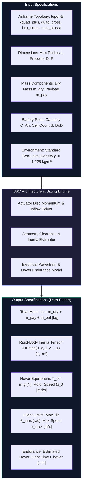
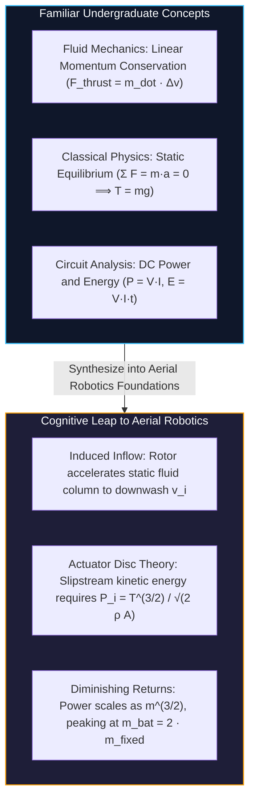
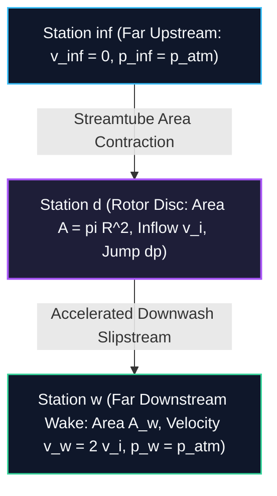
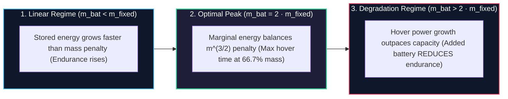
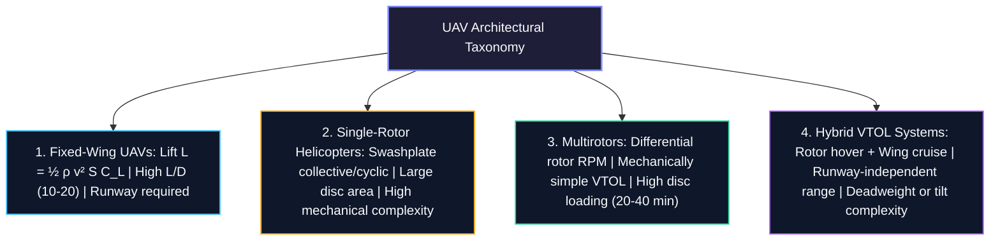
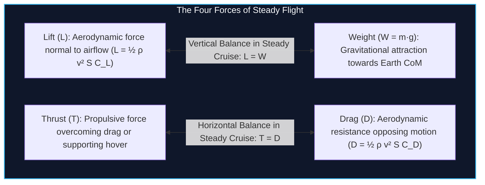
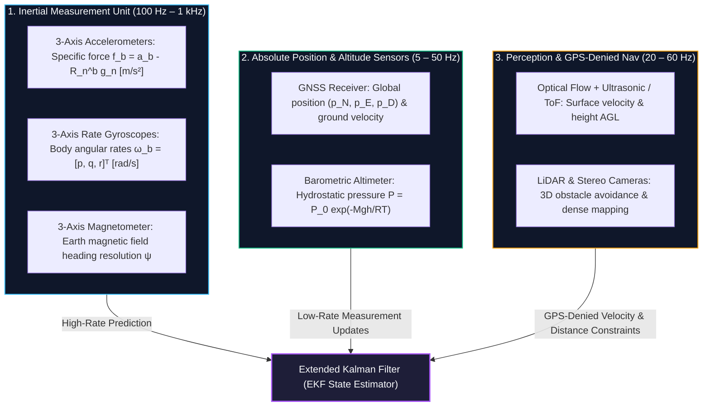
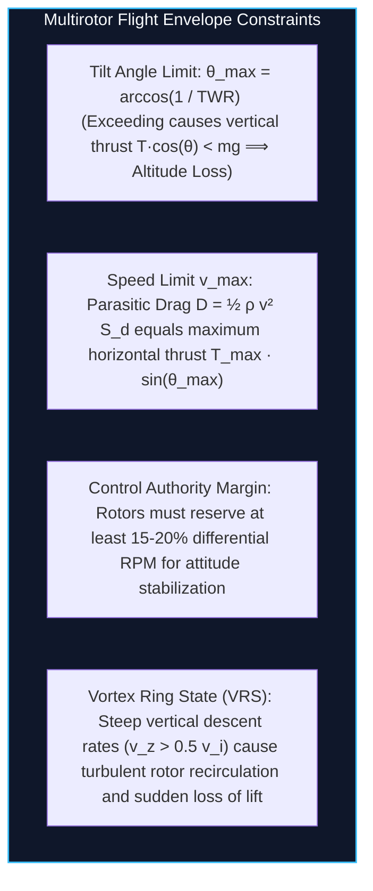

# Topic 1: UAV Architectures, Classification & Flight Envelopes

**Subject:** EEEE4138 — Aerial Robotics  
**Topic:** Topic 1: UAV Architectures, Classification & Flight Envelopes  
**Curriculum Alignment:** Synthesizes Topic 1 Lecture Parts 1 & 2 (`raw/EEEE4138 - Topic 1 Introduction (Part 1).pdf` & `raw/EEEE4138 - Topic 1 Introduction (Part 2).pdf`), Tutorial Problem Sets, and Powertrain Sizing Benchmarks.  
**Companion Interactive Simulation:** [`Widget 1: Flight Envelope & Endurance Visualizer`](artifacts/widgets/widget_1_flight_envelope.html)

---

## 1. Executive Summary & Modular Architecture

Unmanned Aerial Vehicles (UAVs) encompass diverse mechanical layouts, propulsion architectures, and flight regimes. For robotics engineers, an aerial platform is fundamentally an **aerodynamic energy transducer**: chemical energy stored in electrochemical batteries is converted via pulse-width-modulated electronic speed controllers (ESCs) and brushless direct-current (BLDC) motors into rotor shaft torque, which in turn accelerates ambient fluid downwards to generate vertical thrust and control moments.

Designing or controlling a UAV requires understanding the interplay between **aerodynamics**, **actuation geometry**, **energy storage scaling**, and **physical envelope boundaries**:
1. **Actuator Disc Momentum Theory** establishes the lower physical bound on power required to hover as a function of thrust and disc area ($P_i \propto T^{3/2}/\sqrt{A}$).
2. **Battery Sizing Scaling Laws** dictate that adding battery mass exhibits steep diminishing returns; because electrical hover power scales with total mass as $m^{3/2}$, flight endurance peaks at an analytical mass ratio beyond which adding battery cells *shortens* flight time.
3. **Flight Envelopes** define the operational bounds within which an aircraft can sustain flight, resist atmospheric wind disturbances, and track spatial trajectories without control saturation or aerodynamic stall.

---

## 2. Standardized Architecture & API Contract

Following modern modular robotics architecture (e.g., PX4, ArduPilot, ROS 2 microservices), every subsystem must expose an unambiguous mathematical interface with strictly typed inputs, physical outputs, dynamic invariants, and failure conditions.

### Module Interface Table: `UAV_Architecture_And_Sizing`

| Field | Parameter / Symbol | Type / Units | Valid Range | Physical Description | Downstream Consumer |
| :--- | :--- | :--- | :--- | :--- | :--- |
| **Module / Block** | `UAV_Architecture_And_Sizing` | Subsystem Class | - | Core vehicle sizing and flight envelope model | All Downstream Blocks |
| **Input** | `topol` | Enum / String | `+, ×, hex, octo` | Geometric airframe configuration | Topic 4 (Rotor Mixer) |
| **Input** | $L$ | Float / $\text{m}$ | $0.10 \le L \le 1.50$ | Center-of-mass to motor shaft radius | Topic 3 (Dynamics), Topic 4 |
| **Input** | $m_{\text{dry}}, m_{\text{bat}}, m_{\text{pay}}$ | Float / $\text{kg}$ | $> 0$ | Structural, battery, and payload masses | Topic 3 (Rigid-Body Dynamics) |
| **Input** | $D, P$ | Float / $\text{m}$ | $> 0$ | Propeller diameter and geometric pitch | Topic 4 (Aerodynamic Forces) |
| **Input** | $C_{\text{Ah}}, V_{\text{nom}}, DoD$ | Float / $\text{Ah}, \text{V}, -$ | $DoD \in [0.7, 0.85]$ | Battery electrical energy parameters | Sizing & Telemetry HUD |
| **Output** | $m_{\text{total}}$ | Float / $\text{kg}$ | $m > 0$ | Total all-up vehicle mass ($m_{\text{dry}} + m_{\text{bat}} + m_{\text{pay}}$) | Topic 3, Topic 5 (Hover thrust $mg$) |
| **Output** | $J = \text{diag}(J_x, J_y, J_z)$ | Matrix / $\text{kg}\cdot\text{m}^2$ | $J \succ 0$ | Principal moment of inertia tensor | Topic 3 (Euler Rotational ODEs) |
| **Output** | $T_0, \Omega_0$ | Float / $\text{N}, \text{rad/s}$ | $T_0 > 0, \Omega_0 > 0$ | Equilibrium collective thrust and motor speed | Topic 4, Topic 5 (Linearization) |
| **Output** | $\theta_{\max}$ | Float / $\text{rad}$ | $0 < \theta_{\max} < \pi/2$ | Maximum pitch/roll tilt for level altitude hold | Topic 5 (Attitude setpoint clamp) |
| **Output** | $t_{\text{hover}}$ | Float / $\text{min}$ | $t_{\text{hover}} > 0$ | Estimated hover operational endurance | Mission Planner / GCS |
| **Invariant** | Equilibrium Equation | Equation | $T_{\text{total}} = mg$ | Vertical thrust balances total weight at hover | All Topics (Equilibrium invariant) |
| **Failure** | $TWR < 1.2$ | Boolean | `True` / `False` | Thrust-to-Weight Ratio below safe margin | System Abort / Config Warning |
| **Failure** | Prop Clearance Conflict | Boolean | $2R \ge 2L\sin(\frac{\pi}{N})$ | Propeller tips collide or overlap | Geometric Design Violation |

---

## 3. Prerequisite Bridge: Anchoring Aerial Robotics in Fundamentals

Students frequently begin multirotor design with the intuitive assumption that flight endurance scales linearly with battery capacity: *"If a $2000\,\text{mAh}$ battery provides 10 minutes, a $6000\,\text{mAh}$ battery should provide 30 minutes."*

In reality, increasing battery capacity introduces heavy additional mass. The rotor must generate more thrust to maintain hover equilibrium ($T = mg$). Because the aerodynamic power required to generate thrust grows with the **three-halves power** of mass ($P_i \propto m^{3/2}$), the rate of energy consumption accelerates faster than the stored energy increases.

---

## 4. First-Principles Derivation: Actuator Disc Momentum Theory

To understand rotor efficiency, disc loading, and hover power, we model the propeller using Rankine-Froude **1D Actuator Disc Momentum Theory**.

### 4.1 Assumptions of Actuator Disc Theory
1. The rotor is modeled as an infinitely thin actuator disc of area $A = \pi R^2$ supporting a uniform pressure jump $\Delta p$.
2. The flow is 1-dimensional, incompressible ($\rho = \text{const}$), inviscid, quasi-steady, and non-rotational (swirl losses neglected).
3. The far upstream velocity is zero in static hover ($v_\infty = 0$), with ambient atmospheric pressure $p_\infty = p_{\text{atm}}$.
4. Far downstream in the slipstream, pressure recovers to ambient ($p_w = p_{\text{atm}}$).

### 4.2 Step-by-Step Derivation

#### Step 1: Conservation of Mass
The mass flow rate $\dot{m}$ passing through the rotor disc of area $A$ with induced inflow velocity $v_i$ is:
$$\dot{m} = \rho A v_i \tag{1.1}$$

By continuity, this exact mass flow rate passes through every cross-section of the streamtube:
$$\dot{m} = \rho A v_i = \rho A_w v_w \tag{1.2}$$

#### Step 2: Conservation of Linear Momentum
The rotor thrust $T$ equals the net time rate of change of linear momentum of the fluid column from far upstream ($v_\infty = 0$) to far downstream ($v_w$):
$$T = \dot{m}(v_w - v_\infty) = \dot{m} v_w = (\rho A v_i) v_w \tag{1.3}$$

#### Step 3: Conservation of Kinetic Energy
The aerodynamic mechanical power $P$ transferred from the rotor blades to the air equals the work done per unit time, which must equal the net flux of kinetic energy across the control volume:
$$P = T v_i = \frac{1}{2} \dot{m} (v_w^2 - v_\infty^2) = \frac{1}{2} (\rho A v_i) v_w^2 \tag{1.4}$$

#### Step 4: Relation Between Induced and Wake Velocity
Equating the two expressions for power:
$$T v_i = \frac{1}{2} \dot{m} v_w^2 \tag{1.5}$$

Substitute $T = \dot{m} v_w$ from Equation (1.3) into Equation (1.5):
$$(\dot{m} v_w) v_i = \frac{1}{2} \dot{m} v_w^2 \tag{1.6}$$

Assuming non-zero mass flow ($\dot{m} \ne 0$) and non-zero wake velocity ($v_w \ne 0$), divide both sides by $\dot{m} v_w$:
$$\boxed{v_w = 2 v_i} \tag{1.7}$$

> **Key Fluid Mechanical Insight:**  
> Half of the total slipstream velocity acceleration occurs *before* the rotor disc, and the remaining half occurs in the contracting wake *below* the rotor disc.

#### Step 5: Induced Hover Velocity
Now substitute Equation (1.7) back into the momentum expression (Equation 1.3):
$$T = \rho A v_i (2 v_i) = 2 \rho A v_i^2 \tag{1.8}$$

Solving explicitly for the induced hover velocity $v_i$:
$$\boxed{v_i = \sqrt{\frac{T}{2 \rho A}}} \tag{1.9}$$

#### Step 6: Ideal Induced Hover Power
The minimum theoretical mechanical power required to generate thrust $T$ in stationary air is:
$$P_i = T v_i = T \sqrt{\frac{T}{2 \rho A}} = \frac{T^{3/2}}{\sqrt{2 \rho A}} \tag{1.10}$$

In static hover equilibrium, total thrust equals total weight ($T = mg$):
$$\boxed{P_i = \frac{(mg)^{3/2}}{\sqrt{2 \rho A}}} \tag{1.11}$$

---

## 5. Aerodynamic Metrics & Multi-Rotor Scaling

### 5.1 Disc Loading ($DL$) and Power Loading ($PL$)
To evaluate rotor efficiency across different aircraft scales:

* **Disc Loading ($DL$):** Thrust per unit disc area:
  $$DL = \frac{T}{A} \quad \left[\frac{\text{N}}{\text{m}^2}\right] \tag{1.12}$$
* **Power Loading ($PL$):** Thrust generated per unit of induced power:
  $$PL = \frac{T}{P_i} = \frac{T}{T \sqrt{\frac{T}{2\rho A}}} = \sqrt{\frac{2\rho}{DL}} \quad \left[\frac{\text{N}}{\text{W}}\right] \tag{1.13}$$

> **The Fundamental Tradeoff:**  
> Power Loading is inversely proportional to the square root of Disc Loading ($PL \propto 1/\sqrt{DL}$).  
> - **Low Disc Loading (e.g., Helicopters, Large Props):** Large disc area $A$, low induced velocity $v_i$, high power loading ($PL \approx 8\text{--}12\,\text{N/W}$). Highly energy efficient in hover.  
> - **High Disc Loading (e.g., Small FPV Racers):** Small disc area $A$, high downwash velocity $v_i$, low power loading ($PL \approx 2\text{--}4\,\text{N/W}$). Highly inefficient in hover, requiring high electrical power.

### 5.2 Rotor Area Partitioning: Helicopter vs Multirotor
Consider an aircraft of mass $m$ comparing a **single large helicopter rotor** of radius $R_1$ against an **$N$-rotor multirotor** where each rotor has radius $R_N$.

If the overall aircraft footprint is constrained such that each rotor must fit within the frame envelope:
$$A_{\text{single}} = \pi R_1^2, \qquad A_{\text{multi}} = N \pi R_N^2$$

If $R_N \approx R_1 / \sqrt{N}$, the total area is similar. However, mechanical arm clearances dictate $R_N < R_1 / \sqrt{N}$, so:
$$A_{\text{multi}} < A_{\text{single}} \implies DL_{\text{multi}} > DL_{\text{single}}$$

Consequently, multirotors suffer from higher disc loading and lower hover efficiency than single-rotor helicopters of the same mass, trading hover endurance for **mechanical simplicity** (zero swashplates, no cyclic pitch linkages) and **agility**.

---

## 6. The Mathematical Proof of Diminishing Battery Returns

Let us formally prove why adding battery cells eventually decreases flight time.

### 6.1 Total Mass Formulation
Let the total aircraft mass $m$ be partitioned into:
$$m = m_{\text{fixed}} + m_{\text{bat}} \tag{1.14}$$
where $m_{\text{fixed}} = m_{\text{dry}} + m_{\text{payload}}$ is the invariant mass of the airframe, motors, electronics, and mission sensor payload.

### 6.2 Electrical Power Consumption
From Equation (1.11), the actual electrical hover power is:
$$P_{\text{elec}} = \frac{P_i}{\eta_{\text{total}}} + P_{\text{avionics}} = \frac{g^{3/2}}{\eta_{\text{total}}\sqrt{2\rho A}} m^{3/2} + P_{\text{avionics}} \tag{1.15}$$
where $\eta_{\text{total}} = FM \cdot \eta_{\text{motor}} \cdot \eta_{\text{esc}}$ combines the aerodynamic Figure of Merit ($FM \approx 0.70$), motor efficiency ($\eta_m \approx 0.85$), and ESC inverter efficiency ($\eta_{\text{esc}} \approx 0.95$).

Let $K_p = \frac{g^{3/2}}{\eta_{\text{total}}\sqrt{2\rho A}}$. Assuming avionics power is small compared to propulsion ($P_{\text{avionics}} \ll P_{\text{elec}}$):
$$P_{\text{elec}} \approx K_p (m_{\text{fixed}} + m_{\text{bat}})^{3/2} \tag{1.16}$$

### 6.3 Stored Usable Battery Energy
The usable electrical energy stored in a lithium battery with specific gravimetric energy density $e_{\text{bat}}$ ($\text{J/kg}$ or $\text{W}\cdot\text{h/kg}$) and Depth of Discharge $DoD$ is:
$$E_{\text{usable}} = DoD \cdot e_{\text{bat}} \cdot m_{\text{bat}} = K_e m_{\text{bat}} \tag{1.17}$$
where $K_e = DoD \cdot e_{\text{bat}}$ is a constant of battery chemistry.

### 6.4 Hover Endurance Function
The hover flight endurance $t_{\text{hover}}$ is the stored energy divided by power consumption:
$$t_{\text{hover}}(m_{\text{bat}}) = \frac{E_{\text{usable}}}{P_{\text{elec}}} = \frac{K_e}{K_p} \frac{m_{\text{bat}}}{(m_{\text{fixed}} + m_{\text{bat}})^{3/2}} \tag{1.18}$$

### 6.5 Finding the Analytical Maximum
To find the battery mass that maximizes endurance, differentiate $t_{\text{hover}}$ with respect to $m_{\text{bat}}$ and set the derivative to zero:
$$\frac{d}{dm_{\text{bat}}} \left[ \frac{m_{\text{bat}}}{(m_{\text{fixed}} + m_{\text{bat}})^{3/2}} \right] = 0 \tag{1.19}$$

Applying the quotient rule:
$$\frac{1 \cdot (m_{\text{fixed}} + m_{\text{bat}})^{3/2} - m_{\text{bat}} \cdot \frac{3}{2}(m_{\text{fixed}} + m_{\text{bat}})^{1/2}}{(m_{\text{fixed}} + m_{\text{bat}})^3} = 0 \tag{1.20}$$

Dividing by the non-zero common factor $(m_{\text{fixed}} + m_{\text{bat}})^{1/2}$:
$$(m_{\text{fixed}} + m_{\text{bat}}) - \frac{3}{2} m_{\text{bat}} = 0 \tag{1.21}$$
$$m_{\text{fixed}} - \frac{1}{2} m_{\text{bat}} = 0 \implies \boxed{m_{\text{bat}} = 2 m_{\text{fixed}}} \tag{1.22}$$

  <iframe src="artifacts/widgets/widget_1_flight_envelope.html" width="100%" height="520" frameborder="0" style="border-radius: 8px; box-shadow: 0 4px 6px -1px rgba(0,0,0,0.1);"></iframe>
  
<em>Interactive Visualizer: <a href="artifacts/widgets/widget_1_flight_envelope.html" target="_blank">Open in standalone tab ↗</a></em>

> **The 2:1 Battery-to-Dry Mass Sizing Limit:**  
> In pure hover, the theoretical maximum endurance occurs when **battery mass is exactly twice the fixed empty mass** ($m_{\text{bat}} = 2 m_{\text{fixed}}$), giving a battery mass fraction of $m_{\text{bat}} / m_{\text{total}} = 2/3 \approx 66.7\%$.  
> Beyond this point, any added battery cell increases hover power consumption faster than it adds usable energy, causing endurance to strictly decrease!  
> In practice, because motors must maintain dynamic control authority and margin for wind gusts ($TWR \ge 1.5$), real-world platforms size batteries at $m_{\text{bat}} \approx 0.8\text{--}1.2 \times m_{\text{fixed}}$ (30% to 50% of all-up mass).

---

## 7. UAV Classifications & Operational Flight Regimes

### 7.1 Regulatory & Operational Regimes
Civil aviation authorities (FAA, EASA, UK CAA) classify UAV operations into three primary operational envelopes based on pilot line of sight and operational risk:

| Operational Category | Pilot Sight Baseline | Maximum Range / Altitude Bounds | Primary Collision Avoidance | Mandatory Avionics & Failsafes |
| :--- | :--- | :--- | :--- | :--- |
| **VLOS** (Visual Line of Sight) | Direct, unaided visual contact | Horizontal $\le 500\,\text{m}$, AGL $\le 120\,\text{m}$ ($400\,\text{ft}$) | Pilot "see-and-avoid" visual observation | Barometer, basic telemetry, manual override |
| **EVLOS** (Extended Visual Line of Sight) | Chained visual observers along corridor | Extended via visual observer relay stations | Observer radio situational reports to pilot | Low-latency voice/data comms, return-to-home (RTH) |
| **BVLOS** (Beyond Visual Line of Sight) | Zero direct optical visibility | Mission envelope bound (unlimited visual range) | Automated onboard Sense-and-Avoid (SAA) | ADS-B In/Out, Radar/Optical transponders, Geofencing, Auto-RTH |

---

## 8. Principles of Aerodynamic Flight: The Four Forces

Every aircraft in atmospheric flight is acted upon by four vector forces:

1. **Weight ($W = mg$):** Gravitational attraction pulling the aircraft mass towards the center of the Earth. Acts through the vehicle Center of Mass (CoM).
2. **Thrust ($T$):** Forward or upward propulsive force generated by the propulsion system (rotors or propellers).
3. **Lift ($L$):** Aerodynamic force generated perpendicular to the oncoming relative airflow by fluid pressure differences across lifting surfaces:
   $$L = \frac{1}{2} \rho v^2 S C_L \tag{1.23}$$
   where $\rho$ is air density, $v$ is true airspeed, $S$ is wing planform area, and $C_L$ is the non-dimensional lift coefficient.
4. **Drag ($D$):** Aerodynamic force resisting motion, parallel to relative airflow:
   $$D = \frac{1}{2} \rho v^2 S C_D \tag{1.24}$$
   where $C_D = C_{D,0} + \frac{C_L^2}{\pi e AR}$ consists of parasite drag $C_{D,0}$ and lift-induced drag.

### Aerofoil Aerodynamics and Stall
For small angles of attack ($\alpha$), the lift coefficient increases linearly:
$$C_L(\alpha) = C_{L,0} + C_{L\alpha} \alpha \tag{1.25}$$

At the critical angle of attack ($\alpha_{\text{stall}} \approx 14^\circ\text{--}18^\circ$), boundary layer separation occurs over the suction surface, causing catastrophic loss of lift and a sharp rise in drag.

The minimum forward airspeed required for a fixed-wing aircraft to sustain level flight ($L = mg$) at maximum lift coefficient $C_{L,\max}$ is the **stall speed**:
$$\boxed{v_{\text{stall}} = \sqrt{\frac{2mg}{\rho S C_{L,\max}}}} \tag{1.26}$$

---

## 9. Powertrain Components & Electrical Architecture

### 9.1 Brushless DC (BLDC) Motors
Multirotors use outrunner permanent-magnet synchronous motors (BLDC). Unlike brushed motors, commutation is performed electronically by the ESC.

* **Motor Velocity Constant ($K_v$):**
  Defines the theoretical rotational speed generated per applied Volt of back-EMF under no load:
  $$\Omega_{\text{no-load}} [\text{RPM}] = K_v \times V_{\text{applied}} \tag{1.27}$$
  In SI units ($\text{rad}/(\text{s}\cdot\text{V})$):
  $$K_{v,\text{SI}} = K_v \cdot \frac{2\pi}{60} \tag{1.28}$$
* **Motor Torque Constant ($K_t$):**
  Relates mechanical shaft torque $\tau_m$ to motor armature current $I_m$:
  $$\tau_m = K_t \cdot I_m \tag{1.29}$$
  By conservation of electrical and mechanical energy ($V_{\text{bemf}} I_m = \tau_m \Omega$), in ideal SI units:
  $$\boxed{K_t = \frac{1}{K_{v,\text{SI}}} = \frac{60}{2\pi K_v}} \quad \left[\frac{\text{N}\cdot\text{m}}{\text{A}}\right] \tag{1.30}$$

> **Motor Selection Rule:**  
> - **High $K_v$ (e.g., $2000\text{--}2700\,\text{RPM/V}$):** Low torque constant $K_t$, high RPM. Paired with small, light propellers ($5\text{--}6\text{ inch}$) on acrobatic racing drones.  
> - **Low $K_v$ (e.g., $300\text{--}600\,\text{RPM/V}$):** High torque constant $K_t$, low RPM. Paired with large propellers ($15\text{--}22\text{ inch}$) and high voltage ($6S\text{--}12S$) on heavy-lift and endurance platforms.

### 9.2 Electronic Speed Controllers (ESCs)
The ESC is a 3-phase MOSFET inverter bridge commanded by the autopilot via high-frequency protocols (Standard PWM at $50\text{--}490\,\text{Hz}$, OneShot125, or digital DShot300/DShot600). The ESC modulates the effective stator voltage, governing the motor speed.

### 9.3 Lithium-Polymer (LiPo) Batteries & Depth of Discharge
LiPo chemistry provides high gravimetric power density ($> 1500\,\text{W/kg}$) and high specific energy ($150\text{--}250\,\text{W}\cdot\text{h/kg}$).

| Cell Operating State | Cell Voltage Threshold | Pack Voltage (3S / 11.1V) | Pack Voltage (4S / 14.8V) | Pack Voltage (6S / 22.2V) | Operational Significance |
| :--- | :--- | :--- | :--- | :--- | :--- |
| **Fully Charged** | $4.20\,\text{V/cell}$ | $12.60\,\text{V}$ | $16.80\,\text{V}$ | $25.20\,\text{V}$ | Maximum charge termination limit |
| **Nominal Baseline** | $3.70\,\text{V/cell}$ | $11.10\,\text{V}$ | $14.80\,\text{V}$ | $22.20\,\text{V}$ | Rating baseline for power calculations |
| **Storage Level** | $3.85\,\text{V/cell}$ | $11.55\,\text{V}$ | $15.40\,\text{V}$ | $23.10\,\text{V}$ | Optimal chemical stability for shelf storage |
| **Critical Cut-off** | $3.20\text{--}3.30\,\text{V/cell}$ | $9.60\text{--}9.90\,\text{V}$ | $12.80\text{--}13.20\,\text{V}$ | $19.20\text{--}19.80\,\text{V}$ | Mandatory autopilot emergency landing trigger |

* **C-Rating and Current Delivery:**
  The C-rating defines maximum safe continuous discharge current relative to capacity:
  $$I_{\max,\text{cont}} = C_{\text{rating}} \times C_{\text{Ah}} \quad [\text{A}] \tag{1.31}$$
  *Example:* A $4000\,\text{mAh}$ ($4.0\,\text{Ah}$) battery rated at $30C$ delivers up to $30 \times 4.0 = 120\,\text{A}$ continuously.

> [!WARNING]
> **The 80% Depth of Discharge ($DoD$) Rule & Chemical Degradation:**  
> Discharging a LiPo pack beyond $80\%$ of its nominal capacity ($DoD > 0.80$, resting cell voltage $< 3.50\,\text{V}$) triggers irreversible chemical damage:
> - **Lithium Plating & Dendrites:** Metallic lithium precipitates on the graphite anode, piercing the separator membrane and causing internal micro-shorts.
> - **Impedance Spike & Thermal Runaway:** Internal resistance increases exponentially, accelerating Joule heating ($I^2 R$) and pouch swelling.
> - **Avionics Brownout:** Under high throttle maneuvers, damaged cells suffer catastrophic voltage sag below the ESC low-voltage threshold, inducing mid-air motor cutoff.

---

## 10. Sensor Suites & Avionics Packages

An autonomous aerial robot relies on a complementary multisensor suite to close its flight control loops:

---

## 11. Flight Envelope Boundaries & Mathematical Limits

The operational flight envelope of a multirotor defines the boundary where physical laws constrain steady-state operation:

### 11.1 Thrust-to-Weight Ratio ($TWR$)
$$TWR = \frac{T_{\max}}{m g} = \frac{\sum_{i=1}^N T_{i,\max}}{m g} \tag{1.32}$$
* **Hard Safety Minimum:** $TWR \ge 1.5$. If $TWR < 1.5$, the aircraft lacks sufficient dynamic control authority to reject vertical down-drafts and stabilize attitude simultaneously.
* **Camera / Mapping Multirotors:** $TWR \approx 1.8\text{--}2.2$.
* **Agile Racing Quads:** $TWR \approx 4.0\text{--}8.0$.

### 11.2 Maximum Tilt Angle Limit ($\theta_{\max}$)
To fly forward at steady speed, the multirotor pitches down by angle $\theta$. The vertical component of collective thrust must satisfy equilibrium to prevent altitude loss:
$$T \cos\theta = mg \tag{1.33}$$

Since the maximum available thrust is $T_{\max} = TWR \cdot mg$, the maximum bank or pitch tilt angle that permits maintaining altitude without sinking is:
$$\cos\theta_{\max} = \frac{mg}{T_{\max}} = \frac{1}{TWR} \implies \boxed{\theta_{\max} = \arccos\left(\frac{1}{TWR}\right)} \tag{1.34}$$

### 11.3 Maximum Horizontal Acceleration
At maximum tilt $\theta_{\max}$, the horizontal acceleration component $a_{x,\max}$ is:
$$m a_{x,\max} = T_{\max} \sin\theta_{\max} = \frac{mg}{\cos\theta_{\max}} \sin\theta_{\max} = mg \tan\theta_{\max} \tag{1.35}$$
$$\boxed{a_{x,\max} = g \tan(\theta_{\max}) = g \sqrt{TWR^2 - 1}} \tag{1.36}$$

*Example:* For $TWR = 2.0$, $\theta_{\max} = \arccos(0.5) = 60^\circ$, yielding $a_{x,\max} = g \sqrt{2^2 - 1} = g\sqrt{3} \approx 1.732 g \approx 17.0\,\text{m/s}^2$.

---

## 12. Comprehensive Worked Numerical Example

To anchor these derivations in authoritative course benchmarks, we solve the complete powertrain and flight envelope drill matching Tutorial sizing specifications.

### Problem Statement
A quadrotor platform ($N=4$) is configured with the following parameters:
* All-up mass: $m = 1.60\,\text{kg}$
* Propeller radius: $R = 0.127\,\text{m}$ ($10\text{-inch}$ diameter $D = 0.254\,\text{m}$)
* Maximum thrust per motor: $T_{i,\max} = 8.00\,\text{N}$
* Battery pack: $4S$ LiPo ($V_{\text{nom}} = 14.8\,\text{V}$, capacity $C = 4000\,\text{mAh} = 4.00\,\text{Ah}$, usable $DoD = 0.80$)
* Total combined powertrain efficiency: $\eta_{\text{total}} = 0.55$
* Avionics base power draw: $P_{\text{avionics}} = 8.00\,\text{W}$
* Standard sea-level air density: $\rho = 1.225\,\text{kg/m}^3$, gravitational acceleration $g = 9.81\,\text{m/s}^2$

---

### Step-by-Step Solution

#### Step 1: Aircraft Weight and Thrust-to-Weight Ratio
Total vehicle weight:
$$W = mg = 1.60 \times 9.81 = 15.696\,\text{N}$$

Total available maximum thrust:
$$T_{\max} = 4 \times T_{i,\max} = 4 \times 8.00 = 32.00\,\text{N}$$

Thrust-to-Weight Ratio:
$$TWR = \frac{T_{\max}}{W} = \frac{32.00}{15.696} = \mathbf{2.0387 \approx 2.04} \quad (\ge 1.5 \implies \text{Safe})$$

#### Step 2: Total Propeller Disc Area
Each rotor sweeps an area of $A_i = \pi R^2 = \pi (0.127)^2 = 0.05067\,\text{m}^2$.  
Total collective actuator disc area:
$$A = 4 \times A_i = 4 \times 0.05067 = \mathbf{0.20268\,\text{m}^2 \approx 0.2027\,\text{m}^2}$$

Disc Loading at hover:
$$DL = \frac{W}{A} = \frac{15.696}{0.20268} = \mathbf{77.44\,\text{N/m}^2}$$

#### Step 3: Induced Inflow Velocity in Hover
Applying Actuator Disc Theory (Equation 1.9):
$$v_i = \sqrt{\frac{W}{2 \rho A}} = \sqrt{\frac{15.696}{2 \times 1.225 \times 0.20268}} = \sqrt{\frac{15.696}{0.49657}} = \sqrt{31.609} = \mathbf{5.622\,\text{m/s}}$$

#### Step 4: Ideal Induced Hover Power
$$P_i = W \cdot v_i = 15.696 \times 5.622 = \mathbf{88.24\,\text{W}}$$

#### Step 5: Total Electrical Power Consumption
Accounting for combined powertrain losses ($\eta_{\text{total}} = 0.55$) and avionics draw:
$$P_{\text{elec}} = \frac{P_i}{\eta_{\text{total}}} + P_{\text{avionics}} = \frac{88.24}{0.55} + 8.00 = 160.44 + 8.00 = \mathbf{168.44\,\text{W}}$$

#### Step 6: Steady Hover Current Draw
$$I_{\text{hover}} = \frac{P_{\text{elec}}}{V_{\text{nom}}} = \frac{168.44\,\text{W}}{14.8\,\text{V}} = \mathbf{11.38\,\text{A}}$$

Per-motor hover current: $I_{i,\text{hover}} = 11.38 / 4 = 2.85\,\text{A}$.

#### Step 7: Usable Battery Energy and Hover Flight Time
Usable capacity respecting the 80% Depth of Discharge rule:
$$C_{\text{usable}} = DoD \times C_{\text{Ah}} = 0.80 \times 4.00\,\text{Ah} = 3.20\,\text{Ah}$$

Estimated continuous hover endurance:
$$t_{\text{hover}} = \frac{C_{\text{usable}}}{I_{\text{hover}}} \times 60\,\text{min/h} = \frac{3.20\,\text{Ah}}{11.38\,\text{A}} \times 60 = \mathbf{16.87\,\text{minutes}}$$
$$(16\,\text{minutes and } 52\,\text{seconds})$$

#### Step 8: Maximum Allowable Tilt Angle
$$\theta_{\max} = \arccos\left(\frac{1}{TWR}\right) = \arccos\left(\frac{1}{2.0387}\right) = \arccos(0.4905) = \mathbf{60.63^\circ \approx 60.6^\circ}$$

#### Step 9: Maximum Sustained Horizontal Acceleration
$$a_{x,\max} = g \tan(\theta_{\max}) = 9.81 \times \tan(60.63^\circ) = 9.81 \times 1.777 = \mathbf{17.43\,\text{m/s}^2} \quad (1.78\,g)$$

---

## 13. Common Student Pitfalls & Engineering Traps

### Pitfall 1: The "Bigger Battery = Longer Flight" Fallacy
* **The Error:** Assuming flight endurance scales linearly with battery capacity ($2\times \text{battery} = 2\times \text{time}$).
* **The Physics:** Adding battery mass increases hover thrust demand ($T = mg$). Aerodynamic induced power grows with mass as $m^{3/2}$. Past $m_{\text{bat}} = 2 m_{\text{fixed}}$, power consumption growth strictly outpaces stored energy addition.
* **The Mitigation:** Enforce the analytical sizing limit $m_{\text{bat}} \le 2 m_{\text{fixed}}$ (maximum $66.7\%$ battery mass fraction). Target $m_{\text{bat}} \approx 0.8\text{--}1.2 m_{\text{fixed}}$ for balanced agility and payload margin.

### Pitfall 2: Ignoring Depth of Discharge ($DoD$) in Mission Planning
* **The Error:** Calculating flight endurance using $100\%$ nameplate battery capacity ($t = C_{\text{Ah}} / I_{\text{hover}}$).
* **The Physics:** Consuming $>80\%$ capacity causes severe voltage sag and irreversible chemical degradation. Real usable capacity is strictly $0.80 \times C_{\text{Ah}}$.
* **The Mitigation:** Scale all endurance predictions by the usable fraction $\eta_{\text{DoD}} = 0.80$. Configure autopilot fail-safe battery alarms at $3.55\,\text{V/cell}$ (Warning) and $3.40\,\text{V/cell}$ (Mandatory Auto-Land).

### Pitfall 3: Propeller Tip Compressibility Shocks
* **The Error:** Increasing propeller diameter and motor RPM simultaneously to maximize thrust without checking tip speed.
* **The Physics:** Propeller blade tips travel at linear speed $v_{\text{tip}} = \Omega R$. When $v_{\text{tip}}$ exceeds Mach 0.65 ($v_{\text{tip}} > 220\,\text{m/s}$ in standard air $a = 340\,\text{m/s}$), localized transonic shock waves form on blade tips, causing boundary layer separation, extreme drag divergence, and intense acoustic noise.
* **The Mitigation:** Maintain tip Mach number $M_{\text{tip}} = \frac{\Omega R}{a} \le 0.60$. For large props ($D \ge 15\text{ in}$), select low $K_v$ motors ($< 400\,\text{RPM/V}$) to cap rotational velocity.

### Pitfall 4: Confusing Ground Speed with Relative Airspeed
* **The Error:** Using GPS ground speed to compute aerodynamic lift and drag forces ($L = \frac{1}{2}\rho v_{\text{ground}}^2 S C_L$).
* **The Physics:** Aerodynamic forces depend strictly on the relative air velocity vector $\mathbf{v}_{\text{air}} = \mathbf{v}_{\text{ground}} - \mathbf{v}_{\text{wind}}$. A fixed-wing drone flying downwind at $15\,\text{m/s}$ in a $15\,\text{m/s}$ tailwind has zero relative airspeed and will stall instantly.
* **The Mitigation:** Always install a dynamic pitot-static airspeed sensor for winged or hybrid UAVs. In software, estimate wind vectors using EKF wind states to protect minimum stall margin ($v_{\text{air}} \ge 1.3 v_{\text{stall}}$).

### Pitfall 5: Designing Around Burst C-Ratings
* **The Error:** Sizing battery wiring and ESC current limits based on the manufacturer's 10-second "Burst C-Rating" (e.g. 100C).
* **The Physics:** Burst ratings represent short thermal transients before melting. Sustained flight at burst currents causes excessive $I^2 R$ heat, melting solder joints and causing thermal runaway in LiPo cells.
* **The Mitigation:** Size continuous hover current at $\le 50\%$ of the battery's continuous C-rating ($I_{\text{hover}} \le 0.5 I_{\max,\text{cont}}$) to ensure cool operation, high efficiency, and extended cycle life.

---

## 14. Bidirectional Cross-References & Downstream Navigation

To explore how parameters derived here integrate into the rest of the aerial robotics stack:

* [**Topic 2: Coordinate Frames & Kinematics**](topic_2_coordinate_frames.md)  
  *Translates body-fixed thrust axes into inertial NED coordinates via Direction Cosine Matrices $R_b^n$ and unit quaternions.*
* [**Topic 3: 6-DoF Rigid-Body Dynamics**](topic_3_kinematics_dynamics.md)  
  *Consumes total mass $m$ and inertia tensor $J = \text{diag}(J_x, J_y, J_z)$ to integrate Newton-Euler translational and rotational equations of motion.*
* [**Topic 4: Rotor Forces, Moments & Control Allocation**](topic_4_forces_moments.md)  
  *Maps collective hover thrust $T_0$ and moments into individual motor speeds $\Omega_i = \sqrt{T_i / k_T}$ across $+$, $\times$, and hexarotor geometries.*
* [**Topic 5: Cascaded Flight Control (Parts I & II)**](topic_5_flight_control.md)  
  *Utilizes the tilt-to-accelerate mapping $\theta^d = -u_x / g$ and altitude thrust compensation $T_{\text{cmd}} = \frac{m(g - u_z)}{\cos\phi \cos\theta}$ constrained by $\theta_{\max}$.*
* [**Companion Widget 1: Interactive Flight Envelope & Endurance Visualizer**](artifacts/widgets/widget_1_flight_envelope.html)  
  *Directly experiment with airframe arm radius, propeller diameter, battery cell count, payload mass, and visualize the non-linear endurance curve in real time.*
