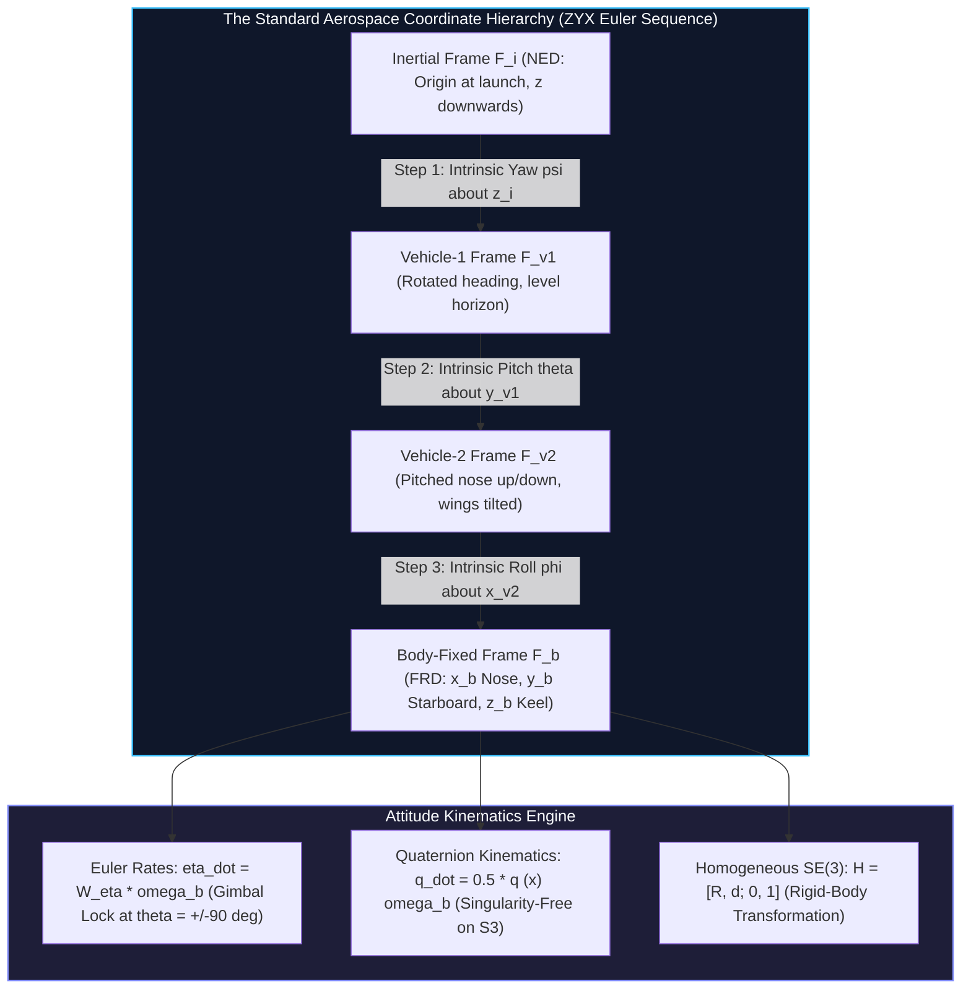
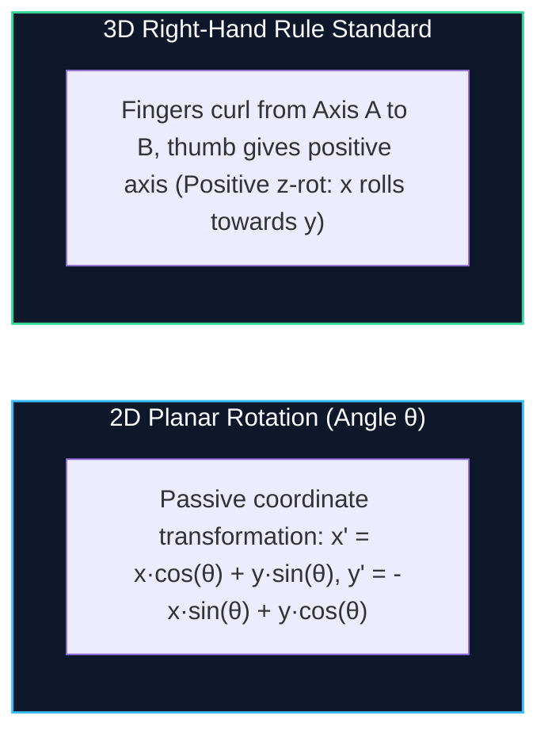
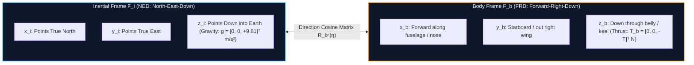
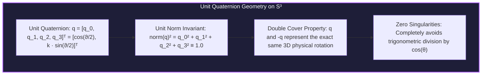
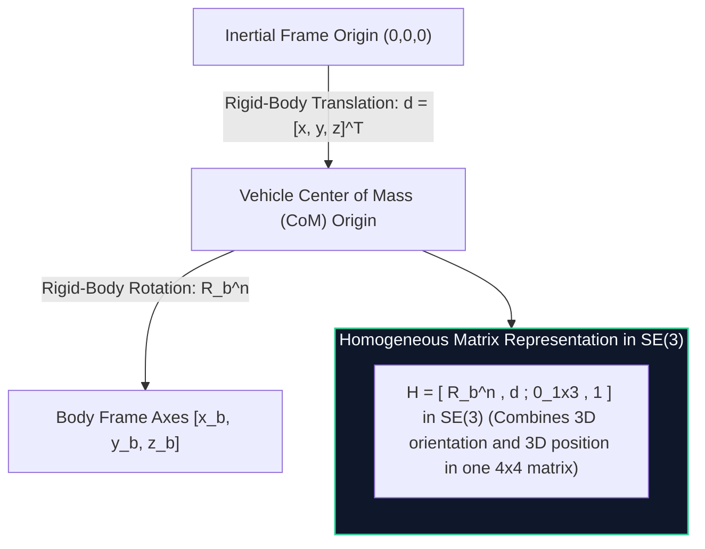

# Topic 2: Coordinate Frames, Euler Rotations & Attitude Kinematics

**Subject:** EEEE4138 — Aerial Robotics  
**Module:** Topic 2: Coordinate Frames, Euler Rotations & Attitude Kinematics  
**Authoritative Slide & Tutorial Alignment:** 
* `EEEE4138 - Topic 2 Reference Frames Part 1_v2.pdf` (Slides 1–32)
* `EEEE4138 - Topic 2 Reference Frames Part 2.pdf` (Slides 1–22)
* `EEEE4138 Tutorial 1 Topic 2 Reference Frames and Orientation.pdf` (Pages 1–10)
* Downstream Integration: Topic 3 (`topic_3_kinematics_dynamics.md`), Topic 4 (`topic_4_forces_moments.md`), Topic 5 (`topic_5_flight_control.md`)  
**Interactive Companion:** [`artifacts/widgets/widget_2_frames_gimbal_lock.html`](artifacts/widgets/widget_2_frames_gimbal_lock.html)

---

## 1. Executive Summary & Architectural Overview

In aerial robotics, an unmanned aerial vehicle (UAV) operates simultaneously across physical, aerodynamic, computational, and navigational domains. A fundamental challenge in modeling and controlling flight is that no single coordinate system is suitable for all physical phenomena:
* **Newton's Laws of Motion** are valid only in an **Inertial Reference Frame** ($\mathcal{F}_i$).
* **Aerodynamic Forces and Rotor Thrusts** are generated relative to the physical airframe and are naturally expressed in a **Body-Fixed Frame** ($\mathcal{F}_b$).
* **On-Board Inertial Sensors** (tri-axial MEMS rate gyroscopes and accelerometers) measure specific force and angular velocity along **Body Axes**.
* **Navigation Sensors** (GNSS receivers, RTK beacons, magnetometers) measure global position, ground track, and heading relative to **Earth-Fixed Geographic Frames**.
* **Aerodynamic Airflow** (lift, drag, sideslip, angle of attack) depends strictly on the aircraft velocity vector relative to the surrounding airmass, requiring **Stability** ($\mathcal{F}_s$) and **Wind** ($\mathcal{F}_w$) frames.

To unify these disparate physics into a tractable computational pipeline, this chapter establishes the **standard 6-frame coordinate hierarchy** used throughout EEEE4138. We derive the analytical transformations between frames, formalize the **Direction Cosine Matrix (DCM)** via the standard aerospace Tait-Bryan $Z$-$Y$-$X$ intrinsic sequence, invert the kinematics mapping body angular rates $[p, q, r]^T$ to Euler rates $[\dot{\phi}, \dot{\theta}, \dot{\psi}]^T$, analyze the mathematical singularity known as **Gimbal Lock**, and construct the singularity-free **Unit Quaternion ($\mathbb{S}^3$)** formulation required for high-agility aerobatic flight control.

---

## 2. Standardized Architecture & Modular API Contract

Following the systems-engineering paradigm of modern autonomous flight stacks (e.g., PX4, ArduPilot, ROS 2 Autoware), the coordinate frame and attitude kinematics engine is formulated as an isolated, verified software and mathematical interface:

### API Interface: `Attitude_Kinematics_Engine`

| Direction | Parameter / Variable | Symbol | Units | Mathematical Domain | Physical Meaning & Coordinate Frame | Source / Consumer Block |
| :--- | :--- | :--- | :--- | :--- | :--- | :--- |
| **Input** | Euler Angles | $\boldsymbol{\eta} = [\phi, \theta, \psi]^T$ | $\text{rad}$ | $[-\pi, \pi) \times [-\frac{\pi}{2}, \frac{\pi}{2}] \times [-\pi, \pi)$ | Roll, pitch, and yaw angles relative to Inertial NED | State Estimator / EKF / Sensor Fusion |
| **Input** | Body Angular Velocity | $\boldsymbol{\omega}_b = [p, q, r]^T$ | $\text{rad/s}$ | $\mathbb{R}^3$ | Tri-axial angular rates about Body FRD axes | MEMS Gyroscopes / IMU Driver |
| **Input** | Body Linear Velocity | $\mathbf{v}_b = [u, v, w]^T$ | $\text{m/s}$ | $\mathbb{R}^3$ | Forward, starboard, and down velocities in $\mathcal{F}_b$ | Topic 3 (Rigid-Body Dynamics) |
| **Input** | Unit Quaternion | $\mathbf{q} = [q_0, q_1, q_2, q_3]^T$ | - | $\mathbb{S}^3 \subset \mathbb{R}^4, \|\mathbf{q}\| = 1$ | Singularity-free 4-parameter attitude representation | Topic 3 / Extended Kalman Filter |
| **Input** | Sensor Lever-Arm Offset | $\mathbf{d}_{\text{sensor}}^b$ | $\text{m}$ | $\mathbb{R}^3$ | Position vector of payload relative to airframe CoM in $\mathcal{F}_b$ | Mechanical CAD / Configuration Specs |
| **Output** | Direction Cosine Matrix | $R_b^n \in SO(3)$ | - | $\mathbb{R}^{3 \times 3}, R^T R = I, \det(R) = +1$ | Orthonormal transformation mapping body vectors to NED | $\to$ Topic 3 (Gravity & Thrust projection) |
| **Output** | Inertial Velocities | $\dot{\mathbf{p}}^n = [\dot{p}_n, \dot{p}_e, \dot{p}_d]^T$ | $\text{m/s}$ | $\mathbb{R}^3$ | Time rate of change of North, East, Down positions in $\mathcal{F}_i$ | $\to$ Trajectory Tracker / GNSS Guidance |
| **Output** | Euler Angle Rates | $\dot{\boldsymbol{\eta}} = [\dot{\phi}, \dot{\theta}, \dot{\psi}]^T$ | $\text{rad/s}$ | $\mathbb{R}^3$ | Kinematic Euler rates computed via $W_\eta(\boldsymbol{\eta}) \boldsymbol{\omega}_b$ | $\to$ Topic 5 (Cascaded Attitude Loop) |
| **Output** | Quaternion Derivative | $\dot{\mathbf{q}} = [\dot{q}_0, \dot{q}_1, \dot{q}_2, \dot{q}_3]^T$ | $\text{s}^{-1}$ | $\mathbb{R}^4$ | Kinematic rate $\dot{\mathbf{q}} = \frac{1}{2} \mathbf{q} \otimes \bar{\boldsymbol{\omega}}_b$ | $\to$ Topic 3 (Numerical Integration) |
| **Output** | Transformed Sensor Position | $\mathbf{p}_{\text{sensor}}^n$ | $\text{m}$ | $\mathbb{R}^3$ | Sensor point in NED coordinates: $\mathbf{p}^n + R_b^n \mathbf{d}_{\text{sensor}}^b$ | $\to$ SLAM / Computer Vision Mapping |
| **Invariant** | Orthonormality | $(R_b^n)^T R_b^n = I_{3\times 3}$ | - | Identity Matrix | Distance and angle preservation under coordinate rotation | Checked at every integration step |
| **Invariant** | Proper Rotation | $\det(R_b^n) = +1.0$ | - | Scalar strictly $+1$ | Precludes reflection or handedness inversion | Verified against drift: tolerance $10^{-6}$ |
| **Invariant** | Quaternion Unity | $\|\mathbf{q}\| = \sqrt{\sum_{i=0}^3 q_i^2} \equiv 1.0$ | - | Unit Hypersphere $\mathbb{S}^3$ | Preserves purely rotational scale | Enforced via normalization: $\mathbf{q} \leftarrow \mathbf{q}/\|\mathbf{q}\|$ |
| **Failure Mode**| Gimbal Lock Singularity | $|\theta| \ge 85.0^\circ$ ($1.4835\text{ rad}$) | - | Boolean Flag | $\cos\theta \to 0$, causing $W_\eta$ denominator to blow up | System asserts lock; disables Euler rates; falls back to quaternion propagation |

---

## 3. Prerequisite Bridge & Mathematical Foundations

Before examining 3D aerospace rotations, students must anchor their intuition in undergraduate linear algebra and 2D vector kinematics.

### 3.1 2D Rotation Matrices & Dot Product Derivation
Consider a 2D planar coordinate frame $\mathcal{F}_0$ with orthonormal basis vectors $\{\mathbf{i}_0, \mathbf{j}_0\}$. Let frame $\mathcal{F}_1$ with basis $\{\mathbf{i}_1, \mathbf{j}_1\}$ be rotated counterclockwise by an angle $\theta$ about the shared origin.

Any physical vector $\mathbf{p}$ can be expanded in either frame:
$$\mathbf{p} = p_x^0 \mathbf{i}_0 + p_y^0 \mathbf{j}_0 = p_x^1 \mathbf{i}_1 + p_y^1 \mathbf{j}_1$$

By projecting the basis vectors of $\mathcal{F}_1$ onto $\mathcal{F}_0$:
$$\begin{aligned}
\mathbf{i}_1 &= \cos\theta \mathbf{i}_0 + \sin\theta \mathbf{j}_0 \\
\mathbf{j}_1 &= -\sin\theta \mathbf{i}_0 + \cos\theta \mathbf{j}_0
\end{aligned}$$

Taking the vector dot product of $\mathbf{p}$ with unit vectors $\mathbf{i}_0$ and $\mathbf{j}_0$:
$$p_x^0 = \mathbf{p} \cdot \mathbf{i}_0 = p_x^1 (\mathbf{i}_1 \cdot \mathbf{i}_0) + p_y^1 (\mathbf{j}_1 \cdot \mathbf{i}_0) = p_x^1 \cos\theta - p_y^1 \sin\theta$$
$$p_y^0 = \mathbf{p} \cdot \mathbf{j}_0 = p_x^1 (\mathbf{i}_1 \cdot \mathbf{j}_0) + p_y^1 (\mathbf{j}_1 \cdot \mathbf{j}_0) = p_x^1 \sin\theta + p_y^1 \cos\theta$$

In matrix form, mapping components from $\mathcal{F}_1$ to $\mathcal{F}_0$:
$$\begin{bmatrix} p_x^0 \\ p_y^0 \end{bmatrix} = \begin{bmatrix} \cos\theta & -\sin\theta \\ \sin\theta & \cos\theta \end{bmatrix} \begin{bmatrix} p_x^1 \\ p_y^1 \end{bmatrix} = R_1^0 \begin{bmatrix} p_x^1 \\ p_y^1 \end{bmatrix}$$

### 3.2 Active vs. Passive Transformations
A critical source of student confusion is the distinction between:
1. **Passive Transformation (Change of Basis / Coordinate Transformation):** The physical vector $\mathbf{p}$ remains static in space; only the coordinate axes rotate. The matrix $R_1^0$ converts the numerical coordinates of $\mathbf{p}$ measured in $\mathcal{F}_1$ into coordinates measured in $\mathcal{F}_0$.
2. **Active Transformation (Vector Rotation):** The coordinate axes remain fixed, and the physical vector itself is rotated through an angle $\theta$ to a new physical location.

> **Course Convention Invariant:**  
> Throughout EEEE4138, all rotation matrices $R_A^B$ are **passive change-of-basis operators**. The notation $R_A^B$ denotes the matrix that transforms components of a vector expressed in Frame $A$ into components expressed in Frame $B$:
> $$\mathbf{p}^B = R_A^B \mathbf{p}^A$$

### 3.3 The Special Orthogonal Group $SO(3)$
In 3D Euclidean space, any valid pure rotation matrix $R$ belongs to the **Special Orthogonal Group** of dimension 3, denoted $SO(3)$:
$$SO(3) \triangleq \left\{ R \in \mathbb{R}^{3 \times 3} \;\middle|\; R^T R = I_{3 \times 3}, \; \det(R) = +1 \right\}$$

Key algebraic properties of $SO(3)$:
1. **Inverse Equals Transpose:**
   $$R^{-1} = R^T$$
   *Proof:* Since $R^T R = I$, multiplying on the right by $R^{-1}$ yields $R^T = R^{-1}$.
2. **Length & Angle Preservation:**
   For any vectors $\mathbf{u}, \mathbf{v} \in \mathbb{R}^3$:
   $$\|R \mathbf{u}\| = \sqrt{(R \mathbf{u})^T (R \mathbf{u})} = \sqrt{\mathbf{u}^T R^T R \mathbf{u}} = \sqrt{\mathbf{u}^T \mathbf{u}} = \|\mathbf{u}\|$$
   $$(R \mathbf{u}) \cdot (R \mathbf{v}) = (R \mathbf{u})^T (R \mathbf{v}) = \mathbf{u}^T R^T R \mathbf{v} = \mathbf{u}^T \mathbf{v} = \mathbf{u} \cdot \mathbf{v}$$
   Coordinate rotations do not stretch vectors or distort angles between them.
3. **Determinant Invariant:**
   $$\det(R^T R) = \det(I) = 1 \implies (\det(R))^2 = 1 \implies \det(R) = \pm 1$$
   A proper rotation preserves coordinate handedness (right-handed remains right-handed), requiring $\det(R) = +1$. Matrices with $\det(R) = -1$ represent reflections (improper rotations).
4. **Non-Commutative Product:**
   In 3D space, finite rotations do **not** commute:
   $$R_1 R_2 \ne R_2 R_1$$
   The sequence in which rotations are executed physically and mathematically alters the resulting orientation.

---

## 4. The Six Aerial Robotics Reference Frames

To model both multirotor and fixed-wing UAVs, EEEE4138 establishes six formal reference frames. Throughout this course, we enforce two foundational assumptions:
* **Flat, Non-Rotating Earth:** The inertial frame is treated as fixed in space. Coriolis accelerations due to Earth's rotation ($\Omega_{\text{earth}} \approx 7.29 \times 10^{-5}\text{ rad/s}$) and centrifugal accelerations are negligible for local tactical UAV flights ($v < 50\text{ m/s}$, ranges $< 10\text{ km}$).
* **Rigid Airframe:** The structural distance between any two points on the drone remains constant over time.

### 4.1 Frame 1: The Inertial Frame ($\mathcal{F}_i$)
* **Origin ($O_i$):** Fixed at an arbitrary Earth reference location (typically the mission take-off point or home waypoint).
* **Axes Convention:** **North-East-Down (NED)**.
  * $\mathbf{i}_i$ ($x_i$): Directed horizontally towards **True North**.
  * $\mathbf{j}_i$ ($y_i$): Directed horizontally towards **True East**.
  * $\mathbf{k}_i$ ($z_i$): Directed vertically downwards towards the center of the Earth along the local gravity vector.
* **Key Role:** Newton's second law ($\mathbf{F} = m \mathbf{a}$) holds strictly in $\mathcal{F}_i$. GNSS coordinates (latitude, longitude, ellipsoidal height) are mapped into local tangent NED coordinates $(p_n, p_e, p_d)$.
* **Gravity Vector:**
  $$\mathbf{g}^n = \begin{bmatrix} 0 \\ 0 \\ +g \end{bmatrix} = \begin{bmatrix} 0 \\ 0 \\ +9.81 \end{bmatrix}\text{ m/s}^2$$

### 4.2 Frame 2: The Vehicle Frame ($\mathcal{F}_v$)
* **Origin ($O_v$):** Located at the **Center of Mass (CoM)** of the aerial robot.
* **Orientation:** The axes $\{\mathbf{i}_v, \mathbf{j}_v, \mathbf{k}_v\}$ remain **strictly parallel** to the inertial axes $\{\mathbf{i}_i, \mathbf{j}_i, \mathbf{k}_i\}$ at all times.
* **Relationship to $\mathcal{F}_i$:** Pure translation. As the UAV maneuvers, $\mathcal{F}_v$ translates with the aircraft, but does **not** rotate.
  $$\mathbf{p}_v = \mathbf{p}_i - \mathbf{d}_{\text{CoM}}^i$$

### 4.3 Frame 3: The Vehicle-1 Frame ($\mathcal{F}_{v1}$) — Yaw Rotated
* **Origin ($O_{v1}$):** Fixed at the aircraft CoM.
* **Orientation:** Obtained by rotating $\mathcal{F}_v$ about its vertical down-axis ($\mathbf{k}_v$) by the **heading (yaw) angle $\psi$** according to the right-hand rule.
  * $\mathbf{i}_{v1}$: Points horizontally out the projected heading direction of the nose.
  * $\mathbf{j}_{v1}$: Points horizontally out the projected starboard wing/arm.
  * $\mathbf{k}_{v1}$: Collinear with $\mathbf{k}_v$ (pointing vertically into the Earth).

### 4.4 Frame 4: The Vehicle-2 Frame ($\mathcal{F}_{v2}$) — Pitch Rotated
* **Origin ($O_{v2}$):** Fixed at the aircraft CoM.
* **Orientation:** Obtained by rotating $\mathcal{F}_{v1}$ about its lateral starboard axis ($\mathbf{j}_{v1}$) by the **pitch angle $\theta$** according to the right-hand rule.
  * $\mathbf{i}_{v2}$: Points directly along the aircraft fuselage centerline out the nose.
  * $\mathbf{j}_{v2}$: Collinear with $\mathbf{j}_{v1}$ (pointing out the starboard wing/arm).
  * $\mathbf{k}_{v2}$: Points out the bottom of the fuselage, perpendicular to the longitudinal axis.

### 4.5 Frame 5: The Body Frame ($\mathcal{F}_b$) — Roll Rotated (FRD)
* **Origin ($O_b$):** Fixed at the aircraft CoM.
* **Axes Convention:** **Forward-Right-Down (FRD)**.
  * $\mathbf{i}_b$ ($x_b$): Points out the **nose** of the aircraft along the structural fuselage centerline.
  * $\mathbf{j}_b$ ($y_b$): Points out the **starboard (right) wing or arm**.
  * $\mathbf{k}_b$ ($z_b$): Points out the **belly (downward)**, completing the right-handed triad ($\mathbf{i}_b \times \mathbf{j}_b = \mathbf{k}_b$).
* **Relationship to $\mathcal{F}_{v2}$:** Obtained by rotating $\mathcal{F}_{v2}$ about its longitudinal axis ($\mathbf{i}_{v2}$) by the **roll angle $\phi$** according to the right-hand rule.
* **Key Role:** Aerodynamic forces and rotor moments are stationary in $\mathcal{F}_b$. MEMS accelerometers measure specific force $[\tilde{a}_x, \tilde{a}_y, \tilde{a}_z]^T$ in $\mathcal{F}_b$, and MEMS gyroscopes measure angular velocity $[p, q, r]^T$ in $\mathcal{F}_b$.

### 4.6 Frame 6: The Stability ($\mathcal{F}_s$) & Wind ($\mathcal{F}_w$) Frames (Fixed-Wing Aerodynamics)
For fixed-wing aircraft or high-speed winged UAVs, aerodynamic forces depend directly on the relative wind velocity vector $\mathbf{V}_a$ (the airspeed vector).
* **Airspeed Magnitude ($V_a$):** $V_a = \|\mathbf{V}_a\|$.
* **Angle of Attack ($\alpha$):** The angle between the aircraft longitudinal body axis $\mathbf{i}_b$ and the projection of the airspeed vector $\mathbf{V}_a$ onto the aircraft symmetry plane ($\mathbf{i}_b$-$\mathbf{k}_b$ plane).
* **Sideslip Angle ($\beta$):** The angle between the airspeed vector $\mathbf{V}_a$ and the aircraft symmetry plane ($\mathbf{i}_b$-$\mathbf{k}_b$ plane).

#### The Stability Frame ($\mathcal{F}_s$)
* Obtained from the body frame $\mathcal{F}_b$ by a **left-handed rotation** about $\mathbf{j}_b$ by the angle of attack $\alpha$:
  * $\mathbf{i}_s$: Aligned with the projection of $\mathbf{V}_a$ onto the body $\mathbf{i}_b$-$\mathbf{k}_b$ plane.
  * $\mathbf{j}_s$: Identical to $\mathbf{j}_b$.
  * $\mathbf{k}_s$: Completes the right-handed orthogonal frame.

#### The Wind Frame ($\mathcal{F}_w$)
* Obtained from the stability frame $\mathcal{F}_s$ by a **right-handed rotation** about $\mathbf{k}_s$ by the sideslip angle $\beta$:
  * $\mathbf{i}_w$: Points **directly along the airspeed vector $\mathbf{V}_a$**.
  * $\mathbf{j}_w$: Points to starboard, perpendicular to $\mathbf{V}_a$.
  * $\mathbf{k}_w$: Identical to $\mathbf{k}_s$.
* **Aerodynamic Definition:** In the Wind frame, **Drag ($D$)** acts directly along $-\mathbf{i}_w$, **Sideforce ($Y$)** acts along $\mathbf{j}_w$, and **Lift ($L$)** acts along $-\mathbf{k}_w$.

| Aerodynamic Force Component | Vector Representation | Wind Frame Axis ($\mathcal{F}_w$) | Stability Frame Axis ($\mathcal{F}_s$) | Physical Action & Sign Convention |
| :--- | :--- | :--- | :--- | :--- |
| **Drag ($D$)** | $\mathbf{D} = -D\,\mathbf{i}_w$ | $-\mathbf{i}_w$ (Opposing $\mathbf{V}_a$) | $-D\cos\beta\,\mathbf{i}_s + D\sin\beta\,\mathbf{j}_s$ | Opposes forward aircraft motion through airmass |
| **Sideforce ($Y$)** | $\mathbf{Y} = +Y\,\mathbf{j}_w$ | $+\mathbf{j}_w$ (Starboard normal) | $-Y\sin\beta\,\mathbf{i}_s + Y\cos\beta\,\mathbf{j}_s$ | Aerodynamic crosswind resistance / lateral restoring force |
| **Lift ($L$)** | $\mathbf{L} = -L\,\mathbf{k}_w$ | $-\mathbf{k}_w$ (Upward normal) | $-\mathbf{k}_s$ (Normal to $\mathbf{i}_s$) | Perpendicular to relative wind, counteracting weight |

### Summary Table of Reference Frames

| Frame Symbol | Frame Name | Origin | Primary Axis Orientation | Defining Rotation | Key Physical Usage |
| :--- | :--- | :--- | :--- | :--- | :--- |
| $\mathcal{F}_i$ / $\mathcal{F}_n$ | **Inertial (NED)** | Earth fixed (Home) | $x$: North, $y$: East, $z$: Down | None (Datum) | Global navigation, GNSS, Newton's equations |
| $\mathcal{F}_v$ | **Vehicle** | Aircraft CoM | Parallel to $\mathcal{F}_i$ | Pure translation $\mathbf{p}^n$ | Intermediate bridge linking translation to rotation |
| $\mathcal{F}_{v1}$ | **Vehicle-1** | Aircraft CoM | $x$: Heading track, $z$: Down | Yaw $\psi$ about $z_v$ | Course regulation, decoupled yaw tracking |
| $\mathcal{F}_{v2}$ | **Vehicle-2** | Aircraft CoM | $x$: Pitched nose, $y$: Starboard | Pitch $\theta$ about $y_{v1}$ | Longitudinal climb/descent tracking |
| $\mathcal{F}_b$ | **Body (FRD)** | Aircraft CoM | $x$: Nose, $y$: Starboard, $z$: Belly | Roll $\phi$ about $x_{v2}$ | Rotor thrusts, moments, IMU gyros & accels |
| $\mathcal{F}_s$ | **Stability** | Aircraft CoM | $x$: Projected airspeed, $y$: Wing | Angle of attack $-\alpha$ about $y_b$ | Wing lift/drag polar calculations |
| $\mathcal{F}_w$ | **Wind** | Aircraft CoM | $x$: Directed along $\mathbf{V}_a$ | Sideslip angle $\beta$ about $z_s$ | Aerodynamic lift, drag, and sideforce definitions |

---

## 5. Step-by-Step Derivation of Elementary & Composite Rotation Matrices

To eliminate any unexplained leaps, every elementary matrix and intermediate matrix product is expanded in full algebraic detail.

### 5.1 Elementary Axis Rotations (Right-Hand Rule)
Using standard right-hand aerospace definitions (positive rotation curls fingers about the axis when the thumb points along the positive axis direction):

#### 1. Rotation about $z$-axis by Yaw Angle $\psi$:
Rotating from $\mathcal{F}_v$ to $\mathcal{F}_{v1}$:
$$\mathbf{p}^{v1} = R_v^{v1}(\psi) \mathbf{p}^v$$
$$\boxed{R_v^{v1}(\psi) = \begin{bmatrix} \cos\psi & \sin\psi & 0 \\ -\sin\psi & \cos\psi & 0 \\ 0 & 0 & 1 \end{bmatrix}}$$

Conversely, transforming vectors from $\mathcal{F}_{v1}$ back to $\mathcal{F}_v$:
$$R_{v1}^v(\psi) = (R_v^{v1}(\psi))^T = R_z(\psi) = \begin{bmatrix} \cos\psi & -\sin\psi & 0 \\ \sin\psi & \cos\psi & 0 \\ 0 & 0 & 1 \end{bmatrix}$$

#### 2. Rotation about $y$-axis by Pitch Angle $\theta$:
Rotating from $\mathcal{F}_{v1}$ to $\mathcal{F}_{v2}$:
$$\mathbf{p}^{v2} = R_{v1}^{v2}(\theta) \mathbf{p}^{v1}$$
$$\boxed{R_{v1}^{v2}(\theta) = \begin{bmatrix} \cos\theta & 0 & -\sin\theta \\ 0 & 1 & 0 \\ \sin\theta & 0 & \cos\theta \end{bmatrix}}$$

Conversely, transforming vectors from $\mathcal{F}_{v2}$ back to $\mathcal{F}_{v1}$:
$$R_{v2}^{v1}(\theta) = (R_{v1}^{v2}(\theta))^T = R_y(\theta) = \begin{bmatrix} \cos\theta & 0 & \sin\theta \\ 0 & 1 & 0 \\ -\sin\theta & 0 & \cos\theta \end{bmatrix}$$

#### 3. Rotation about $x$-axis by Roll Angle $\phi$:
Rotating from $\mathcal{F}_{v2}$ to $\mathcal{F}_b$:
$$\mathbf{p}^b = R_{v2}^b(\phi) \mathbf{p}^{v2}$$
$$\boxed{R_{v2}^b(\phi) = \begin{bmatrix} 1 & 0 & 0 \\ 0 & \cos\phi & \sin\phi \\ 0 & -\sin\phi & \cos\phi \end{bmatrix}}$$

Conversely, transforming vectors from $\mathcal{F}_b$ back to $\mathcal{F}_{v2}$:
$$R_b^{v2}(\phi) = (R_{v2}^b(\phi))^T = R_x(\phi) = \begin{bmatrix} 1 & 0 & 0 \\ 0 & \cos\phi & -\sin\phi \\ 0 & \sin\phi & \cos\phi \end{bmatrix}$$

---

### 5.2 Step-by-Step Derivation of Vehicle-to-Body Transformation Matrix $R_v^b$

The complete transformation from the vehicle frame $\mathcal{F}_v$ to the body frame $\mathcal{F}_b$ is compounded in sequential order:
$$\mathbf{p}^b = R_{v2}^b(\phi) R_{v1}^{v2}(\theta) R_v^{v1}(\psi) \mathbf{p}^v = R_v^b(\phi, \theta, \psi) \mathbf{p}^v$$

We introduce standard trigonometric abbreviations:
$$c\phi \equiv \cos\phi, \quad s\phi \equiv \sin\phi, \quad c\theta \equiv \cos\theta, \quad s\theta \equiv \sin\theta, \quad c\psi \equiv \cos\psi, \quad s\psi \equiv \sin\psi$$

#### Step 1: Intermediate product $R_{v1}^b = R_{v2}^b(\phi) R_{v1}^{v2}(\theta)$
$$\begin{aligned}
R_{v1}^b &= \begin{bmatrix} 1 & 0 & 0 \\ 0 & c\phi & s\phi \\ 0 & -s\phi & c\phi \end{bmatrix} \begin{bmatrix} c\theta & 0 & -s\theta \\ 0 & 1 & 0 \\ s\theta & 0 & c\theta \end{bmatrix} \\
&= \begin{bmatrix}
1 \cdot c\theta + 0 + 0 & 0 & 1 \cdot (-s\theta) + 0 + 0 \\
0 + 0 + s\phi \cdot s\theta & 0 + c\phi \cdot 1 + 0 & 0 + 0 + s\phi \cdot c\theta \\
0 + 0 + c\phi \cdot s\theta & 0 - s\phi \cdot 1 + 0 & 0 + 0 + c\phi \cdot c\theta
\end{bmatrix} \\
&= \begin{bmatrix}
c\theta & 0 & -s\theta \\
s\phi s\theta & c\phi & s\phi c\theta \\
c\phi s\theta & -s\phi & c\phi c\theta
\end{bmatrix}
\end{aligned}$$

#### Step 2: Full product $R_v^b = R_{v1}^b R_v^{v1}(\psi)$
$$\begin{aligned}
R_v^b &= \begin{bmatrix}
c\theta & 0 & -s\theta \\
s\phi s\theta & c\phi & s\phi c\theta \\
c\phi s\theta & -s\phi & c\phi c\theta
\end{bmatrix} \begin{bmatrix} c\psi & s\psi & 0 \\ -s\psi & c\psi & 0 \\ 0 & 0 & 1 \end{bmatrix}
\end{aligned}$$

Evaluating each entry $(i, j)$:
* Row 1:
  $$\begin{aligned}
  (R_v^b)_{11} &= c\theta \cdot c\psi + 0 \cdot (-s\psi) + (-s\theta) \cdot 0 = c\theta c\psi \\
  (R_v^b)_{12} &= c\theta \cdot s\psi + 0 \cdot c\psi + (-s\theta) \cdot 0 = c\theta s\psi \\
  (R_v^b)_{13} &= c\theta \cdot 0 + 0 \cdot 0 + (-s\theta) \cdot 1 = -s\theta
  \end{aligned}$$
* Row 2:
  $$\begin{aligned}
  (R_v^b)_{21} &= (s\phi s\theta) \cdot c\psi + c\phi \cdot (-s\psi) + (s\phi c\theta) \cdot 0 = s\phi s\theta c\psi - c\phi s\psi \\
  (R_v^b)_{22} &= (s\phi s\theta) \cdot s\psi + c\phi \cdot c\psi + (s\phi c\theta) \cdot 0 = s\phi s\theta s\psi + c\phi c\psi \\
  (R_v^b)_{23} &= (s\phi s\theta) \cdot 0 + c\phi \cdot 0 + (s\phi c\theta) \cdot 1 = s\phi c\theta
  \end{aligned}$$
* Row 3:
  $$\begin{aligned}
  (R_v^b)_{31} &= (c\phi s\theta) \cdot c\psi + (-s\phi) \cdot (-s\psi) + (c\phi c\theta) \cdot 0 = c\phi s\theta c\psi + s\phi s\psi \\
  (R_v^b)_{32} &= (c\phi s\theta) \cdot s\psi + (-s\phi) \cdot c\psi + (c\phi c\theta) \cdot 0 = c\phi s\theta s\psi - s\phi c\psi \\
  (R_v^b)_{33} &= (c\phi s\theta) \cdot 0 + (-s\phi) \cdot 0 + (c\phi c\theta) \cdot 1 = c\phi c\theta
  \end{aligned}$$

Assembling the complete Vehicle-to-Body Transformation Matrix:
$$\boxed{R_v^b(\phi, \theta, \psi) = \begin{bmatrix}
c\theta c\psi & c\theta s\psi & -s\theta \\
s\phi s\theta c\psi - c\phi s\psi & s\phi s\theta s\psi + c\phi c\psi & s\phi c\theta \\
c\phi s\theta c\psi + s\phi s\psi & c\phi s\theta s\psi - s\phi c\psi & c\phi c\theta
\end{bmatrix}}$$

---

### 5.3 Step-by-Step Derivation of Body-to-Inertial (NED) Direction Cosine Matrix $R_b^n$

Because the vehicle frame $\mathcal{F}_v$ and inertial frame $\mathcal{F}_n$ have identical axis orientations, the transformation from Body to Inertial coordinates is the exact matrix transpose (and inverse) of $R_v^b$:
$$R_b^n = R_b^v = (R_v^b)^T = R_z(\psi) R_y(\theta) R_x(\phi)$$

Taking the transpose by swapping rows and columns of $R_v^b$:
$$\boxed{R_b^n(\phi, \theta, \psi) = \begin{bmatrix}
c\theta c\psi & s\phi s\theta c\psi - c\phi s\psi & c\phi s\theta c\psi + s\phi s\psi \\
c\theta s\psi & s\phi s\theta s\psi + c\phi c\psi & c\phi s\theta s\psi - s\phi c\psi \\
-s\theta & s\phi c\theta & c\phi c\theta
\end{bmatrix}}$$

#### Analytical Proof of Orthogonality: $(R_b^n)^{-1} = (R_b^n)^T$
To prove that $R_b^n$ is strictly orthogonal without testing every entry individually, consider the definition of matrix transpose over a product:
$$(A B C)^T = C^T B^T A^T$$
Recall that each elementary matrix $R_x, R_y, R_z$ is individually orthonormal ($R_i^T R_i = I$):
$$\begin{aligned}
(R_b^n)^T R_b^n &= \left( R_z(\psi) R_y(\theta) R_x(\phi) \right)^T \left( R_z(\psi) R_y(\theta) R_x(\phi) \right) \\
&= \left( R_x(\phi)^T R_y(\theta)^T R_z(\psi)^T \right) \left( R_z(\psi) R_y(\theta) R_x(\phi) \right) \\
&= R_x(\phi)^T R_y(\theta)^T \left( R_z(\psi)^T R_z(\psi) \right) R_y(\theta) R_x(\phi) \\
&= R_x(\phi)^T R_y(\theta)^T (I) R_y(\theta) R_x(\phi) \\
&= R_x(\phi)^T \left( R_y(\theta)^T R_y(\theta) \right) R_x(\phi) \\
&= R_x(\phi)^T (I) R_x(\phi) \\
&= R_x(\phi)^T R_x(\phi) = I_{3 \times 3} \quad \blacksquare
\end{aligned}$$

---

### 5.4 Translational Velocity Kinematics

Let the translational velocity vector of the UAV expressed in body coordinates be:
$$\mathbf{v}_b = \begin{bmatrix} u \\ v \\ w \end{bmatrix}$$
where:
* $u$: Forward speed along the nose ($x_b$).
* $v$: Lateral starboard speed ($y_b$).
* $w$: Downward vertical speed ($z_b$).

The time derivative of inertial position $\mathbf{p}^n = [p_n, p_e, p_d]^T$ (inertial velocities $\dot{p}_n, \dot{p}_e, \dot{p}_d$) is obtained by rotating $\mathbf{v}_b$ into the inertial frame via $R_b^n$:
$$\boxed{\begin{bmatrix} \dot{p}_n \\ \dot{p}_e \\ \dot{p}_d \end{bmatrix} = R_b^n \begin{bmatrix} u \\ v \\ w \end{bmatrix} = \begin{bmatrix}
c\theta c\psi & s\phi s\theta c\psi - c\phi s\psi & c\phi s\theta c\psi + s\phi s\psi \\
c\theta s\psi & s\phi s\theta s\psi + c\phi c\psi & c\phi s\theta s\psi - s\phi c\psi \\
-s\theta & s\phi c\theta & c\phi c\theta
\end{bmatrix} \begin{bmatrix} u \\ v \\ w \end{bmatrix}}$$

Expanding into individual scalar differential equations:
$$\begin{aligned}
\dot{p}_n &= (c\theta c\psi) u + (s\phi s\theta c\psi - c\phi s\psi) v + (c\phi s\theta c\psi + s\phi s\psi) w \\
\dot{p}_e &= (c\theta s\psi) u + (s\phi s\theta s\psi + c\phi c\psi) v + (c\phi s\theta s\psi - s\phi c\psi) w \\
\dot{p}_d &= (-s\theta) u + (s\phi c\theta) v + (c\phi c\theta) w
\end{aligned}$$

---

### 5.5 Transformations for Fixed-Wing Stability and Wind Frames

#### 1. Body Frame to Stability Frame ($\mathcal{F}_b \to \mathcal{F}_s$)
The transformation is a left-handed rotation by angle of attack $\alpha$ about the $y_b$ axis:
$$\mathbf{p}^s = R_b^s(\alpha) \mathbf{p}^b, \qquad \boxed{R_b^s(\alpha) = \begin{bmatrix} \cos\alpha & 0 & \sin\alpha \\ 0 & 1 & 0 \\ -\sin\alpha & 0 & \cos\alpha \end{bmatrix}}$$

#### 2. Stability Frame to Wind Frame ($\mathcal{F}_s \to \mathcal{F}_w$)
The transformation is a right-handed rotation by sideslip angle $\beta$ about the $z_s$ axis:
$$\mathbf{p}^w = R_s^w(\beta) \mathbf{p}^s, \qquad \boxed{R_s^w(\beta) = \begin{bmatrix} \cos\beta & \sin\beta & 0 \\ -\sin\beta & \cos\beta & 0 \\ 0 & 0 & 1 \end{bmatrix}}$$

#### 3. Composite Body Frame to Wind Frame ($\mathcal{F}_b \to \mathcal{F}_w$)
Multiplying the two matrices:
$$\begin{aligned}
R_b^w(\alpha, \beta) &= R_s^w(\beta) R_b^s(\alpha) = \begin{bmatrix} \cos\beta & \sin\beta & 0 \\ -\sin\beta & \cos\beta & 0 \\ 0 & 0 & 1 \end{bmatrix} \begin{bmatrix} \cos\alpha & 0 & \sin\alpha \\ 0 & 1 & 0 \\ -\sin\alpha & 0 & \cos\alpha \end{bmatrix} \\
&= \boxed{\begin{bmatrix}
\cos\beta \cos\alpha & \sin\beta & \cos\beta \sin\alpha \\
-\sin\beta \cos\alpha & \cos\beta & -\sin\beta \sin\alpha \\
-\sin\alpha & 0 & \cos\alpha
\end{bmatrix}}
\end{aligned}$$

The inverse rotation (from Wind frame $\mathcal{F}_w$ back to Body frame $\mathcal{F}_b$) is its transpose:
$$\boxed{R_w^b(\alpha, \beta) = (R_b^w)^T = \begin{bmatrix}
\cos\beta \cos\alpha & -\sin\beta \cos\alpha & -\sin\alpha \\
\sin\beta & \cos\beta & 0 \\
\cos\beta \sin\alpha & -\sin\beta \sin\alpha & \cos\alpha
\end{bmatrix}}$$

---

## 6. Euler Angle Rate Kinematics & The Gimbal Lock Singularity

A pervasive trap in flight simulation is conflating **body angular rates** $\boldsymbol{\omega}_b = [p, q, r]^T$ (measured directly by gyroscopes in the rotating airframe) with **Euler angle time derivatives** $\dot{\boldsymbol{\eta}} = [\dot{\phi}, \dot{\theta}, \dot{\psi}]^T$. 

Euler rates are **not** orthogonal vectors! Each Euler rate rotates about an axis belonging to a different intermediate frame:
* Yaw rate $\dot{\psi}$ acts along the vertical axis $\mathbf{k}_v$ of frame $\mathcal{F}_v$.
* Pitch rate $\dot{\theta}$ acts along the pitch axis $\mathbf{j}_{v1}$ of frame $\mathcal{F}_{v1}$.
* Roll rate $\dot{\phi}$ acts along the roll axis $\mathbf{i}_{v2} = \mathbf{i}_b$ of frame $\mathcal{F}_{v2}$ and $\mathcal{F}_b$.

### 6.1 Derivation of the Forward Angular Velocity Mapping $M_\omega(\boldsymbol{\eta})$

To relate $[p, q, r]^T$ to $[\dot{\phi}, \dot{\theta}, \dot{\psi}]^T$, we project each Euler rate vector into the final body frame $\mathcal{F}_b$:
$$\boldsymbol{\omega}_b = \begin{bmatrix} p \\ q \\ r \end{bmatrix} = \begin{bmatrix} \dot{\phi} \\ 0 \\ 0 \end{bmatrix} + R_{v2}^b(\phi) \begin{bmatrix} 0 \\ \dot{\theta} \\ 0 \end{bmatrix} + R_{v2}^b(\phi) R_{v1}^{v2}(\theta) \begin{bmatrix} 0 \\ 0 \\ \dot{\psi} \end{bmatrix}$$

Substituting the elementary rotation matrices:
1. Contribution from $\dot{\phi}$:
   $$\mathbf{\omega}_\phi = \begin{bmatrix} \dot{\phi} \\ 0 \\ 0 \end{bmatrix}$$
2. Contribution from $\dot{\theta}$:
   $$\mathbf{\omega}_\theta = \begin{bmatrix} 1 & 0 & 0 \\ 0 & \cos\phi & \sin\phi \\ 0 & -\sin\phi & \cos\phi \end{bmatrix} \begin{bmatrix} 0 \\ \dot{\theta} \\ 0 \end{bmatrix} = \begin{bmatrix} 0 \\ \dot{\theta}\cos\phi \\ -\dot{\theta}\sin\phi \end{bmatrix}$$
3. Contribution from $\dot{\psi}$:
   $$\begin{aligned}
   \mathbf{\omega}_\psi &= \begin{bmatrix} 1 & 0 & 0 \\ 0 & \cos\phi & \sin\phi \\ 0 & -\sin\phi & \cos\phi \end{bmatrix} \begin{bmatrix} \cos\theta & 0 & -\sin\theta \\ 0 & 1 & 0 \\ \sin\theta & 0 & \cos\theta \end{bmatrix} \begin{bmatrix} 0 \\ 0 \\ \dot{\psi} \end{bmatrix} \\
   &= \begin{bmatrix} 1 & 0 & 0 \\ 0 & \cos\phi & \sin\phi \\ 0 & -\sin\phi & \cos\phi \end{bmatrix} \begin{bmatrix} -\dot{\psi}\sin\theta \\ 0 \\ \dot{\psi}\cos\theta \end{bmatrix} = \begin{bmatrix} -\dot{\psi}\sin\theta \\ \dot{\psi}\sin\phi\cos\theta \\ \dot{\psi}\cos\phi\cos\theta \end{bmatrix}
   \end{aligned}$$

Summing the three components yields the forward kinematic mapping:
$$\begin{bmatrix} p \\ q \\ r \end{bmatrix} = \begin{bmatrix} \dot{\phi} - \dot{\psi}\sin\theta \\ \dot{\theta}\cos\phi + \dot{\psi}\sin\phi\cos\theta \\ -\dot{\theta}\sin\phi + \dot{\psi}\cos\phi\cos\theta \end{bmatrix} = \begin{bmatrix} 1 & 0 & -\sin\theta \\ 0 & \cos\phi & \sin\phi\cos\theta \\ 0 & -\sin\phi & \cos\phi\cos\theta \end{bmatrix} \begin{bmatrix} \dot{\phi} \\ \dot{\theta} \\ \dot{\psi} \end{bmatrix} = M_\omega(\boldsymbol{\eta}) \dot{\boldsymbol{\eta}}$$

$$\boxed{M_\omega(\boldsymbol{\eta}) = \begin{bmatrix} 1 & 0 & -\sin\theta \\ 0 & \cos\phi & \sin\phi\cos\theta \\ 0 & -\sin\phi & \cos\phi\cos\theta \end{bmatrix}}$$

---

### 6.2 Analytical Inversion: The Euler Rate Propagation Matrix $W_\eta(\boldsymbol{\eta})$

To numerically propagate attitude angles from gyro measurements, flight controllers require the inverse mapping:
$$\dot{\boldsymbol{\eta}} = W_\eta(\boldsymbol{\eta}) \boldsymbol{\omega}_b, \qquad W_\eta(\boldsymbol{\eta}) = M_\omega(\boldsymbol{\eta})^{-1}$$

#### Step 1: Calculate the Determinant of $M_\omega$
Expanding $\det(M_\omega)$ along Row 1:
$$\begin{aligned}
\det(M_\omega) &= 1 \cdot \left[ (\cos\phi)(\cos\phi\cos\theta) - (\sin\phi\cos\theta)(-\sin\phi) \right] - 0 + (-\sin\theta) \cdot (0 - 0) \\
&= \cos^2\phi\cos\theta + \sin^2\phi\cos\theta \\
&= (\cos^2\phi + \sin^2\phi)\cos\theta \\
&= \boxed{\cos\theta}
\end{aligned}$$

#### Step 2: Compute the Adjugate Matrix $\text{adj}(M_\omega)$
The matrix of classical cofactors $C_{ij} = (-1)^{i+j} M_{ij}$:
* $C_{11} = +(\cos^2\phi\cos\theta + \sin^2\phi\cos\theta) = \cos\theta$
* $C_{12} = -(0 - 0) = 0$
* $C_{13} = +(0 - 0) = 0$
* $C_{21} = -(0 - (-\sin\theta)(-\sin\phi)) = \sin\phi\sin\theta$
* $C_{22} = +(1 \cdot \cos\phi\cos\theta - 0) = \cos\phi\cos\theta$
* $C_{23} = -(1 \cdot (-\sin\phi) - 0) = \sin\phi$
* $C_{31} = +(0 - (-\sin\theta)\cos\phi) = \cos\phi\sin\theta$
* $C_{32} = -(1 \cdot \sin\phi\cos\theta - 0) = -\sin\phi\cos\theta$
* $C_{33} = +(1 \cdot \cos\phi - 0) = \cos\phi$

Transposing the cofactor matrix yields the adjugate:
$$\text{adj}(M_\omega) = \begin{bmatrix} C_{11} & C_{21} & C_{31} \\ C_{12} & C_{22} & C_{32} \\ C_{13} & C_{23} & C_{33} \end{bmatrix} = \begin{bmatrix}
\cos\theta & \sin\phi\sin\theta & \cos\phi\sin\theta \\
0 & \cos\phi\cos\theta & -\sin\phi\cos\theta \\
0 & \sin\phi & \cos\phi
\end{bmatrix}$$

#### Step 3: Divide by $\det(M_\omega) = \cos\theta$
$$\begin{aligned}
W_\eta(\boldsymbol{\eta}) &= \frac{1}{\cos\theta} \begin{bmatrix}
\cos\theta & \sin\phi\sin\theta & \cos\phi\sin\theta \\
0 & \cos\phi\cos\theta & -\sin\phi\cos\theta \\
0 & \sin\phi & \cos\phi
\end{bmatrix} \\
&= \boxed{\begin{bmatrix}
1 & \sin\phi\tan\theta & \cos\phi\tan\theta \\
0 & \cos\phi & -\sin\phi \\
0 & \frac{\sin\phi}{\cos\theta} & \frac{\cos\phi}{\cos\theta}
\end{bmatrix}}
\end{aligned}$$

The Euler-angle kinematic rate propagation equation is:
$$\boxed{\begin{bmatrix} \dot{\phi} \\ \dot{\theta} \\ \dot{\psi} \end{bmatrix} = \begin{bmatrix}
1 & \sin\phi\tan\theta & \cos\phi\tan\theta \\
0 & \cos\phi & -\sin\phi \\
0 & \frac{\sin\phi}{\cos\theta} & \frac{\cos\phi}{\cos\theta}
\end{bmatrix} \begin{bmatrix} p \\ q \\ r \end{bmatrix}}$$

---

### 6.3 Mathematical & Physical Analysis of Gimbal Lock

The phenomenon of **Gimbal Lock** occurs when the aircraft pitches straight up or straight down:
$$\theta = \pm 90^\circ = \pm \frac{\pi}{2}\text{ rad}$$

#### 1. Mathematical Breakdown
At $\theta = \pm 90^\circ$:
$$\cos\theta = 0, \quad \tan\theta \to \pm \infty, \quad \sec\theta \to \pm \infty$$
The determinant of $M_\omega$ vanishes: $\det(M_\omega) = \cos(\pm 90^\circ) = 0$. Consequently, $M_\omega$ becomes **singular and non-invertible**, causing the expressions for $\dot{\phi}$ and $\dot{\psi}$ in $W_\eta$ to diverge to infinity ($\pm \infty$).

#### 2. Physical & Geometric Degeneration
When pitch reaches $+90^\circ$ (nose pointing straight up), evaluate the vehicle-to-body rotation matrix:
$$\sin 90^\circ = 1, \quad \cos 90^\circ = 0$$
$$R_v^b\Big|_{\theta=90^\circ} = \begin{bmatrix}
0 & 0 & -1 \\
s\phi(1)c\psi - c\phi s\psi & s\phi(1)s\psi + c\phi c\psi & 0 \\
c\phi(1)c\psi + s\phi s\psi & c\phi(1)s\psi - s\phi c\psi & 0
\end{bmatrix}$$

Applying trigonometric angle-difference identities:
$$\sin(\phi - \psi) = \sin\phi\cos\psi - \cos\phi\sin\psi$$
$$\cos(\phi - \psi) = \cos\phi\cos\psi + \sin\phi\sin\psi$$

The matrix collapses into:
$$\boxed{R_v^b\Big|_{\theta=90^\circ} = \begin{bmatrix}
0 & 0 & -1 \\
\sin(\phi - \psi) & \cos(\phi - \psi) & 0 \\
\cos(\phi - \psi) & -\sin(\phi - \psi) & 0
\end{bmatrix}}$$

Similarly, for the body-to-vehicle matrix $R_b^v = (R_v^b)^T$:
$$\boxed{R_b^v\Big|_{\theta=90^\circ} = \begin{bmatrix}
0 & \sin(\phi - \psi) & \cos(\phi - \psi) \\
0 & \cos(\phi - \psi) & -\sin(\phi - \psi) \\
-1 & 0 & 0
\end{bmatrix}}$$

#### 3. Loss of Degree of Freedom
Notice that in $R_v^b\big|_{\theta=90^\circ}$, the individual roll angle $\phi$ and yaw angle $\psi$ have **completely vanished**; only their difference $(\phi - \psi)$ remains in the matrix!
* Physical meaning: When the aircraft is pitched $90^\circ$ vertical, the roll axis ($x_b$) points vertically upwards, becoming **strictly collinear** with the yaw axis ($z_v$).
* Rotating about the roll axis and rotating about the yaw axis produce physical motion about the **exact same line in space**.
* The mechanical or mathematical system loses one rotational degree of freedom. An infinite combination of $(\phi, \psi)$ pairs produce the exact same orientation.

> [!CAUTION]
> **Autopilot Flight-Software Invariant: Gimbal Lock Safeguard & Quaternion Fallback**  
> When using Euler angle representations in flight software, an explicit clamping guard must be enforced:
> $$\text{If } |\theta| \ge 85^\circ \implies \text{Bypass } \dot{\boldsymbol{\eta}} = W_\eta \boldsymbol{\omega}_b \quad \text{and switch state estimator to } \dot{\mathbf{q}} = \frac{1}{2}\mathbf{q}\otimes\bar{\boldsymbol{\omega}}_b$$
> For all acrobatic, 3D mapping, aggressive obstacle avoidance, or inverted flight envelopes, Euler angles must be strictly avoided in favor of **Unit Quaternions** ($\mathbb{S}^3$).

---

## 7. Unit Quaternions: Singularity-Free Attitude Representation

To achieve seamless, all-attitude, singularity-free flight dynamics, aerial robotics employs **Euler-Rodrigues Symmetric Parameters**, commonly known as **Unit Quaternions**.

  <iframe src="artifacts/widgets/widget_2_frames_gimbal_lock.html" width="100%" height="520" frameborder="0" style="border-radius: 8px; box-shadow: 0 4px 6px -1px rgba(0,0,0,0.1);"></iframe>
  
<em>Interactive Visualizer: <a href="artifacts/widgets/widget_2_frames_gimbal_lock.html" target="_blank">Open in standalone tab ↗</a></em>

### 7.1 Quaternion Definition & Euler's Rotation Theorem
By Euler's Rotation Theorem, any 3D rigid-body orientation can be described as a single rotation by an angle $\vartheta$ about a fixed unit axis $\mathbf{k} = [k_x, k_y, k_z]^T$ ($\|\mathbf{k}\| = 1$).

A unit quaternion is defined as a 4-dimensional hypercomplex number:
$$\mathbf{q} \triangleq q_0 + q_1 \mathbf{i} + q_2 \mathbf{j} + q_3 \mathbf{k} = \begin{bmatrix} q_0 \\ \mathbf{q}_v \end{bmatrix} \in \mathbb{R}^4$$
where:
$$\boxed{q_0 = \cos\left(\frac{\vartheta}{2}\right), \qquad \mathbf{q}_v = \begin{bmatrix} q_1 \\ q_2 \\ q_3 \end{bmatrix} = \mathbf{k} \sin\left(\frac{\vartheta}{2}\right)}$$

* $q_0$ (often denoted $q_w$): The scalar real part.
* $\mathbf{q}_v = [q_1, q_2, q_3]^T$ (often denoted $[q_x, q_y, q_z]^T$): The vector imaginary part.
* **Unit Norm Constraint:**
  $$\|\mathbf{q}\|^2 = q_0^2 + q_1^2 + q_2^2 + q_3^2 = \cos^2\left(\frac{\vartheta}{2}\right) + \|\mathbf{k}\|^2 \sin^2\left(\frac{\vartheta}{2}\right) = \cos^2\left(\frac{\vartheta}{2}\right) + \sin^2\left(\frac{\vartheta}{2}\right) \equiv 1.0$$
* **Double Cover Property:** Both $\mathbf{q}$ and $-\mathbf{q}$ represent the exact same physical orientation in 3D space:
  $$-\mathbf{q} = \left[ \cos\left(\frac{\vartheta + 2\pi}{2}\right), \mathbf{k} \sin\left(\frac{\vartheta + 2\pi}{2}\right) \right]^T = \left[ -\cos\left(\frac{\vartheta}{2}\right), -\mathbf{k} \sin\left(\frac{\vartheta}{2}\right) \right]^T$$

---

### 7.2 Hamilton Quaternion Algebra

Following Sir William Rowan Hamilton's 1843 formulation, the imaginary basis elements satisfy:
$$\mathbf{i}^2 = \mathbf{j}^2 = \mathbf{k}^2 = \mathbf{i}\mathbf{j}\mathbf{k} = -1$$
$$\mathbf{i}\mathbf{j} = \mathbf{k}, \quad \mathbf{j}\mathbf{i} = -\mathbf{k}, \quad \mathbf{j}\mathbf{k} = \mathbf{i}, \quad \mathbf{k}\mathbf{j} = -\mathbf{i}, \quad \mathbf{k}\mathbf{i} = \mathbf{j}, \quad \mathbf{i}\mathbf{k} = -\mathbf{j}$$

#### 1. Quaternion Multiplication ($\otimes$)
For two quaternions $\mathbf{p} = [p_0, \mathbf{p}_v]^T$ and $\mathbf{q} = [q_0, \mathbf{q}_v]^T$:
$$\mathbf{p} \otimes \mathbf{q} = \begin{bmatrix} p_0 q_0 - \mathbf{p}_v \cdot \mathbf{q}_v \\ p_0 \mathbf{q}_v + q_0 \mathbf{p}_v + \mathbf{p}_v \times \mathbf{q}_v \end{bmatrix}$$

In matrix form:
$$\mathbf{p} \otimes \mathbf{q} = \begin{bmatrix}
p_0 & -p_1 & -p_2 & -p_3 \\
p_1 & p_0 & -p_3 & p_2 \\
p_2 & p_3 & p_0 & -p_1 \\
p_3 & -p_2 & p_1 & p_0
\end{bmatrix} \begin{bmatrix} q_0 \\ q_1 \\ q_2 \\ q_3 \end{bmatrix}$$

#### 2. Quaternion Conjugate ($\mathbf{q}^*$) & Inverse ($\mathbf{q}^{-1}$)
The conjugate reverses the direction of the vector axis:
$$\mathbf{q}^* \triangleq \begin{bmatrix} q_0 \\ -\mathbf{q}_v \end{bmatrix} = \begin{bmatrix} q_0 \\ -q_1 \\ -q_2 \\ -q_3 \end{bmatrix}$$

For any quaternion, $\mathbf{q} \otimes \mathbf{q}^* = \|\mathbf{q}\|^2 [1, 0, 0, 0]^T$. Therefore, the inverse is:
$$\mathbf{q}^{-1} = \frac{\mathbf{q}^*}{\|\mathbf{q}\|^2}$$
For a **unit quaternion** ($\|\mathbf{q}\| = 1$), the inverse is identically equal to its conjugate:
$$\boxed{\mathbf{q}^{-1} = \mathbf{q}^*}$$

#### 3. Vector Rotation (The Quaternion Sandwich)
To rotate a 3D vector $\mathbf{v} \in \mathbb{R}^3$, embed $\mathbf{v}$ into a pure quaternion $\mathbf{p}_v = [0, \mathbf{v}]^T$. The rotated vector $\mathbf{v}'$ is given by the conjugation product:
$$\mathbf{p}_{v'} = \mathbf{q} \otimes \mathbf{p}_v \otimes \mathbf{q}^*$$

---

### 7.3 Quaternion Kinematic Differential Equation

Differentiating the definition of $\mathbf{q}$ with respect to time under body angular rate $\boldsymbol{\omega}_b = [p, q, r]^T$ yields the celebrated kinematic differential equation:
$$\dot{\mathbf{q}} = \frac{1}{2} \mathbf{q} \otimes \bar{\boldsymbol{\omega}}_b$$
where $\bar{\boldsymbol{\omega}}_b = [0, p, q, r]^T$ is the pure quaternion formed from body angular rates.

Expanding the product into matrix-vector form:
$$\boxed{\begin{bmatrix} \dot{q}_0 \\ \dot{q}_1 \\ \dot{q}_2 \\ \dot{q}_3 \end{bmatrix} = \frac{1}{2} \begin{bmatrix}
0 & -p & -q & -r \\
p & 0 & r & -q \\
q & -r & 0 & p \\
r & q & -p & 0
\end{bmatrix} \begin{bmatrix} q_0 \\ q_1 \\ q_2 \\ q_3 \end{bmatrix}}$$

Alternatively, parameterized by the quaternion states:
$$\boxed{\begin{bmatrix} \dot{q}_0 \\ \dot{q}_1 \\ \dot{q}_2 \\ \dot{q}_3 \end{bmatrix} = \frac{1}{2} \begin{bmatrix}
-q_1 & -q_2 & -q_3 \\
q_0 & -q_3 & q_2 \\
q_3 & q_0 & -q_1 \\
-q_2 & q_1 & q_0
\end{bmatrix} \begin{bmatrix} p \\ q \\ r \end{bmatrix}}$$

> **Numerical Integration Advantage:**  
> Notice that unlike the Euler rate equation ($W_\eta$), the quaternion derivative $\dot{\mathbf{q}}$ contains **zero trigonometric functions and zero divisions**. It is completely linear in body rates and contains no singularities anywhere on $\mathbb{S}^3$.

---

### 7.4 Direction Cosine Matrix from Unit Quaternions $R_b^n(\mathbf{q})$

By expanding the quaternion rotation product $\mathbf{q} \otimes \mathbf{p}_v \otimes \mathbf{q}^*$ into matrix form, we obtain the Direction Cosine Matrix directly as a function of quaternion entries:
$$\boxed{R_b^n(\mathbf{q}) = \begin{bmatrix}
q_0^2 + q_1^2 - q_2^2 - q_3^2 & 2(q_1 q_2 - q_0 q_3) & 2(q_1 q_3 + q_0 q_2) \\
2(q_1 q_2 + q_0 q_3) & q_0^2 - q_1^2 + q_2^2 - q_3^2 & 2(q_2 q_3 - q_0 q_1) \\
2(q_1 q_3 - q_0 q_2) & 2(q_2 q_3 + q_0 q_1) & q_0^2 - q_1^2 - q_2^2 + q_3^2
\end{bmatrix}}$$

Using the identity $q_0^2 + q_1^2 + q_2^2 + q_3^2 = 1$, the diagonal entries can be simplified to eliminate $q_0$:
$$\boxed{R_b^n(\mathbf{q}) = \begin{bmatrix}
1 - 2(q_2^2 + q_3^2) & 2(q_1 q_2 - q_0 q_3) & 2(q_1 q_3 + q_0 q_2) \\
2(q_1 q_2 + q_0 q_3) & 1 - 2(q_1^2 + q_3^2) & 2(q_2 q_3 - q_0 q_1) \\
2(q_1 q_3 - q_0 q_2) & 2(q_2 q_3 + q_0 q_1) & 1 - 2(q_1^2 + q_2^2)
\end{bmatrix}}$$

---

### 7.5 Conversions Between Euler Angles and Quaternions

#### 1. Euler Angles to Quaternion ($\boldsymbol{\eta} \to \mathbf{q}$)
Given Euler angles $\phi, \theta, \psi$ in standard $Z$-$Y$-$X$ order:
$$\begin{aligned}
\mathbf{q} &= \mathbf{q}_z(\psi) \otimes \mathbf{q}_y(\theta) \otimes \mathbf{q}_x(\phi) \\
&= \begin{bmatrix} \cos(\psi/2) \\ 0 \\ 0 \\ \sin(\psi/2) \end{bmatrix} \otimes \begin{bmatrix} \cos(\theta/2) \\ 0 \\ \sin(\theta/2) \\ 0 \end{bmatrix} \otimes \begin{bmatrix} \cos(\phi/2) \\ \sin(\phi/2) \\ 0 \\ 0 \end{bmatrix}
\end{aligned}$$

Multiplying out yields:
$$\boxed{\begin{aligned}
q_0 &= \cos\left(\frac{\phi}{2}\right)\cos\left(\frac{\theta}{2}\right)\cos\left(\frac{\psi}{2}\right) + \sin\left(\frac{\phi}{2}\right)\sin\left(\frac{\theta}{2}\right)\sin\left(\frac{\psi}{2}\right) \\
q_1 &= \sin\left(\frac{\phi}{2}\right)\cos\left(\frac{\theta}{2}\right)\cos\left(\frac{\psi}{2}\right) - \cos\left(\frac{\phi}{2}\right)\sin\left(\frac{\theta}{2}\right)\sin\left(\frac{\psi}{2}\right) \\
q_2 &= \cos\left(\frac{\phi}{2}\right)\sin\left(\frac{\theta}{2}\right)\cos\left(\frac{\psi}{2}\right) + \sin\left(\frac{\phi}{2}\right)\cos\left(\frac{\theta}{2}\right)\sin\left(\frac{\psi}{2}\right) \\
q_3 &= \cos\left(\frac{\phi}{2}\right)\cos\left(\frac{\theta}{2}\right)\sin\left(\frac{\psi}{2}\right) - \sin\left(\frac{\phi}{2}\right)\sin\left(\frac{\theta}{2}\right)\cos\left(\frac{\psi}{2}\right)
\end{aligned}}$$

#### 2. Quaternion to Euler Angles ($\mathbf{q} \to \boldsymbol{\eta}$)
Equating entries of $R_b^n(\mathbf{q})$ with $R_b^n(\phi, \theta, \psi)$ gives:
$$\begin{aligned}
\sin\theta &= -R_{31} = -2(q_1 q_3 - q_0 q_2) \\
\implies \theta &= \arcsin\left( 2(q_0 q_2 - q_1 q_3) \right)
\end{aligned}$$

Using the four-quadrant arctangent function `atan2(y, x)`:
$$\boxed{\begin{aligned}
\phi &= \text{atan2}\left( 2(q_2 q_3 + q_0 q_1), \; 1 - 2(q_1^2 + q_2^2) \right) \\
\theta &= \text{atan2}\left( 2(q_0 q_2 - q_1 q_3), \; \sqrt{1 - 4(q_0 q_2 - q_1 q_3)^2} \right) \\
\psi &= \text{atan2}\left( 2(q_1 q_2 + q_0 q_3), \; 1 - 2(q_2^2 + q_3^2) \right)
\end{aligned}}$$

---

## 8. Homogeneous Transformations & Sensor Offsets

In physical UAV construction, sensors (cameras, LiDAR, GPS antennas, pitot tubes) are rarely co-located exactly at the vehicle Center of Mass. Transforming coordinates between the body CoM, payloads, and the global inertial map requires **$4 \times 4$ Homogeneous Transformations**.

### 8.1 Homogeneous Matrix Definition
A homogeneous transformation combines a $3 \times 3$ rotation matrix $R$ and a $3 \times 1$ translation displacement $\mathbf{d}$ into a single $4 \times 4$ matrix $H$:
$$\boxed{H = \begin{bmatrix} R & \mathbf{d} \\ \mathbf{0}_{1 \times 3} & 1 \end{bmatrix} = \begin{bmatrix}
r_{11} & r_{12} & r_{13} & d_x \\
r_{21} & r_{22} & r_{23} & d_y \\
r_{31} & r_{32} & r_{33} & d_z \\
0 & 0 & 0 & 1
\end{bmatrix}}$$

#### Homogeneous Vectors: Points vs. Directions
* **Points in Space (Position Vectors):** Append $1$ as the 4th coordinate: $\mathbf{P} = [p_x, p_y, p_z, 1]^T$. The translation $\mathbf{d}$ is added.
* **Directions (Free Vectors, e.g., Velocities, Forces):** Append $0$ as the 4th coordinate: $\mathbf{V} = [v_x, v_y, v_z, 0]^T$. The translation $\mathbf{d}$ has zero effect ($d \times 0 = 0$).

### 8.2 Analytical Inverse of Homogeneous Transformations
Inverting a general $4 \times 4$ matrix normally requires Gaussian elimination ($O(n^3)$). However, because $R \in SO(3)$ is orthonormal ($R^{-1} = R^T$), the analytical inverse $H^{-1}$ can be written by inspection:
$$\boxed{H^{-1} = \begin{bmatrix} R^T & -R^T \mathbf{d} \\ \mathbf{0}_{1 \times 3} & 1 \end{bmatrix}}$$

#### Step-by-Step Proof that $H H^{-1} = I_{4 \times 4}$:
$$\begin{aligned}
H H^{-1} &= \begin{bmatrix} R & \mathbf{d} \\ \mathbf{0} & 1 \end{bmatrix} \begin{bmatrix} R^T & -R^T \mathbf{d} \\ \mathbf{0} & 1 \end{bmatrix} \\
&= \begin{bmatrix}
R R^T + \mathbf{d} \mathbf{0} & R (-R^T \mathbf{d}) + \mathbf{d} \cdot 1 \\
\mathbf{0} R^T + 1 \cdot \mathbf{0} & \mathbf{0} (-R^T \mathbf{d}) + 1 \cdot 1
\end{bmatrix} \\
&= \begin{bmatrix}
I_{3 \times 3} & -(R R^T) \mathbf{d} + \mathbf{d} \\
\mathbf{0}_{1 \times 3} & 1
\end{bmatrix} \\
&= \begin{bmatrix}
I_{3 \times 3} & -\mathbf{d} + \mathbf{d} \\
\mathbf{0}_{1 \times 3} & 1
\end{bmatrix} = \begin{bmatrix}
I_{3 \times 3} & \mathbf{0}_{3 \times 1} \\
\mathbf{0}_{1 \times 3} & 1
\end{bmatrix} = I_{4 \times 4} \quad \blacksquare
\end{aligned}$$

---

## 9. Comprehensive Worked Numerical Examples

To prepare students for examinations and laboratory assignments, we work through 6 detailed numerical problems directly aligned with course lecture slides and Tutorial 1 drills.

### Example 1: Body Velocity to NED Velocity & Displacement
*(Source: Topic 2 Part 2 Slide 15 / Tutorial 1)*
* **Problem Statement:**  
  A quadrotor flies in level flight ($\phi = 0^\circ, \theta = 0^\circ$) at a constant heading $\psi = 30^\circ$ ($0.5236\text{ rad}$) east of north. The onboard pitot tube/odometry measures constant body velocity:
  $$\mathbf{v}_b = [u, v, w]^T = [4.0, 0.0, 0.0]^T\text{ m/s}$$
  Calculate:
  1. The Direction Cosine Matrix $R_b^n$.
  2. The velocity vector in inertial NED coordinates $[\dot{p}_n, \dot{p}_e, \dot{p}_d]^T$.
  3. The total displacement after $\Delta t = 5.0\text{ seconds}$.

* **Step-by-Step Solution:**
  1. Evaluate $R_b^n$ with $\phi = 0, \theta = 0, \psi = 30^\circ$:
     $$\cos 30^\circ = \frac{\sqrt{3}}{2} \approx 0.8660, \quad \sin 30^\circ = \frac{1}{2} = 0.5000$$
     $$R_b^n = \begin{bmatrix} \cos 30^\circ & -\sin 30^\circ & 0 \\ \sin 30^\circ & \cos 30^\circ & 0 \\ 0 & 0 & 1 \end{bmatrix} = \begin{bmatrix} 0.8660 & -0.5000 & 0 \\ 0.5000 & 0.8660 & 0 \\ 0 & 0 & 1 \end{bmatrix}$$
  2. Compute inertial velocity:
     $$\dot{\mathbf{p}}^n = R_b^n \mathbf{v}_b = \begin{bmatrix} 0.8660 & -0.5000 & 0 \\ 0.5000 & 0.8660 & 0 \\ 0 & 0 & 1 \end{bmatrix} \begin{bmatrix} 4.0 \\ 0.0 \\ 0.0 \end{bmatrix} = \begin{bmatrix} 4.0 \times 0.8660 \\ 4.0 \times 0.5000 \\ 0.0 \end{bmatrix} = \boxed{\begin{bmatrix} +3.464\text{ m/s (North)} \\ +2.000\text{ m/s (East)} \\ 0.000\text{ m/s (Down)} \end{bmatrix}}$$
  3. Displacement after $5.0\text{ s}$:
     $$\Delta \mathbf{p}^n = \dot{\mathbf{p}}^n \times \Delta t = \begin{bmatrix} 3.464 \times 5.0 \\ 2.000 \times 5.0 \\ 0.0 \times 5.0 \end{bmatrix} = \boxed{\begin{bmatrix} +17.32\text{ m North} \\ +10.00\text{ m East} \\ 0.00\text{ m Down} \end{bmatrix}}$$

---

### Example 2: Sensor Payload Offset via Homogeneous Transformation
*(Source: Topic 2 Part 2 Slide 29 / Tutorial 1)*
* **Problem Statement:**  
  A fixed-wing mapping drone is flying in level cruise facing East ($\psi = 90^\circ, \theta = 0^\circ, \phi = 0^\circ$). The GPS receiver at the aircraft CoM reports an inertial position of:
  $$\mathbf{p}_{\text{drone}}^n = [10.0, 20.0, -5.0]^T\text{ m}$$
  *(Note: $p_d = -5.0\text{ m}$ indicates an altitude of $5.0\text{ m}$ above the home datum).*  
  A camera payload is mounted with a body lever-arm offset of:
  $$\mathbf{d}_{\text{cam}}^b = [0.30, 0.0, 0.10]^T\text{ m}$$
  *(0.30 m forward along the nose, 0.10 m down below the belly).*  
  Determine the exact NED coordinates of the camera payload using a $4 \times 4$ homogeneous transformation.

* **Step-by-Step Solution:**
  1. Construct $R_b^n$ for heading $\psi = 90^\circ$:
     $$\cos 90^\circ = 0, \quad \sin 90^\circ = 1 \implies R_b^n = \begin{bmatrix} 0 & -1 & 0 \\ 1 & 0 & 0 \\ 0 & 0 & 1 \end{bmatrix}$$
  2. Assemble the homogeneous transformation matrix $H_b^n$:
     $$H_b^n = \begin{bmatrix} R_b^n & \mathbf{p}_{\text{drone}}^n \\ \mathbf{0} & 1 \end{bmatrix} = \begin{bmatrix}
     0 & -1 & 0 & 10.0 \\
     1 & 0 & 0 & 20.0 \\
     0 & 0 & 1 & -5.0 \\
     0 & 0 & 0 & 1
     \end{bmatrix}$$
  3. Form the homogeneous camera point vector $\mathbf{P}_{\text{cam}}^b = [0.30, 0.0, 0.10, 1]^T$:
     $$\mathbf{P}_{\text{cam}}^n = H_b^n \mathbf{P}_{\text{cam}}^b = \begin{bmatrix}
     0 & -1 & 0 & 10.0 \\
     1 & 0 & 0 & 20.0 \\
     0 & 0 & 1 & -5.0 \\
     0 & 0 & 0 & 1
     \end{bmatrix} \begin{bmatrix} 0.30 \\ 0.0 \\ 0.10 \\ 1 \end{bmatrix} = \begin{bmatrix}
     0(0.30) - 1(0) + 0(0.10) + 10.0 \\
     1(0.30) + 0(0) + 0(0.10) + 20.0 \\
     0(0.30) + 0(0) + 1(0.10) - 5.0 \\
     1
     \end{bmatrix} = \boxed{\begin{bmatrix} 10.00 \\ 20.30 \\ -4.90 \\ 1 \end{bmatrix}}$$
  * **Result:** The camera is at **$10.00\text{ m North}$**, **$20.30\text{ m East}$**, and **$-4.90\text{ m Down}$** ($4.90\text{ m}$ altitude).  
    *Physical check:* Because the drone faces East, a $0.30\text{ m}$ forward offset extends the camera $+0.30\text{ m}$ further East ($20.0 \to 20.30\text{ m}$). A $0.10\text{ m}$ downward offset places the camera closer to the ground (altitude decreases from $5.0\text{ m}$ to $4.90\text{ m}$, so $p_d = -4.90\text{ m}$).

---

### Example 3: Quaternion Normalization, Inverse & Rotation
*(Source: Topic 2 Part 2 Slides 12–14)*
* **Problem Statement:**  
  1. An unnormalized raw quaternion is output by an attitude observer: $\mathbf{q} = [2, 0, 0, 2]^T$. Calculate its Euclidean norm, normalize it to unit length $\mathbf{q}_{\text{unit}}$, and compute its analytical inverse $\mathbf{q}_{\text{unit}}^{-1}$.
  2. Construct the unit quaternion for a pure $+60^\circ$ pitch rotation about the $y$-axis.

* **Step-by-Step Solution:**
  1. Norm calculation:
     $$\|\mathbf{q}\| = \sqrt{2^2 + 0^2 + 0^2 + 2^2} = \sqrt{4 + 0 + 0 + 4} = \sqrt{8} = 2\sqrt{2} \approx 2.8284$$
     Divide each component by $\|\mathbf{q}\|$:
     $$\mathbf{q}_{\text{unit}} = \left[ \frac{2}{2\sqrt{2}}, 0, 0, \frac{2}{2\sqrt{2}} \right]^T = \boxed{\left[ \frac{1}{\sqrt{2}}, 0, 0, \frac{1}{\sqrt{2}} \right]^T} \approx [0.7071, 0, 0, 0.7071]^T$$
     For a unit quaternion, the inverse is its conjugate:
     $$\mathbf{q}_{\text{unit}}^{-1} = \mathbf{q}_{\text{unit}}^* = [q_0, -q_1, -q_2, -q_3]^T = \boxed{\left[ \frac{1}{\sqrt{2}}, 0, 0, -\frac{1}{\sqrt{2}} \right]^T}$$
  2. Pure $+60^\circ$ rotation about $y$-axis ($\mathbf{k} = [0, 1, 0]^T$, $\vartheta = 60^\circ$):
     $$\frac{\vartheta}{2} = 30^\circ, \quad \cos 30^\circ = \frac{\sqrt{3}}{2} \approx 0.8660, \quad \sin 30^\circ = \frac{1}{2} = 0.5000$$
     $$\mathbf{q} = \left[ \cos\left(\frac{\vartheta}{2}\right), \mathbf{k} \sin\left(\frac{\vartheta}{2}\right) \right]^T = \left[ \frac{\sqrt{3}}{2}, 0, \frac{1}{2}, 0 \right]^T = \boxed{[0.8660, 0, 0.5000, 0]^T}$$
     *Sanity check:* $\|\mathbf{q}\|^2 = (0.8660)^2 + 0 + (0.5000)^2 + 0 = 0.75 + 0.25 = 1.000$.

---

### Example 4: Tutorial 1 Question 6 Drill (Gimbal Lock Singularity)
*(Source: Tutorial 1 Pages 8–10)*
* **Problem Statement:**  
  Consider the vehicle-to-body rotation sequence with Euler angle triple:
  $$(\phi, \theta, \psi) = (120^\circ, 90^\circ, -60^\circ)$$
  1. Calculate the analytical numerical entries of the vehicle-to-body rotation matrix $R_v^b$.
  2. Can the matrix uniquely recover the original triple $(120^\circ, 90^\circ, -60^\circ)$?
  3. Give a distinct, alternative Euler triple that produces the identical rotation matrix.

* **Step-by-Step Solution:**
  1. Since pitch $\theta = 90^\circ$, we have $\cos 90^\circ = 0$ and $\sin 90^\circ = 1$.  
     Evaluate the difference angle between roll and yaw:
     $$\phi - \psi = 120^\circ - (-60^\circ) = 180^\circ$$
     Evaluate trigonometric terms:
     $$\sin(180^\circ) = 0, \quad \cos(180^\circ) = -1$$
     Substitute into the collapsed Gimbal Lock matrix $R_v^b\big|_{\theta=90^\circ}$:
     $$R_v^b = \begin{bmatrix}
     0 & 0 & -1 \\
     \sin(\phi - \psi) & \cos(\phi - \psi) & 0 \\
     \cos(\phi - \psi) & -\sin(\phi - \psi) & 0
     \end{bmatrix} = \begin{bmatrix}
     0 & 0 & -1 \\
     0 & -1 & 0 \\
     -1 & 0 & 0
     \end{bmatrix}$$
     $$\boxed{R_v^b = \begin{bmatrix} 0 & 0 & -1 \\ 0 & -1 & 0 \\ -1 & 0 & 0 \end{bmatrix}}$$
  2. **Uniqueness:** **No.** Because the matrix depends solely on $\theta = 90^\circ$ and the difference $(\phi - \psi) = 180^\circ$, any pair $(\phi, \psi)$ satisfying $\phi - \psi = 180^\circ$ generates the exact same Direction Cosine Matrix.
  3. **Alternative Euler Triple:**
     Choose $\psi' = 0^\circ \implies \phi' = 180^\circ$:
     $$(\phi', \theta', \psi') = \boxed{(180^\circ, 90^\circ, 0^\circ)}$$
     Another valid triple: $\psi'' = -90^\circ \implies \phi'' = 90^\circ \implies \boxed{(90^\circ, 90^\circ, -90^\circ)}$.

---

### Example 5: Recovering Euler Angles from Matrix Entries
*(Source: Tutorial 1 Questions 3 & 4)*
* **Problem Statement:**  
  Given an arbitrary numerical vehicle-to-body rotation matrix $R_v^b$:
  $$R_v^b = \begin{bmatrix} R_{11} & R_{12} & R_{13} \\ R_{21} & R_{22} & R_{23} \\ R_{31} & R_{32} & R_{33} \end{bmatrix}$$
  Derive explicit expressions to recover $\phi, \theta, \psi$ for the principal pitch branch $-90^\circ < \theta < +90^\circ$.

* **Step-by-Step Solution:**
  1. Inspect the matrix definition:
     $$R_{13} = -\sin\theta, \quad R_{11} = \cos\theta\cos\psi, \quad R_{12} = \cos\theta\sin\psi$$
     $$R_{23} = \sin\phi\cos\theta, \quad R_{33} = \cos\phi\cos\theta$$
  2. For $-90^\circ < \theta < 90^\circ$, $\cos\theta > 0$. We can compute $\cos\theta$ from Row 1:
     $$\cos\theta = \sqrt{R_{11}^2 + R_{12}^2} = \sqrt{(\cos\theta\cos\psi)^2 + (\cos\theta\sin\psi)^2} = \sqrt{\cos^2\theta(\cos^2\psi + \sin^2\psi)} = \cos\theta$$
  3. Solve for pitch $\theta$:
     $$\boxed{\theta = \text{atan2}\left( -R_{13}, \; \sqrt{R_{11}^2 + R_{12}^2} \right)}$$
  4. Solve for roll $\phi$ by taking the ratio of $R_{23}$ and $R_{33}$:
     $$\frac{R_{23}}{R_{33}} = \frac{\sin\phi\cos\theta}{\cos\phi\cos\theta} = \frac{\sin\phi}{\cos\phi} = \tan\phi \implies \boxed{\phi = \text{atan2}(R_{23}, R_{33})}$$
  5. Solve for yaw $\psi$ by taking the ratio of $R_{12}$ and $R_{11}$:
     $$\frac{R_{12}}{R_{11}} = \frac{\cos\theta\sin\psi}{\cos\theta\cos\psi} = \frac{\sin\psi}{\cos\psi} = \tan\psi \implies \boxed{\psi = \text{atan2}(R_{12}, R_{11})}$$
  * *Singularity Warning:* When $\sqrt{R_{11}^2 + R_{12}^2} = 0$, $\cos\theta = 0 \implies \theta = \pm 90^\circ$, the expressions for $\phi$ and $\psi$ become undefined (`atan2(0, 0)`), validating our earlier gimbal lock proof.

---

### Example 6: Body Angular Rate to Euler Rate Mapping
* **Problem Statement:**  
  A quadrotor executes a climbing turn. Onboard gyroscopes measure body rates:
  $$\boldsymbol{\omega}_b = [p, q, r]^T = [0.10, 0.05, 0.20]^T\text{ rad/s}$$
  The state estimator reports current attitude angles:
  $$\phi = 15^\circ \approx 0.2618\text{ rad}, \qquad \theta = 10^\circ \approx 0.1745\text{ rad}$$
  Compute the instantaneous rates of change of the Euler angles $[\dot{\phi}, \dot{\theta}, \dot{\psi}]^T$.

* **Step-by-Step Solution:**
  1. Evaluate trigonometric functions:
     $$\cos 10^\circ \approx 0.9848, \quad \tan 10^\circ \approx 0.1763$$
     $$\sin 15^\circ \approx 0.2588, \quad \cos 15^\circ \approx 0.9659$$
  2. Compute $\dot{\phi}$:
     $$\begin{aligned}
     \dot{\phi} &= p + q \sin\phi\tan\theta + r \cos\phi\tan\theta \\
     &= 0.10 + 0.05(0.2588)(0.1763) + 0.20(0.9659)(0.1763) \\
     &= 0.10 + 0.00228 + 0.03406 = \mathbf{+0.1363\text{ rad/s}}\quad (+7.81^\circ/\text{s})
     \end{aligned}$$
  3. Compute $\dot{\theta}$:
     $$\begin{aligned}
     \dot{\theta} &= q \cos\phi - r \sin\phi \\
     &= 0.05(0.9659) - 0.20(0.2588) \\
     &= 0.04830 - 0.05176 = \mathbf{-0.0035\text{ rad/s}}\quad (-0.20^\circ/\text{s})
     \end{aligned}$$
  4. Compute $\dot{\psi}$:
     $$\begin{aligned}
     \dot{\psi} &= q \frac{\sin\phi}{\cos\theta} + r \frac{\cos\phi}{\cos\theta} \\
     &= 0.05 \left(\frac{0.2588}{0.9848}\right) + 0.20 \left(\frac{0.9659}{0.9848}\right) \\
     &= 0.05(0.2628) + 0.20(0.9808) \\
     &= 0.01314 + 0.19616 = \mathbf{+0.2093\text{ rad/s}}\quad (+11.99^\circ/\text{s})
     \end{aligned}$$
  * **Takeaway:** Notice that $\dot{\phi} = 0.1363\text{ rad/s}$ is significantly higher than body roll rate $p = 0.10\text{ rad/s}$ because the strong yaw rate $r = 0.20\text{ rad/s}$ couples into Euler roll via pitch tilt ($\tan 10^\circ$). Directly setting $\dot{\phi} = p$ would produce a **$36\%$ kinematic error**!

---

## 10. Interactive Generative UI Visualizer Widget

To internalize 3D frame rotations, gimbal lock, and quaternion invariance, students are encouraged to experiment directly with the companion interactive simulation widget:

> [!TIP]
> **Interactive Laboratory Exploration:**  
> Experiment directly with 3D coordinate frames, rotate the intrinsic Euler gimbal rings to observe singularity locking, and track quaternion updates on $\mathbb{S}^3$:  
> 👉 [**Launch Companion Widget 2: 3D Coordinate Frames & Gimbal Lock Visualizer**](artifacts/widgets/widget_2_frames_gimbal_lock.html)

> [!NOTE]
> ### Laboratory & Exam Concept Summary (Tutorial 1)
> 1. **Gimbal Lock Reproduction:**  
>    Pitching the aircraft to $|\theta| = 90^\circ$ causes the roll axis to become collinear with the inertial yaw axis. The matrix $W_\eta$ has $\cos\theta$ in the denominator, causing Euler rates to blow up to infinity ($\dot{\phi}, \dot{\psi} \to \infty$).
> 2. **Orthonormality & Inversion:**  
>    Every proper aerospace rotation matrix belongs to $SO(3)$, guaranteeing $R^{-1} = R^T$ and $\det(R) = +1$.
> 3. **Quaternion Dual-Cover:**  
>    Both $\mathbf{q}$ and $-\mathbf{q}$ represent the exact same physical orientation in 3D space, preserving smooth kinematics without numerical singularities.
---

## 11. Common Student Pitfalls & Examination Traps

### Pitfall 1: Confusing NED Down ($+z$) with Cartesian Up
* **The Error:** Assuming upward vertical acceleration or altitude is positive along $+z$.
* **The Physics:** In the North-East-Down (NED) convention, $+z$ points **into the center of the Earth**.
  * Gravity acts in $+z$: $\mathbf{g}^n = [0, 0, +9.81]^T\text{ m/s}^2$.
  * Upward vertical velocity (climbing) has a **negative** sign: $w < 0$ or $\dot{p}_d < 0$.
  * Altitude $h$ is the negative of down position: $h = -p_d$.

### Pitfall 2: Confusing Passive $R_b^n$ with Active Vector Rotation
* **The Error:** Multiplying by $R_v^b$ when transforming body velocity into the inertial frame.
* **The Physics:** To transform components from Body coordinates to Inertial coordinates, you must use $R_b^n = (R_v^b)^T$:
  $$\dot{\mathbf{p}}^n = R_b^n \mathbf{v}_b \quad (\text{Correct}), \qquad \dot{\mathbf{p}}^n \ne R_v^b \mathbf{v}_b \quad (\text{Catastrophic Error})$$

### Pitfall 3: Assuming $\dot{\phi} = p, \dot{\theta} = q, \dot{\psi} = r$
* **The Error:** Integrating gyro rates $[p, q, r]^T$ directly as Euler angle derivatives.
* **The Physics:** As proven in Section 6, $[p, q, r]^T$ are only equal to $[\dot{\phi}, \dot{\theta}, \dot{\psi}]^T$ when the aircraft is at the origin with zero attitude ($\phi = \theta = 0$). Under non-zero pitch and roll, cross-coupling terms inject large kinematic corrections.

### Pitfall 4: Neglecting Quaternion Renormalization in Flight Software
* **The Error:** Integrating $\dot{\mathbf{q}} = \frac{1}{2}\mathbf{q}\otimes\bar{\boldsymbol{\omega}}_b$ in discrete time (e.g., Forward Euler $\mathbf{q}_{k+1} = \mathbf{q}_k + \Delta t \dot{\mathbf{q}}_k$) without normalizing.
* **The Physics:** Numerical truncation and floating-point errors gradually cause $\|\mathbf{q}\| \ne 1.0$. Over hundreds of time steps, this acts as an unphysical scaling factor, causing calculated vectors to expand or shrink. Flight code must enforce:
  $$\mathbf{q}_{k+1} \leftarrow \frac{\mathbf{q}_{k+1}}{\|\mathbf{q}_{k+1}\|}$$

---

## 12. Bidirectional Cross-References & Downstream Integration

This chapter serves as the geometric bedrock for the rest of the EEEE4138 flight physics and control architecture:

* **Upstream Anchor $\leftarrow$ [Topic 1: UAV Architectures, Classification & Flight Envelopes](topic_1_uav_architectures.md):**  
  Topic 1 defines the structural airframe geometry (motor arm radius $l$, motor angular positions $\beta_i$) that establishes the origin and axes of the Body FRD frame $\mathcal{F}_b$.
* **Downstream Integration $\to$ [Topic 3: 6-DoF Rigid-Body Dynamics & Newton-Euler Equations](topic_3_kinematics_dynamics.md):**  
  Topic 3 consumes the Direction Cosine Matrix $R_b^n$ to rotate body thrust $\mathbf{F}_{\text{prop}}^b = [0, 0, -T]^T$ into the inertial frame ($m \ddot{\mathbf{p}}^n = m\mathbf{g}^n + R_b^n \mathbf{F}_b$) and projects body angular rates $\boldsymbol{\omega}_b$ through the quaternion kinematic equation $\dot{\mathbf{q}} = \frac{1}{2}\mathbf{q}\otimes\bar{\boldsymbol{\omega}}_b$.
* **Downstream Integration $\to$ [Topic 4: Aerodynamic Forces, Rotor Moments & Control Allocation / Mixing](topic_4_forces_moments.md):**  
  Topic 4 uses the Body FRD axes to formulate cross products $\mathbf{r}_i \times \mathbf{F}_i$ and yaw reaction torques $\sigma_i k_{MT} T_i$ that define the rotor mixer matrices $M_+$ and $M_\times$.
* **Downstream Integration $\to$ [Topic 5: Flight Control Architectures (Cascaded Loops, State-Space & LQR)](topic_5_flight_control.md) & [Topic 5 Part 2 Prototype](topic_5_flight_ctrl_2.md):**  
  Topic 5 linearizes the translational kinematics derived in Section 5.4 around hover ($\theta \approx 0, \phi \approx 0$), proving that horizontal tilt vectors thrust to produce linear accelerations: $\ddot{x} \approx -g\theta$ and $\ddot{y} \approx +g\phi$.
* **Interactive Visualizer $\leftrightarrow$ [Widget 2: 3D Coordinate Frames & Gimbal Lock Visualizer](artifacts/widgets/widget_2_frames_gimbal_lock.html):**  
  Provides real-time tactile exploration of all equations, matrices, and gimbal lock singularities derived in this chapter.
