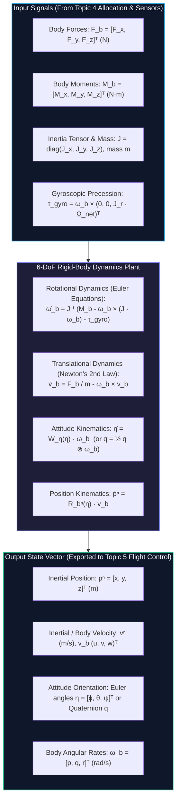
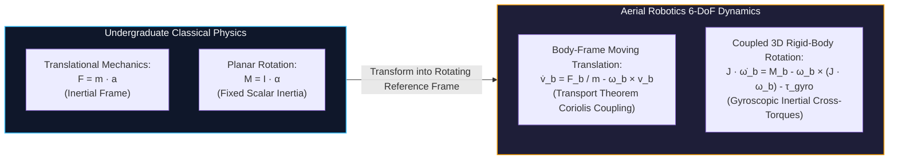
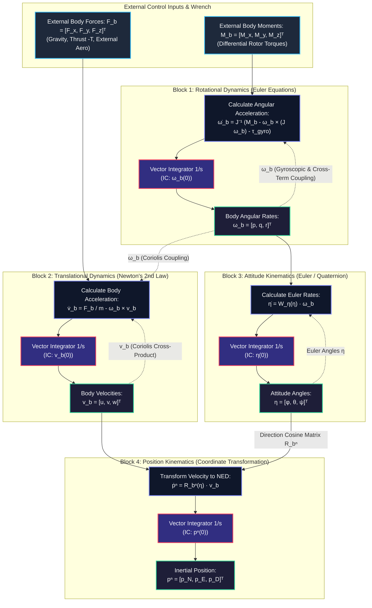

# 6-DoF Rigid-Body Dynamics & Newton-Euler Equations

**Subject:** EEEE4138 — Aerial Robotics  
**Topic:** Topic 3: Kinematics and Dynamics (6-DoF Rigid-Body Equations of Motion, Rotating Frames, Coriolis Terms, Euler Rotational Dynamics, Gyroscopic Precession & Full Nonlinear State-Space Architecture)  
**Authoritative Alignment:** EEEE4138 Topic 3 Lecture Slides (Slides 1–42), Tutorial 2 Problem Set & Official Solutions (Questions 1–4)  
**Companion Interactive Simulation:** [`widget_3_rigid_body_dynamics.html`](artifacts/widgets/widget_3_rigid_body_dynamics.html)

---

## Architecture & Modular API Contract

In the EEEE4138 aerial robotics flight software architecture, the **Rigid-Body Dynamics Engine** serves as the core physical plant. It accepts the total aerodynamic forces and control moments generated by the actuators, applies the fundamental laws of classical mechanics in rotating non-inertial reference frames, and outputs the state derivatives for numerical integration and feedback control.

### Standardized API Specification: `Six_DoF_Rigid_Body_Dynamics`

| Interface Element | Parameter / Variable | Symbol | Units | Type / Dimensions | Physical Description & Invariants | Upstream Source / Downstream Consumer |
| :--- | :--- | :--- | :--- | :--- | :--- | :--- |
| **Input** | Collective Propulsive Thrust | $T$ | $\text{N}$ | Scalar $\mathbb{R}^+$ | Total magnitude of propulsive thrust produced by all rotors along negative body $z$-axis: $\mathbf{F}_{\text{prop}}^b = [0, 0, -T]^T$. Invariant: $T \ge 0$. | From [Topic 4: Rotor Forces, Moments & Mixing](topic_4_forces_moments.md) |
| **Input** | Applied Body Moments | $\mathbf{M}_b = [\tau_\phi, \tau_\theta, \tau_\psi]^T$ | $\text{N}\cdot\text{m}$ | Vector $\mathbb{R}^3$ | Net control moments produced by differential rotor thrusts and reaction torques about body axes $[x_b, y_b, z_b]^T$. | From [Topic 4: Rotor Forces, Moments & Mixing](topic_4_forces_moments.md) |
| **Input** | Motor Rotor Speeds | $\Omega_i$ ($i = 1, \dots, N$) | $\text{rad/s}$ | Vector $\mathbb{R}^N$ | Physical spin rates of individual motors; used to compute net rotor angular momentum and gyroscopic cross-coupling torques. | From [Topic 4: Rotor Forces, Moments & Mixing](topic_4_forces_moments.md) |
| **Input** | Aircraft Mass & Inertia | $m, J$ | $\text{kg}, \text{kg}\cdot\text{m}^2$ | $\mathbb{R}^+, \mathbb{R}^{3\times 3}$ | Rigid airframe mass $m > 0$ and symmetric positive-definite inertia tensor $J = J^T \succ 0$. | From [Topic 1: UAV Architectures & Sizing](topic_1_uav_architectures.md) |
| **Input** | Gravity & External Forces | $\mathbf{g}^n, \mathbf{F}_{\text{ext}}^b$ | $\text{m/s}^2, \text{N}$ | Vectors $\mathbb{R}^3$ | Gravitational acceleration vector in NED frame $\mathbf{g}^n = [0, 0, +9.81]^T\text{ m/s}^2$, and environmental wind/drag forces. | Environmental Model |
| **Internal State** | 12-DoF State Vector | $\mathbf{x}_{12}$ | mixed | Vector $\mathbb{R}^{12}$ | Minimal state representation: $\mathbf{x}_{12} = [p_n, p_e, p_d, u, v, w, \phi, \theta, \psi, p, q, r]^T$. | Internal state storage |
| **Output** | Inertial Acceleration | $\ddot{\mathbf{p}}^n = [\ddot{p}_n, \ddot{p}_e, \ddot{p}_d]^T$ | $\text{m/s}^2$ | Vector $\mathbb{R}^3$ | Second time-derivative of position in the inertial NED reference frame. | To Trajectory Tracking & Navigation EKF |
| **Output** | Body Linear Acceleration | $\dot{\mathbf{v}}_b = [\dot{u}, \dot{v}, \dot{w}]^T$ | $\text{m/s}^2$ | Vector $\mathbb{R}^3$ | Apparent time-derivative of linear velocity components relative to the rotating body frame (includes Coriolis terms). | To IMU Accelerometer Sensor Model |
| **Output** | Body Angular Acceleration | $\dot{\boldsymbol{\omega}}_b = [\dot{p}, \dot{q}, \dot{r}]^T$ | $\text{rad/s}^2$ | Vector $\mathbb{R}^3$ | Angular acceleration around airframe principal axes, driven by Euler's equations and gyroscopic precession. | To Numerical ODE Integrator / Gyroscope Model |
| **Output** | Full State Derivative | $\dot{\mathbf{x}}_{12}$ | mixed | Vector $\mathbb{R}^{12}$ | Complete instantaneous derivative vector consumed by numerical simulation solvers (e.g. RK4). | To [Widget 3 Simulation Engine](artifacts/widgets/widget_3_rigid_body_dynamics.html) |
| **Physical Invariants** | Momentum & Energy Bounds | $\frac{d}{dt}\mathbf{P} = \sum \mathbf{F}$ | - | Equations | Linear and angular momentum strictly satisfy Newton-Euler equations; total kinetic + potential energy is conserved in unforced free flight. | System-wide invariant |
| **Failure Modes** | Dynamic Divergence | $\|\boldsymbol{\omega}_b\| > 25\text{ rad/s}$ | $\text{rad/s}$ | Boolean Flag | Indicates uncontrollable spin, aerodynamic departure, or numerical instability. Triggers fail-safe motor cut. | To [Topic 5: Flight Control Fail-Safe Logic](topic_5_flight_control.md) |

---

## 1. Prerequisite Bridge & Conceptual Intuition

### 1.1 The Classical Anchor: Newton's Second Law and the Double Integrator

In introductory undergraduate dynamics and classical control courses, motion is typically formulated in a single, non-rotating inertial frame:

$$\mathbf{F} = m \mathbf{a} = m \ddot{\mathbf{p}}$$

For rotational motion about a single fixed pivot axis, Newton's rotational analogue is equally straightforward:

$$\tau = J \ddot{\theta} \implies \frac{\Theta(s)}{\mathcal{T}(s)} = \frac{1}{J s^2}$$

This classical single-input single-output (SISO) transfer function $\frac{1}{J s^2}$ is the standard "double-integrator" plant that students routinely control using lead-lag compensators or PID feedback.

### 1.2 The 3D Reality: Why Aerial Robotics Breaks the Simple SISO Plant

When moving from a 1D laboratory benchtop to a 6-DoF free-flying aerial robot, two profound physical phenomena invalidate the decoupled double-integrator assumption:

1. **Non-Inertial Rotating Coordinates (The Transport Theorem):**  
   Sensors (accelerometers, gyroscopes) and actuators (propellers, control surfaces) are rigidly mounted to the drone's **moving body frame** $\mathcal{F}_b$. Because the body frame itself rotates at angular velocity $\boldsymbol{\omega}_b = [p, q, r]^T$, taking the time derivative of any vector in body coordinates generates fictitious inertial accelerations—most notably the **Coriolis cross-product term** $-\boldsymbol{\omega}_b \times \mathbf{v}_b$. As a direct consequence, **a quadrotor can experience a lateral velocity derivative $\dot{v} \ne 0$ even when the external lateral force is strictly zero ($F_y = 0$)**.

2. **Nonlinear Rotational Cross-Coupling ($\boldsymbol{\omega}_b \times (J \boldsymbol{\omega}_b)$ and $\boldsymbol{\tau}_{\text{gyro}}$):**  
   In three dimensions, angular momentum is a vector: $\mathbf{H}_b = J \boldsymbol{\omega}_b$. Because the inertia tensor $J$ typically has unequal principal moments ($J_x \ne J_y \ne J_z$), rotating simultaneously about two axes transfers angular momentum into the third axis. Furthermore, multirotor drones carry spinning motor rotors that store substantial internal spin momentum $\mathbf{H}_r$. Pitching or rolling the airframe while these rotors spin forces that angular momentum vector to precess, generating an orthogonal **rotor gyroscopic torque** $\boldsymbol{\tau}_{\text{gyro}}$.

> [!TIP]
> **Interactive 6-DoF Simulation & Oscilloscope:**  
> Inject body moments in real-time, inspect multi-axis Coriolis coupling on a live scrolling oscilloscope, and watch gyroscopic precession up to $1,200\text{ rad/s}$:  
> 👉 [Launch Widget 3: 6-DoF Rigid-Body Dynamics Visualizer](artifacts/widgets/widget_3_rigid_body_dynamics.html)

---

## 2. The Transport Theorem in Rotating Reference Frames

To establish Newton's equations of motion for an aircraft, we must differentiate position and velocity vectors with respect to time. However, Newton's second law is valid **only in an inertial reference frame** (such as the Earth-fixed NED frame $\mathcal{F}_n$). Because measurements and aerodynamic forces are formulated in the body frame $\mathcal{F}_b$, we must bridge the time derivative between the two frames.

### 2.1 First-Principles Derivation from Rotating Basis Vectors

Let the body-fixed coordinate frame $\mathcal{F}_b$ be defined by the orthonormal unit basis vectors $\mathbf{i}_b, \mathbf{j}_b, \mathbf{k}_b$ pointing along the forward, starboard, and belly axes, respectively. Any arbitrary physical vector $\mathbf{A}(t)$ can be decomposed into its body-axis components:

$$\mathbf{A}(t) = A_x(t) \mathbf{i}_b(t) + A_y(t) \mathbf{j}_b(t) + A_z(t) \mathbf{k}_b(t)$$

Now, differentiate $\mathbf{A}(t)$ with respect to time as observed from the **inertial frame** $\mathcal{F}_n$, applying the product rule of calculus:

$$\left(\frac{d\mathbf{A}}{dt}\right)_n = \left(\frac{dA_x}{dt}\mathbf{i}_b + \frac{dA_y}{dt}\mathbf{j}_b + \frac{dA_z}{dt}\mathbf{k}_b\right) + \left(A_x \frac{d\mathbf{i}_b}{dt} + A_y \frac{d\mathbf{j}_b}{dt} + A_z \frac{d\mathbf{k}_b}{dt}\right)$$

Notice the two distinct grouped terms:
1. The first group represents the rate of change of the vector's scalar components relative to the body axes. This is the **body-frame derivative**:
   $$\left(\frac{d\mathbf{A}}{dt}\right)_b \equiv \dot{A}_x \mathbf{i}_b + \dot{A}_y \mathbf{j}_b + \dot{A}_z \mathbf{k}_b \equiv \dot{\mathbf{A}}_b$$

2. The second group arises entirely because the basis vectors $\mathbf{i}_b, \mathbf{j}_b, \mathbf{k}_b$ are themselves rotating in inertial space. If the body frame rotates with instantaneous angular velocity $\boldsymbol{\omega}_b = [p, q, r]^T$, Poisson's kinematic formulas for rotating basis vectors dictate:
   $$\frac{d\mathbf{i}_b}{dt} = \boldsymbol{\omega}_b \times \mathbf{i}_b, \qquad \frac{d\mathbf{j}_b}{dt} = \boldsymbol{\omega}_b \times \mathbf{j}_b, \qquad \frac{d\mathbf{k}_b}{dt} = \boldsymbol{\omega}_b \times \mathbf{k}_b$$

Substitute these relations back into the second group:

$$\begin{aligned}
A_x \left(\boldsymbol{\omega}_b \times \mathbf{i}_b\right) + A_y \left(\boldsymbol{\omega}_b \times \mathbf{j}_b\right) + A_z \left(\boldsymbol{\omega}_b \times \mathbf{k}_b\right) &= \boldsymbol{\omega}_b \times \left(A_x \mathbf{i}_b + A_y \mathbf{j}_b + A_z \mathbf{k}_b\right) \\
&= \boldsymbol{\omega}_b \times \mathbf{A}_b
\end{aligned}$$

Combining both groups yields the fundamental **Transport Theorem** (also known as the Coriolis Operator equation):

$$\boxed{\left(\frac{d\mathbf{A}}{dt}\right)_n = \left(\frac{d\mathbf{A}}{dt}\right)_b + \boldsymbol{\omega}_b \times \mathbf{A}_b}$$

---

## 3. Translational Dynamics in Body Coordinates

We now apply the Transport Theorem directly to the linear velocity vector $\mathbf{v}$ to derive the governing translational equations of motion.

### 3.1 Linear Acceleration in Non-Inertial Coordinates

Let $\mathbf{v}_b = [u, v, w]^T$ be the true linear velocity of the aircraft's center of mass expressed in body coordinates. The true inertial acceleration $\mathbf{a}_n$ is the inertial time derivative of velocity:

$$\mathbf{a}_n = \left(\frac{d\mathbf{v}}{dt}\right)_n = \left(\frac{d\mathbf{v}_b}{dt}\right)_b + \boldsymbol{\omega}_b \times \mathbf{v}_b = \dot{\mathbf{v}}_b + \boldsymbol{\omega}_b \times \mathbf{v}_b$$

According to Newton's Second Law, the sum of all external forces $\mathbf{F}_b$ acting on the rigid body of mass $m$ equals the mass multiplied by the true inertial acceleration:

$$\mathbf{F}_b = m \mathbf{a}_n = m \left(\dot{\mathbf{v}}_b + \boldsymbol{\omega}_b \times \mathbf{v}_b\right)$$

Rearranging for the apparent time derivative of velocity components measured along the body axes:

$$\boxed{\dot{\mathbf{v}}_b = \frac{\mathbf{F}_b}{m} - \boldsymbol{\omega}_b \times \mathbf{v}_b}$$

> **Key Pedagogical Takeaway:**  
> The term $-\boldsymbol{\omega}_b \times \mathbf{v}_b$ is the non-inertial Coriolis acceleration. It represents the apparent change in body-axis velocity components that occurs purely because the coordinate frame is rotating beneath the moving velocity vector.

### 3.2 Step-by-Step Component Expansion ($\dot{u}, \dot{v}, \dot{w}$)

Let body velocity be $\mathbf{v}_b = [u, v, w]^T$ and body angular velocity be $\boldsymbol{\omega}_b = [p, q, r]^T$. We compute the determinant cross product:

$$\boldsymbol{\omega}_b \times \mathbf{v}_b = \det \begin{bmatrix} \mathbf{i}_b & \mathbf{j}_b & \mathbf{k}_b \\ p & q & r \\ u & v & w \end{bmatrix} = \begin{bmatrix} q w - r v \\ r u - p w \\ p v - q u \end{bmatrix}$$

Substituting this cross product into the vector equation $\dot{\mathbf{v}}_b = \frac{1}{m}\mathbf{F}_b - \boldsymbol{\omega}_b \times \mathbf{v}_b$:

$$\begin{aligned}
\begin{bmatrix} \dot{u} \\ \dot{v} \\ \dot{w} \end{bmatrix} &= \frac{1}{m}\begin{bmatrix} F_x \\ F_y \\ F_z \end{bmatrix} - \begin{bmatrix} q w - r v \\ r u - p w \\ p v - q u \end{bmatrix}
\end{aligned}$$

Distributing the negative sign across the cross-product components yields the canonical **body-axis translational equations of motion**:

$$\boxed{\begin{aligned}
\dot{u} &= r v - q w + \frac{F_x}{m} \\
\dot{v} &= p w - r u + \frac{F_y}{m} \\
\dot{w} &= q u - p v + \frac{F_z}{m}
\end{aligned}}$$

### 3.3 Force Decomposition: Gravity, Thrust, and Aerodynamics

The net external body force $\mathbf{F}_b = [F_x, F_y, F_z]^T$ consists of three distinct physical contributions:

$$\mathbf{F}_b = \mathbf{F}_{\text{gravity}}^b + \mathbf{F}_{\text{prop}}^b + \mathbf{F}_{\text{aero}}^b$$

1. **Gravity Vector in Body Axes ($\mathbf{F}_{\text{gravity}}^b$):**  
   Gravity acts strictly downward in the inertial NED frame: $\mathbf{g}^n = [0, 0, +g]^T$. To express gravity in body coordinates, we apply the transpose (inverse) of the direction cosine matrix $R_b^n$ derived in [Topic 2: Coordinate Frames & Kinematics](topic_2_coordinate_frames.md):
   $$\mathbf{F}_{\text{gravity}}^b = m R_n^b \mathbf{g}^n = m (R_b^n)^T \begin{bmatrix} 0 \\ 0 \\ g \end{bmatrix}$$
   Expanding using the canonical ZYX Euler angles $(\phi, \theta, \psi)$:
   $$\mathbf{F}_{\text{gravity}}^b = m \begin{bmatrix} -g \sin\theta \\ g \sin\phi \cos\theta \\ g \cos\phi \cos\theta \end{bmatrix}$$

2. **Propulsive Thrust Vector ($\mathbf{F}_{\text{prop}}^b$):**  
   In multirotor aircraft, propellers produce thrust perpendicular to the motor mounting plane, pointing upward along $-z_b$:
   $$\mathbf{F}_{\text{prop}}^b = \begin{bmatrix} 0 \\ 0 \\ -T \end{bmatrix}, \qquad T = \sum_{i=1}^N T_i \ge 0$$

3. **External Aerodynamic Drag ($\mathbf{F}_{\text{aero}}^b$):**  
   At low hover velocities, aerodynamic drag can be modeled via linear damping coefficients:
   $$\mathbf{F}_{\text{aero}}^b = \begin{bmatrix} -d_u u \\ -d_v v \\ -d_w w \end{bmatrix}$$

Substituting these forces into the vertical channel for a level aircraft ($\phi = 0, \theta = 0, \boldsymbol{\omega}_b = \mathbf{0}$):

$$F_z = m g - T \implies \boxed{\dot{w} = \ddot{z} = g - \frac{T}{m}}$$

* If collective thrust balances weight ($T = mg$), then $\dot{w} = 0$ (steady hover equilibrium).
* If $T > mg$, then $\dot{w} < 0$. In NED coordinates, negative vertical acceleration means accelerating **upwards** away from the Earth!

### 3.4 Alternative: Direct Inertial Position Formulation

For simulation and position guidance, tracking position in the inertial frame $\mathcal{F}_n$ avoids the Coriolis cross-terms entirely:

$$\boxed{m \ddot{\mathbf{p}}^n = m \begin{bmatrix} 0 \\ 0 \\ g \end{bmatrix} + R_b^n \begin{bmatrix} 0 \\ 0 \\ -T \end{bmatrix} + \mathbf{F}_{\text{ext}}^n = \begin{bmatrix} 0 \\ 0 \\ mg \end{bmatrix} - T R_b^n \mathbf{e}_3 + \mathbf{F}_{\text{ext}}^n}$$

where $\mathbf{e}_3 = [0, 0, 1]^T$ is the third column of the identity matrix.

---

## 4. Euler's Rotational Dynamics

Rotational dynamics describe how applied moments change the angular velocity of the rigid airframe.

### 4.1 Angular Momentum and the Rotational Transport Theorem

The angular momentum of a rigid body about its center of mass, expressed in body coordinates, is:

$$\mathbf{H}_b = J \boldsymbol{\omega}_b$$

where $J \in \mathbb{R}^{3\times 3}$ is the aircraft inertia tensor:

$$J = \begin{bmatrix} J_x & -J_{xy} & -J_{xz} \\ -J_{xy} & J_y & -J_{yz} \\ -J_{xz} & -J_{yz} & J_z \end{bmatrix}$$

Applying the Transport Theorem to the angular momentum vector:

$$\mathbf{M}_b = \left(\frac{d\mathbf{H}}{dt}\right)_n = \left(\frac{d\mathbf{H}_b}{dt}\right)_b + \boldsymbol{\omega}_b \times \mathbf{H}_b$$

Since the mass distribution of a rigid airframe is constant over time, the body-frame derivative of the inertia tensor is zero ($\dot{J} = 0$). Thus:

$$\left(\frac{d\mathbf{H}_b}{dt}\right)_b = J \dot{\boldsymbol{\omega}}_b$$

Substituting this into the moment balance gives **Euler's equation for a rotating rigid body**:

$$\mathbf{M}_b = J \dot{\boldsymbol{\omega}}_b + \boldsymbol{\omega}_b \times (J \boldsymbol{\omega}_b)$$

Solving for angular acceleration $\dot{\boldsymbol{\omega}}_b$:

$$\boxed{\dot{\boldsymbol{\omega}}_b = J^{-1} \left[ \mathbf{M}_b - \boldsymbol{\omega}_b \times (J \boldsymbol{\omega}_b) \right]}$$

### 4.2 Expansion for Principal Inertia Axes (Multirotors)

For symmetric multirotors, the body coordinate axes coincide with the principal axes of inertia. Consequently, the products of inertia vanish ($J_{xy} = J_{xz} = J_{yz} = 0$), and the inertia tensor simplifies to a diagonal matrix:

$$J = \begin{bmatrix} J_x & 0 & 0 \\ 0 & J_y & 0 \\ 0 & 0 & J_z \end{bmatrix}$$

The body angular momentum components are:

$$J \boldsymbol{\omega}_b = \begin{bmatrix} J_x p \\ J_y q \\ J_z r \end{bmatrix}$$

Now compute the cross-product coupling vector:

$$\boldsymbol{\omega}_b \times (J \boldsymbol{\omega}_b) = \det \begin{bmatrix} \mathbf{i}_b & \mathbf{j}_b & \mathbf{k}_b \\ p & q & r \\ J_x p & J_y q & J_z r \end{bmatrix} = \begin{bmatrix} q(J_z r) - r(J_y q) \\ r(J_x p) - p(J_z r) \\ p(J_y q) - q(J_x p) \end{bmatrix} = \begin{bmatrix} (J_z - J_y) q r \\ (J_x - J_z) p r \\ (J_y - J_x) p q \end{bmatrix}$$

Substituting this into Euler's equation:

$$\begin{aligned}
\begin{bmatrix} M_x \\ M_y \\ M_z \end{bmatrix} &= \begin{bmatrix} J_x \dot{p} \\ J_y \dot{q} \\ J_z \dot{r} \end{bmatrix} + \begin{bmatrix} (J_z - J_y) q r \\ (J_x - J_z) p r \\ (J_y - J_x) p q \end{bmatrix}
\end{aligned}$$

Rearranging for the individual angular accelerations yields the **principal-axis rotational equations**:

$$\boxed{\begin{aligned}
\dot{p} &= \frac{M_x + (J_y - J_z) q r}{J_x} \\
\dot{q} &= \frac{M_y + (J_z - J_x) p r}{J_y} \\
\dot{r} &= \frac{M_z + (J_x - J_y) p q}{J_z}
\end{aligned}}$$

> **Physical Interpretation of Coupling Terms:**  
> Notice that if an aircraft is rolling ($p \ne 0$) and yawing ($r \ne 0$) simultaneously, the term $(J_z - J_x) p r$ acts as an effective internal pitch torque, driving $\dot{q}$ even when no external pitch moment is commanded ($M_y = 0$).

---

## 5. Rotor Gyroscopic Coupling & Precession Moments

In multirotor aircraft, high-speed spinning BLDC motors and propellers possess significant internal angular momentum that is not captured by the rigid airframe inertia tensor $J$.

### 5.1 Physical Origin of Gyroscopic Precession

Consider $N$ rotors spinning about their respective motor shafts, aligned with the body $+z_b$ axis. Let:
* $J_r$: Rotational moment of inertia of a single motor rotor + propeller assembly about its spin axis ($\text{kg}\cdot\text{m}^2$).
* $\Omega_i$: Angular speed of the $i$-th motor ($\text{rad/s}$).
* $s_i \in \{+1, -1\}$: Direction indicator ($s_i = +1$ for CW rotation, $s_i = -1$ for CCW rotation).

The total internal angular momentum contributed by all spinning rotors is directed along the $+z_b$ axis:

$$\mathbf{H}_r = \begin{bmatrix} 0 \\ 0 \\ H_z \end{bmatrix} = \begin{bmatrix} 0 \\ 0 \\ J_r \Omega_{\text{net}} \end{bmatrix}, \qquad \Omega_{\text{net}} = \sum_{i=1}^N s_i \Omega_i$$

When the airframe rotates at angular rate $\boldsymbol{\omega}_b = [p, q, r]^T$, the spinning rotor momentum vector $\mathbf{H}_r$ precesses in space. By the Transport Theorem, the rate of change of this internal rotor momentum exerts a **gyroscopic reaction torque** $\boldsymbol{\tau}_{\text{gyro}}$ on the airframe:

$$\boldsymbol{\tau}_{\text{gyro}} = \boldsymbol{\omega}_b \times \mathbf{H}_r = \det \begin{bmatrix} \mathbf{i}_b & \mathbf{j}_b & \mathbf{k}_b \\ p & q & r \\ 0 & 0 & J_r \Omega_{\text{net}} \end{bmatrix} = \begin{bmatrix} q J_r \Omega_{\text{net}} \\ -p J_r \Omega_{\text{net}} \\ 0 \end{bmatrix}$$

Subtracting this reaction torque from the right-hand side of Euler's equation:

$$J \dot{\boldsymbol{\omega}}_b = \mathbf{M}_b - \boldsymbol{\omega}_b \times (J \boldsymbol{\omega}_b) - \boldsymbol{\tau}_{\text{gyro}}$$

### 5.2 Full Euler Equations with Rotor Gyroscopic Coupling

Expanding the component equations for principal axes:

$$\boxed{\begin{aligned}
\dot{p} &= \frac{M_x + (J_y - J_z) q r - q J_r \Omega_{\text{net}}}{J_x} \\
\dot{q} &= \frac{M_y + (J_z - J_x) p r + p J_r \Omega_{\text{net}}}{J_y} \\
\dot{r} &= \frac{M_z + (J_x - J_y) p q}{J_z}
\end{aligned}}$$

### 5.3 Symmetry Cancellation in Quadrotors

In a quadrotor at steady hover:
* Two rotors spin CCW ($\Omega_1, \Omega_3$) and two rotors spin CW ($\Omega_2, \Omega_4$).
* In perfect balance, $\Omega_1 = \Omega_2 = \Omega_3 = \Omega_4 \implies \Omega_{\text{net}} = -\Omega_1 + \Omega_2 - \Omega_3 + \Omega_4 = 0$.
* Therefore, $\mathbf{H}_r = \mathbf{0}$, and gyroscopic precession vanishes!

However, whenever the quadrotor performs a **yaw maneuver** or experiences **rotor RPM mismatch**, $\Omega_{\text{net}} \ne 0$. Under this condition:
* A pure pitch rate ($q > 0$) induces an unexpected **roll acceleration** $\dot{p} = -\frac{q J_r \Omega_{\text{net}}}{J_x}$.
* A pure roll rate ($p > 0$) induces an unexpected **pitch acceleration** $\dot{q} = +\frac{p J_r \Omega_{\text{net}}}{J_y}$.

This cross-axis gyroscopic induction is interactively demonstrated in [Widget 3: 6-DoF Dynamics & Gyroscopic Precession Explorer](artifacts/widgets/widget_3_rigid_body_dynamics.html).

---

## 6. Asymmetric Inertia Tensor for Fixed-Wing Aircraft ($J_{xz} \ne 0$)

While multirotors are typically symmetric across both pitch and roll planes, conventional fixed-wing aircraft possess only one plane of structural symmetry: the **vertical longitudinal $x\text{--}z$ plane**.

### 6.1 Inertia Tensor Structure

Because the airframe is symmetric about $y = 0$, the cross-products of inertia involving $y$ vanish:

$$J_{xy} = \int x y \, dm = 0, \qquad J_{yz} = \int y z \, dm = 0$$

However, because the mass is distributed asymmetrically between top and bottom (high-wing vs low-wing, vertical tailplane), the product of inertia $J_{xz}$ is **non-zero**:

$$J_{xz} = \int x z \, dm \ne 0$$

The resulting inertia tensor is:

$$J = \begin{bmatrix} J_x & 0 & -J_{xz} \\ 0 & J_y & 0 \\ -J_{xz} & 0 & J_z \end{bmatrix}$$

### 6.2 Determinant and Analytic Matrix Inverse

The determinant of $J$ is denoted by $\Gamma$:

$$\Gamma = \det(J) = J_y \left(J_x J_z - J_{xz}^2\right)$$

Because $J$ is strictly positive-definite, we define the 2D planar determinant:

$$\boxed{\Gamma = J_x J_z - J_{xz}^2 > 0}$$

The analytic matrix inverse $J^{-1}$ is computed via the adjugate matrix:

$$\boxed{J^{-1} = \frac{1}{\Gamma} \begin{bmatrix} J_z & 0 & J_{xz} \\ 0 & \Gamma / J_y & 0 \\ J_{xz} & 0 & J_x \end{bmatrix} = \begin{bmatrix} J_z / \Gamma & 0 & J_{xz} / \Gamma \\ 0 & 1 / J_y & 0 \\ J_{xz} / \Gamma & 0 & J_x / \Gamma \end{bmatrix}}$$

### 6.3 Derivation of Decoupled Equations of Motion

We evaluate the angular momentum vector $\mathbf{H}_b = J \boldsymbol{\omega}_b$:

$$\mathbf{H}_b = \begin{bmatrix} J_x & 0 & -J_{xz} \\ 0 & J_y & 0 \\ -J_{xz} & 0 & J_z \end{bmatrix} \begin{bmatrix} p \\ q \\ r \end{bmatrix} = \begin{bmatrix} J_x p - J_{xz} r \\ J_y q \\ -J_{xz} p + J_z r \end{bmatrix}$$

Computing the cross product $\boldsymbol{\omega}_b \times \mathbf{H}_b$:

$$\boldsymbol{\omega}_b \times \mathbf{H}_b = \det \begin{bmatrix} \mathbf{i}_b & \mathbf{j}_b & \mathbf{k}_b \\ p & q & r \\ J_x p - J_{xz} r & J_y q & -J_{xz} p + J_z r \end{bmatrix} = \begin{bmatrix} q(-J_{xz} p + J_z r) - r(J_y q) \\ r(J_x p - J_{xz} r) - p(-J_{xz} p + J_z r) \\ p(J_y q) - q(J_x p - J_{xz} r) \end{bmatrix}$$

Simplifying each component:

$$\begin{aligned}
\left[\boldsymbol{\omega}_b \times \mathbf{H}_b\right]_x &= (J_z - J_y) q r - J_{xz} p q \\
\left[\boldsymbol{\omega}_b \times \mathbf{H}_b\right]_y &= (J_x - J_z) p r + J_{xz} (p^2 - r^2) \\
\left[\boldsymbol{\omega}_b \times \mathbf{H}_b\right]_z &= (J_y - J_x) p q + J_{xz} q r
\end{aligned}$$

Now define the net torque components $\mathbf{N} = \mathbf{M}_b - \boldsymbol{\omega}_b \times \mathbf{H}_b = [A, B, C]^T$:

$$\boxed{\begin{aligned}
A &= M_x + (J_y - J_z) q r + J_{xz} p q \\
B &= M_y + (J_z - J_x) p r - J_{xz} (p^2 - r^2) \\
C &= M_z + (J_x - J_y) p q - J_{xz} q r
\end{aligned}}$$

Multiplying by $J^{-1}$:

$$\begin{bmatrix} \dot{p} \\ \dot{q} \\ \dot{r} \end{bmatrix} = \begin{bmatrix} J_z / \Gamma & 0 & J_{xz} / \Gamma \\ 0 & 1 / J_y & 0 \\ J_{xz} / \Gamma & 0 & J_x / \Gamma \end{bmatrix} \begin{bmatrix} A \\ B \\ C \end{bmatrix}$$

Multiplying out the matrix yields the exact decoupled angular acceleration equations for an aircraft with $J_{xz} \ne 0$:

$$\boxed{\begin{aligned}
\dot{p} &= \frac{J_z A + J_{xz} C}{\Gamma} \\
\dot{q} &= \frac{B}{J_y} \\
\dot{r} &= \frac{J_{xz} A + J_x C}{\Gamma}
\end{aligned}}$$

Notice that pitch acceleration $\dot{q}$ remains completely decoupled because $J_{xy} = J_{yz} = 0$, but roll acceleration $\dot{p}$ and yaw acceleration $\dot{r}$ are directly cross-coupled through both the torque components ($A, C$) and the off-diagonal inertia terms ($J_{xz}$).

---

## 7. Full 12-State Nonlinear ODE State-Space Representation

Combining translational dynamics, position kinematics, rotational dynamics, and attitude kinematics yields the complete 12-state nonlinear model of an aerial robot.

### 7.1 State Vector Definition

The 12 states are grouped into four 3-element physical vectors:

$$\mathbf{x}_{12} = \begin{bmatrix} \mathbf{p}^n \\ \mathbf{v}_b \\ \boldsymbol{\eta} \\ \boldsymbol{\omega}_b \end{bmatrix} = \begin{bmatrix} p_n \\ p_e \\ p_d \\ u \\ v \\ w \\ \phi \\ \theta \\ \psi \\ p \\ q \\ r \end{bmatrix} \in \mathbb{R}^{12}$$

### 7.2 Complete Differential Equation System ($\dot{\mathbf{x}}_{12} = \mathbf{f}(\mathbf{x}_{12}, \mathbf{u})$)

$$\boxed{\begin{aligned}
\begin{bmatrix} \dot{p}_n \\ \dot{p}_e \\ \dot{p}_d \end{bmatrix} &= R_b^n(\phi, \theta, \psi) \begin{bmatrix} u \\ v \\ w \end{bmatrix} \\[10pt]
\begin{bmatrix} \dot{u} \\ \dot{v} \\ \dot{w} \end{bmatrix} &= \begin{bmatrix} r v - q w \\ p w - r u \\ q u - p v \end{bmatrix} + \begin{bmatrix} -g\sin\theta \\ g\sin\phi\cos\theta \\ g\cos\phi\cos\theta \end{bmatrix} + \frac{1}{m}\begin{bmatrix} 0 \\ 0 \\ -T \end{bmatrix} + \frac{1}{m}\mathbf{F}_{\text{ext}}^b \\[10pt]
\begin{bmatrix} \dot{\phi} \\ \dot{\theta} \\ \dot{\psi} \end{bmatrix} &= \begin{bmatrix} 1 & \sin\phi\tan\theta & \cos\phi\tan\theta \\ 0 & \cos\phi & -\sin\phi \\ 0 & \sin\phi/\cos\theta & \cos\phi/\cos\theta \end{bmatrix} \begin{bmatrix} p \\ q \\ r \end{bmatrix} \\[10pt]
\begin{bmatrix} \dot{p} \\ \dot{q} \\ \dot{r} \end{bmatrix} &= J^{-1} \left( \begin{bmatrix} M_x \\ M_y \\ M_z \end{bmatrix} - \begin{bmatrix} p \\ q \\ r \end{bmatrix} \times \left( J \begin{bmatrix} p \\ q \\ r \end{bmatrix} \right) - \begin{bmatrix} q J_r \Omega_{\text{net}} \\ -p J_r \Omega_{\text{net}} \\ 0 \end{bmatrix} \right)
\end{aligned}}$$

### 7.3 Singularity-Free Attitude Alternative (Unit Quaternions)

Because the Euler rate matrix $W_\eta$ contains $\tan\theta$ and $1/\cos\theta$, it blows up to infinity at $\theta = \pm 90^\circ$ (gimbal lock). For all-attitude simulation, the attitude triplet $[\phi, \theta, \psi]^T$ is replaced by the unit quaternion $\mathbf{q} = [q_w, q_x, q_y, q_z]^T$:

$$\dot{\mathbf{q}} = \frac{1}{2} \mathbf{q} \otimes \bar{\boldsymbol{\omega}}_b = \frac{1}{2} \begin{bmatrix} 0 & -p & -q & -r \\ p & 0 & r & -q \\ q & -r & 0 & p \\ r & q & -p & 0 \end{bmatrix} \begin{bmatrix} q_w \\ q_x \\ q_y \\ q_z \end{bmatrix}$$

This 13-state formulation ($\mathbb{R}^3 \times \mathbb{R}^3 \times \mathbb{S}^3 \times \mathbb{R}^3$) is singularity-free throughout the entire rotation group $SO(3)$.

---

## 8. System Architecture & Signal Flow Diagram

The following Mermaid diagram illustrates the full 12-state multirotor dynamic system, directly matching the four physical equation blocks and integrator branches established in **Tutorial 2 Question 4 (Tutorial 2 Q4: System Model & Block Diagram)**.

---

## 9. Comprehensive Worked Numerical Examples (Tutorial 2 Drills)

The following worked numerical examples are extracted directly from the official course problem sets and examination drills. Every intermediate algebraic step, numerical unit, and physical interpretation is rigorously verified.

### Example 1: Level UAV Vertical Motion and Hover Equilibrium (Tutorial 2 Q1)

* **Problem Statement:**  
  A level multirotor UAV has total mass $m = 1.60\text{ kg}$ and produces a collective upward thrust $T = 18.0\text{ N}$. The aircraft moves vertically with no body rotation ($\boldsymbol{\omega}_b = \mathbf{0}$) and zero aerodynamic drag. Use the NED convention where $z$ is positive downwards and $w = \dot{z}$ is the vertical velocity.
  1. Write the two state equations for vertical position $z$ and vertical velocity $w$.
  2. Calculate the vertical acceleration $\dot{w}$ and state its physical direction.
  3. If current velocity is $w = +0.800\text{ m/s}$, is the descent speeding up or slowing down?
  4. State both mathematical conditions required for sustained hover.

* **Step-by-Step Solution:**

  **Part 1: State Equations**  
  In the NED coordinate system, the kinematic position rate is simply vertical velocity:
  $$\dot{z} = w$$
  For translational dynamics, gravity exerts a downward force $+mg$, while collective rotor thrust exerts an upward force $-T$:
  $$F_z = m g - T$$
  Dividing by mass $m$ yields the vertical acceleration state equation:
  $$\boxed{\dot{w} = g - \frac{T}{m}}$$

  **Part 2: Numerical Acceleration Calculation**  
  Substitute $g = 9.81\text{ m/s}^2$, $m = 1.60\text{ kg}$, and $T = 18.0\text{ N}$:
  $$\dot{w} = 9.81 - \frac{18.0}{1.60} = 9.81 - 11.25 = \mathbf{-1.44\text{ m/s}^2}$$
  *Physical Direction:* Because the $z$-axis points downward into the Earth, a negative acceleration ($\dot{w} < 0$) indicates that the net acceleration is **directed UPWARDS**, away from the ground.

  **Part 3: Descent Behavior Analysis**  
  * The current vertical velocity is $w = +0.800\text{ m/s}$ (positive, meaning the UAV is descending towards the ground).
  * The acceleration is $\dot{w} = -1.44\text{ m/s}^2$ (negative, acting upward in direct opposition to the downward motion).
  * Because velocity and acceleration have **opposite signs** ($w \cdot \dot{w} < 0$), the speed is decreasing:
    $$\boxed{\text{The UAV is descending, but slowing down.}}$$

  **Part 4: Conditions for Sustained Hover**  
  For sustained hover equilibrium, the aircraft must remain at a fixed vertical altitude with zero acceleration:
  1. Velocity condition: $\mathbf{w = 0\text{ m/s}}$ (the aircraft must be stationary).
  2. Thrust condition: $\dot{w} = 0 \implies \mathbf{T = mg} = 1.60 \times 9.81 = \mathbf{15.696\text{ N}}$.

---

### Example 2: Rotating Body Velocity and Coriolis Acceleration (Tutorial 2 Q2)

* **Problem Statement:**  
  At a given instant during aggressive flight, an aircraft of mass $m = 2.50\text{ kg}$ has linear velocity $\mathbf{v}_b = [3.00, 1.00, 0.00]^T\text{ m/s}$ and angular velocity $\boldsymbol{\omega}_b = [0.00, 0.00, 0.400]^T\text{ rad/s}$, both expressed in body axes. The total external force is $\mathbf{F}_b = [5.00, 0.00, 0.00]^T\text{ N}$.
  1. Calculate the body-axis acceleration components $\dot{u}, \dot{v}, \dot{w}$.
  2. Explain physically why the lateral acceleration $\dot{v}$ is nonzero even though external lateral force $F_y = 0$.

* **Step-by-Step Solution:**

  **Part 1: Component Calculation**  
  We apply the body-axis translational equation:
  $$\dot{\mathbf{v}}_b = \frac{\mathbf{F}_b}{m} - \boldsymbol{\omega}_b \times \mathbf{v}_b$$
  
  First, evaluate the applied force acceleration term $\frac{1}{m}\mathbf{F}_b$:
  $$\frac{\mathbf{F}_b}{m} = \frac{1}{2.50} \begin{bmatrix} 5.00 \\ 0.00 \\ 0.00 \end{bmatrix} = \begin{bmatrix} 2.00 \\ 0.00 \\ 0.00 \end{bmatrix}\text{ m/s}^2$$

  Next, evaluate the Coriolis cross-product term $\boldsymbol{\omega}_b \times \mathbf{v}_b$:
  $$\boldsymbol{\omega}_b \times \mathbf{v}_b = \det \begin{bmatrix} \mathbf{i}_b & \mathbf{j}_b & \mathbf{k}_b \\ 0 & 0 & 0.400 \\ 3.00 & 1.00 & 0.00 \end{bmatrix} = \begin{bmatrix} (0)(0) - (0.400)(1.00) \\ (0.400)(3.00) - (0)(0) \\ (0)(1.00) - (0)(3.00) \end{bmatrix} = \begin{bmatrix} -0.400 \\ +1.20 \\ 0.00 \end{bmatrix}\text{ m/s}^2$$

  Now subtract the Coriolis term from the applied force acceleration:
  $$\dot{\mathbf{v}}_b = \begin{bmatrix} 2.00 \\ 0.00 \\ 0.00 \end{bmatrix} - \begin{bmatrix} -0.400 \\ 1.20 \\ 0.00 \end{bmatrix} = \begin{bmatrix} 2.00 - (-0.400) \\ 0.00 - 1.20 \\ 0.00 - 0.00 \end{bmatrix} = \begin{bmatrix} \mathbf{+2.40\text{ m/s}^2} \\ \mathbf{-1.20\text{ m/s}^2} \\ \mathbf{0.00\text{ m/s}^2} \end{bmatrix}$$
  Therefore:
  $$\boxed{\dot{u} = +2.40\text{ m/s}^2, \qquad \dot{v} = -1.20\text{ m/s}^2, \qquad \dot{w} = 0.00\text{ m/s}^2}$$

  **Part 2: Physical Explanation of $\dot{v} \ne 0$**  

  > **Physical Mechanism Breakdown: Rotating Reference Frame Kinematics**  
  > The derivative $\dot{v}$ represents the rate of change of the velocity component **along the body's starboard $y_b$-axis**, not an absolute inertial sideways acceleration. Because the aircraft is actively yawing to the right ($r = +0.400\text{ rad/s}$), the body axes rotate continuously beneath the aircraft.
  >
  > | Component Source | Physical Contribution | Numerical Value | Direction in Body Frame |
  > | :--- | :--- | :---: | :--- |
  > | **External Force Term** | $\frac{F_y}{m} = \frac{0}{2.50}$ | $0.00\text{ m/s}^2$ | Zero applied sideways aerodynamic or actuator force |
  > | **Roll-Coupled Term** | $+p w = (0)(0)$ | $0.00\text{ m/s}^2$ | No rolling motion or vertical velocity coupling |
  > | **Coriolis Yaw Cross-Term** | $-r u = -(0.400)(3.00)$ | $\mathbf{-1.20\text{ m/s}^2}$ | Forward velocity vector $u$ sweeps toward negative port axis |
  > | **Net Apparent Derivative** | $\dot{v} = \frac{F_y}{m} + p w - r u$ | $\mathbf{-1.20\text{ m/s}^2}$ | Apparent port acceleration due purely to coordinate rotation |
  >
  > *Core Insight:* Even with **zero sideways force ($F_y = 0$)**, rotating body axes cause existing velocity vectors to project onto changing coordinate directions, creating a real nonzero rate derivative $\dot{v}$.

---

### Example 3: Rotational Dynamics with Angular Momentum Cross-Coupling (Tutorial 2 Q3)

* **Problem Statement:**  
  A rigid multirotor UAV has principal diagonal moments of inertia:
  $$J_x = 0.0250\text{ kg}\cdot\text{m}^2, \qquad J_y = 0.0350\text{ kg}\cdot\text{m}^2, \qquad J_z = 0.0450\text{ kg}\cdot\text{m}^2$$
  A pure roll moment $M_x = 0.0800\text{ N}\cdot\text{m}$ is applied, with $M_y = M_z = 0$.
  1. If the UAV is initially stationary ($p = q = r = 0$), calculate roll angular acceleration $\dot{p}$.
  2. In a separate flight condition, the UAV has existing angular rates $p = 0$, $q = 1.50\text{ rad/s}$, and $r = 2.00\text{ rad/s}$. Calculate the resulting angular accelerations $\dot{p}, \dot{q}, \dot{r}$.
  3. Explain why $\dot{p}$ differs between Case 1 and Case 2.

* **Step-by-Step Solution:**

  **Part 1: Stationary Case ($p = q = r = 0$)**  
  Using Euler's principal equation for roll:
  $$\dot{p} = \frac{M_x + (J_y - J_z) q r}{J_x}$$
  With $q = 0$ and $r = 0$, the cross-coupling term vanishes:
  $$\dot{p} = \frac{0.0800 + 0}{0.0250} = \mathbf{+3.20\text{ rad/s}^2}$$

  **Part 2: Coupled Case ($q = 1.50\text{ rad/s}, r = 2.00\text{ rad/s}$)**  
  First compute the gyroscopic cross-coupling term $(J_y - J_z) q r$:
  $$(J_y - J_z) q r = (0.0350 - 0.0450) \times 1.50 \times 2.00 = (-0.0100) \times 3.00 = \mathbf{-0.0300\text{ N}\cdot\text{m}}$$
  Now compute $\dot{p}$:
  $$\dot{p} = \frac{M_x + (J_y - J_z) q r}{J_x} = \frac{0.0800 - 0.0300}{0.0250} = \frac{0.0500}{0.0250} = \mathbf{+2.00\text{ rad/s}^2}$$
  Next, compute pitch acceleration $\dot{q}$ and yaw acceleration $\dot{r}$:
  $$\dot{q} = \frac{M_y + (J_z - J_x) p r}{J_y} = \frac{0 + (0.0450 - 0.0250)(0)(2.00)}{0.0350} = \mathbf{0.00\text{ rad/s}^2}$$
  $$\dot{r} = \frac{M_z + (J_x - J_y) p q}{J_z} = \frac{0 + (0.0250 - 0.0350)(0)(1.50)}{0.0450} = \mathbf{0.00\text{ rad/s}^2}$$

  **Part 3: Comparative Physical Summary & Mechanism Breakdown**  

  | Parameter / State | Case 1: Stationary ($p = q = r = 0$) | Case 2: Coupled ($q = 1.50, r = 2.00\text{ rad/s}$) | Physical Mechanism & Engineering Consequence |
  | :--- | :---: | :---: | :--- |
  | **Pitch Momentum ($H_y$)** | $0.0000\text{ N}\cdot\text{m}\cdot\text{s}$ | $+0.0525\text{ N}\cdot\text{m}\cdot\text{s}$ | $H_y = J_y q = 0.0350 \times 1.50$ |
  | **Yaw Momentum ($H_z$)** | $0.0000\text{ N}\cdot\text{m}\cdot\text{s}$ | $+0.0900\text{ N}\cdot\text{m}\cdot\text{s}$ | $H_z = J_z r = 0.0450 \times 2.00$ |
  | **Internal Gyroscopic Torque** | $0.0000\text{ N}\cdot\text{m}$ | $\mathbf{-0.0300\text{ N}\cdot\text{m}}$ | $\tau_{\text{cross}} = (J_y - J_z) q r = (-0.0100)(3.00)$ |
  | **Applied Roll Moment ($M_x$)** | $+0.0800\text{ N}\cdot\text{m}$ | $+0.0800\text{ N}\cdot\text{m}$ | External commanded actuator moment |
  | **Net Effective Moment** | $+0.0800\text{ N}\cdot\text{m}$ | $\mathbf{+0.0500\text{ N}\cdot\text{m}}$ | Internal torque directly opposes command ($37.5\%$ cancellation) |
  | **Roll Acceleration ($\dot{p}$)** | $\mathbf{+3.20\text{ rad/s}^2}$ | $\mathbf{+2.00\text{ rad/s}^2}$ | $\dot{p} = \frac{M_x + \tau_{\text{cross}}}{J_x}$ |

  > **Key Flight Control Takeaway:**  
  > In Case 1, the roll torque acts on a non-rotating body, accelerating roll inertia $J_x$ purely according to SISO transfer function dynamics ($\dot{p} = M_x / J_x = 3.20\text{ rad/s}^2$).  
  > In Case 2, unequal principal inertias ($J_y \ne J_z$) coupled with simultaneous pitch and yaw angular rates generate an internal gyroscopic reaction torque that **opposes** the commanded control torque, degrading control effectiveness by $37.5\%$. Multirotor flight controllers must incorporate nonlinear feedforward decoupling to cancel $(J_y - J_z)qr$ dynamically during multi-axis maneuvers.

---

### Example 4: Fixed-Wing Cross-Coupled Inertia with $J_{xz} \ne 0$

* **Problem Statement:**  
  A subscale fixed-wing UAV has mass properties:
  $$J_x = 0.0250\text{ kg}\cdot\text{m}^2, \quad J_y = 0.0350\text{ kg}\cdot\text{m}^2, \quad J_z = 0.0450\text{ kg}\cdot\text{m}^2, \quad J_{xz} = 0.0030\text{ kg}\cdot\text{m}^2$$
  The aircraft encounters a rolling gust creating $M_x = 0.0500\text{ N}\cdot\text{m}$ with $M_y = M_z = 0$, while moving at trim rates $p = 0.50\text{ rad/s}, q = 0, r = 0.20\text{ rad/s}$.
  Calculate $\dot{p}, \dot{q}, \dot{r}$ taking into account the product of inertia $J_{xz}$.

* **Step-by-Step Solution:**

  1. Compute the planar determinant $\Gamma$:
     $$\Gamma = J_x J_z - J_{xz}^2 = (0.0250)(0.0450) - (0.0030)^2 = 0.001125 - 0.000009 = \mathbf{0.001116\text{ kg}^2\cdot\text{m}^4}$$

  2. Compute intermediate moment components $A, B, C$:
     * Component $A$:
       $$A = M_x + (J_y - J_z) q r + J_{xz} p q = 0.0500 + (0.0350 - 0.0450)(0)(0.20) + (0.0030)(0.50)(0) = \mathbf{0.0500\text{ N}\cdot\text{m}}$$
     * Component $B$:
       $$B = M_y + (J_z - J_x) p r - J_{xz} (p^2 - r^2) = 0 + (0.0450 - 0.0250)(0.50)(0.20) - 0.0030 \left(0.50^2 - 0.20^2\right)$$
       $$B = (0.0200)(0.10) - 0.0030(0.25 - 0.04) = 0.0020 - 0.0030(0.21) = 0.0020 - 0.00063 = \mathbf{+0.00137\text{ N}\cdot\text{m}}$$
     * Component $C$:
       $$C = M_z + (J_x - J_y) p q - J_{xz} q r = 0 + (0.0250 - 0.0350)(0.50)(0) - (0.0030)(0)(0.20) = \mathbf{0.0000\text{ N}\cdot\text{m}}$$

  3. Compute angular accelerations:
     * Roll rate derivative:
       $$\dot{p} = \frac{J_z A + J_{xz} C}{\Gamma} = \frac{(0.0450)(0.0500) + (0.0030)(0)}{0.001116} = \frac{0.002250}{0.001116} = \mathbf{+2.0161\text{ rad/s}^2}$$
     * Pitch rate derivative:
       $$\dot{q} = \frac{B}{J_y} = \frac{0.00137}{0.0350} = \mathbf{+0.0391\text{ rad/s}^2}$$
     * Yaw rate derivative:
       $$\dot{r} = \frac{J_{xz} A + J_x C}{\Gamma} = \frac{(0.0030)(0.0500) + (0.0250)(0)}{0.001116} = \frac{0.000150}{0.001116} = \mathbf{+0.1344\text{ rad/s}^2}$$

  > **Analytical Insight:**  
  > Even though the applied yaw moment is strictly zero ($M_z = 0$), the aircraft produces a noticeable **yaw angular acceleration** $\dot{r} = +0.1344\text{ rad/s}^2$. This occurs because the product of inertia $J_{xz}$ mechanically couples rolling torques directly into the yaw channel!

---

## 10. Common Student Pitfalls & "Watch Out For"

In academic examinations and practical autopilot implementations, students routinely make several predictable errors when handling 6-DoF dynamics:

### ⚠️ Pitfall 1: Coriolis Blindness ($\dot{v} \ne 0$ despite $F_y = 0$)
* **The Error:** A student looks at an aircraft flying forward at $u = 5\text{ m/s}$ with zero lateral force ($F_y = 0$) and asserts that lateral acceleration $\dot{v} \equiv 0$.
* **The Reality:** In rotating coordinates, $\dot{v} = \frac{F_y}{m} + p w - r u$. If the drone is yawing ($r \ne 0$), the term $-ru$ creates a substantial derivative $\dot{v} = -ru \ne 0$. Failing to account for this Coriolis term in state estimators (EKFs) causes severe lateral velocity drift.

### ⚠️ Pitfall 2: Coordinate Sign Confusion in NED Vertical Dynamics
* **The Error:** Writing vertical acceleration as $\ddot{z} = \frac{T}{m} - g$, expecting positive acceleration to mean "flying up".
* **The Reality:** In the aerospace North-East-Down (NED) frame, the positive $z$-axis points **down toward Earth center**. Therefore:
  * Gravity acts downward: $+g$.
  * Propulsive thrust acts upward: $-T$.
  * The correct acceleration equation is $\ddot{z} = g - \frac{T}{m}$. Upward acceleration corresponds to a **negative numerical value** ($\ddot{z} < 0$).

### ⚠️ Pitfall 3: The SISO Rotational Illusion ($\dot{p} \ne M_x / J_x$)
* **The Error:** Applying classical transfer function $1/(J_x s^2)$ directly to 3D flight control, ignoring rotational cross-terms.
* **The Reality:** The relation $\dot{p} = M_x / J_x$ holds **only when $q = r = 0$**. In multi-axis maneuvering, the gyroscopic term $(J_y - J_z) q r$ can exceed the control moment $M_x$, causing severe rate-controller windup or cross-axis instability if feedforward decoupling is omitted.

### ⚠️ Pitfall 4: Cross-Product Coordinate Invariance Fallacy
* **The Error:** Evaluating cross products like $\boldsymbol{\omega} \times \mathbf{v}$ where $\boldsymbol{\omega}$ is taken from body gyro readings ($[p, q, r]^T$) but $\mathbf{v}$ is taken from GPS inertial velocities ($[\dot{p}_n, \dot{p}_e, \dot{p}_d]^T$) without transforming frames first.
* **The Reality:** Vectors involved in cross products **must be expressed in the exact same coordinate basis**:
  $$\boldsymbol{\omega}_b \times \mathbf{v}_b \ne \boldsymbol{\omega}_b \times \dot{\mathbf{p}}^n$$
  Always transform inertial velocities into body axes via $\mathbf{v}_b = R_n^b \dot{\mathbf{p}}^n$ before computing Coriolis terms.

---

## 11. Interactive Simulation: Companion Widget 3

To build physical intuition for 6-DoF rigid-body dynamics, gyroscopic precession, and the Transport Theorem, interact with the companion simulation below:

  <iframe src="artifacts/widgets/widget_3_rigid_body_dynamics.html" width="100%" height="520" frameborder="0" style="border-radius: 8px; box-shadow: 0 4px 6px -1px rgba(0,0,0,0.1);"></iframe>
  
<em>Interactive Visualizer: <a href="artifacts/widgets/widget_3_rigid_body_dynamics.html" target="_blank">Open in standalone tab ↗</a></em>

### Guided Interactive Experiments

1. **Gyroscopic Roll Induction from Pure Pitch:**
   * In Widget 3, ensure **"Enable Gyroscopic Precession $\boldsymbol{\tau}_{\text{gyro}}$"** is switched **ON**.
   * Set the motor rotor speed slider to $\Omega_{\text{rotor}} = 1000\text{ rad/s}$.
   * Click the **"+Pitch Impulse (+0.5 N·m)"** button.
   * *Observation:* Notice on the right-hand oscilloscope that even though applied roll torque is strictly zero ($\tau_\phi \equiv 0$), the red trace ($p(t)$) immediately develops a large roll rate! This directly confirms the formula $\dot{p} = -\frac{q J_r \Omega_{\text{net}}}{J_x}$.
   * Switch gyroscopic precession **OFF** and repeat the test. Observe that roll rate $p(t)$ now remains strictly zero!

2. **Nutation and Dynamic Cross-Coupling:**
   * Switch **"Nonlinear Cross-Terms $\boldsymbol{\omega}\times(J\boldsymbol{\omega})$"** to **ON**.
   * Apply simultaneous small sustained pitch and yaw torques ($\tau_\theta = 0.2\text{ N}\cdot\text{m}, \tau_\psi = 0.2\text{ N}\cdot\text{m}$).
   * Observe the 3D projection on the left canvas: the yellow angular velocity vector $\boldsymbol{\omega}_b$ and cyan angular momentum vector $\mathbf{H}_b$ are no longer collinear and undergo classical rigid-body nutation.

---

## 12. Bidirectional Module Cross-References

* **Upstream Foundations:**
  * [Topic 1: UAV Architectures, Classification & Flight Envelopes](topic_1_uav_architectures.md) — Supplies total airframe mass $m$, arm length $l$, and principal moments of inertia $J = \text{diag}(J_x, J_y, J_z)$.
  * [Topic 2: Coordinate Frames, Euler Rotations & Attitude Kinematics](topic_2_coordinate_frames.md) — Supplies the body-to-NED direction cosine matrix $R_b^n$, Euler rate transformation matrix $W_\eta$, and unit quaternion propagation $\dot{\mathbf{q}}$.
* **Downstream Flight Control & Actuation:**
  * [Topic 4: Aerodynamic Forces, Rotor Moments & Control Allocation / Mixing](topic_4_forces_moments.md) — Maps virtual control demands $[T, M_x, M_y, M_z]^T$ through the mixer matrix into physical motor speeds $\Omega_i$ and rotor forces $T_i$, which serve as direct inputs to the Newton-Euler equations.
  * [Topic 5: Flight Control Architectures (Cascaded Loops, State-Space & LQR)](topic_5_flight_control.md) — Linearizes the 12-state nonlinear ODE system around the hover operating point ($x_0 = 0, \theta_0 = 0, T_0 = mg$), proving longitudinal controllability $\det(\mathcal{C}) \ne 0$ and synthesizing inner-loop attitude rate feedback.
