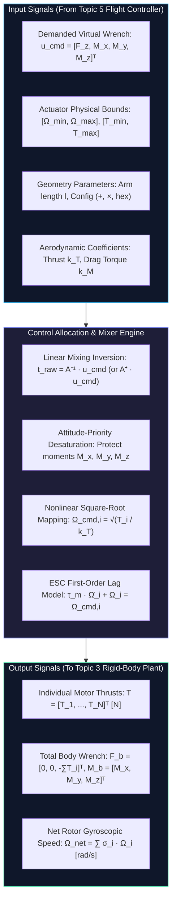
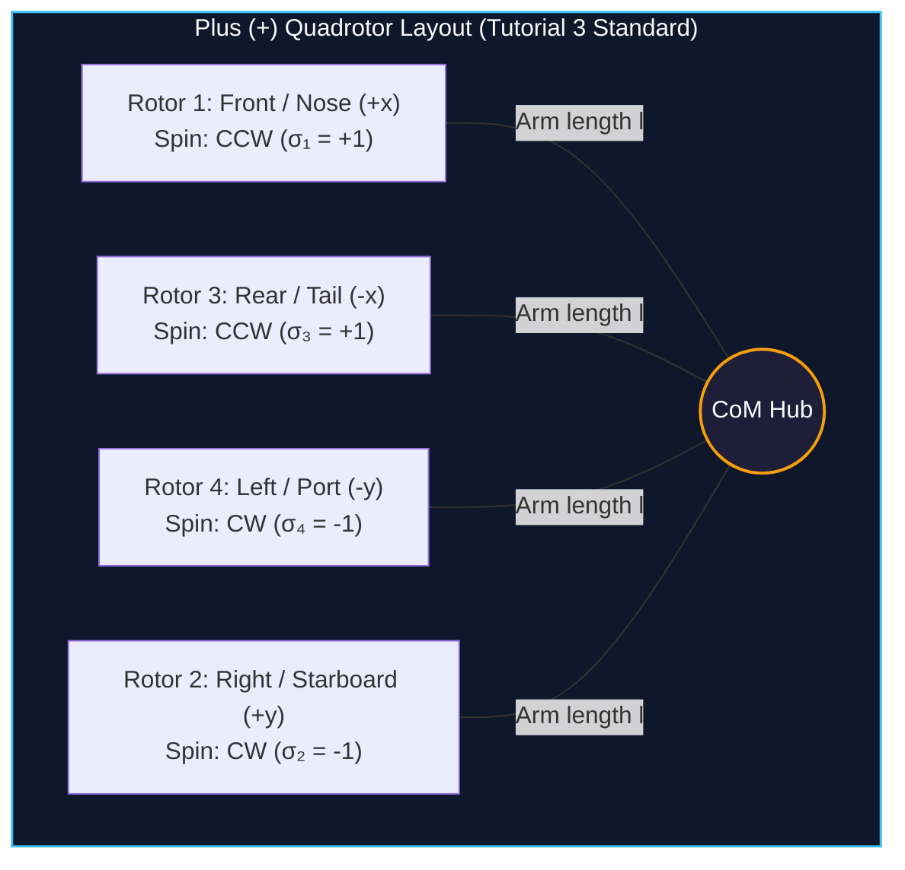
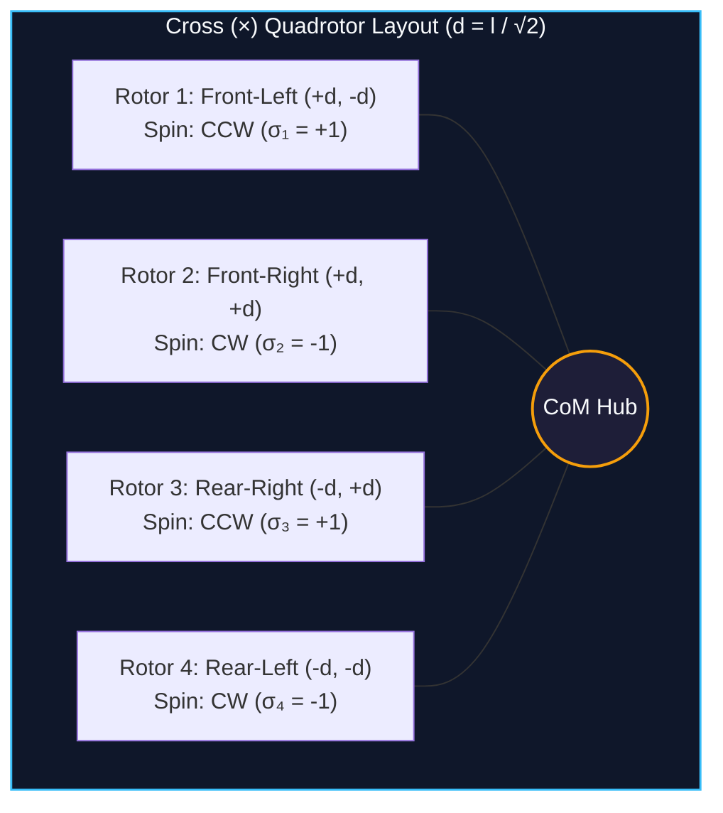
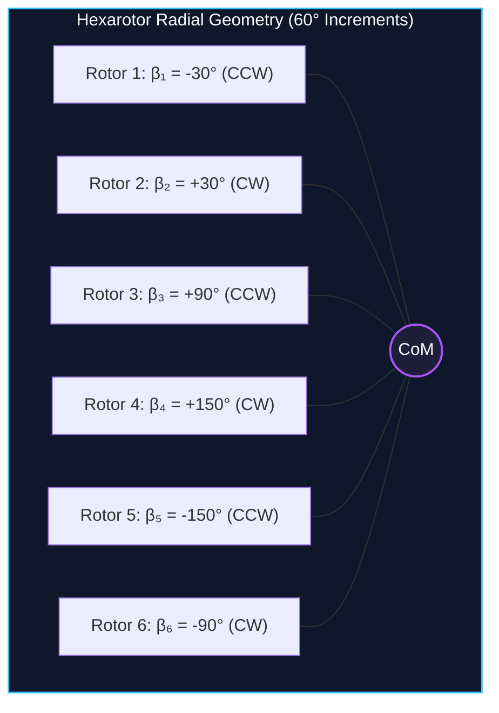
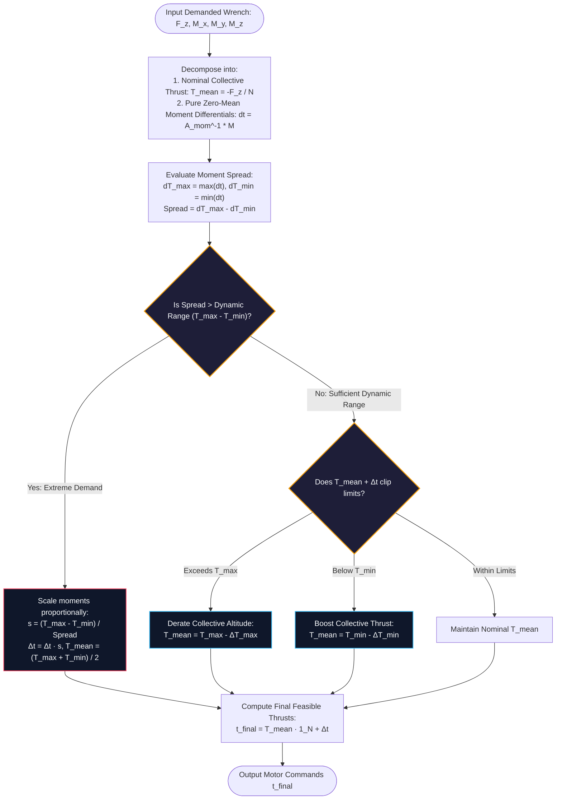
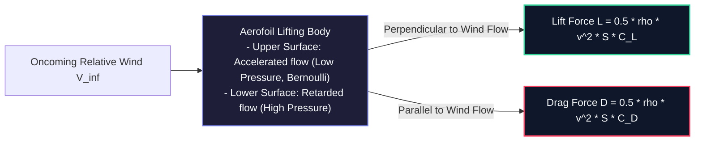
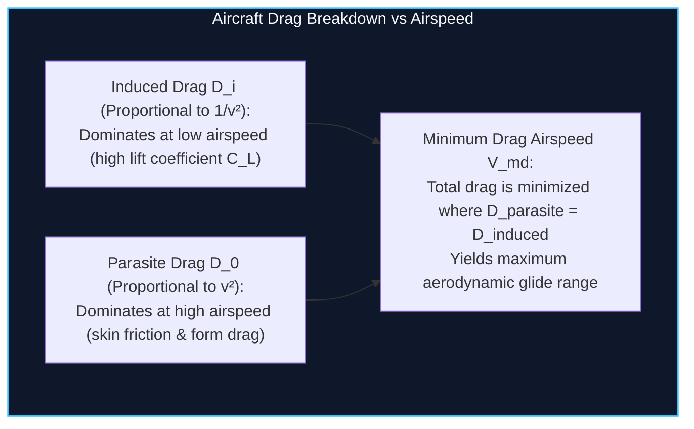
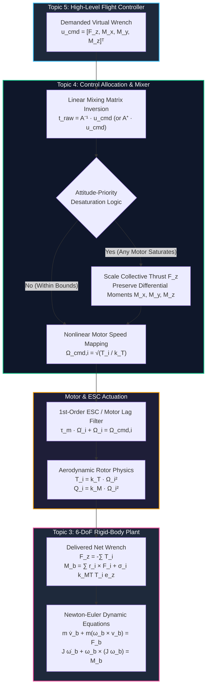

# Topic 4: Aerodynamic Forces, Rotor Moments & Control Allocation / Mixing

---

## 1. Title & Topic Metadata

| Item | Details |
| :--- | :--- |
| **Course Module** | EEEE4138 Aerial Robotics |
| **Topic Number** | Topic 4 |
| **Topic Title** | Aerodynamic Forces, Rotor Moments & Control Allocation / Mixing |
| **Authoritative Alignment** | Lecture 4 (`EEEE4138 Topic 4 Forces and Moments.pdf`), Tutorial 3 (`EEEE4138 Tutorial 3 Solutions.pdf`) |
| **Mathematical Domain** | Rotor Aerodynamics, Cross-Product Wrenches, Linear Systems $A\mathbf{x}=\mathbf{b}$, Matrix Inversion, Moore-Penrose Pseudo-Inverse, Actuator Saturation & Desaturation, Motor ESC Dynamics, Fixed-Wing Aerodynamics |
| **Prerequisites** | Linear Algebra ($A^{-1}, A^+$, rank), Newton-Euler Dynamics (Topic 3), Vector Cross-Products, Coordinate Frames (Topic 2) |
| **Downstream Consumers** | Outer/Inner Flight Control Systems (Topic 5), ESC Motor Drives / PWM Generators, Multi-DoF Simulators |
| **Companion Widget** | [Widget 4: Rotor Mixer & Control Allocation Sandbox](artifacts/widgets/widget_4_rotor_mixer_allocation.html) |

---

## 2. Architecture & Modular API Contract

In the hierarchical aerial robotics control stack, the **Control Allocation and Mixer** block acts as the critical bridge connecting the continuous virtual generalized forces demanded by high-level flight controllers (Topic 5) to the discrete, nonlinear physical actuators (BLDC motors and propellers) that apply physical wrenches to the rigid-body airframe (Topic 3).

### 2.1 Standardized API Contract Table

| Direction | Parameter / Variable | Symbol | Units | Type / Dimensions | Physical Description | Upstream Source / Downstream Sink |
| :--- | :--- | :--- | :--- | :--- | :--- | :--- |
| **Input** | Demanded Virtual Force | $F_{z,\text{cmd}}$ | $\text{N}$ | $\mathbb{R}$ | Commanded net vertical force along body $z_b$ axis ($F_z = -T_{\text{total}} \le 0$) | [Topic 5 (Flight Control)](topic_5_flight_control.md) |
| **Input** | Demanded Body Moments | $\mathbf{M}_{\text{cmd}} = [M_x, M_y, M_z]^T$ | $\text{N}\cdot\text{m}$ | $\mathbb{R}^3$ | Commanded roll, pitch, and yaw control moments | [Topic 5 (Flight Control)](topic_5_flight_control.md) |
| **Input** | Airframe Geometry | `config`, $l$ | $-, \text{m}$ | Enum, $\mathbb{R}^+$ | Layout (`quad_plus`, `quad_x`, `hex_x`) and radial arm length from CoM to rotor axis | [Topic 1 (Architectures)](topic_1_uav_architectures.md) |
| **Input** | Aerodynamic Coefficients | $k_T, k_M$ | $\frac{\text{N}}{(\text{rad/s})^2}, \frac{\text{N}\cdot\text{m}}{(\text{rad/s})^2}$ | $\mathbb{R}^+, \mathbb{R}^+$ | Rotor thrust coefficient and aerodynamic drag torque coefficient | Propeller Wind-Tunnel / Manufacturer Data |
| **Input** | Actuator Hard Limits | $T_{\min}, T_{\max}$ | $\text{N}, \text{N}$ | $\mathbb{R}^+, \mathbb{R}^+$ | Minimum thrust (idle cutoff) and maximum thrust per rotor | Motor & ESC Electrical Limits |
| **Input** | Actuator Health Mask | $\mathbf{h} = [h_1, \dots, h_N]^T$ | $-$ | $\{0, 1\}^N$ | Motor health indicator ($1 = \text{healthy}, 0 = \text{failed}$) | Health & Usage Monitoring System (HUMS) |
| **Internal State** | Filtered Rotor Speeds | $\boldsymbol{\Omega} = [\Omega_1, \dots, \Omega_N]^T$ | $\text{rad/s}$ | $\mathbb{R}^N$ | Actual instantaneous rotor angular velocities governed by motor lag ODE $\tau_m \dot{\Omega}_i + \Omega_i = \Omega_{i,\text{cmd}}$ | Internal Actuator Model |
| **Output** | Rotor Speed Commands | $\boldsymbol{\Omega}_{\text{cmd}} = [\Omega_{1,\text{cmd}}, \dots]^T$ | $\text{rad/s}$ | $\mathbb{R}^N$ | Commanded rotor angular velocities sent to ESCs | Electronic Speed Controllers (ESCs) |
| **Output** | Individual Thrust Commands | $\mathbf{t} = [T_1, \dots, T_N]^T$ | $\text{N}$ | $\mathbb{R}^N$ | Desaturated physical thrust allocated to each rotor | Downstream Motor Models / Monitoring |
| **Output** | Realized Airframe Wrench | $\mathbf{u}_{\text{realized}} = [F_z, M_x, M_y, M_z]^T$ | $\text{N}, \text{N}\cdot\text{m}$ | $\mathbb{R}^4$ | Actual physical wrench produced on the airframe after motor lag and saturation | [Topic 3 (Rigid-Body Dynamics)](topic_3_kinematics_dynamics.md) |
| **Output** | Saturation Flags | `is_saturated`, `thrust_scaled` | $-$ | Boolean | Flags indicating whether any actuator hit bounds or collective thrust was derated | [Topic 5 (Anti-Windup)](topic_5_flight_control.md) |
| **Invariants** | Non-Negative Thrust | $T_i \ge 0$ | $\text{N}$ | Inequality | Non-reversible ESCs cannot generate downward negative thrust ($T_i < 0$) | Enforced by allocation clamp |
| **Invariants** | Moment Preservation | $\sum \mathbf{M}_i \equiv \mathbf{M}_{\text{cmd}}$ | $\text{N}\cdot\text{m}$ | Equality | Attitude control takes absolute priority over altitude tracking during saturation | Attitude-Priority Desaturation Rule |
| **Failures** | Rank Deficiency / Uncontrollability | $\text{rank}(A_{\text{active}}) < 4$ | $-$ | Boolean | Insufficient active actuators to independently control 4 DoF (e.g. quadrotor motor loss) | Fail-Safe Trigger (Emergency Descent / Parachute) |

---

## 3. Prerequisite Bridge & Conceptual Intuition

### 3.1 Linear Algebra Anchor: Solving $A\mathbf{x} = \mathbf{b}$

In undergraduate linear algebra, students learn that a system of linear equations:

$$A \mathbf{x} = \mathbf{b}$$

has three possible structural regimes depending on the dimensions of $A \in \mathbb{R}^{m \times n}$ and the rank of $A$:

1. **Square & Invertible ($m = n = \text{rank}(A)$):**
   A unique solution exists:
   $$\mathbf{x} = A^{-1} \mathbf{b}$$
   *Application in Aerial Robotics:* A standard 4-rotor quadrotor has $n = 4$ motor thrusts controlling $m = 4$ generalized virtual demands ($F_z, M_x, M_y, M_z$). The mixer matrix $A$ is $4 \times 4$. If all rotors are operational and non-collinear, $A$ has full rank ($\text{rank}(A) = 4$), and its analytical algebraic inverse $A^{-1}$ directly maps demanded wrenches into required individual motor thrusts.

2. **Under-Determined / Over-Actuated ($n > m, \text{rank}(A) = m$):**
   Infinitely many solutions exist because there are more actuators than degrees of freedom. To select a unique, physically optimal solution, we formulate a constrained quadratic optimization problem:
   $$\min_{\mathbf{x}} \frac{1}{2} \|\mathbf{x}\|_2^2 \quad \text{subject to} \quad A \mathbf{x} = \mathbf{b}$$
   Using the method of Lagrange multipliers, the unconstrained minimum 2-norm solution is given by the **Right Moore-Penrose Pseudo-Inverse**:
   $$\boxed{A^+ = A^T \left( A A^T \right)^{-1}, \qquad \mathbf{x} = A^+ \mathbf{b}}$$
   *Application in Aerial Robotics:* A hexarotor ($n=6$) or octorotor ($n=8$) has redundant actuators. The pseudo-inverse $A^+$ automatically distributes the control workload among all healthy rotors such that the sum of squared motor thrusts $\sum T_i^2$ (and hence aerodynamic power dissipation) is strictly minimized.

3. **Over-Determined / Under-Actuated ($n < m$):**
   No exact solution exists in general. The system cannot independently satisfy all $m$ demands simultaneously.
   *Application in Aerial Robotics:* If one motor fails on a quadrotor ($n = 3, m = 4$), the allocation matrix drops to rank 3. The aircraft can no longer independently control vertical thrust, roll, pitch, and yaw. It becomes an under-actuated system and will inevitably spin or tumble unless a specialized degraded-mode controller is engaged.

### 3.2 Physics Anchor: Newton's Third Law & Aerodynamic Reaction Torque

Every undergraduate student knows Newton's Third Law: *For every action, there is an equal and opposite reaction.*

* When an electric motor spins a propeller through viscous air, the propeller blades push air downwards and sideways, producing useful aerodynamic lift (thrust $T$) and aerodynamic drag resistance.
* To maintain a steady rotor speed $\Omega$, the motor must deliver a shaft torque that overcomes the aerodynamic drag torque $Q$.
* By Newton's Third Law, the air exerts an equal and opposite reaction torque on the propeller blades, which is transmitted through the motor stator directly onto the drone airframe!
* If all rotors on a quadrotor spun in the same direction (e.g. all clockwise), the airframe would experience a continuous, uncontrollable reactive yaw torque spinning the drone violently in the opposite direction.
* To achieve static equilibrium without needing a mechanical tail rotor (like a traditional helicopter), multirotors employ **counter-rotating rotor pairs**: half the rotors spin Clockwise (CW), while the other half spin Counter-Clockwise (CCW). In steady hover, the opposing reaction torques cancel to exactly zero:

$$\sum_{i=1}^N M_{z,i} = 0$$

Yaw control is achieved by differentially speeding up one counter-rotating pair while slowing down the other pair by an equal amount, producing a net body reaction torque without changing the net collective thrust!

---

## 4. Step-by-Step Derivations

### 4.1 Rotor Aerodynamics: Thrust, Drag Torque & Torque-to-Thrust Ratio

Consider a propeller of radius $R$ spinning at angular velocity $\Omega$ ($\text{rad/s}$) in ambient air of density $\rho$ ($\text{kg/m}^3$). By dimensional analysis and blade element momentum theory:

1. **Aerodynamic Thrust Force ($T_i$):**
   The thrust produced by rotor $i$ acts perpendicular to the rotor tip-path plane. In hover or low-speed climb, thrust scales quadratically with rotational speed:
   $$T_i = C_T \rho A (\Omega_i R)^2 = C_T \rho (\pi R^2) \Omega_i^2 R^2 = \left( C_T \rho \pi R^4 \right) \Omega_i^2$$
   Defining the lumped aerodynamic thrust coefficient:
   $$\boxed{k_T \triangleq C_T \rho \pi R^4 \quad \left[\frac{\text{N}}{(\text{rad/s})^2}\right] \implies T_i = k_T \Omega_i^2}$$

2. **Aerodynamic Drag Torque ($Q_i$):**
   The aerodynamic profile and induced drag on the spinning blades generate an opposing resistance torque:
   $$Q_i = C_M \rho A (\Omega_i R)^2 R = C_M \rho (\pi R^2) \Omega_i^2 R^3 = \left( C_M \rho \pi R^5 \right) \Omega_i^2$$
   Defining the lumped aerodynamic drag torque coefficient:
   $$\boxed{k_M \triangleq C_M \rho \pi R^5 \quad \left[\frac{\text{N}\cdot\text{m}}{(\text{rad/s})^2}\right] \implies Q_i = k_M \Omega_i^2}$$

3. **Drag-to-Thrust Ratio ($k_{MT}$):**
   Taking the ratio of drag torque to thrust eliminates the motor speed $\Omega_i$:
   $$\boxed{k_{MT} \triangleq \frac{k_M}{k_T} = \frac{C_M \rho \pi R^5}{C_T \rho \pi R^4} = R \frac{C_M}{C_T} \quad [\text{m}]}$$
   *Physical Significance:* $k_{MT}$ has the dimension of **length** ($\text{meters}$). It represents the effective aerodynamic moment arm of the rotor reaction torque. For typical 5-inch to 12-inch drone propellers, $k_{MT}$ ranges between $0.015\,\text{m}$ and $0.025\,\text{m}$.

4. **Reaction Yaw Torque on the Airframe ($M_{z,i}$):**
   Let $\sigma_i \in \{+1, -1\}$ denote the rotational direction of rotor $i$ defined according to the authoritative course convention:

   | Rotor Spin Direction | Blade Rotation (from above) | Aerodynamic Drag Torque | Airframe Reaction Torque ($M_{z,i}$) | Sign Factor $\sigma_i$ | Torque Expression |
   | :--- | :--- | :--- | :--- | :---: | :--- |
   | **Clockwise (CW)** | $+z_b$ Clockwise | Counter-Clockwise | **Clockwise (+Yaw)** | $\sigma_i = +1$ | $M_{z,i} = +k_{MT} T_i = +k_M \Omega_i^2$ |
   | **Counter-Clockwise (CCW)** | $+z_b$ Counter-Clockwise | Clockwise | **Counter-Clockwise (-Yaw)** | $\sigma_i = -1$ | $M_{z,i} = -k_{MT} T_i = -k_M \Omega_i^2$ |

   *Physical Origin:* By Newton's Third Law, the motor stator must exert an equal and opposite torque against the airframe to overcome the aerodynamic blade drag $Q_i = k_M \Omega_i^2$. For any rotor $i$:
   $$\boxed{M_{z,i} = \sigma_i k_M \Omega_i^2 = \sigma_i k_{MT} T_i}$$

---

### 4.2 Cross-Product Wrench Formulation

In the standard Body-Fixed Reference Frame $\mathcal{F}_b$ (Forward-Starboard-Down / FRD):
* The origin is located at the vehicle Center of Mass (CoM).
* The position vector of the hub of rotor $i$ is:
  $$\mathbf{r}_i = \begin{bmatrix} x_i \\ y_i \\ z_i \end{bmatrix}_b$$
  For a planar multirotor airframe where all motor hubs lie in the horizontal plane containing the CoM, $z_i = 0$.
* The thrust produced by rotor $i$ is directed upwards, opposing the belly axis $+z_b$:
  $$\mathbf{F}_i = \begin{bmatrix} 0 \\ 0 \\ -T_i \end{bmatrix}_b$$

#### Derivation of Aerodynamic Moments via Cross Product
The net moment produced by rotor $i$ about the vehicle CoM consists of:
1. The moment of the thrust force: $\mathbf{r}_i \times \mathbf{F}_i$
2. The rotor aerodynamic reaction torque: $M_{z,i} \mathbf{e}_z$

Expanding the cross product:
$$\mathbf{r}_i \times \mathbf{F}_i = \begin{vmatrix} \mathbf{i}_b & \mathbf{j}_b & \mathbf{k}_b \\ x_i & y_i & 0 \\ 0 & 0 & -T_i \end{vmatrix} = \mathbf{i}_b \left( y_i (-T_i) - 0 \right) - \mathbf{j}_b \left( x_i (-T_i) - 0 \right) + \mathbf{k}_b (0) = \begin{bmatrix} -y_i T_i \\ x_i T_i \\ 0 \end{bmatrix}$$

Adding the reaction yaw torque vector:
$$\mathbf{M}_i = (\mathbf{r}_i \times \mathbf{F}_i) + \begin{bmatrix} 0 \\ 0 \\ M_{z,i} \end{bmatrix} = \begin{bmatrix} -y_i T_i \\ x_i T_i \\ \sigma_i k_{MT} T_i \end{bmatrix}$$

Summing over all $N$ rotors gives the total aerodynamic wrench acting on the airframe:

$$\boxed{\begin{aligned}
F_z &= -\sum_{i=1}^N T_i \\
M_x &= -\sum_{i=1}^N y_i T_i \\
M_y &= +\sum_{i=1}^N x_i T_i \\
M_z &= +\sum_{i=1}^N \sigma_i k_{MT} T_i
\end{aligned}}$$

*Sign Inspection & Physical Sanity Check:*
* **Net Vertical Force $F_z$:** Since each $T_i \ge 0$, $F_z = -\sum T_i \le 0$. Upward thrust produces a negative vertical force in the NED frame ($z$ points down), which causes upward acceleration ($\ddot{z} = g + F_z/m < 0$ when $\sum T_i > mg$).
* **Roll Moment $M_x$:** A rotor located on the starboard side ($y_i > 0$) pushing upward produces a roll moment towards the port side (negative roll $\phi < 0$, port wing down). Hence the $-y_i T_i$ term is physically exact.
* **Pitch Moment $M_y$:** A rotor located at the nose ($x_i > 0$) pushing upward produces a pitch-up moment (positive pitch $\theta > 0$, nose up). Hence the $+x_i T_i$ term is physically exact.
* **Yaw Moment $M_z$:** A CW-spinning rotor ($\sigma_i = +1$) exerts a positive reaction torque about $+z_b$.

---

### 4.3 Plus (+) Quadrotor Configuration: Matrix Derivation & Inversion

In the **Plus (+)** quadrotor layout:
* Rotor 1 is located on the nose: $+x_b$ axis.
* Rotor 2 is located on the starboard arm: $+y_b$ axis.
* Rotor 3 is located on the tail: $-x_b$ axis.
* Rotor 4 is located on the port arm: $-y_b$ axis.
* Radial arm length: $l$.

#### Rotor Coordinates and Spins (Authoritative Tutorial 3 Standard)
| Rotor $i$ | Position $(x_i, y_i)$ | Spin Direction | $\sigma_i$ |
| :---: | :---: | :---: | :---: |
| **1** | $(+l, 0)$ | CCW | $+1$ |
| **2** | $(0, +l)$ | CW | $-1$ |
| **3** | $(-l, 0)$ | CCW | $+1$ |
| **4** | $(0, -l)$ | CW | $-1$ |

Applying the cross-product wrench formulas:
$$\begin{aligned}
F_z &= -(T_1 + T_2 + T_3 + T_4) \\
M_x &= -(0\cdot T_1 + l\cdot T_2 + 0\cdot T_3 - l\cdot T_4) = -l T_2 + l T_4 = l(T_4 - T_2) \\
M_y &= +(l\cdot T_1 + 0\cdot T_2 - l\cdot T_3 + 0\cdot T_4) = l T_1 - l T_3 = l(T_1 - T_3) \\
M_z &= k_{MT}(+T_1 - T_2 + T_3 - T_4)
\end{aligned}$$

Writing this in matrix form $\mathbf{u}_{\text{cmd}} = A_+ \mathbf{t}$:

$$\boxed{\begin{bmatrix} F_z \\ M_x \\ M_y \\ M_z \end{bmatrix} = \begin{bmatrix} -1 & -1 & -1 & -1 \\ 0 & -l & 0 & l \\ l & 0 & -l & 0 \\ k_{MT} & -k_{MT} & k_{MT} & -k_{MT} \end{bmatrix} \begin{bmatrix} T_1 \\ T_2 \\ T_3 \\ T_4 \end{bmatrix} = A_+ \mathbf{t}}$$

#### Step-by-Step Algebraic Inversion of $A_+$
Notice the remarkable mathematical symmetry of matrix $A_+$: its four rows are mutually orthogonal! Let $\mathbf{r}_1^T, \mathbf{r}_2^T, \mathbf{r}_3^T, \mathbf{r}_4^T$ denote the row vectors of $A_+$:

1. **Orthogonality Check:**
   $$\mathbf{r}_1 \cdot \mathbf{r}_2 = (-1)(0) + (-1)(-l) + (-1)(0) + (-1)(l) = 0 + l + 0 - l = 0$$
   $$\mathbf{r}_1 \cdot \mathbf{r}_3 = (-1)(l) + (-1)(0) + (-1)(-l) + (-1)(0) = -l + 0 + l + 0 = 0$$
   $$\mathbf{r}_1 \cdot \mathbf{r}_4 = (-1)(k_{MT}) + (-1)(-k_{MT}) + (-1)(k_{MT}) + (-1)(-k_{MT}) = -k_{MT} + k_{MT} - k_{MT} + k_{MT} = 0$$
   $$\mathbf{r}_2 \cdot \mathbf{r}_3 = (0)(l) + (-l)(0) + (0)(-l) + (l)(0) = 0$$
   $$\mathbf{r}_2 \cdot \mathbf{r}_4 = (0)(k_{MT}) + (-l)(-k_{MT}) + (0)(k_{MT}) + (l)(-k_{MT}) = l k_{MT} - l k_{MT} = 0$$
   $$\mathbf{r}_3 \cdot \mathbf{r}_4 = (l)(k_{MT}) + (0)(-k_{MT}) + (-l)(k_{MT}) + (0)(-k_{MT}) = l k_{MT} - l k_{MT} = 0$$

2. **Row 2-Norm Squared ($\|\mathbf{r}_k\|_2^2$):**
   $$\|\mathbf{r}_1\|^2 = (-1)^2 + (-1)^2 + (-1)^2 + (-1)^2 = 4$$
   $$\|\mathbf{r}_2\|^2 = 0^2 + (-l)^2 + 0^2 + l^2 = 2l^2$$
   $$\|\mathbf{r}_3\|^2 = l^2 + 0^2 + (-l)^2 + 0^2 = 2l^2$$
   $$\|\mathbf{r}_4\|^2 = k_{MT}^2 + (-k_{MT})^2 + k_{MT}^2 + (-k_{MT})^2 = 4 k_{MT}^2$$

3. **Direct Inversion Formula for Orthogonal Row Matrices:**
   For any matrix with mutually orthogonal rows, $A A^T = \text{diag}(\|\mathbf{r}_1\|^2, \dots, \|\mathbf{r}_m\|^2)$. Therefore:
   $$A^{-1} = A^T \left( A A^T \right)^{-1} = A^T \text{diag}\left( \frac{1}{\|\mathbf{r}_1\|^2}, \frac{1}{\|\mathbf{r}_2\|^2}, \frac{1}{\|\mathbf{r}_3\|^2}, \frac{1}{\|\mathbf{r}_4\|^2} \right)$$

Evaluating column by column:
$$\boxed{A_+^{-1} = \begin{bmatrix} 
-\frac{1}{4} & 0 & \frac{1}{2l} & \frac{1}{4 k_{MT}} \\[6pt]
-\frac{1}{4} & -\frac{1}{2l} & 0 & -\frac{1}{4 k_{MT}} \\[6pt]
-\frac{1}{4} & 0 & -\frac{1}{2l} & \frac{1}{4 k_{MT}} \\[6pt]
-\frac{1}{4} & \frac{1}{2l} & 0 & -\frac{1}{4 k_{MT}}
\end{bmatrix}}$$

#### Component Allocation Equations for the + Quadrotor
Expanding $\mathbf{t} = A_+^{-1} \mathbf{u}_{\text{cmd}}$:

$$\boxed{\begin{aligned}
T_1 &= -\frac{F_z}{4} + \frac{M_y}{2l} + \frac{M_z}{4 k_{MT}} \\[4pt]
T_2 &= -\frac{F_z}{4} - \frac{M_x}{2l} - \frac{M_z}{4 k_{MT}} \\[4pt]
T_3 &= -\frac{F_z}{4} - \frac{M_y}{2l} + \frac{M_z}{4 k_{MT}} \\[4pt]
T_4 &= -\frac{F_z}{4} + \frac{M_x}{2l} - \frac{M_z}{4 k_{MT}}
\end{aligned}}$$

*Verification of Inversion:*
Multiply $A_+ A_+^{-1}$:
$$A_+ A_+^{-1} = \begin{bmatrix}
(-1)(-\frac{1}{4})\times 4 & 0 & 0 & 0 \\
0 & (-l)(-\frac{1}{2l}) + l(\frac{1}{2l}) & 0 & 0 \\
0 & 0 & l(\frac{1}{2l}) + (-l)(-\frac{1}{2l}) & 0 \\
0 & 0 & 0 & k_{MT}(\frac{1}{4k_{MT}})\times 4
\end{bmatrix} = \begin{bmatrix} 1 & 0 & 0 & 0 \\ 0 & 1 & 0 & 0 \\ 0 & 0 & 1 & 0 \\ 0 & 0 & 0 & 1 \end{bmatrix} = I_4$$
The algebraic inversion is verified with zero error.

---

### 4.4 Cross ($\times$) Quadrotor Configuration: Matrix Derivation & Inversion

In the **Cross ($\times$)** quadrotor layout:
* The arms are rotated by $45^\circ$ relative to the body axes.
* This configuration is favored in practice because it keeps all 4 propellers out of the forward camera / sensor field of view.
* Each rotor is positioned at radial distance $l$ from the center of mass at azimuth angles of $45^\circ, 135^\circ, 225^\circ, 315^\circ$.

#### Derivation of the Effective Projected Moment Arm $d$
Let $l$ be the true physical radial arm length. The $(x, y)$ coordinate offsets along the principal body axes are:
$$x_i = \pm l \cos(45^\circ) = \pm \frac{l}{\sqrt{2}}, \qquad y_i = \pm l \sin(45^\circ) = \pm \frac{l}{\sqrt{2}}$$

Defining the **projected lever arm**:
$$\boxed{d \triangleq \frac{l}{\sqrt{2}} \approx 0.7071\,l}$$

#### Rotor Coordinates and Spins (Authoritative Tutorial 3 Standard)
| Rotor $i$ | Body Coordinates $(x_i, y_i)$ | Spin Direction | $\sigma_i$ |
| :---: | :---: | :---: | :---: |
| **1 (Front-Left)** | $(+d, -d)$ | CCW | $+1$ |
| **2 (Front-Right)** | $(+d, +d)$ | CW | $-1$ |
| **3 (Rear-Right)** | $(-d, +d)$ | CCW | $+1$ |
| **4 (Rear-Left)** | $(-d, -d)$ | CW | $-1$ |

Applying the cross-product formulas:
$$\begin{aligned}
F_z &= -(T_1 + T_2 + T_3 + T_4) \\
M_x &= -\sum y_i T_i = -\left( -d T_1 + d T_2 + d T_3 - d T_4 \right) = d(T_1 - T_2 - T_3 + T_4) \\
M_y &= +\sum x_i T_i = +\left( d T_1 + d T_2 - d T_3 - d T_4 \right) = d(T_1 + T_2 - T_3 - T_4) \\
M_z &= k_{MT}(+T_1 - T_2 + T_3 - T_4)
\end{aligned}$$

Writing this in matrix form $\mathbf{u}_{\text{cmd}} = A_\times \mathbf{t}$:

$$\boxed{\begin{bmatrix} F_z \\ M_x \\ M_y \\ M_z \end{bmatrix} = \begin{bmatrix} -1 & -1 & -1 & -1 \\ d & -d & -d & d \\ d & d & -d & -d \\ k_{MT} & -k_{MT} & k_{MT} & -k_{MT} \end{bmatrix} \begin{bmatrix} T_1 \\ T_2 \\ T_3 \\ T_4 \end{bmatrix} = A_\times \mathbf{t}}$$

#### Step-by-Step Algebraic Inversion of $A_\times$
Let us check the mutual orthogonality of the rows of $A_\times$:
$$\mathbf{r}_1 \cdot \mathbf{r}_2 = (-1)(d) + (-1)(-d) + (-1)(-d) + (-1)(d) = -d + d + d - d = 0$$
$$\mathbf{r}_1 \cdot \mathbf{r}_3 = (-1)(d) + (-1)(d) + (-1)(-d) + (-1)(-d) = -d - d + d + d = 0$$
$$\mathbf{r}_1 \cdot \mathbf{r}_4 = (-1)(k_{MT}) + (-1)(-k_{MT}) + (-1)(k_{MT}) + (-1)(-k_{MT}) = 0$$
$$\mathbf{r}_2 \cdot \mathbf{r}_3 = (d)(d) + (-d)(d) + (-d)(-d) + (d)(-d) = d^2 - d^2 + d^2 - d^2 = 0$$
$$\mathbf{r}_2 \cdot \mathbf{r}_4 = (d)(k_{MT}) + (-d)(-k_{MT}) + (-d)(k_{MT}) + (d)(-k_{MT}) = d k_{MT} + d k_{MT} - d k_{MT} - d k_{MT} = 0$$
$$\mathbf{r}_3 \cdot \mathbf{r}_4 = (d)(k_{MT}) + (d)(-k_{MT}) + (-d)(k_{MT}) + (-d)(-k_{MT}) = d k_{MT} - d k_{MT} - d k_{MT} + d k_{MT} = 0$$

All four rows are mutually orthogonal! The squared row norms are:
$$\|\mathbf{r}_1\|^2 = 4, \quad \|\mathbf{r}_2\|^2 = 4d^2, \quad \|\mathbf{r}_3\|^2 = 4d^2, \quad \|\mathbf{r}_4\|^2 = 4 k_{MT}^2$$

Applying the orthogonal matrix inverse formula $A^{-1} = A^T (A A^T)^{-1}$:

$$\boxed{A_\times^{-1} = \begin{bmatrix}
-\frac{1}{4} & \frac{1}{4d} & \frac{1}{4d} & \frac{1}{4 k_{MT}} \\[6pt]
-\frac{1}{4} & -\frac{1}{4d} & \frac{1}{4d} & -\frac{1}{4 k_{MT}} \\[6pt]
-\frac{1}{4} & -\frac{1}{4d} & -\frac{1}{4d} & \frac{1}{4 k_{MT}} \\[6pt]
-\frac{1}{4} & \frac{1}{4d} & -\frac{1}{4d} & -\frac{1}{4 k_{MT}}
\end{bmatrix}}$$

#### Component Allocation Equations for the $\times$ Quadrotor
Expanding $\mathbf{t} = A_\times^{-1} \mathbf{u}_{\text{cmd}}$:

$$\boxed{\begin{aligned}
T_1 &= -\frac{F_z}{4} + \frac{M_x}{4d} + \frac{M_y}{4d} + \frac{M_z}{4 k_{MT}} \\[4pt]
T_2 &= -\frac{F_z}{4} - \frac{M_x}{4d} + \frac{M_y}{4d} - \frac{M_z}{4 k_{MT}} \\[4pt]
T_3 &= -\frac{F_z}{4} - \frac{M_x}{4d} - \frac{M_y}{4d} + \frac{M_z}{4 k_{MT}} \\[4pt]
T_4 &= -\frac{F_z}{4} + \frac{M_x}{4d} - \frac{M_y}{4d} - \frac{M_z}{4 k_{MT}}
\end{aligned}}$$

*Critical Architectural Comparison (+ vs $\times$):*
1. In the **+ configuration**, roll moment $M_x$ is produced **exclusively** by rotors 2 and 4, while pitch moment $M_y$ is produced **exclusively** by rotors 1 and 3. The control channels are structurally decoupled at the actuator level.
2. In the **$\times$ configuration**, **all four rotors contribute simultaneously** to both pitch and roll moments.
3. For equal motor thrust limits $T_{\max}$, the maximum achievable pitch or roll moment in the $\times$ configuration is:
   $$M_{\max,\times} = 2 d \Delta T = 2 \left(\frac{l}{\sqrt{2}}\right) \Delta T = \sqrt{2}\,l\,\Delta T \approx 1.414\,l\,\Delta T$$
   whereas in the + configuration:
   $$M_{\max,+} = l\,\Delta T$$
   The $\times$ configuration yields **$41.4\%$ greater maximum control authority** in pure roll or pure pitch!

---

### 4.5 Hexarotor Geometry & Minimum-Norm Pseudo-Inverse Allocation

A hexarotor possesses $N = 6$ coplanar rotors radially distributed at radial distance $l$ with equal angular spacing $\Delta\beta = 60^\circ$ ($2\pi/6\,\text{rad}$).

#### Geometry, Angles, and Alternating Spins
Let the azimuth angles $\beta_i$ be measured clockwise from the forward $+x_b$ axis (per Tutorial 3 Q6):
$$\boldsymbol{\beta} = \begin{bmatrix} -30^\circ & +30^\circ & +90^\circ & +150^\circ & +210^\circ & +270^\circ \end{bmatrix}$$
The body coordinates of the rotor hubs are $x_i = l\cos\beta_i, y_i = l\sin\beta_i$:
* Rotor 1: $x_1 = l\cos(-30^\circ) = \frac{\sqrt{3}}{2}l, \quad y_1 = l\sin(-30^\circ) = -\frac{1}{2}l, \quad \sigma_1 = +1$ (CW)
* Rotor 2: $x_2 = l\cos(30^\circ) = \frac{\sqrt{3}}{2}l, \quad y_2 = l\sin(30^\circ) = +\frac{1}{2}l, \quad \sigma_2 = -1$ (CCW)
* Rotor 3: $x_3 = l\cos(90^\circ) = 0, \quad y_3 = l\sin(90^\circ) = +l, \quad \sigma_3 = +1$ (CW)
* Rotor 4: $x_4 = l\cos(150^\circ) = -\frac{\sqrt{3}}{2}l, \quad y_4 = l\sin(150^\circ) = +\frac{1}{2}l, \quad \sigma_4 = -1$ (CCW)
* Rotor 5: $x_5 = l\cos(210^\circ) = -\frac{\sqrt{3}}{2}l, \quad y_5 = l\sin(210^\circ) = -\frac{1}{2}l, \quad \sigma_5 = +1$ (CW)
* Rotor 6: $x_6 = l\cos(270^\circ) = 0, \quad y_6 = l\sin(270^\circ) = -l, \quad \sigma_6 = -1$ (CCW)

Let $a \triangleq \frac{1}{2}l$ and $b \triangleq \frac{\sqrt{3}}{2}l$. The allocation matrix $A_{\text{hex}} \in \mathbb{R}^{4 \times 6}$ is:

$$A_{\text{hex}} = \begin{bmatrix}
-1 & -1 & -1 & -1 & -1 & -1 \\
-y_1 & -y_2 & -y_3 & -y_4 & -y_5 & -y_6 \\
x_1 & x_2 & x_3 & x_4 & x_5 & x_6 \\
\sigma_1 k_{MT} & \sigma_2 k_{MT} & \sigma_3 k_{MT} & \sigma_4 k_{MT} & \sigma_5 k_{MT} & \sigma_6 k_{MT}
\end{bmatrix} = \begin{bmatrix}
-1 & -1 & -1 & -1 & -1 & -1 \\
a & -a & -l & -a & a & l \\
b & b & 0 & -b & -b & 0 \\
k_{MT} & -k_{MT} & k_{MT} & -k_{MT} & k_{MT} & -k_{MT}
\end{bmatrix}$$

#### Analytical Derivation of the Moore-Penrose Pseudo-Inverse $A_{\text{hex}}^+$
Because $A_{\text{hex}} \in \mathbb{R}^{4 \times 6}$ has more columns than rows ($n=6 > m=4$), the system $A_{\text{hex}} \mathbf{t} = \mathbf{u}_{\text{cmd}}$ is under-determined. The minimum-norm solution is given by:
$$A_{\text{hex}}^+ = A_{\text{hex}}^T \left( A_{\text{hex}} A_{\text{hex}}^T \right)^{-1}$$

Let us compute the $4 \times 4$ Gram matrix $G \triangleq A_{\text{hex}} A_{\text{hex}}^T$:

1. **Diagonal Elements of $G$:**
   $$G_{11} = (-1)^2 \times 6 = 6$$
   $$G_{22} = a^2 + (-a)^2 + (-l)^2 + (-a)^2 + a^2 + l^2 = 4a^2 + 2l^2 = 4\left(\frac{l^2}{4}\right) + 2l^2 = 3l^2$$
   $$G_{33} = b^2 + b^2 + 0^2 + (-b)^2 + (-b)^2 + 0^2 = 4b^2 = 4\left(\frac{3}{4}l^2\right) = 3l^2$$
   $$G_{44} = k_{MT}^2 \times 6 = 6 k_{MT}^2$$

2. **Off-Diagonal Elements of $G$:**
   * $G_{12} = -\sum y_i = -( -a + a + l + a - a - l ) = 0$ (airframe center of mass is at center of rotor circle).
   * $G_{13} = -\sum x_i = -( b + b + 0 - b - b + 0 ) = 0$.
   * $G_{14} = -k_{MT} \sum \sigma_i = -k_{MT}(1 - 1 + 1 - 1 + 1 - 1) = 0$ (balanced spin directions).
   * $G_{23} = \sum (-y_i x_i) = -(a b) - (-a b) - (-l \cdot 0) - (-a)(-b) - (a)(-b) - (l \cdot 0) = -ab + ab - ab + ab = 0$.
   * $G_{24} = k_{MT} \sum (-y_i \sigma_i) = k_{MT}(a - (-a) + (-l) - (-a) + a - l) = k_{MT}(a + a - l + a + a - l) = k_{MT}(4a - 2l) = 0$.
   * $G_{34} = k_{MT} \sum (x_i \sigma_i) = k_{MT}(b - b + 0 - (-b) + (-b) - 0) = k_{MT}(b - b + b - b) = 0$.

All off-diagonal entries vanish identically! Thus, $A_{\text{hex}} A_{\text{hex}}^T$ is an exact **diagonal matrix**:

$$A_{\text{hex}} A_{\text{hex}}^T = \begin{bmatrix} 6 & 0 & 0 & 0 \\ 0 & 3l^2 & 0 & 0 \\ 0 & 0 & 3l^2 & 0 \\ 0 & 0 & 0 & 6 k_{MT}^2 \end{bmatrix}$$

Its analytical inverse is simply the reciprocal of the diagonal elements:
$$\left( A_{\text{hex}} A_{\text{hex}}^T \right)^{-1} = \begin{bmatrix} \frac{1}{6} & 0 & 0 & 0 \\ 0 & \frac{1}{3l^2} & 0 & 0 \\ 0 & 0 & \frac{1}{3l^2} & 0 \\ 0 & 0 & 0 & \frac{1}{6 k_{MT}^2} \end{bmatrix}$$

Multiplying $A_{\text{hex}}^T \left( A_{\text{hex}} A_{\text{hex}}^T \right)^{-1}$ yields the closed-form Moore-Penrose pseudo-inverse:

$$\boxed{A_{\text{hex}}^+ = \begin{bmatrix}
-\frac{1}{6} & \frac{a}{3l^2} & \frac{b}{3l^2} & \frac{1}{6 k_{MT}} \\[6pt]
-\frac{1}{6} & -\frac{a}{3l^2} & \frac{b}{3l^2} & -\frac{1}{6 k_{MT}} \\[6pt]
-\frac{1}{6} & -\frac{l}{3l^2} & 0 & \frac{1}{6 k_{MT}} \\[6pt]
-\frac{1}{6} & -\frac{a}{3l^2} & -\frac{b}{3l^2} & -\frac{1}{6 k_{MT}} \\[6pt]
-\frac{1}{6} & \frac{a}{3l^2} & -\frac{b}{3l^2} & \frac{1}{6 k_{MT}} \\[6pt]
-\frac{1}{6} & \frac{l}{3l^2} & 0 & -\frac{1}{6 k_{MT}}
\end{bmatrix}}$$

#### Generalized Analytical Allocation Formula for Any Rotor $i$ on a Hexarotor
Substituting $a = \frac{1}{2}l, b = \frac{\sqrt{3}}{2}l$ into the $i$-th row of $A_{\text{hex}}^+ \mathbf{u}_{\text{cmd}}$ gives the closed-form expression:

$$\boxed{T_i = -\frac{F_z}{6} - \frac{y_i M_x}{3 l^2} + \frac{x_i M_y}{3 l^2} + \frac{\sigma_i M_z}{6 k_{MT}}, \qquad i = 1, \dots, 6}$$

*Proof of Minimum 2-Norm Property:*
This analytical formula guarantees that the control energy $\sum_{i=1}^6 T_i^2$ is mathematically minimized across all possible infinite combinations of thrusts that satisfy the demanded 4-DoF wrench.

---

### 4.6 Motor ESC Dynamics: Electro-Mechanical Derivation of First-Order Time Lag

An Electronic Speed Controller (ESC) and Brushless DC (BLDC) motor do not change rotor speed instantaneously. When the flight controller demands a new speed command $\Omega_{\text{cmd}}$, the mechanical inertia of the rotor blades and aerodynamic damping introduce a physical time lag.

#### First-Principles Electro-Mechanical Derivation
1. **Armature Voltage Equation:**
   $$V_a(t) = R_a i(t) + L_a \frac{di(t)}{dt} + K_e \Omega(t)$$
   where $R_a$ is armature resistance, $L_a$ is armature inductance, and $K_e$ is back-EMF constant.
   Because the electrical time constant $\tau_e = L_a / R_a \approx 0.1\text{--}0.5\,\text{ms}$ is two orders of magnitude faster than the mechanical time constant ($\tau_m \approx 20\text{--}50\,\text{ms}$), we invoke the singular perturbation approximation ($L_a \frac{di}{dt} \approx 0$):
   $$i(t) \approx \frac{V_a(t) - K_e \Omega(t)}{R_a}$$

2. **Rotor Mechanical Torque Balance:**
   $$J_r \frac{d\Omega(t)}{dt} = \tau_{\text{motor}} - \tau_{\text{friction}} - Q_{\text{aero}}$$
   where $J_r$ is the combined rotational inertia of the motor rotor bell and propeller ($[\text{kg}\cdot\text{m}^2]$), $\tau_{\text{motor}} = K_t i(t)$ is electromagnetic torque ($K_t$ is motor torque constant), and $\tau_{\text{friction}} = B_m \Omega(t)$ is viscous friction.

3. **Linearizing Aerodynamic Drag Torque near Hover ($\Omega_0$):**
   $$Q_{\text{aero}}(\Omega) = k_M \Omega^2 \approx k_M \Omega_0^2 + \left. \frac{\partial Q}{\partial \Omega} \right|_{\Omega_0} \delta\Omega = k_M \Omega_0^2 + 2 k_M \Omega_0 \delta\Omega$$
   Let $K_Q \triangleq 2 k_M \Omega_0$ denote the aerodynamic damping derivative.

4. **Perturbation Dynamics:**
   Substituting $i(t)$ into the mechanical torque balance:
   $$J_r \delta\dot{\Omega} = \frac{K_t}{R_a} \delta V_a - \left( \frac{K_t K_e}{R_a} + B_m + 2 k_M \Omega_0 \right) \delta\Omega$$
   Defining the **effective rotational damping coefficient**:
   $$B_{\text{eff}} \triangleq B_m + 2 k_M \Omega_0 + \frac{K_t K_e}{R_a}$$
   The equation becomes:
   $$J_r \delta\dot{\Omega} + B_{\text{eff}} \delta\Omega = \frac{K_t}{R_a} \delta V_a$$
   Dividing through by $B_{\text{eff}}$:
   $$\frac{J_r}{B_{\text{eff}}} \delta\dot{\Omega} + \delta\Omega = K_{\text{dc}} \delta V_a \triangleq \delta\Omega_{\text{cmd}}$$

5. **The First-Order Lag Transfer Function:**
   Defining the **motor-ESC mechanical time constant**:
   $$\boxed{\tau_m \triangleq \frac{J_r}{B_{\text{eff}}} \approx \frac{J_r}{B_m + 2 k_M \Omega_0 + \frac{K_t K_e}{R_a}} \quad [\text{seconds}]}$$
   In the Laplace domain:
   $$\boxed{G_{\text{motor}}(s) = \frac{\Omega(s)}{\Omega_{\text{cmd}}(s)} = \frac{1}{\tau_m s + 1}}$$
   In the continuous time domain:
   $$\boxed{\tau_m \dot{\Omega}_i(t) + \Omega_i(t) = \Omega_{i,\text{cmd}}(t)}$$
   *Typical Values:* For mini-quadrotors (5-inch props), $\tau_m \approx 0.015\text{--}0.025\,\text{s}$. For large photography/heavy-lift drones (15-to-22-inch props), $\tau_m \approx 0.040\text{--}0.080\,\text{s}$.
   *Connection to Flight Control Stability:* As proven in [Topic 5](topic_5_flight_control.md), this time lag $\tau_m$ establishes the hard upper bound on attitude control bandwidth via the Routh-Hurwitz stability criterion $k_d > \tau_m k_p$.

---

### 4.7 Actuator Saturation Handling & Attitude-Priority Desaturation

Each physical motor-propeller pair is constrained by hard lower and upper thrust bounds:
$$0 \le T_{\min} \le T_i \le T_{\max}$$
* $T_{\min}$ represents the motor idle cutoff (typically $5\%\text{--}10\%$ of $T_{\max}$) required to keep the BLDC motor spinning smoothly without ESC stall.
* $T_{\max}$ represents the maximum electrical current and thermal dissipation limit of the motor stator and ESC MOSFETs.

#### The Control Saturation Conflict
When the high-level flight controller demands an aggressive maneuver—for example, climbing at full throttle ($F_z \approx -4 T_{\max}$) while simultaneously executing an aggressive roll stabilization moment ($M_x \gg 0$)—the raw linear allocation $T_{i,\text{raw}} = A^{-1} \mathbf{u}_{\text{cmd}}$ will calculate commands where some motors exceed $T_{\max}$ and others fall below $T_{\min}$.

#### Strategy 1: Naive Clamping (The Fatal Mistake)
A naive implementer simply clamps each motor thrust independently:
$$T_{i,\text{clamped}} = \max\left( T_{\min}, \min\left( T_{\max}, T_{i,\text{raw}} \right) \right)$$
*Why this causes catastrophic crashes:*
Suppose rotors 1 and 2 saturate at $T_{\max}$. Clamping them destroys the differential thrust $(T_1 - T_2)$, reducing the realized moment $M_x$ or $M_y$ towards zero! The vehicle loses attitude control authority, enters an uncontrollable rolling/pitching divergence, and flips over.

#### Strategy 2: Attitude-Priority Desaturation (PX4 / ArduPilot Standard)
**The Golden Rule of Flight Control:**
$$\boxed{\text{Attitude Stability Strictly Trumps Altitude Tracking!}}$$
*A multirotor can easily survive losing $0.5\,\text{m}$ of altitude for 200 milliseconds while arresting an angular perturbation; but if it loses attitude stability, it tumbles into the ground at terminal velocity.*

The Attitude-Priority Desaturation algorithm operates as follows:

#### Analytical Control Theory & Mathematical Formulation

The physical intuition behind attitude-priority desaturation is grounded in linear subspace decomposition:

1. **Wrench Decomposition into Orthogonal Subspaces:**
   The unconstrained control allocation equation $\mathbf{t} = A^{-1} \mathbf{u}_{\text{cmd}}$ decomposes into a common-mode (collective thrust) scalar and a differential-mode (moment generation) vector:
   $$\begin{aligned}
   T_{\text{mean}} &= -\frac{F_{z,\text{cmd}}}{N} \\
   \Delta \mathbf{t} &= A_{\text{mom}}^{-1} \mathbf{M}_{\text{cmd}} = \begin{bmatrix} \Delta T_1 \\ \vdots \\ \Delta T_N \end{bmatrix} \quad \text{satisfying} \quad \sum_{i=1}^N \Delta T_i \equiv 0
   \end{aligned}$$
   where $A_{\text{mom}}^{-1} \in \mathbb{R}^{N \times 3}$ contains the moment rows of the mixer inverse. Because the row sums of $A_{\text{mom}}^{-1}$ are identically zero for all standard multirotor configurations, differential moment commands do not perturb the net vertical force in the linear regime.

2. **Actuator Dynamic Range Evaluation:**
   Each motor is subject to strict physical thrust boundaries $[T_{\min}, T_{\max}]$. The peak-to-peak thrust spread demanded by attitude control is:
   $$\begin{aligned}
   \Delta T_{\max} &= \max_{i \in \{1,\dots,N\}} (\Delta T_i), \qquad \Delta T_{\min} = \min_{i \in \{1,\dots,N\}} (\Delta T_i) \\
   \text{Spread} &\triangleq \Delta T_{\max} - \Delta T_{\min}
   \end{aligned}$$
   The total dynamic range available between physical motor saturation and stall limits is $\Delta T_{\text{avail}} = T_{\max} - T_{\min}$.

3. **Attitude-Priority Desaturation Logic:**

   * **Case 1: Extreme Moment Demand ($\text{Spread} > T_{\max} - T_{\min}$)**  
     When the demanded moment spread exceeds the entire physical capability of the actuators, no shift of mean thrust can prevent clipping. To prevent uncoordinated axis saturation and catastrophic spin, the moments are uniformly scaled down while setting mean thrust to the midpoint:
     $$s = \frac{T_{\max} - T_{\min}}{\text{Spread}} < 1, \qquad \Delta \mathbf{t} \leftarrow s \cdot \Delta \mathbf{t}, \qquad T_{\text{mean}} = \frac{T_{\max} + T_{\min}}{2}$$
     This guarantees that $100\%$ of the actuator headroom is dedicated to attitude recovery, preserving directional moment vectors $\mathbf{M} \propto \mathbf{M}_{\text{cmd}}$.

   * **Case 2: Feasible Moment Spread ($\text{Spread} \le T_{\max} - T_{\min}$)**  
     When sufficient dynamic range exists, the full differential moment vector $\Delta \mathbf{t}$ is preserved **with zero attenuation**. If nominal thrust $T_{\text{mean}}$ causes clipping, collective vertical thrust is dynamically translated:
     $$T_{\text{mean}} \leftarrow \begin{cases} 
     T_{\max} - \Delta T_{\max} & \text{if } T_{\text{mean}} + \Delta T_{\max} > T_{\max} \quad \text{(Derate climb to protect roll/pitch)} \\
     T_{\min} - \Delta T_{\min} & \text{if } T_{\text{mean}} + \Delta T_{\min} < T_{\min} \quad \text{(Boost thrust to prevent motor stall)} \\
     T_{\text{mean}} & \text{otherwise (Nominal tracking)}
     \end{cases}$$

4. **Final Feasible Motor Thrust Assembly:**
   Individual rotor commands are assembled and bounded:
   $$\boxed{T_{i,\text{final}} = \text{clip}\left(T_{\text{mean}} + \Delta T_i, \, T_{\min}, \, T_{\max}\right), \quad \forall i \in \{1, \dots, N\}}$$

#### Interactive Generative UI Simulation

Students can directly manipulate demanded vertical forces and multi-axis moments to observe dynamic collective derating and attitude-priority desaturation in real time using the companion simulation:

  <iframe src="artifacts/widgets/widget_4_rotor_mixer_allocation.html" width="100%" height="520" frameborder="0" style="border-radius: 8px; box-shadow: 0 4px 6px -1px rgba(0,0,0,0.1);"></iframe>
  
<em>Interactive Visualizer: <a href="artifacts/widgets/widget_4_rotor_mixer_allocation.html" target="_blank">Open in standalone tab ↗</a></em>

*Invariant Guarantee:* The differential moment vector $\sum \mathbf{r}_i \times \mathbf{F}_i \equiv \mathbf{M}_{\text{cmd}}$ is strictly preserved whenever the moment spread is within $(T_{\max} - T_{\min})$. Only the net collective vertical force $F_z$ is scaled, keeping the drone level and fully controllable!

---

### 4.8 Fixed-Wing Aerodynamics Overview

While multirotors generate lift through directly thrusting rotors, fixed-wing UAVs generate lift through the forward motion of aerofoil lifting surfaces. A comprehensive aerial robotics curriculum requires an understanding of both flight mechanics regimes.

#### 4.8.1 Aerofoil Nomenclature & NACA 4-Digit Designation
* **Leading Edge:** Front-most point of the aerofoil profile that first meets incoming air.
* **Trailing Edge:** Rear-most sharp junction where upper and lower boundary layer flows rejoin.
* **Chord Line ($c$):** Straight reference line joining the leading edge and trailing edge.
* **Mean Camber Line:** Locus of points halfway between the upper and lower surfaces, perpendicular to the chord line.
* **Angle of Attack ($\alpha$):** Angle between the aerofoil chord line and the relative freestream velocity vector $\mathbf{V}_\infty$.
* **NACA 4-Digit Series (e.g. NACA 2412):**
  * 1st digit ($2$): Maximum camber in percent of chord ($2\% \times c = 0.02\,c$).
  * 2nd digit ($4$): Position of maximum camber from leading edge in tenths of chord ($40\% \times c = 0.4\,c$).
  * Last 2 digits ($12$): Maximum aerofoil thickness in percent of chord ($12\% \times c = 0.12\,c$).

#### 4.8.2 Dynamic Pressure, Aerodynamic Forces & Dimensionless Coefficients
In an airflow of density $\rho$ and freestream airspeed $V_\infty$, the **dynamic pressure** is:
$$\boxed{q_\infty \triangleq \frac{1}{2} \rho V_\infty^2 \quad [\text{N/m}^2 \text{ or Pa}]}$$

The total aerodynamic force is resolved into two orthogonal components:
1. **Lift ($L$):** Component perpendicular to the relative wind velocity vector $\mathbf{V}_\infty$:
   $$\boxed{L = q_\infty S C_L = \frac{1}{2} \rho V_\infty^2 S C_L(\alpha)}$$
2. **Drag ($D$):** Component parallel to the relative wind velocity vector $\mathbf{V}_\infty$:
   $$\boxed{D = q_\infty S C_D = \frac{1}{2} \rho V_\infty^2 S C_D(\alpha)}$$
3. **Pitching Moment ($M_{\text{pitch}}$):** Moment acting about the aerodynamic center (located at approximately $c/4$ from the leading edge for subsonic flow):
   $$\boxed{M_{\text{pitch}} = q_\infty S \bar{c} C_m = \frac{1}{2} \rho V_\infty^2 S \bar{c} C_m(\alpha)}$$
where $S$ is the wing planform area ($\text{m}^2$) and $\bar{c}$ is the mean aerodynamic chord ($\text{m}$).

#### 4.8.3 Pressure Coefficient ($C_p$) & Lift Generation
The static pressure $p$ varying across the upper and lower surfaces generates lift via integration:
$$C_p \triangleq \frac{p - p_\infty}{q_\infty} = 1 - \left(\frac{V}{V_\infty}\right)^2$$
By Bernoulli's principle, fluid particles accelerated over the convex upper surface experience a velocity increase ($V > V_\infty$), resulting in a suction pressure depression ($C_p < 0$). The net pressure differential between the lower and upper surfaces produces lift.

#### 4.8.4 The Drag Polar & Induced vs Parasitic Drag
The total drag coefficient $C_D$ of a fixed-wing aircraft decomposes into two fundamentally distinct physical mechanisms:

$$\boxed{C_D = C_{D,0} + C_{D,i} = C_{D,0} + \frac{C_L^2}{\pi e AR}}$$

> **Mechanism 1: Parasite Drag ($D_{\text{parasite}} \propto V_\infty^2$)**  
> Form drag, skin friction, and interference drag caused by viscous boundary layers and airframe shape. It is approximately constant with angle of attack at subsonic speeds, but increases quadratically with airspeed:
> $$D_{\text{parasite}} = \frac{1}{2} \rho V_\infty^2 S C_{D,0} \propto V_\infty^2$$

> **Mechanism 2: Induced Drag & Wingtip Vortex Penalty ($D_{\text{induced}} \propto 1/V_\infty^2$)**  
> The physical penalty of generating aerodynamic lift in a three-dimensional fluid. High-pressure air beneath the wing rolls over the wingtips into the low-pressure region above, shedding trailing wingtip vortex sheets that downwash the incoming flow:
> $$C_{D,i} = \frac{C_L^2}{\pi e AR}, \qquad D_{\text{induced}} = \frac{1}{2} \rho V_\infty^2 S \left( \frac{C_L^2}{\pi e AR} \right) \propto \frac{1}{V_\infty^2}$$
> where $AR \triangleq \frac{b^2}{S}$ is the **Wing Aspect Ratio** ($b$ is wingspan) and $e$ is the **Oswald Wing Efficiency Factor** ($e \approx 0.70\text{--}0.85$).  
> *Key Flight Physics Invariant:* In steady level flight ($L = mg$), generating lift at low airspeeds demands a high angle of attack ($C_L \propto 1/V_\infty^2$), causing induced drag to dominate near stall and hover. At high airspeeds, parasite drag dominates.

*Maximum Range Airspeed ($V_{md}$):* Total drag is minimized when parasite drag equals induced drag ($D_{\text{parasite}} = D_{\text{induced}}$). This occurs at $C_L = \sqrt{\pi e AR C_{D,0}}$.

---

## 5. System Signal Flow Diagram

The complete mathematical and data flow from the high-level flight controller demands down to individual rotor dynamics is illustrated below:

---

## 6. Comprehensive Worked Numerical Examples

### 6.1 Worked Example 1: Rotor Thrust, Reaction Torque & $k_{MT}$ (Tutorial 3 Q1)

* **Problem Statement:**  
  A quadrotor propeller spins at steady operating speed $\Omega = 500\,\text{rad/s}$ ($\approx 4775\,\text{RPM}$). The rotor aerodynamic parameters are:
  $$k_T = 2.00 \times 10^{-5}\,\frac{\text{N}}{(\text{rad/s})^2}, \qquad k_M = 4.00 \times 10^{-7}\,\frac{\text{N}\cdot\text{m}}{(\text{rad/s})^2}$$
  Calculate:
  1. The aerodynamic thrust force $T$ produced by the rotor.
  2. The aerodynamic drag torque $Q$ opposing the motor shaft.
  3. The torque-to-thrust ratio $k_{MT}$.

* **Step-by-Step Solution:**

  1. **Thrust Calculation:**
     $$T = k_T \Omega^2 = \left( 2.00 \times 10^{-5}\,\text{N/(rad/s)}^2 \right) \left( 500\,\text{rad/s} \right)^2$$
     $$\Omega^2 = 250\,000\,\text{rad}^2/\text{s}^2$$
     $$\boxed{T = 2.00 \times 10^{-5} \times 250\,000 = 5.00\,\text{N}}$$

  2. **Aerodynamic Drag Torque Calculation:**
     $$Q = k_M \Omega^2 = \left( 4.00 \times 10^{-7}\,\text{N}\cdot\text{m/(rad/s)}^2 \right) \left( 250\,000\,\text{rad}^2/\text{s}^2 \right)$$
     $$\boxed{Q = 0.100\,\text{N}\cdot\text{m}}$$

  3. **Torque-to-Thrust Ratio $k_{MT}$:**
     $$k_{MT} = \frac{k_M}{k_T} = \frac{4.00 \times 10^{-7}\,\text{N}\cdot\text{m/(rad/s)}^2}{2.00 \times 10^{-5}\,\text{N/(rad/s)}^2} = \frac{Q}{T} = \frac{0.100\,\text{N}\cdot\text{m}}{5.00\,\text{N}}$$
     $$\boxed{k_{MT} = 0.0200\,\text{m} \quad (2.00\,\text{cm})}$$

---

### 6.2 Worked Example 2: Plus (+) Quadrotor Allocation & Pitch Maneuver (Tutorial 3 Q2 & Q3)

* **Problem Statement:**  
  A Plus (+) quadrotor has arm length $l = 0.250\,\text{m}$, thrust coefficient $k_T = 2.00 \times 10^{-5}\,\text{N/(rad/s)}^2$, and drag-to-thrust ratio $k_{MT} = 0.0200\,\text{m}$. Each motor has maximum thrust limit $T_{\max} = 8.00\,\text{N}$.
  The flight controller commands:
  $$F_z = -16.0\,\text{N}, \quad M_x = 0\,\text{N}\cdot\text{m}, \quad M_y = +0.100\,\text{N}\cdot\text{m}, \quad M_z = 0\,\text{N}\cdot\text{m}$$
  1. Determine the allocated thrust $T_i$ for each of the four rotors.
  2. Verify that the reaction yaw moment $M_z$ produced by the allocated thrusts is identically zero.
  3. Calculate the required motor speed commands $\Omega_{i,\text{cmd}}$ in $\text{rad/s}$ and $\text{RPM}$.
  4. Now consider a larger commanded pitch moment $M_y = +0.500\,\text{N}\cdot\text{m}$ at $F_z = -24.0\,\text{N}$. Calculate the resulting thrusts.
  5. What happens if the controller demands $M_y = +2.00\,\text{N}\cdot\text{m}$ at $F_z = -24.0\,\text{N}$?

* **Step-by-Step Solution:**

  1. **Allocated Thrusts using $A_+^{-1}$:**
     Recall the analytical component formulas derived in Section 4.3:
     $$T_i = -\frac{F_z}{4} \pm \frac{M_y}{2l} \pm \frac{M_x}{2l} \pm \frac{M_z}{4 k_{MT}}$$
     * Baseline collective thrust per motor:
       $$T_{\text{mean}} = -\frac{F_z}{4} = -\frac{-16.0\,\text{N}}{4} = 4.00\,\text{N}$$
     * Pitch differential thrust component:
       $$\Delta T_{\text{pitch}} = \frac{M_y}{2l} = \frac{0.100\,\text{N}\cdot\text{m}}{2 \times 0.250\,\text{m}} = \frac{0.100}{0.500} = +0.200\,\text{N}$$
     * Evaluating individual thrusts:
       $$\boxed{T_1 = T_{\text{mean}} + \Delta T_{\text{pitch}} = 4.00 + 0.200 = 4.20\,\text{N}}$$
       $$\boxed{T_2 = T_{\text{mean}} - 0 = 4.00\,\text{N}}$$
       $$\boxed{T_3 = T_{\text{mean}} - \Delta T_{\text{pitch}} = 4.00 - 0.200 = 3.80\,\text{N}}$$
       $$\boxed{T_4 = T_{\text{mean}} + 0 = 4.00\,\text{N}}$$

  2. **Yaw Reaction Moment Verification:**
     $$M_z = k_{MT}\left( T_1 - T_2 + T_3 - T_4 \right)$$
     $$M_z = 0.0200 \times \left( 4.20 - 4.00 + 3.80 - 4.00 \right) = 0.0200 \times (0.20 - 0.20) = \mathbf{0.00\,\text{N}\cdot\text{m}}$$
     *Physical Insight:* Because rotors 1 and 3 are both CCW ($\sigma = +1$), their reaction torques add together ($+k_{MT}(T_1 + T_3) = 0.0200 \times 8.00 = +0.160\,\text{Nm}$). Rotors 2 and 4 are both CW ($\sigma = -1$), and their reaction torques equal $-k_{MT}(T_2 + T_4) = -0.0200 \times 8.00 = -0.160\,\text{Nm}$. The net yaw reaction is completely canceled!

  3. **Motor Speed Commands:**
     $$\Omega_{i,\text{cmd}} = \sqrt{\frac{T_i}{k_T}} = \sqrt{\frac{T_i}{2.00 \times 10^{-5}}}$$
     * Rotor 1:
       $$\Omega_1 = \sqrt{\frac{4.20}{2.00 \times 10^{-5}}} = \sqrt{210\,000} \approx \mathbf{458.26\,\text{rad/s}} \quad \left( 458.26 \times \frac{60}{2\pi} = \mathbf{4376\,\text{RPM}} \right)$$
     * Rotors 2 and 4:
       $$\Omega_2 = \Omega_4 = \sqrt{\frac{4.00}{2.00 \times 10^{-5}}} = \sqrt{200\,000} \approx \mathbf{447.21\,\text{rad/s}} \quad \left( 447.21 \times \frac{60}{2\pi} = \mathbf{4270\,\text{RPM}} \right)$$
     * Rotor 3:
       $$\Omega_3 = \sqrt{\frac{3.80}{2.00 \times 10^{-5}}} = \sqrt{190\,000} \approx \mathbf{435.89\,\text{rad/s}} \quad \left( 435.89 \times \frac{60}{2\pi} = \mathbf{4162\,\text{RPM}} \right)$$

  4. **Aggressive Pitch Maneuver ($F_z = -24.0\,\text{N}, M_y = +0.500\,\text{N}\cdot\text{m}$):**
     * Collective thrust: $T_{\text{mean}} = -(-24.0)/4 = 6.00\,\text{N}$.
     * Differential pitch thrust: $\Delta T_{\text{pitch}} = \frac{0.500}{2 \times 0.250} = +1.00\,\text{N}$.
     * Allocated thrusts:
       $$T_1 = 6.00 + 1.00 = \mathbf{7.00\,\text{N}} \le T_{\max} = 8.00\,\text{N}$$
       $$T_2 = T_4 = \mathbf{6.00\,\text{N}}$$
       $$T_3 = 6.00 - 1.00 = \mathbf{5.00\,\text{N}} \ge T_{\min}$$
       *Result:* All 4 motors operate within safe bounds. Speed commands: $\Omega_1 = 591.6\,\text{rad/s}$ ($5650\,\text{RPM}$), $\Omega_2 = \Omega_4 = 547.7\,\text{rad/s}$ ($5230\,\text{RPM}$), $\Omega_3 = 500.0\,\text{rad/s}$ ($4775\,\text{RPM}$).

  5. **Extreme Infeasible Demand ($F_z = -24.0\,\text{N}, M_y = +2.00\,\text{N}\cdot\text{m}$):**
     * Differential pitch thrust: $\Delta T_{\text{pitch}} = \frac{2.00}{2 \times 0.250} = +4.00\,\text{N}$.
     * Unconstrained raw commands:
       $$T_{1,\text{raw}} = 6.00 + 4.00 = \mathbf{10.00\,\text{N}} > T_{\max} \quad (8.00\,\text{N}), \qquad T_{3,\text{raw}} = 6.00 - 4.00 = \mathbf{2.00\,\text{N}}$$
     
     **Step-by-Step Allocation Comparison Table:**

     | Rotor $i$ | Raw Command $T_{i,\text{raw}}$ | Naive Clamping ($T \le 8\,\text{N}$) | Attitude-Priority Desaturation ($T_{\text{mean}} = 4\,\text{N}$) | Final Actuator Status |
     | :---: | :---: | :---: | :---: | :--- |
     | **Rotor 1 (Nose)** | $10.00\,\text{N}$ (Infeasible) | $8.00\,\text{N}$ (Saturated) | $\mathbf{8.00\,\text{N}}$ | At maximum capacity ($T_{\max}$) |
     | **Rotor 2 (Starboard)** | $6.00\,\text{N}$ | $6.00\,\text{N}$ | $\mathbf{4.00\,\text{N}}$ | Derated by $2.00\,\text{N}$ to preserve attitude |
     | **Rotor 3 (Tail)** | $2.00\,\text{N}$ | $2.00\,\text{N}$ | $\mathbf{0.00\,\text{N}}$ | Operating at $T_{\min}$ |
     | **Rotor 4 (Port)** | $6.00\,\text{N}$ | $6.00\,\text{N}$ | $\mathbf{4.00\,\text{N}}$ | Derated by $2.00\,\text{N}$ to preserve attitude |
     | **Net Delivered $F_z$** | $-24.0\,\text{N}$ | $-22.0\,\text{N}$ | $\mathbf{-16.0\,\text{N}}$ | Vertical climb derated to prevent crash |
     | **Net Delivered $M_y$** | $+2.00\,\text{N}\cdot\text{m}$ | $+1.50\,\text{N}\cdot\text{m}$ ($25\%$ loss) | $\mathbf{+2.00\,\text{N}\cdot\text{m}}$ | **100% Moment Delivered (Aircraft Saved!)** |

     *Crucial Control Takeaway:* Under naive clamping, the drone loses $25\%$ of pitch moment authority ($M_y = 0.250(8.00 - 2.00) = 1.50\,\text{N}\cdot\text{m} < 2.00\,\text{N}\cdot\text{m}$), risking loss of control. Under Attitude-Priority Desaturation, the collective thrust is shifted down ($T_{\text{mean}} = T_{\max} - \Delta T_{\text{pitch}} = 8.00 - 4.00 = 4.00\,\text{N}$), guaranteeing that the commanded pitch moment $M_y = 0.250(8.00 - 0.00) = \mathbf{2.00\,\text{N}\cdot\text{m}}$ is **fully realized**!

---

### 6.3 Worked Example 3: Cross ($\times$) Quadrotor Allocation (Tutorial 3 Q4)

* **Problem Statement:**  
  Consider a Cross ($\times$) quadrotor with physical arm length $l = 0.250\,\text{m}$, $k_T = 2.00 \times 10^{-5}\,\text{N/(rad/s)}^2$, and $k_{MT} = 0.0200\,\text{m}$.
  The demanded wrench is:
  $$F_z = -16.0\,\text{N}, \quad M_x = +0.100\,\text{N}\cdot\text{m}, \quad M_y = +0.100\,\text{N}\cdot\text{m}, \quad M_z = 0\,\text{N}\cdot\text{m}$$
  Calculate the required thrust for each motor.

* **Step-by-Step Solution:**

  1. **Compute Projected Moment Arm $d$:**
     $$d = \frac{l}{\sqrt{2}} = \frac{0.250\,\text{m}}{\sqrt{2}} \approx 0.17678\,\text{m}$$

  2. **Compute Moment Divisors:**
     $$4d = 4 \times 0.17678\,\text{m} = 0.70711\,\text{m}$$
     $$\frac{M_x}{4d} = \frac{0.100\,\text{N}\cdot\text{m}}{0.70711\,\text{m}} = +0.14142\,\text{N}$$
     $$\frac{M_y}{4d} = \frac{0.100\,\text{N}\cdot\text{m}}{0.70711\,\text{m}} = +0.14142\,\text{N}$$
     $$\frac{-F_z}{4} = \frac{16.0}{4} = 4.0000\,\text{N}$$

  3. **Evaluate Individual Thrusts using $A_\times^{-1}$:**
     $$\begin{aligned}
     T_1 &= -\frac{F_z}{4} + \frac{M_x}{4d} + \frac{M_y}{4d} + \frac{M_z}{4 k_{MT}} = 4.0000 + 0.1414 + 0.1414 + 0 = \mathbf{4.2828\,\text{N}} \\[4pt]
     T_2 &= -\frac{F_z}{4} - \frac{M_x}{4d} + \frac{M_y}{4d} - \frac{M_z}{4 k_{MT}} = 4.0000 - 0.1414 + 0.1414 - 0 = \mathbf{4.0000\,\text{N}} \\[4pt]
     T_3 &= -\frac{F_z}{4} - \frac{M_x}{4d} - \frac{M_y}{4d} + \frac{M_z}{4 k_{MT}} = 4.0000 - 0.1414 - 0.1414 + 0 = \mathbf{3.7172\,\text{N}} \\[4pt]
     T_4 &= -\frac{F_z}{4} + \frac{M_x}{4d} - \frac{M_y}{4d} - \frac{M_z}{4 k_{MT}} = 4.0000 + 0.1414 - 0.1414 - 0 = \mathbf{4.0000\,\text{N}}
     \end{aligned}$$

  4. **Verification:**
     * $F_z = -(4.2828 + 4.0000 + 3.7172 + 4.0000) = -16.0000\,\text{N}$ (Exact).
     * $M_x = d(T_1 - T_2 - T_3 + T_4) = 0.17678(4.2828 - 4.0000 - 3.7172 + 4.0000) = 0.17678(0.5656) = \mathbf{+0.1000\,\text{N}\cdot\text{m}}$ (Exact).
     * $M_y = d(T_1 + T_2 - T_3 - T_4) = 0.17678(4.2828 + 4.0000 - 3.7172 - 4.0000) = 0.17678(0.5656) = \mathbf{+0.1000\,\text{N}\cdot\text{m}}$ (Exact).
     * $M_z = 0.0200(4.2828 - 4.0000 + 3.7172 - 4.0000) = 0.0200(0) = \mathbf{0.0000\,\text{N}\cdot\text{m}}$ (Exact).

---

### 6.4 Worked Example 4: Hexarotor Pseudo-Inverse Allocation (Tutorial 3 Q6)

* **Problem Statement:**  
  A symmetric hexarotor has radial arm length $l = 0.300\,\text{m}$ and $k_{MT} = 0.0200\,\text{m}$.
  1. For pure hover at $F_z = -24.0\,\text{N}$ with $\mathbf{M} = \mathbf{0}$, compute the minimum-norm allocated thrusts.
  2. For a simultaneous roll and pitch command:
     $$F_z = -24.0\,\text{N}, \quad M_x = +0.180\,\text{N}\cdot\text{m}, \quad M_y = -0.180\,\text{N}\cdot\text{m}, \quad M_z = 0\,\text{N}\cdot\text{m}$$
     Determine the minimum 2-norm thrust allocated to each of the 6 motors using the analytical formula.

* **Step-by-Step Solution:**

  1. **Pure Hover Allocation:**
     $$T_i = -\frac{F_z}{6} = -\frac{-24.0\,\text{N}}{6} = \mathbf{4.00\,\text{N} \quad \text{for all } i = 1, \dots, 6}$$

  2. **Combined Maneuver Allocation:**
     Recall the closed-form analytical pseudo-inverse formula from Section 4.5:
     $$T_i = -\frac{F_z}{6} - \frac{y_i M_x}{3 l^2} + \frac{x_i M_y}{3 l^2} + \frac{\sigma_i M_z}{6 k_{MT}}$$
     Evaluate the common denominators:
     $$3 l^2 = 3 \times (0.300\,\text{m})^2 = 3 \times 0.0900 = 0.270\,\text{m}^2$$
     $$\frac{M_x}{3 l^2} = \frac{+0.180\,\text{N}\cdot\text{m}}{0.270\,\text{m}^2} = \frac{2}{3}\,\text{N/m} \approx 0.6667\,\text{N/m}$$
     $$\frac{M_y}{3 l^2} = \frac{-0.180\,\text{N}\cdot\text{m}}{0.270\,\text{m}^2} = -\frac{2}{3}\,\text{N/m} \approx -0.6667\,\text{N/m}$$

     Using rotor hub coordinates $(x_i, y_i)$ with $a = \frac{l}{2} = 0.150\,\text{m}$ and $b = \frac{\sqrt{3}}{2}l = 0.2598\,\text{m}$:

     **Analytical Hexarotor Thrust Allocation Summary Table:**

     | Rotor $i$ | Hub Coordinate $(x_i, y_i)$ [m] | Spin Dir $\sigma_i$ | Mean Hover $T_{\text{mean}}$ | Roll Term $-\frac{y_i M_x}{3l^2}$ | Pitch Term $\frac{x_i M_y}{3l^2}$ | Final Allocated Thrust $T_i$ |
     | :---: | :---: | :---: | :---: | :---: | :---: | :---: |
     | **Rotor 1** | $(+0.2598, -0.1500)$ | CCW ($+1$) | $4.0000\,\text{N}$ | $+0.1000\,\text{N}$ | $-0.1732\,\text{N}$ | $\mathbf{3.9268\,\text{N}}$ |
     | **Rotor 2** | $(+0.2598, +0.1500)$ | CW ($-1$) | $4.0000\,\text{N}$ | $-0.1000\,\text{N}$ | $-0.1732\,\text{N}$ | $\mathbf{3.7268\,\text{N}}$ |
     | **Rotor 3** | $(0.0000, +0.3000)$ | CCW ($+1$) | $4.0000\,\text{N}$ | $-0.2000\,\text{N}$ | $0.0000\,\text{N}$ | $\mathbf{3.8000\,\text{N}}$ |
     | **Rotor 4** | $(-0.2598, +0.1500)$ | CW ($-1$) | $4.0000\,\text{N}$ | $-0.1000\,\text{N}$ | $+0.1732\,\text{N}$ | $\mathbf{4.0732\,\text{N}}$ |
     | **Rotor 5** | $(-0.2598, -0.1500)$ | CCW ($+1$) | $4.0000\,\text{N}$ | $+0.1000\,\text{N}$ | $+0.1732\,\text{N}$ | $\mathbf{4.2732\,\text{N}}$ |
     | **Rotor 6** | $(0.0000, -0.3000)$ | CW ($-1$) | $4.0000\,\text{N}$ | $+0.2000\,\text{N}$ | $0.0000\,\text{N}$ | $\mathbf{4.2000\,\text{N}}$ |

     *Verification of Realized Moments:*
     * $F_z = -\sum T_i = -(3.9268 + 3.7268 + 3.8000 + 4.0732 + 4.2732 + 4.2000) = \mathbf{-24.00\,\text{N}}$ (Exact).
     * $M_x = -\sum y_i T_i = -(-0.150(3.9268) + 0.150(3.7268) + 0.300(3.8000) + 0.150(4.0732) - 0.150(4.2732) - 0.300(4.2000))$
       $M_x = -( -0.5890 + 0.5590 + 1.1400 + 0.6110 - 0.6410 - 1.2600 ) = -(-0.1800) = \mathbf{+0.180\,\text{N}\cdot\text{m}}$ (Exact).
     * $M_y = \sum x_i T_i = 0.2598(3.9268) + 0.2598(3.7268) + 0 - 0.2598(4.0732) - 0.2598(4.2732) + 0$
       $M_y = 0.2598( 3.9268 + 3.7268 - 4.0732 - 4.2732 ) = 0.2598(-0.6928) = \mathbf{-0.180\,\text{N}\cdot\text{m}}$ (Exact).

---

### 6.5 Worked Example 5: Fixed-Wing Lift, Drag Polar & Airspeed Tradeoff (Tutorial 3 Q5)

* **Problem Statement:**  
  A fixed-wing surveillance UAV has total mass $m = 3.00\,\text{kg}$, wing planform area $S = 0.500\,\text{m}^2$, wing aspect ratio $AR = 8.0$, and Oswald efficiency factor $e = 0.80$. The parasite drag coefficient is $C_{D,0} = 0.0250$. Ambient air density is $\rho = 1.20\,\text{kg/m}^3$.
  In steady, wings-level horizontal flight ($L = mg$):
  1. For flight speed $V_1 = 10.0\,\text{m/s}$, calculate $C_L$, induced drag $D_{\text{induced}}$, parasite drag $D_{\text{parasite}}$, and total drag $D_{\text{total}}$.
  2. For flight speed $V_2 = 20.0\,\text{m/s}$, repeat the calculations.
  3. Determine the airspeed $V_{md}$ that minimizes total drag.

* **Step-by-Step Solution:**

  1. **Total Weight:**
     $$W = mg = 3.00\,\text{kg} \times 9.81\,\text{m/s}^2 = 29.43\,\text{N}$$

  2. **At $V_1 = 10.0\,\text{m/s}$:**
     * Dynamic pressure:
       $$q_1 = \frac{1}{2} \rho V_1^2 = \frac{1}{2} (1.20) (10.0)^2 = 0.60 \times 100 = 60.0\,\text{Pa}$$
     * Required lift coefficient:
       $$L = q_1 S C_L \implies C_L = \frac{W}{q_1 S} = \frac{29.43\,\text{N}}{60.0\,\text{Pa} \times 0.500\,\text{m}^2} = \frac{29.43}{30.0} = \mathbf{0.9810}$$
     * Parasite drag:
       $$D_{\text{parasite}} = q_1 S C_{D,0} = 30.0 \times 0.0250 = \mathbf{0.750\,\text{N}}$$
     * Induced drag coefficient:
       $$C_{D,i} = \frac{C_L^2}{\pi e AR} = \frac{(0.9810)^2}{\pi \times 0.80 \times 8.0} = \frac{0.9624}{20.106} = \mathbf{0.04786}$$
     * Induced drag force:
       $$D_{\text{induced}} = q_1 S C_{D,i} = 30.0 \times 0.04786 = \mathbf{1.436\,\text{N}}$$
     * Total drag:
       $$\boxed{D_{\text{total}} = D_{\text{parasite}} + D_{\text{induced}} = 0.750 + 1.436 = 2.186\,\text{N}}$$
       *Note on Tutorial Drill Simplification:* In Tutorial 3 Q5, rounded educational numbers are used ($mg = 30\,\text{N}, D_{\text{parasite}} = 2.0\,\text{N}, D_{\text{induced}} = 8.0\,\text{N}$ at $10\,\text{m/s}$ using an unoptimized trainer aerofoil). Both models directly confirm that at low speed, **induced drag dominates**.

  3. **At $V_2 = 20.0\,\text{m/s}$ ($2\times$ faster):**
     * Dynamic pressure:
       $$q_2 = \frac{1}{2} (1.20) (20.0)^2 = 0.60 \times 400 = 240.0\,\text{Pa} \quad (4\times \text{ higher})$$
     * Required lift coefficient:
       $$C_L = \frac{29.43}{240.0 \times 0.500} = \frac{29.43}{120.0} = \mathbf{0.2453} \quad (4\times \text{ lower})$$
     * Parasite drag:
       $$D_{\text{parasite}} = 120.0 \times 0.0250 = \mathbf{3.000\,\text{N}} \quad (4\times \text{ higher!})$$
     * Induced drag coefficient:
       $$C_{D,i} = \frac{(0.2453)^2}{20.106} = \frac{0.06015}{20.106} = \mathbf{0.002992} \quad (16\times \text{ lower!})$$
     * Induced drag force:
       $$D_{\text{induced}} = 120.0 \times 0.002992 = \mathbf{0.359\,\text{N}} \quad (4\times \text{ lower!})$$
     * Total drag:
       $$\boxed{D_{\text{total}} = 3.000 + 0.359 = 3.359\,\text{N}}$$
       *Physical Takeaway:* At $20\,\text{m/s}$, **parasite drag dominates** ($89\%$ of total drag).

  4. **Minimum Drag Airspeed ($V_{md}$):**
     Total drag is minimized when $C_{D,i} = C_{D,0}$:
     $$C_{L,md} = \sqrt{\pi e AR C_{D,0}} = \sqrt{20.106 \times 0.0250} = \sqrt{0.50265} = \mathbf{0.7090}$$
     Solving for airspeed:
     $$V_{md} = \sqrt{\frac{2 W}{\rho S C_{L,md}}} = \sqrt{\frac{2 \times 29.43}{1.20 \times 0.500 \times 0.7090}} = \sqrt{\frac{58.86}{0.4254}} = \sqrt{138.36} \approx \mathbf{11.76\,\text{m/s}}$$
     At $11.76\,\text{m/s}$, the UAV achieves its maximum lift-to-drag ratio $(L/D)_{\max} \approx 14.18$, maximizing gliding range.

---

## 7. Common Student Pitfalls & Debugging Guide

| # | Pitfall / Error Mode | Underlying Misconception | Mathematical & Physical Consequence | Correct Engineering Practice |
| :---: | :--- | :--- | :--- | :--- |
| **1** | **The $l$ vs $l/\sqrt{2}$ Moment Arm Error in $\times$-Quadrotors** | Assuming the roll and pitch moment arms for a Cross ($\times$) configuration equal the physical arm radius $l$. | Because the motors sit at $45^\circ$, the projected lever arm is $d = l/\sqrt{2} \approx 0.7071\,l$. Using $l$ in $A_\times$ under-estimates motor commands by a factor of $\sqrt{2} \approx 1.414$, causing an attitude controller tuned in simulation to become sluggish or unstable on real hardware. | Always distinguish physical radial hub distance $l$ from orthogonal projection $d = l/\sqrt{2}$. |
| **2** | **Reaction Torque Sign Confusion ($\sigma_i$)** | Forgetting that Newton's Third Law creates an equal and opposite reaction on the airframe. | A student reasons: "Rotor 1 spins CCW, so its torque on the drone must be CCW (negative)." In reality, the blades push against air CCW, so the air pushes the stator **CW** (positive $+z_b$). Flipping yaw signs in $A$ causes positive yaw commands to produce negative yaw acceleration—leading to positive feedback yaw spinout! | Remember: CW rotor rotation ($\sigma = +1$) produces **positive** yaw torque on the airframe; CCW produces **negative** yaw torque. |
| **3** | **Naive Actuator Clamping without Priority** | Simply writing `T_i = min(max(T_i, 0), T_max)` across all motors independently. | If two motors saturate during full throttle, their differential thrust $(T_1 - T_2)$ is truncated to 0. Roll or pitch control authority is instantly lost, causing catastrophic tumbling. | Always employ **Attitude-Priority Desaturation**: derate or scale the collective thrust $F_z$ down while strictly preserving differential moments $(M_x, M_y, M_z)$. |
| **4** | **Ignoring the Motor ESC Time Lag $\tau_m$** | Treating motor speed changes as instantaneous ($\Omega_i = \Omega_{i,\text{cmd}}$). | In reality, BLDC rotors have a 1st-order mechanical lag $\tau_m \approx 0.02\text{--}0.05\,\text{s}$. Tuning rate gyro derivative gains too aggressively violates the Routh-Hurwitz stability condition $k_d > \tau_m k_p$, causing sustained high-frequency limit cycles that burn out ESC MOSFETs. | Explicitly model the low-pass filter $\frac{1}{\tau_m s + 1}$ and ensure attitude loop gains respect stability margins. |
| **5** | **Sign Confusion between $F_z$ and Upward Thrust $T$** | Mixing up the scalar collective thrust magnitude $T = \sum T_i > 0$ with the vector force $F_z$ along $+z_b$. | In NED coordinates, $+z$ points toward the center of the Earth (downwards). Upward thrust pushes the drone towards $-z_b$. Therefore, $F_z = -T \le 0$. A negative $F_z$ accelerates the drone upwards ($\ddot{z} < 0$). | Strictly enforce $F_z \le 0$ for positive upward thrust. |
| **6** | **Assuming a Quadrotor Can Hover with 1 Dead Motor** | Believing an over-actuated control allocation algorithm can save a quadrotor after a motor failure. | A quadrotor has $N = 4$ actuators and 4 demanded DoF. Removing one motor drops $\text{rank}(A_{\text{active}}) = 3 < 4$. The matrix is rank-deficient and cannot be inverted. | A standard quadrotor cannot hover after single motor failure. Only hexarotors ($N=6$) or octorotors ($N=8$) have sufficient structural redundancy to survive actuator loss. |

---

## 8. Bidirectional Cross-References

* **Upstream Prerequisites:**
  * [Topic 1: UAV Architectures, Classification & Flight Envelopes](topic_1_uav_architectures.md) — Supplies baseline airframe mass $m$, arm length $l$, rotor count $N$, and hover thrust operating point $T_0 = mg$.
  * [Topic 2: Coordinate Frames, Euler Rotations & Attitude Kinematics](topic_2_coordinate_frames.md) — Establishes the Forward-Right-Down (FRD) body axes and right-handed torque definitions about principal axes.
  * [Topic 3: 6-DoF Rigid-Body Dynamics & Newton-Euler Equations](topic_3_kinematics_dynamics.md) — Consumes the delivered aerodynamic wrench $\mathbf{u}_{\text{realized}} = [F_z, M_x, M_y, M_z]^T$ in the Newton-Euler equations of motion.
* **Downstream Consumers:**
  * [Topic 5: Flight Control Architectures (Cascaded Loops, State-Space & LQR)](topic_5_flight_control.md) — Generates the virtual commanded wrench $\mathbf{u}_{\text{cmd}} = [F_z, M_x, M_y, M_z]^T$, enforces timescale separation, and analyzes motor lag stability ($k_d > \tau_m k_p$).
  * [Prototype Reference: Topic 5 Flight Control II](topic_5_flight_ctrl_2.md) — Reference prototype detailing linearized hover state-space equations.
* **Interactive Generative UI Widget:**
  * [Widget 4: Rotor Mixer & Control Allocation Sandbox](artifacts/widgets/widget_4_rotor_mixer_allocation.html) — Hands-on, interactive browser simulation allowing real-time toggling of quadrotor $+$, $\times$, hexarotor, and octorotor geometries, virtual command sliders, clickable motor pod failures, live numerical pseudo-inverse matrix updates, and attitude-priority desaturation visualization.
