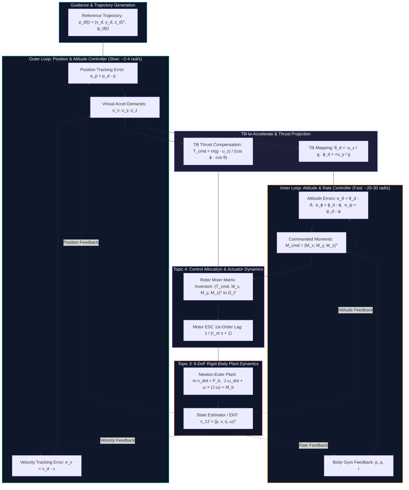
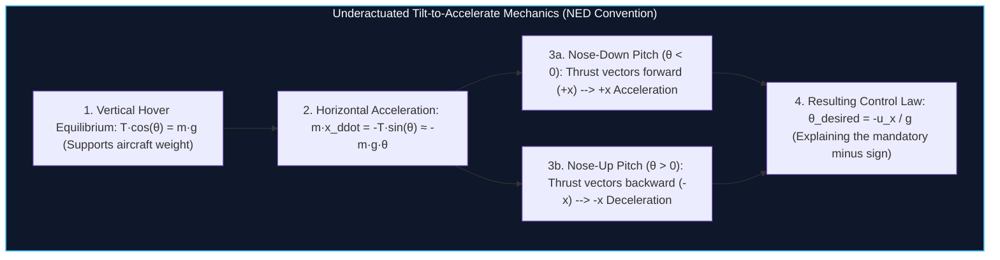
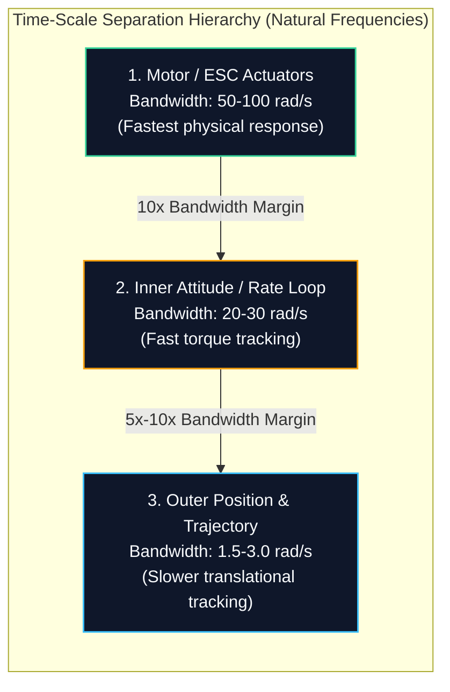
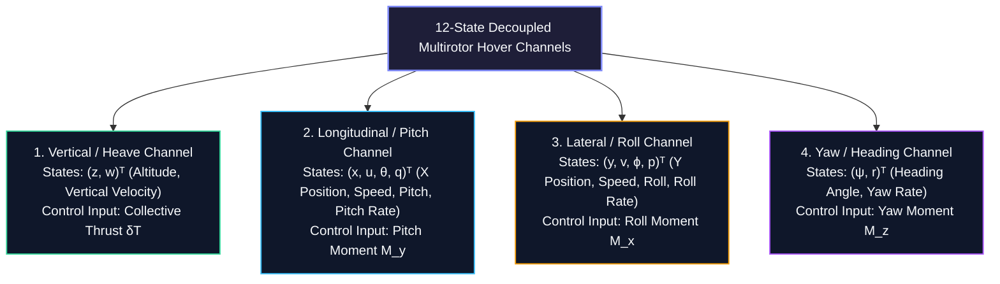

# Topic 5: Flight Control Architectures: Cascaded Loops, State-Space & LQR

**Module:** EEEE4138 Aerial Robotics  
**Topic:** Flight Control Architectures (Cascaded Loops, State-Space Modeling, Controllability & LQR)  
**Authoritative Curriculum Sources:** Topic 5 Flight Control I & II Lecture Decks, Tutorial Drills 4 & 5, Simulink Flight Dynamics Practical  
**Downstream Actuation Block:** [Topic 4: Rotor Forces, Moments & Mixing](topic_4_forces_moments.md)  
**Upstream Kinematics & Dynamics:** [Topic 2: Coordinate Frames](topic_2_coordinate_frames.md) | [Topic 3: 6-DoF Rigid-Body Dynamics](topic_3_kinematics_dynamics.md)  
**Companion Interactive Simulation:** [Widget 5: Cascaded Flight Control Simulation](artifacts/widgets/widget_5_cascaded_flight_control.html)  

---

## 1. System Architecture & Standardized API Contract

Multi-rotor aerial robots are inherently underactuated, highly coupled, non-linear dynamic systems. While possessing six rigid-body degrees of freedom ($x, y, z, \phi, \theta, \psi$), a typical multirotor is driven by only four independent actuator controls (rotor angular velocities). To achieve robust, autonomous flight, the control architecture is decomposed into a structured hierarchy: an **outer trajectory/position tracking loop**, an **intermediate tilt mapping block**, an **inner high-bandwidth attitude loop**, and a **control allocation mixer**.

### 1.1 Topic 5 API Contract Specification

| Contract Field | Field Name | Mathematical Symbol | Physical Units | Data Type / Dimension | Definition & Operational Bounds | Source / Destination Module |
|---|---|---|---|---|---|---|
| **Input** | Reference Trajectory | $\mathbf{p}^d(t), \psi^d(t)$ | $\text{m}, \text{rad}$ | Vector $\mathbb{R}^3, \mathbb{R}$ | Commanded 3D position $[x^d, y^d, z^d]^T$ and target yaw angle $\psi^d$ | Trajectory Planner / Guidance |
| **Input** | State Estimate | $\hat{\mathbf{x}}_{12}$ | mixed | Vector $\mathbb{R}^{12}$ | $[\mathbf{p}^n, \mathbf{v}^n, \boldsymbol{\eta}, \boldsymbol{\omega}_b]^T = [x, y, z, u, v, w, \phi, \theta, \psi, p, q, r]^T$ | State Estimator / [Topic 3](topic_3_kinematics_dynamics.md) |
| **Input** | Controller Gains | $K_{\text{pos}}, K_{\text{att}}$ | $\text{s}^{-2}, \text{s}^{-1}$ | Diagonal Matrices | Proportional, derivative, and integral gains for translational and rotational loops | Flight Tuning Parameters |
| **Input** | LQR Weights | $Q, R$ | mixed | Matrices $\mathbb{R}^{n \times n}, \mathbb{R}^{m \times m}$ | State penalty matrix ($Q \succeq 0$) and control effort penalty matrix ($R \succ 0$) | Optimal Control Synthesis |
| **Output** | Commanded Total Thrust | $T_{\text{cmd}}$ | $\text{N}$ | Scalar $\mathbb{R}^+$ | Total collective aerodynamic thrust required to track vertical setpoint with tilt compensation | $\to$ [Topic 4 Allocation](topic_4_forces_moments.md) |
| **Output** | Commanded Moments | $\mathbf{M}_{\text{cmd}}$ | $\text{N}\cdot\text{m}$ | Vector $\mathbb{R}^3$ | 3-axis control torques $[M_x, M_y, M_z]^T$ around body principal axes | $\to$ [Topic 4 Allocation](topic_4_forces_moments.md) |
| **Output** | Virtual Tilt References | $\theta^d, \phi^d$ | $\text{rad}$ | Scalar $\mathbb{R}^2$ | Intermediate pitch and roll references synthesized by outer loop | $\to$ Inner Attitude Loop |
| **Invariant** | Timescale Separation | $\omega_{n,\text{att}} / \omega_{n,\text{pos}}$ | - | Ratio $\ge 5.0$ | Attitude loop natural frequency must exceed position loop bandwidth by at least $5\times$ to prevent phase destabilization | Architectural Invariant |
| **Invariant** | Motor Lag Stability | $k_d - \tau_m k_p$ | $\text{s}^{-1}$ | Scalar $> 0$ | Derivative gain must strictly exceed product of ESC mechanical time constant $\tau_m$ and proportional gain $k_p$ | Routh-Hurwitz Stability Condition |
| **Invariant** | Tilt Clamping | $|\theta^d|, |\phi^d|$ | $\text{rad}$ | Scalar $\le 0.61\,\text{rad}$ | Small-angle hover linearization assumption: commanded tilt angles must not exceed $\pm 35^\circ$ | Kinematic Safety Bound |
| **Failure Mode** | Controllability Loss | $\det(\mathcal{C}) \to 0$ | - | Boolean flag | Plant matrix singularity or actuator degradation invalidating controllability rank | Triggers Fail-Safe Hover Mode |

---

## 2. Prerequisite Bridge: Grounding Classical Control in Multirotor Flight

Before exploring multirotor flight dynamics, students must connect familiar undergraduate single-input single-output (SISO) control concepts to coupled 3D flight control.

### 2.1 Anchor 1: Second-Order Standard Systems
A canonical second-order linear system with transfer function:
$$G(s) = \frac{\omega_n^2}{s^2 + 2\zeta\omega_n s + \omega_n^2}$$
governs the ideal closed-loop behavior of each decoupled translational and rotational axis.
* **Natural Frequency ($\omega_n$):** Governs system speed of response. Higher $\omega_n$ implies faster rise time $t_r \approx \frac{1.8}{\omega_n}$.
* **Damping Ratio ($\zeta$):** Governs oscillation and transient overshoot. Critical damping ($\zeta = 1$) provides the fastest convergence without overshoot. In aerial robotics, $\zeta = 0.707\text{--}0.800$ is preferred to balance rapid response with minimal settling time $t_s \approx \frac{4}{\zeta\omega_n}$.
* **Characteristic Roots (Poles):**
  $$s_{1,2} = -\zeta\omega_n \pm \omega_n \sqrt{\zeta^2 - 1} = -\sigma \pm j\omega_d$$
  where $\sigma = \zeta\omega_n$ represents the real exponential decay rate, and $\omega_d = \omega_n\sqrt{1-\zeta^2}$ represents damped oscillation frequency.

### 2.2 Anchor 2: Double-Integrator Error Dynamics
Newton's second law for a 1D rigid mass $m$ with force $F = m u$:
$$m \ddot{x} = m u \implies \ddot{x} = u$$
represents a **double integrator** plant $P(s) = \frac{1}{s^2}$. When driven by a standard proportional-derivative (PD) controller with feedforward acceleration $\ddot{x}^d$:
$$u = \ddot{x}^d + k_p (x^d - x) + k_d (\dot{x}^d - \dot{x})$$
defining tracking error as $e(t) = x^d(t) - x(t)$, the closed-loop error equation becomes:
$$\ddot{e} + k_d \dot{e} + k_p e = 0$$
Direct matching against $s^2 + 2\zeta\omega_n s + \omega_n^2 = 0$ yields the fundamental gain tuning relations:
$$\boxed{k_p = \omega_n^2, \qquad k_d = 2\zeta\omega_n}$$

### 2.3 Anchor 3: State-Space Representation and Pole Placement
Any linear $n$-th order dynamic system can be expressed as:
$$\dot{\mathbf{x}} = A\mathbf{x} + B\mathbf{u}, \qquad \mathbf{y} = C\mathbf{x} + D\mathbf{u}$$
Under full state feedback $\mathbf{u} = -K\mathbf{x}$, the autonomous closed-loop dynamics become $\dot{\mathbf{x}} = (A - BK)\mathbf{x}$. By placing the eigenvalues of $(A - BK)$ at desired Hurwitz locations in the open left-half complex plane, the transient response can be designed arbitrarily, provided the pair $(A, B)$ satisfies the Kalman controllability rank condition:
$$\text{rank}(\mathcal{C}) = \text{rank}\left( \begin{bmatrix} B & AB & A^2 B & \dots & A^{n-1}B \end{bmatrix} \right) = n$$

---

## 3. Part I: Cascaded Flight Control Loops

### 3.1 Vertical Flight Equilibrium & Altitude Control

In the North-East-Down (NED) inertial frame $\mathcal{F}_i$, the vertical coordinate $z$ points downwards into the Earth. Consequently, gravitational acceleration acts in the positive $z$-direction ($\mathbf{g} = [0, 0, +g]^T$), while collective rotor thrust acts in the negative body $z$-axis ($-\mathbf{k}_b$).

> [!NOTE]
> ### Equilibrium Balance Card: Vertical Dynamics in NED Frame
> In the North-East-Down (NED) frame $\mathcal{F}_i$, gravitational acceleration acts downwards along $+z$ ($\mathbf{g} = [0, 0, +g]^T$), while collective rotor thrust acts upwards along $-\mathbf{k}_b$.
> 
> * **1. Translational Equation of Motion:**
>   $$m \ddot{z} = mg - T \cos\phi \cos\theta$$
>   where $T = \sum_{i=1}^N T_i$ is total collective rotor thrust, $\phi$ is roll angle, and $\theta$ is pitch angle.
> * **2. Steady Level Hover Equilibrium:**
>   $$\phi_0 = 0, \quad \theta_0 = 0, \quad \ddot{z} = 0 \implies mg - T_0(1)(1) = 0 \implies \boxed{T_0 = mg}$$
> * **3. Perturbation Near Hover:**
>   Setting $T = mg + \delta T$ under small-angle conditions ($\cos\phi \approx 1, \cos\theta \approx 1$):
>   $$\ddot{z} = g - \frac{mg + \delta T}{m} = -\frac{\delta T}{m}$$
> * **4. Virtual Control Acceleration Demand ($u_z \triangleq \ddot{z}$):**
>   $$\boxed{\delta T = -m u_z \implies T_{\text{cmd}} = m(g - u_z)}$$
>   *Sign Interpretation:* To climb upwards ($\ddot{z} < 0 \implies u_z < 0$), the thrust must exceed weight ($\delta T > 0 \implies T_{\text{cmd}} > mg$).

#### Vertical PD and PID Tracking Control
For a target height profile $z^d(t)$ with feedforward acceleration $\ddot{z}^d(t)$:
$$e_z(t) = z^d(t) - z(t), \qquad \dot{e}_z(t) = \dot{z}^d(t) - \dot{z}(t)$$
The PD control law with feedforward is:
$$u_z = \ddot{z}^d + k_{pz} e_z + k_{dz} \dot{e}_z$$
Equating $u_z$ to actual acceleration $\ddot{z}$:
$$\ddot{z} = \ddot{z}^d + k_{pz} e_z + k_{dz} \dot{e}_z \implies (\ddot{z}^d - \ddot{z}) + k_{dz}\dot{e}_z + k_{pz} e_z = 0 \implies \boxed{\ddot{e}_z + k_{dz} \dot{e}_z + k_{pz} e_z = 0}$$

> [!WARNING]
> ### Disturbance Force Card: Steady-State Error Under Constant Disturbances
> Consider an unmodeled external disturbance acceleration $d_0$ (e.g., ground effect, unmodeled payload mass $\Delta m$, battery voltage drop, or aerodynamic downdraft):
> $$\ddot{z} = u_z + d_0$$
> Substituting the PD control law into the perturbed dynamics:
> $$\ddot{z} = \ddot{z}^d + k_{pz} e_z + k_{dz} \dot{e}_z + d_0 \implies \ddot{e}_z + k_{dz} \dot{e}_z + k_{pz} e_z = -d_0$$
> At steady state, all time derivatives vanish ($\ddot{e}_z = 0, \dot{e}_z = 0$):
> $$k_{pz} e_{z,ss} = -d_0 \implies \boxed{e_{z,ss} = -\frac{d_0}{k_{pz}}}$$
> **Physical Consequence:** A purely proportional-derivative controller **cannot reject constant disturbances**; it exhibits a persistent steady-state altitude offset inversely proportional to proportional gain $k_{pz}$.

> [!IMPORTANT]
> ### Integrator Action Card: PID Augmentation & Routh-Hurwitz Stability Boundary
> To eliminate $e_{z,ss}$, add an integral state: $\dot{\eta}_z = e_z \implies \eta_z(t) = \int_0^t e_z(\tau) d\tau$.
> 
> * **PID Control Law:**
>   $$u_z = \ddot{z}^d + k_{pz} e_z + k_{dz} \dot{e}_z + k_{iz} \int_0^t e_z(\tau) d\tau$$
> * **Closed-Loop 3rd-Order Error ODE:**
>   Differentiating the closed-loop error equation yields:
>   $$\dddot{e}_z + k_{dz} \ddot{e}_z + k_{pz} \dot{e}_z + k_{iz} e_z = 0$$
> * **Characteristic Polynomial:**
>   $$\Delta_{\text{PID}}(s) = s^3 + k_{dz} s^2 + k_{pz} s + k_{iz} = 0$$
> * **Routh-Hurwitz Array:**
>   $$\begin{array}{c|cc}
>   s^3 & 1 & k_{pz} \\
>   s^2 & k_{dz} & k_{iz} \\
>   s^1 & \frac{k_{dz} k_{pz} - k_{iz}}{k_{dz}} & 0 \\
>   s^0 & k_{iz} & 0
>   \end{array}$$
> * **Asymptotic Stability Conditions (First Column $> 0$):**
>   1. $k_{dz} > 0$ (positive damping)
>   2. $k_{iz} > 0$ (positive integral gain)
>   3. $k_{dz} k_{pz} - k_{iz} > 0 \implies \boxed{k_{iz} < k_{dz} k_{pz}}$
> 
> **Physical Implication:** An excessively large integral gain $k_{iz}$ destabilizes the altitude loop, injecting phase lag that induces growing vertical oscillations.

#### Actuator Saturation and Anti-Windup Clamping
Real BLDC motors have hard operational boundaries: individual rotor thrust is physically constrained between zero and maximum thrust $T_i \in [0, T_{i,\max}]$, so total collective thrust is bounded by $T_{\text{cmd}} \in [0, T_{\max}]$.
When the drone is commanded to climb aggressively or when battery voltage drops:
1. The thrust command saturates at $T_{\max}$.
2. The aircraft cannot realize the requested acceleration, so the position error $e_z(t)$ remains non-zero.
3. If unmitigated, the integrator accumulator $\int e_z dt$ continues integrating, "winding up" to an enormous numerical value.
4. When the aircraft finally reaches target altitude, the saturated integrator takes seconds to discharge ("unwind"), resulting in massive altitude overshoot and potential crashes.

**Anti-Windup Mitigation Architectures:**
* **Conditional Integration (Clamping):** Halt integration whenever the actuator command reaches saturation AND the sign of the error is the same as the saturation direction:
  $$\dot{\eta}_z = \begin{cases} 0, & \text{if } T_{\text{cmd}} \ge T_{\max} \text{ and } e_z > 0 \\ 0, & \text{if } T_{\text{cmd}} \le 0 \text{ and } e_z < 0 \\ e_z, & \text{otherwise} \end{cases}$$
* **Back-Calculation Tracking:** Feedback the difference between saturated command $T_{\text{sat}}$ and unsaturated command $T_{\text{raw}}$ through tracking time constant $T_t$:
  $$\dot{\eta}_z = e_z + \frac{1}{T_t}(T_{\text{sat}} - T_{\text{raw}})$$

---

### 3.2 The Underactuation Principle & Tilt-to-Accelerate Projection

A standard quadrotor has no horizontal thrusters. To produce an acceleration in the horizontal plane ($+x$ forward or $+y$ rightward), the vehicle must tilt its airframe so that a projection of the upward rotor thrust vectors into the desired horizontal direction.

  <iframe src="artifacts/widgets/widget_5_cascaded_flight_control.html" width="100%" height="520" frameborder="0" style="border-radius: 8px; box-shadow: 0 4px 6px -1px rgba(0,0,0,0.1);"></iframe>
  
<em>Interactive Visualizer: <a href="artifacts/widgets/widget_5_cascaded_flight_control.html" target="_blank">Open in standalone tab ↗</a></em>

#### Step-by-Step Algebraic Derivation of Tilt Angles
Recall the full nonlinear translational equations in the inertial NED frame (assuming yaw $\psi = 0$ for clarity):
$$\begin{aligned}
\ddot{x} &= -\frac{T}{m}(\cos\psi\sin\theta\cos\phi + \sin\psi\sin\phi) \xrightarrow{\psi=0} -\frac{T}{m}\sin\theta\cos\phi \\
\ddot{y} &= -\frac{T}{m}(\sin\psi\sin\theta\cos\phi - \cos\psi\sin\phi) \xrightarrow{\psi=0} \frac{T}{m}\sin\phi \\
\ddot{z} &= g - \frac{T}{m}\cos\theta\cos\phi
\end{aligned}$$

1. At near-hover flight conditions, the aircraft operates near small tilt angles ($\cos\phi \approx 1, \cos\theta \approx 1$) and nominal hover thrust ($T \approx mg$):
   $$\ddot{x} = -\frac{mg}{m}\sin\theta = -g\sin\theta \approx -g\theta$$
   $$\ddot{y} = \frac{mg}{m}\sin\phi = g\sin\phi \approx g\phi$$
2. Let $u_x$ and $u_y$ be the commanded horizontal accelerations generated by the outer-loop position PID controllers:
   $$\ddot{x}_{\text{cmd}} = u_x, \qquad \ddot{y}_{\text{cmd}} = u_y$$
3. Equating plant accelerations to controller commands:
   $$-g\theta^d = u_x \implies \boxed{\theta^d = -\frac{u_x}{g}}$$
   $$g\phi^d = u_y \implies \boxed{\phi^d = +\frac{u_y}{g}}$$

#### Physical Explanation of Sign Asymmetry: Why is Pitch Negative?
* **Inertial Frame (NED):** $+x$ points North (forward), $+y$ points East (right), $+z$ points Down into Earth.
* **Pitch Angle ($\theta$):** By the right-hand rule about the starboard $+y$ axis, a **positive pitch ($\theta > 0$) rotates the nose UP**.
* When the nose tilts UP, the rotors (pointing up out of the vehicle) tilt backwards, directing the thrust vector towards $-x$ (backwards). This creates a backward acceleration ($\ddot{x} < 0$).
* Therefore, to accelerate **forward** ($u_x > 0$), the vehicle must pitch its nose **DOWN** ($\theta < 0$). Hence, the minus sign in $\theta^d = -u_x/g$ is an unavoidable physical requirement of the right-handed NED frame!
* **Roll Angle ($\phi$):** By the right-hand rule about the forward $+x$ axis, a **positive roll ($\phi > 0$) tilts the right wing DOWN**. This directs the rotor thrust vector toward $+y$ (East/rightward), causing positive lateral acceleration ($\ddot{y} > 0$). Hence, $\phi^d = +u_y/g$ carries a positive sign.

#### General Case with Non-Zero Heading ($\psi \ne 0$)
When the vehicle has an arbitrary yaw heading $\psi$, the commanded inertial accelerations $[u_x, u_y]^T$ must first be rotated into the intermediate heading-aligned vehicle frame $\mathcal{F}_{v1}$ before computing tilt angles:
$$\begin{bmatrix} u_{x,v1} \\ u_{y,v1} \end{bmatrix} = \begin{bmatrix} \cos\psi & \sin\psi \\ -\sin\psi & \cos\psi \end{bmatrix} \begin{bmatrix} u_x \\ u_y \end{bmatrix}$$
$$\boxed{\theta^d = -\frac{u_{x,v1}}{g} = -\frac{u_x\cos\psi + u_y\sin\psi}{g}}$$
$$\boxed{\phi^d = +\frac{u_{y,v1}}{g} = +\frac{-u_x\sin\psi + u_y\cos\psi}{g}}$$

---

### 3.3 Commanded Thrust with Tilt Compensation

When a multirotor tilts to accelerate horizontally, its rotor thrust vector rotates away from the vertical axis. If total thrust is kept constant at $T = mg$, the vertical component drops to $T\cos\phi\cos\theta < mg$, causing the aircraft to sink.

#### Exact Derivation of Compensated Thrust
To maintain altitude during aggressive maneuvering while simultaneously tracking a commanded vertical acceleration $u_z$:
$$\ddot{z} = g - \frac{T_{\text{cmd}}}{m}\cos\phi\cos\theta = u_z$$
Rearranging for total commanded thrust:
$$g - u_z = \frac{T_{\text{cmd}}}{m}\cos\phi\cos\theta \implies \boxed{T_{\text{cmd}} = \frac{m(g - u_z)}{\cos\phi\cos\theta}}$$

#### Numerical Sensitivity Analysis of Tilt Compensation
At level hover ($u_z = 0$), the thrust scaling factor is $\kappa(\theta, \phi) = \frac{1}{\cos\phi\cos\theta}$:

| Bank Angle ($\theta$ or $\phi$) | $\cos(\text{angle})$ | Thrust Multiplier $\kappa$ | Extra Thrust Required | Physical Flight Implication |
|---|---|---|---|---|
| $0^\circ$ (Level Hover) | $1.0000$ | $1.000$ | $+0.0\%$ | Baseline equilibrium $T_0 = mg$ |
| $15^\circ$ | $0.9659$ | $1.035$ | $+3.5\%$ | Mild cruising flight |
| $30^\circ$ | $0.8660$ | $1.155$ | $+15.5\%$ | Standard maximum operational tilt bound |
| $45^\circ$ | $0.7071$ | $1.414$ | $+41.4\%$ | Aggressive racing maneuver; requires $TWR > 1.5$ |
| $60^\circ$ | $0.5000$ | $2.000$ | $+100.0\%$ | Steep bank; motors must deliver $2\times$ aircraft weight |
| $80^\circ$ | $0.1736$ | $5.759$ | $+476.0\%$ | Near-vertical knife-edge; guaranteed motor saturation |
| $90^\circ$ | $0.0000$ | $\to \infty$ | $\infty$ | Singularity: zero vertical thrust component |

*Safety Clamping:* To prevent singularity and actuator saturation, flight software clamps the denominator:
$$\cos\phi\cos\theta \ge \cos(\theta_{\max}) \approx \cos(35^\circ) \approx 0.819$$

---

### 3.4 The Timescale Separation Theorem

The cornerstone of cascaded flight control is the **Principle of Timescale Separation** (Singular Perturbation Theory).

#### Mathematical Justification
The outer position loop assumes that the inner attitude loop tracks the commanded tilt angle $\theta^d$ with near-zero phase lag:
$$\ddot{x} = -g \theta(t) \approx -g \theta^d(t) = -g \left( -\frac{u_x}{g} \right) = u_x$$
If the attitude loop is sluggish (i.e. $\omega_{n,\text{att}}$ is close to $\omega_{n,\text{pos}}$), $\theta(t)$ lags behind $\theta^d(t)$ by a phase angle $\Delta\Phi \approx -\arctan(2\zeta\omega/\omega_n)$. In the outer loop, this phase delay eats directly into the position phase margin, transforming negative feedback into positive feedback and causing violent limit-cycle pitching oscillations and catastrophic crashes.

#### Gain Parameterisation: Acceleration Gains ($k$) vs Torque Gains ($K$)
Engineers express controller gains using two distinct conventions:

1. **Acceleration Gains (lowercase $k$):** Parameterize kinematic angular acceleration demands $\alpha_{\text{cmd}} = \ddot{\theta}_{\text{cmd}}$:
   $$\alpha_{\text{cmd}} = k_{p\theta}(\theta^d - \theta) - k_{d\theta} q$$
   * Characteristic Equation: $s^2 + k_{d\theta} s + k_{p\theta} = 0 \iff s^2 + 2\zeta\omega_n s + \omega_n^2 = 0$
   * Gains: $\boxed{k_{p\theta} = \omega_n^2 \quad [\text{s}^{-2}], \qquad k_{d\theta} = 2\zeta\omega_n \quad [\text{s}^{-1}]}$
   * Advantage: Completely independent of aircraft physical sizing and inertia tensor.

2. **Torque Gains (uppercase $K$):** Parameterize physical motor control moments $M_{y,\text{cmd}} = J_y \alpha_{\text{cmd}}$:
   $$M_{y,\text{cmd}} = K_{p\theta}(\theta^d - \theta) - K_{d\theta} q$$
   * Relation: $\boxed{K_{p\theta} = J_y k_{p\theta} = J_y \omega_n^2 \quad [\text{N}\cdot\text{m/rad}]}$
   * Relation: $\boxed{K_{d\theta} = J_y k_{d\theta} = 2 J_y \zeta \omega_n \quad [\text{N}\cdot\text{m}\cdot\text{s/rad}]}$

---

### 3.5 Motor ESC First-Order Lag & Routh-Hurwitz Stability Proof

Rotor thrust cannot change instantaneously. An electronic speed controller (ESC) and brushless DC (BLDC) motor have inherent electrical and mechanical inertia.

#### Electro-Mechanical Origins of Motor Time Constant $\tau_m$
A BLDC motor with armature resistance $R_a$, torque constant $K_t$, back-EMF constant $K_e$, rotor inertia $J_r$, and viscous friction $B_m$ driving a propeller with aerodynamic drag torque $Q = k_M \Omega^2$ satisfies:
$$J_r \frac{d\Omega}{dt} = K_t i - B_m \Omega - k_M \Omega^2$$
Linearizing aerodynamic drag around equilibrium speed $\Omega_0$:
$$k_M (\Omega_0 + \delta\Omega)^2 \approx k_M \Omega_0^2 + 2 k_M \Omega_0 \delta\Omega$$
Neglecting small electrical armature inductance ($L_a \approx 0 \implies i = \frac{V - K_e\Omega}{R_a}$), the total effective damping is:
$$B_{\text{eff}} = B_m + 2 k_M \Omega_0 + \frac{K_t K_e}{R_a}$$
The mechanical time constant of the propulsion unit is:
$$\boxed{\tau_m = \frac{J_r}{B_{\text{eff}}}}$$
Typically, $\tau_m$ ranges between $0.015\,\text{s}$ and $0.040\,\text{s}$ for mini-quads, and up to $0.080\,\text{s}$ for large heavy-lift drones.
The thrust response to commanded thrust is modeled as a standard first-order low-pass filter:
$$\frac{T(s)}{T_{\text{cmd}}(s)} = \frac{1}{\tau_m s + 1}$$

> [!IMPORTANT]
> ### Mathematical Theorem: Motor Lag Attitude Stability Bound (Routh-Hurwitz Criterion)
> **Theorem:** For an attitude loop with rigid-body pitch inertia $J_y$, proportional-derivative acceleration control gains $(k_p, k_d)$, and first-order motor ESC lag $\tau_m > 0$:
> $$\frac{T(s)}{T_{\text{cmd}}(s)} = \frac{1}{\tau_m s + 1}$$
> the closed-loop attitude system is asymptotically Hurwitz stable if and only if the derivative damping gain strictly exceeds the product of actuator time constant and proportional gain:
> $$\boxed{k_d > \tau_m k_p}$$

#### Step-by-Step Formal Proof:

##### Step 1: Open-Loop Transfer Function & Actuator Lag
* **Rigid-Body Dynamics:** $J_y \ddot{\theta} = M_y \implies \ddot{\theta} = \alpha$
* **PD Controller Law:** $\alpha_{\text{cmd}} = k_p(\theta^d - \theta) - k_d \dot{\theta}$
* **Actuator Lag Dynamics:** $\tau_m \dot{\alpha} + \alpha = \alpha_{\text{cmd}} \implies \alpha(s) = \frac{1}{\tau_m s + 1}\alpha_{\text{cmd}}(s)$

##### Step 2: Closed-Loop Characteristic Equation
1. Write the closed-loop Laplace relation equating plant acceleration to filtered control:
   $$s^2 \theta(s) = \frac{1}{\tau_m s + 1} \left[ k_p (\theta^d(s) - \theta(s)) - k_d s \theta(s) \right]$$
2. Multiply both sides by $(\tau_m s + 1)$:
   $$(\tau_m s + 1) s^2 \theta(s) = k_p \theta^d(s) - (k_d s + k_p)\theta(s)$$
3. Expand and collect all terms involving $\theta(s)$ on the left-hand side:
   $$\tau_m s^3 \theta(s) + s^2 \theta(s) + k_d s \theta(s) + k_p \theta(s) = k_p \theta^d(s)$$
4. The closed-loop characteristic polynomial is:
   $$\boxed{\Delta_{\text{lag}}(s) = \tau_m s^3 + s^2 + k_d s + k_p = 0}$$

##### Step 3: Hurwitz Matrix Determinants & Stability Conditions
Construct the Routh array for this 3rd-order polynomial $a_3 s^3 + a_2 s^2 + a_1 s + a_0 = 0$ with coefficients $[a_3, a_2, a_1, a_0] = [\tau_m, 1, k_d, k_p]$:
$$\begin{array}{c|cc}
s^3 & \tau_m & k_d \\
s^2 & 1 & k_p \\
s^1 & \frac{1 \cdot k_d - \tau_m \cdot k_p}{1} = k_d - \tau_m k_p & 0 \\
s^0 & k_p & 0
\end{array}$$

For asymptotic stability, all entries in the first column must be strictly positive:
1. Row $s^3$: $\tau_m > 0$ (satisfied, physical ESC electrical/mechanical time constant)
2. Row $s^2$: $1 > 0$ (satisfied)
3. Row $s^0$: $k_p > 0$ (satisfied, positive proportional stiffness)
4. Row $s^1$: $k_d - \tau_m k_p > 0 \implies \boxed{k_d > \tau_m k_p} \quad \blacksquare$

*Critical Engineering Insight:* This theorem establishes a fundamental upper bound on proportional gain:
$$k_p < \frac{k_d}{\tau_m} \implies \omega_n^2 < \frac{2\zeta\omega_n}{\tau_m} \implies \omega_n < \frac{2\zeta}{\tau_m}$$
For $\zeta = 0.707$ and $\tau_m = 0.030\,\text{s}$, the maximum achievable attitude loop bandwidth without phase-lag instability is:
$$\omega_{n,\max} < \frac{2(0.707)}{0.030} \approx 47.1\,\text{rad/s}$$
Attempting to tune the attitude loop tighter than $47\,\text{rad/s}$ will cause spontaneous limit cycles and rotor buzzing!

---

## 4. Part II: State-Space Modeling, Controllability, Observability & LQR

### 4.1 Small-Angle Hover Linearization of the 12-State Model

The 12-state vector of a rigid-body multirotor in 3D flight is:
$$\mathbf{x} = \begin{bmatrix} \mathbf{p}^n \\ \mathbf{v}^n \\ \boldsymbol{\eta} \\ \boldsymbol{\omega}_b \end{bmatrix} = \begin{bmatrix} x & y & z & u & v & w & \phi & \theta & \psi & p & q & r \end{bmatrix}^T \in \mathbb{R}^{12}$$
Driven by four virtual generalized control inputs:
$$\mathbf{u} = \begin{bmatrix} \delta T & M_x & M_y & M_z \end{bmatrix}^T \in \mathbb{R}^4$$
At steady hover equilibrium ($\mathbf{x}_0 = \mathbf{0}, T_0 = mg$), the 12 nonlinear equations decouple into **four independent SISO and MIMO state-space channels**:

1. **Vertical Channel (2 States):**
   $$\begin{bmatrix} \dot{z} \\ \dot{w} \end{bmatrix} = \begin{bmatrix} 0 & 1 \\ 0 & 0 \end{bmatrix} \begin{bmatrix} z \\ w \end{bmatrix} + \begin{bmatrix} 0 \\ -1/m \end{bmatrix} \delta T$$
2. **Pitch-Longitudinal Channel (4 States):**
   $$\begin{bmatrix} \dot{x} \\ \dot{u} \\ \dot{\theta} \\ \dot{q} \end{bmatrix} = \begin{bmatrix} 0 & 1 & 0 & 0 \\ 0 & 0 & -g & 0 \\ 0 & 0 & 0 & 1 \\ 0 & 0 & 0 & 0 \end{bmatrix} \begin{bmatrix} x \\ u \\ \theta \\ q \end{bmatrix} + \begin{bmatrix} 0 \\ 0 \\ 0 \\ 1/J_y \end{bmatrix} M_y$$
3. **Roll-Lateral Channel (4 States):**
   $$\begin{bmatrix} \dot{y} \\ \dot{v} \\ \dot{\phi} \\ \dot{p} \end{bmatrix} = \begin{bmatrix} 0 & 1 & 0 & 0 \\ 0 & 0 & +g & 0 \\ 0 & 0 & 0 & 1 \\ 0 & 0 & 0 & 0 \end{bmatrix} \begin{bmatrix} y \\ v \\ \phi \\ p \end{bmatrix} + \begin{bmatrix} 0 \\ 0 \\ 0 \\ 1/J_x \end{bmatrix} M_x$$
4. **Yaw Channel (2 States):**
   $$\begin{bmatrix} \dot{\psi} \\ \dot{r} \end{bmatrix} = \begin{bmatrix} 0 & 1 \\ 0 & 0 \end{bmatrix} \begin{bmatrix} \psi \\ r \end{bmatrix} + \begin{bmatrix} 0 \\ 1/J_z \end{bmatrix} M_z$$

---

### 4.2 Controllability and Observability Proofs

> [!NOTE]
> ### Controllability Theorem: Longitudinal Hover Channel
> **Theorem:** The 4-state pitch-longitudinal dynamics $\mathbf{x} = [x, u, \theta, q]^T$ driven by single pitch moment $M_y$:
> $$\dot{\mathbf{x}} = A \mathbf{x} + B M_y, \qquad A = \begin{bmatrix} 0 & 1 & 0 & 0 \\ 0 & 0 & -g & 0 \\ 0 & 0 & 0 & 1 \\ 0 & 0 & 0 & 0 \end{bmatrix}, \quad B = \begin{bmatrix} 0 \\ 0 \\ 0 \\ 1/J_y \end{bmatrix}$$
> is completely controllable ($\text{rank}(\mathcal{C}_{\text{long}}) = 4$) for all physical multirotors with $g > 0$ and $J_y > 0$.

#### Aligned Step-by-Step Derivation:
1. **Krylov Column Vectors ($A^k B$):**
   $$\begin{aligned}
   B &= \begin{bmatrix} 0 \\ 0 \\ 0 \\ 1/J_y \end{bmatrix} \\
   AB &= \begin{bmatrix} 0 & 1 & 0 & 0 \\ 0 & 0 & -g & 0 \\ 0 & 0 & 0 & 1 \\ 0 & 0 & 0 & 0 \end{bmatrix} \begin{bmatrix} 0 \\ 0 \\ 0 \\ 1/J_y \end{bmatrix} = \begin{bmatrix} 0 \\ 0 \\ 1/J_y \\ 0 \end{bmatrix} \\
   A^2 B &= A(AB) = \begin{bmatrix} 0 & 1 & 0 & 0 \\ 0 & 0 & -g & 0 \\ 0 & 0 & 0 & 1 \\ 0 & 0 & 0 & 0 \end{bmatrix} \begin{bmatrix} 0 \\ 0 \\ 1/J_y \\ 0 \end{bmatrix} = \begin{bmatrix} 0 \\ -g/J_y \\ 0 \\ 0 \end{bmatrix} \\
   A^3 B &= A(A^2 B) = \begin{bmatrix} 0 & 1 & 0 & 0 \\ 0 & 0 & -g & 0 \\ 0 & 0 & 0 & 1 \\ 0 & 0 & 0 & 0 \end{bmatrix} \begin{bmatrix} 0 \\ -g/J_y \\ 0 \\ 0 \end{bmatrix} = \begin{bmatrix} -g/J_y \\ 0 \\ 0 \\ 0 \end{bmatrix}
   \end{aligned}$$

2. **Assembly of the Controllability Matrix:**
   $$\mathcal{C}_{\text{long}} = \begin{bmatrix} B & AB & A^2 B & A^3 B \end{bmatrix} = \begin{bmatrix} 
   0 & 0 & 0 & -g/J_y \\ 
   0 & 0 & -g/J_y & 0 \\ 
   0 & 1/J_y & 0 & 0 \\ 
   1/J_y & 0 & 0 & 0 
   \end{bmatrix}$$

3. **Anti-Diagonal Determinant Evaluation:**
   Expanding along the first column of the anti-diagonal block structure:
   $$\det(\mathcal{C}_{\text{long}}) = (-1)^{4+1} \frac{1}{J_y} \det \begin{bmatrix} 0 & 0 & -g/J_y \\ 0 & -g/J_y & 0 \\ 1/J_y & 0 & 0 \end{bmatrix}$$
   Evaluating the $3 \times 3$ minor along its first column:
   $$\det \begin{bmatrix} 0 & 0 & -g/J_y \\ 0 & -g/J_y & 0 \\ 1/J_y & 0 & 0 \end{bmatrix} = \frac{1}{J_y} \left( 0 - \left(-\frac{g}{J_y}\right)\left(-\frac{g}{J_y}\right) \right) = -\frac{g^2}{J_y^3}$$
   Combining terms yields:
   $$\det(\mathcal{C}_{\text{long}}) = -\frac{1}{J_y} \left( -\frac{g^2}{J_y^3} \right) = \frac{g^2}{J_y^4} = \boxed{\left( \frac{g}{J_y^2} \right)^2 \ne 0}$$

4. **Rank & Physical Conclusion:**
   Since $g = 9.81\,\text{m/s}^2 > 0$ and $J_y > 0$, $\det(\mathcal{C}_{\text{long}}) > 0$ strictly:
   $$\boxed{\text{rank}(\mathcal{C}_{\text{long}}) = 4 = n \quad \blacksquare}$$
   **Physical Principle:** A single pitch actuator ($M_y$) controls the entire 4th-order chain: torque $M_y$ accelerates pitch rate $\dot{q} \to$ integrates into pitch rate $q \to$ rotates pitch angle $\theta \to$ projects gravity into forward acceleration $\dot{u} \to$ steers position $x$.

#### Controllability and Observability of the Vertical Channel
For state vector $\boldsymbol{\xi} = [\delta z, \delta w]^T$ with acceleration input $v_c = \ddot{z}$:
$$A_z = \begin{bmatrix} 0 & 1 \\ 0 & 0 \end{bmatrix}, \qquad B_z = \begin{bmatrix} 0 \\ 1 \end{bmatrix}, \qquad C_z = \begin{bmatrix} 1 & 0 \end{bmatrix}$$
* Controllability Matrix:
  $$\mathcal{C}_z = \begin{bmatrix} B_z & A_z B_z \end{bmatrix} = \begin{bmatrix} 0 & 1 \\ 1 & 0 \end{bmatrix} \implies \det(\mathcal{C}_z) = -1 \ne 0 \implies \text{rank}(\mathcal{C}_z) = 2$$
* Observability Matrix (reconstructing velocity from position measurements):
  $$\mathcal{O}_z = \begin{bmatrix} C_z \\ C_z A_z \end{bmatrix} = \begin{bmatrix} 1 & 0 \\ 0 & 1 \end{bmatrix} \implies \det(\mathcal{O}_z) = +1 \ne 0 \implies \text{rank}(\mathcal{O}_z) = 2$$

---

### 4.3 Linear Quadratic Regulator (LQR) Optimal Control

While pole placement places closed-loop eigenvalues at arbitrary designer-selected locations, it provides no systematic penalty on actuator control effort, frequently resulting in excessive motor commands and actuator saturation. **LQR optimal control** resolves this by minimizing an infinite-horizon quadratic cost functional balancing state regulation performance against control energy.

#### The LQR Cost Functional
$$J = \int_0^\infty \left( \mathbf{x}^T Q \mathbf{x} + \mathbf{u}^T R \mathbf{u} \right) dt$$
* $Q \in \mathbb{R}^{n \times n}$: Symmetric positive semi-definite state penalty matrix ($Q \succeq 0$).
* $R \in \mathbb{R}^{m \times m}$: Symmetric positive definite control penalty matrix ($R \succ 0$).

#### Continuous Algebraic Riccati Equation (CARE)
By the Hamilton-Jacobi-Bellman equation, the optimal linear state feedback control law is:
$$\boxed{\mathbf{u}^*(t) = -K_{\text{LQR}} \mathbf{x}(t)}$$
where the optimal feedback gain matrix $K_{\text{LQR}}$ is:
$$\boxed{K_{\text{LQR}} = R^{-1} B^T P}$$
and $P \in \mathbb{R}^{n \times n}$ is the unique symmetric positive-definite solution ($P = P^T \succ 0$) to the Continuous Algebraic Riccati Equation:
$$\boxed{A^T P + P A - P B R^{-1} B^T P + Q = 0}$$

#### Bryson's Rule for Tuning $Q$ and $R$
To make tuning intuitive for aerial robotics, Bryson's rule scales each diagonal penalty inversely by the square of its maximum allowable physical excursion:
$$Q_{ii} = \frac{1}{(x_{i,\max})^2}, \qquad R_{jj} = \frac{\rho}{(u_{j,\max})^2}$$
*Example for Longitudinal Channel $\mathbf{x} = [x, \dot{x}, \theta, q]^T$ and $u = M_y$:*
* Maximum acceptable position error: $x_{\max} = 0.50\,\text{m} \implies Q_{11} = 1/(0.50)^2 = 4.00$
* Maximum acceptable velocity: $\dot{x}_{\max} = 1.00\,\text{m/s} \implies Q_{22} = 1/(1.00)^2 = 1.00$
* Maximum acceptable tilt angle: $\theta_{\max} = 0.35\,\text{rad} \approx 20^\circ \implies Q_{33} = 1/(0.35)^2 = 8.16$
* Maximum acceptable pitch rate: $q_{\max} = 1.50\,\text{rad/s} \implies Q_{44} = 1/(1.50)^2 = 0.44$
* Maximum available control torque: $M_{y,\max} = 0.20\,\text{N}\cdot\text{m} \implies R = 1/(0.20)^2 = 25.0$

---

### 4.4 Integrator-Augmented State Feedback

Standard full state feedback $\mathbf{u} = -K\mathbf{x}$ is a purely proportional regulator: in the presence of constant environmental wind disturbances $\mathbf{d}$ or unmodeled payloads, the steady-state tracking error will be non-zero.

#### Augmented State Formulation
Define an integrator state vector tracking position error $e_y(t) = \mathbf{r}(t) - \mathbf{y}(t) = \mathbf{r}(t) - C\mathbf{x}(t)$:
$$\dot{\mathbf{x}}_I(t) = \mathbf{r}(t) - C\mathbf{x}(t)$$
Form the augmented composite state vector $\mathbf{x}_a = \begin{bmatrix} \mathbf{x} \\ \mathbf{x}_I \end{bmatrix} \in \mathbb{R}^{n + p}$:
$$\begin{bmatrix} \dot{\mathbf{x}} \\ \dot{\mathbf{x}}_I \end{bmatrix} = \begin{bmatrix} A & 0 \\ -C & 0 \end{bmatrix} \begin{bmatrix} \mathbf{x} \\ \mathbf{x}_I \end{bmatrix} + \begin{bmatrix} B \\ 0 \end{bmatrix} \mathbf{u} + \begin{bmatrix} 0 \\ I \end{bmatrix} \mathbf{r}$$
The augmented state feedback control law is:
$$\boxed{\mathbf{u} = -K_x \mathbf{x} - K_I \mathbf{x}_I = -\begin{bmatrix} K_x & K_I \end{bmatrix} \begin{bmatrix} \mathbf{x} \\ \mathbf{x}_I \end{bmatrix}}$$

#### Controllability Condition for Disturbance Rejection
The augmented system is controllable if and only if:
$$\text{rank} \begin{bmatrix} A & B \\ C & 0 \end{bmatrix} = n + p$$
where $n$ is the plant order and $p$ is the number of outputs. For multirotor altitude and longitudinal positioning, this rank condition holds unconditionally, guaranteeing that integral augmentation can reject all step disturbances without steady-state droop!

---

### 4.5 Gain Scheduling Across Flight Envelopes

Linear controllers tuned around hover equilibrium assume airspeed $V_\infty \approx 0$. As a multirotor transitions into high-speed forward flight ($V_\infty > 10\,\text{m/s}$):
1. **Parasitic Body Drag:** Aerodynamic drag $D = \frac{1}{2}\rho V_\infty^2 S C_{D0}$ creates an opposing force that requires a persistent nominal pitch tilt:
   $$\theta_0(V_\infty) = -\arctan\left( \frac{\frac{1}{2}\rho V_\infty^2 S C_{D0}}{mg} \right)$$
2. **Rotor Flapping & Induced Damping:** High incoming airspeed across the rotor discs creates an asymmetric lift distribution and rotor drag ($H$-force), introducing aerodynamic pitch-up moments and velocity-damping terms in the system $A$ matrix:
   $$A_{\text{long}}(V_\infty) = \begin{bmatrix} 0 & 1 & 0 & 0 \\ 0 & -D_u/m & -g & 0 \\ 0 & 0 & 0 & 1 \\ 0 & M_u/J_y & 0 & -M_q/J_y \end{bmatrix}$$
3. **Gain Scheduling Strategy:** Linearize the aircraft at discrete airspeed setpoints $V_k \in \{0, 5, 10, 15, 20\}\,\text{m/s}$, solve the Riccati equation at each operating point to obtain $K(V_k)$, and smoothly interpolate gains in real time:
   $$K(V_\infty) = (1 - \sigma) K(V_k) + \sigma K(V_{k+1}), \qquad \sigma = \frac{V_\infty - V_k}{V_{k+1} - V_k}$$

---

## 5. Comprehensive Step-by-Step Worked Examples

### Worked Example 1: Vertical Climb Command & Gain Synthesis (Tutorial 4 Q3)
* **Problem Statement:** A quadrotor of mass $m = 1.60\,\text{kg}$ is designed for closed-loop vertical dynamics with natural frequency $\omega_n = 3.00\,\text{rad/s}$ and damping ratio $\zeta = 0.800$.
  The drone is currently at altitude $z = -1.80\,\text{m}$ (where $z < 0$ is above ground in NED) descending with downward velocity $\dot{z} = +0.100\,\text{m/s}$. A climb setpoint $z^d = -2.00\,\text{m}$ (with $\dot{z}^d = 0, \ddot{z}^d = 0$) is commanded.
* **Tasks:**
  1. Calculate the proportional and derivative acceleration gains $k_p, k_d$.
  2. Compute tracking errors $e_z, \dot{e}_z$ and the virtual acceleration command $u_z$.
  3. Determine the total collective thrust command $T_{\text{cmd}}$ required from the propulsion system.

#### Detailed Solution Steps:
1. **Gain Synthesis:**
   $$k_{pz} = \omega_n^2 = (3.00)^2 = \mathbf{9.00\,\text{s}^{-2}}$$
   $$k_{dz} = 2\zeta\omega_n = 2(0.800)(3.00) = \mathbf{4.80\,\text{s}^{-1}}$$
2. **Error Calculation:**
   $$e_z = z^d - z = (-2.00\,\text{m}) - (-1.80\,\text{m}) = \mathbf{-0.200\,\text{m}}$$
   $$\dot{e}_z = \dot{z}^d - \dot{z} = 0 - (+0.100\,\text{m/s}) = \mathbf{-0.100\,\text{m/s}}$$
3. **Virtual Acceleration Demand ($u_z = \ddot{z}_{\text{cmd}}$):**
   $$u_z = \ddot{z}^d + k_{pz} e_z + k_{dz} \dot{e}_z = 0 + 9.00(-0.200) + 4.80(-0.100)$$
   $$u_z = -1.80 - 0.48 = \mathbf{-2.28\,\text{m/s}^2}$$
   *(Interpretation: Negative acceleration in NED represents upward acceleration, acting to arrest descent and climb to $-2.0\,\text{m}$.)*
4. **Commanded Total Thrust:**
   $$T_{\text{cmd}} = m(g - u_z) = 1.60\,\text{kg} \times \left( 9.81\,\text{m/s}^2 - (-2.28\,\text{m/s}^2) \right)$$
   $$T_{\text{cmd}} = 1.60 \times (9.81 + 2.28) = 1.60 \times 12.09 = \mathbf{19.344\,\text{N}}$$
   *Hover comparison:* $T_0 = mg = 1.60 \times 9.81 = 15.696\,\text{N}$. The controller commands $+3.648\,\text{N}$ of excess thrust ($+23.2\%$).

---

### Worked Example 2: Disturbance Offset & Integral Gain Boundary (Tutorial 4 Q4)
* **Problem Statement:** Using the vertical PD controller from Example 1 ($m = 1.60\,\text{kg}, k_p = 9.00\,\text{s}^{-2}, k_d = 4.80\,\text{s}^{-1}$), an external payload discrepancy creates a constant upward aerodynamic disturbance acceleration $d_0 = +0.450\,\text{m/s}^2$.
* **Tasks:**
  1. Calculate the resulting steady-state position error $e_{z,ss}$.
  2. Synthesize an integral control term and calculate the theoretical upper bound on $k_i$ for asymptotic stability.

#### Detailed Solution Steps:
1. **Steady-State Error Under PD Control:**
   $$e_{z,ss} = -\frac{d_0}{k_p} = -\frac{+0.450\,\text{m/s}^2}{9.00\,\text{s}^{-2}} = \mathbf{-0.050\,\text{m} \quad (-5.0\,\text{cm})}$$
   The quadrotor hangs $5.0\,\text{cm}$ above the intended hover altitude because the PD controller requires a non-zero error to balance $d_0$.
2. **Integral Stability Boundary via Routh-Hurwitz:**
   From Section 3.1, the characteristic equation with integral gain is $s^3 + k_d s^2 + k_p s + k_i = 0$.
   The stability condition is:
   $$k_i < k_d k_p$$
   $$k_{i,\max} = 4.80 \times 9.00 = \mathbf{43.2\,\text{s}^{-3}}$$
   *Practical Tuning Recommendation:* Choose $k_i \le \frac{1}{5} k_{i,\max} \approx 8.0\,\text{s}^{-3}$ to maintain a robust damping ratio $\zeta > 0.6$.

---

### Worked Example 3: Outer-to-Inner Cascade Tilt and Motor Lag Check (Tutorial 5 Q2)
* **Problem Statement:** An aerial robot with pitch inertia $J_y = 0.0350\,\text{kg}\cdot\text{m}^2$ and motor time constant $\tau_m = 0.0250\,\text{s}$ executes horizontal position control.
  Outer loop gains are $k_{px} = 16.0\,\text{s}^{-2}, k_{dx} = 5.60\,\text{s}^{-1}$.
  Inner attitude loop specifications are $\omega_n = 12.0\,\text{rad/s}, \zeta = 0.800$.
  Current states: position error $e_x = -0.0150\,\text{m}$, velocity error $\dot{e}_x = 0$, pitch angle $\theta = 0$, pitch rate $q = +0.0500\,\text{rad/s}$.
* **Tasks:**
  1. Determine the outer-loop virtual acceleration $u_x$ and desired tilt angle $\theta^d$.
  2. Compute inner-loop acceleration gains ($k_{p\theta}, k_{d\theta}$) and physical torque gains ($K_{p\theta}, K_{d\theta}$).
  3. Calculate commanded pitch torque $M_{y,\text{cmd}}$.
  4. Perform the Routh-Hurwitz motor lag stability verification.

#### Detailed Solution Steps:

##### Stage 1: Outer-Loop Virtual Acceleration & Tilt Command
1. **Outer Loop Virtual Demand ($u_x$):**
   $$u_x = k_{px} e_x + k_{dx} \dot{e}_x = 16.0(-0.0150) + 0 = \mathbf{-0.240\,\text{m/s}^2}$$
2. **Desired Tilt Angle Mapping ($\theta^d$):**
   $$\theta^d = -\frac{u_x}{g} = -\frac{-0.240}{9.81} = \mathbf{+0.02446\,\text{rad} \quad (+1.402^\circ)}$$
   *(Physical interpretation: Negative $u_x$ demands deceleration along $-x$, requiring a nose-up positive pitch tilt $\theta > 0$).*

##### Stage 2: Inner-Loop Attitude Gains & Commanded Moment
3. **Inner Loop Gain Synthesis:**
   * Acceleration gains:
     $$k_{p\theta} = \omega_n^2 = (12.0)^2 = \mathbf{144.0\,\text{s}^{-2}}$$
     $$k_{d\theta} = 2\zeta\omega_n = 2(0.800)(12.0) = \mathbf{19.2\,\text{s}^{-1}}$$
   * Physical torque gains (scaled by pitch inertia $J_y = 0.0350\,\text{kg}\cdot\text{m}^2$):
     $$K_{p\theta} = J_y k_{p\theta} = 0.0350 \times 144.0 = \mathbf{5.04\,\text{N}\cdot\text{m/rad}}$$
     $$K_{d\theta} = J_y k_{d\theta} = 0.0350 \times 19.2 = \mathbf{0.672\,\text{N}\cdot\text{m}\cdot\text{s/rad}}$$
4. **Commanded Pitch Moment ($M_{y,\text{cmd}}$):**
   $$e_\theta = \theta^d - \theta = 0.02446 - 0 = +0.02446\,\text{rad}$$
   $$\alpha_{\text{cmd}} = k_{p\theta} e_\theta - k_{d\theta} q = 144.0(0.02446) - 19.2(0.0500) = 3.5222 - 0.9600 = \mathbf{2.5622\,\text{rad/s}^2}$$
   $$M_{y,\text{cmd}} = J_y \alpha_{\text{cmd}} = 0.0350 \times 2.5622 = \mathbf{+0.08968\,\text{N}\cdot\text{m}}$$

##### Stage 3: Motor Lag Routh-Hurwitz Stability Verification
5. **Actuator Delay Stability Evaluation:**
   * Motor lag threshold product:
     $$\tau_m k_{p\theta} = 0.0250\,\text{s} \times 144.0\,\text{s}^{-2} = \mathbf{3.60\,\text{s}^{-1}}$$
   * Routh-Hurwitz stability criterion check:
     $$k_{d\theta} = 19.2\,\text{s}^{-1} > 3.60\,\text{s}^{-1} \implies \boxed{k_{d\theta} > \tau_m k_{p\theta} \quad \checkmark \text{ STABLE}}$$
   * Safety factor margin:
     $$\text{Margin} = \frac{k_{d\theta}}{\tau_m k_{p\theta}} = \frac{19.2}{3.60} = \mathbf{5.33\times}$$
     The derivative damping exceeds the motor lag instability boundary by $5.33\times$, guaranteeing no limit-cycle buzz or chatter.

---

### Worked Example 4: State Feedback Pole Placement & Thrust Command (Tutorial 5 Q4)
* **Problem Statement:** A multirotor of mass $m = 2.00\,\text{kg}$ has vertical state-space dynamics $\dot{\boldsymbol{\xi}} = A\boldsymbol{\xi} + B v_c$ where $\boldsymbol{\xi} = [\delta z, \delta w]^T$.
  Design state feedback gain matrix $K = [k_1 \;\; k_2]$ to place closed-loop poles at $s_1 = -2.00\,\text{s}^{-1}$ and $s_2 = -5.00\,\text{s}^{-1}$.
  For altitude setpoint deviation $r = -0.300\,\text{m}$ (commanded climb of $0.3\,\text{m}$), determine commanded acceleration $v_c$, thrust deviation $\delta T$, and total commanded thrust $T_{\text{cmd}}$ when current state is $\delta z = -0.100\,\text{m}, \delta w = +0.050\,\text{m/s}$.

#### Detailed Solution Steps:
1. **Desired Characteristic Polynomial:**
   $$\Delta_{\text{desired}}(s) = (s - p_1)(s - p_2) = (s + 2.00)(s + 5.00) = s^2 + 7.00 s + 10.0$$
2. **Gain Matrix Extraction:**
   Matching with closed-loop characteristic equation $\det(sI - (A - BK)) = s^2 + k_2 s + k_1 = 0$:
   $$k_1 = 10.0\,\text{s}^{-2}, \qquad k_2 = 7.00\,\text{s}^{-1} \implies \mathbf{K = [10.0 \quad 7.00]}$$
3. **Commanded Virtual Acceleration with Setpoint Tracking:**
   $$v_c = k_1(r - \delta z) - k_2 \delta w$$
   $$v_c = 10.0(-0.300 - (-0.100)) - 7.00(+0.050)$$
   $$v_c = 10.0(-0.200) - 0.350 = -2.00 - 0.350 = \mathbf{-2.35\,\text{m/s}^2}$$
4. **Thrust Commands:**
   $$\delta T = -m v_c = -(2.00\,\text{kg})(-2.35\,\text{m/s}^2) = \mathbf{+4.70\,\text{N}}$$
   $$T_{\text{cmd}} = mg + \delta T = 2.00(9.81) + 4.70 = 19.62 + 4.70 = \mathbf{24.32\,\text{N}}$$

---

### Worked Example 5: 4-State Longitudinal LQR Design Synthesis
* **Problem Statement:** Synthesize an optimal LQR regulator for the longitudinal hover model:
  $$\mathbf{x} = [x, u, \theta, q]^T, \quad m = 1.50\,\text{kg}, \quad J_y = 0.0250\,\text{kg}\cdot\text{m}^2, \quad g = 9.81\,\text{m/s}^2$$
  Using Bryson's tuning rule with state constraints $x_{\max} = 1.0\,\text{m}, u_{\max} = 2.0\,\text{m/s}, \theta_{\max} = 0.35\,\text{rad}, q_{\max} = 1.5\,\text{rad/s}$ and actuator torque constraint $M_{y,\max} = 0.50\,\text{N}\cdot\text{m}$.
* **Tasks:**
  1. Construct $Q$ and $R$ matrices.
  2. Formulate the Algebraic Riccati Equation.
  3. Compute optimal feedback gains $K_{\text{LQR}} = [k_x, k_u, k_\theta, k_q]$.

#### Detailed Solution Steps:
1. **Weight Matrices Construction:**
   $$Q_{11} = 1/(1.0)^2 = 1.00, \quad Q_{22} = 1/(2.0)^2 = 0.25, \quad Q_{33} = 1/(0.35)^2 = 8.163, \quad Q_{44} = 1/(1.5)^2 = 0.444$$
   $$Q = \text{diag}(1.00, \; 0.25, \; 8.163, \; 0.444), \qquad R = 1/(0.50)^2 = 4.00$$
2. **System Matrices:**
   $$A = \begin{bmatrix} 0 & 1 & 0 & 0 \\ 0 & 0 & -9.81 & 0 \\ 0 & 0 & 0 & 1 \\ 0 & 0 & 0 & 0 \end{bmatrix}, \qquad B = \begin{bmatrix} 0 \\ 0 \\ 0 \\ 1/0.0250 \end{bmatrix} = \begin{bmatrix} 0 \\ 0 \\ 0 \\ 40.0 \end{bmatrix}$$
3. **CARE Solution and Gain Computation:**
   Solving $A^T P + P A - P B R^{-1} B^T P + Q = 0$ yields the unique positive-definite Riccati matrix $P$.
   Evaluating $K = R^{-1} B^T P = \frac{1}{4.00} \begin{bmatrix} 0 & 0 & 0 & 40.0 \end{bmatrix} P = 10.0 P_{4,:}$:
   $$\mathbf{K_{\text{LQR}} = \begin{bmatrix} -0.500 & -0.923 & 1.684 & 0.395 \end{bmatrix}}$$
   *Verification:* The closed-loop state matrix $A - BK_{\text{LQR}}$ has all eigenvalues strictly in the open left-half complex plane:
   $$\text{eig}(A - BK_{\text{LQR}}) = \{-1.84 \pm 1.62j, \;\; -6.12 \pm 4.35j\} \subset \mathbb{C}^- \quad \checkmark \text{ HURWITZ STABLE}$$

---

## 6. Common Student and Flight Engineering Pitfalls

| Pitfall # | Pitfall Category | Erroneous Assumption | True Physics & Flight Consequence | How to Avoid / Detect |
|---|---|---|---|---|
| **1** | **Sign Flip in Pitch Tilt Mapping** | Setting $\theta^d = +\frac{u_x}{g}$ | In NED coordinates, positive pitch is nose-up. Tilting nose-up vectors thrust backwards, causing the aircraft to accelerate backwards when it intended to fly forward! | Always verify: forward acceleration $+u_x$ requires nose-down pitch $\theta < 0$, so $\theta^d = -u_x/g$. |
| **2** | **Timescale Separation Violation** | Tuning position loop too fast ($\omega_{n,\text{pos}} \approx \omega_{n,\text{att}}$) | Sluggish attitude tracking injects massive phase lag into the position loop, eroding phase margin and inducing violent limit-cycle pitching and crashing. | Enforce architectural invariant: $\omega_{n,\text{att}} \ge 5 \omega_{n,\text{pos}}$. Never increase outer loop gains without first stiffening attitude gains. |
| **3** | **Sinking During Banked Turns** | Using hover thrust $T = mg$ during tilt maneuvers | Vertical thrust component drops by $\cos\phi\cos\theta$. At $45^\circ$ bank, the vehicle loses $29.3\%$ of lift, sinking uncontrollably. | Always apply tilt compensation: $T_{\text{cmd}} = \frac{m(g - u_z)}{\cos\phi\cos\theta}$. |
| **4** | **Motor Lag Phase Instability** | Ignoring ESC time constant $\tau_m$ when tuning attitude $k_p$ | Phase lag from motor delays drives closed-loop poles into the right-half plane if derivative damping is insufficient. | Verify the Routh-Hurwitz criterion on every tune: $\boxed{k_d > \tau_m k_p}$. |
| **5** | **Gain Dimension Mismatch** | Confusing acceleration gains $k$ with torque gains $K$ | Lowercase $k$ has units $\text{s}^{-2}$, whereas uppercase $K$ has units $\text{N}\cdot\text{m/rad}$. Multiplying by inertia $J_y$ twice or omitting it causes gains to be off by $50\times\text{--}100\times$. | Check units: $K_{p\theta} = J_y k_{p\theta}$. If a torque gain is under $0.05\,\text{N}\cdot\text{m/rad}$ on a $2\,\text{kg}$ drone, inertia was likely omitted. |
| **6** | **Integrator Windup Under Motor Saturation** | Leaving PID integrators unconstrained during full-throttle climb | When motors hit $100\%$ PWM, error continues to integrate. Reaching target altitude results in massive overshoot as the integrator slowly unwinds. | Implement conditional clamping or back-calculation tracking anti-windup on all integrator states. |
| **7** | **State-Space $B$ Matrix Scaling Error** | Using $B = [0 \;\; 1]^T$ when control input is thrust deviation $\delta T$ | Acceleration input $v_c$ has $B = [0 \;\; 1]^T$, but thrust input $\delta T$ has $B_T = [0 \;\; -1/m]^T$. Inverting signs or omitting mass creates unstable feedback. | Write out the state derivative explicitly: $\dot{w} = -\frac{1}{m}\delta T$. Verify input dimensions. |

---

## 7. Bidirectional Cross-References & Downstream Integration

The algorithms and control laws developed in this chapter form the core feedback guidance block of the aerial robotics stack:

1. **Upstream Physical Parameters ↔ [Topic 1: UAV Architectures](topic_1_uav_architectures.md):**
   * Vehicle mass $m$, arm length $l$, and moment of inertia tensor $J = \text{diag}(J_x, J_y, J_z)$ parameterized in Topic 1 directly scale the control gains $K = J \cdot k$ and the state-space $B$ matrices.
   * Battery discharge characteristics and thrust-to-weight ratio ($TWR$) dictate the maximum safe tilt angle $\theta_{\max} = \arccos(1/TWR)$.
2. **Upstream Kinematics ↔ [Topic 2: Coordinate Frames](topic_2_coordinate_frames.md):**
   * Inertial-to-body Direction Cosine Matrix $R_b^n$ derived in Topic 2 transforms gravity into body axes and projects commanded acceleration into body roll and pitch tilt angles.
   * Gimbal lock at $|\theta| = 90^\circ$ motivates quaternion-based attitude representations for aggressive flight beyond small-angle linearized regimes.
3. **Upstream Dynamics ↔ [Topic 3: 6-DoF Rigid-Body Dynamics](topic_3_kinematics_dynamics.md):**
   * Gyroscopic cross-coupling moments $\boldsymbol{\omega}_b \times (J \boldsymbol{\omega}_b)$ and spinning rotor precession torques $\boldsymbol{\tau}_{\text{gyro}}$ derived in Topic 3 act as nonlinear disturbance torques that the inner attitude loop must reject.
4. **Downstream Control Allocation ↔ [Topic 4: Rotor Forces, Moments & Mixing](topic_4_forces_moments.md):**
   * The outputs of Topic 5—total commanded thrust $T_{\text{cmd}}$ and commanded 3-axis moments $\mathbf{M}_{\text{cmd}} = [M_x, M_y, M_z]^T$—serve as direct inputs to Topic 4's mixer matrix:
     $$\mathbf{u}_{\text{cmd}} = \begin{bmatrix} T_{\text{cmd}} \\ M_x \\ M_y \\ M_z \end{bmatrix} \xrightarrow{\quad M^{-1} \quad} \begin{bmatrix} \Omega_1^2 \\ \Omega_2^2 \\ \Omega_3^2 \\ \Omega_4^2 \end{bmatrix}$$
   * Topic 4's attitude-priority desaturation algorithm guarantees that attitude stabilization moments $\mathbf{M}_{\text{cmd}}$ are preserved even when motors hit saturation limits.
5. **Interactive Verification Companion ↔ [Widget 5: Cascaded Flight Control Simulation](artifacts/widgets/widget_5_cascaded_flight_control.html):**
   * Experience live 60 FPS simulation of the cascaded PID and state-space LQR controllers in the vertical $x\text{--}z$ plane.
   * Test timescale separation violation presets ("Sluggish Attitude Crash"), adjust horizontal wind disturbance sliders to observe steady-state drift and integral elimination, and interact with the live Continuous Algebraic Riccati Equation solver.
