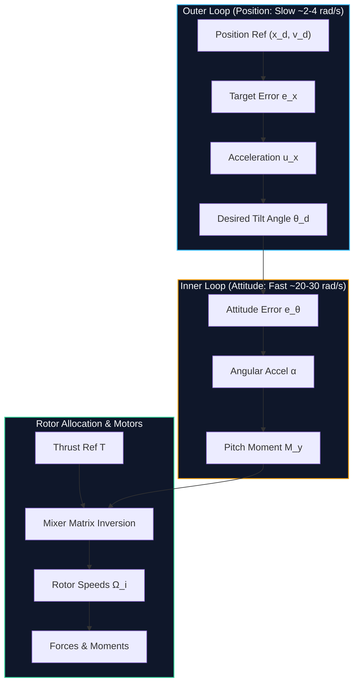
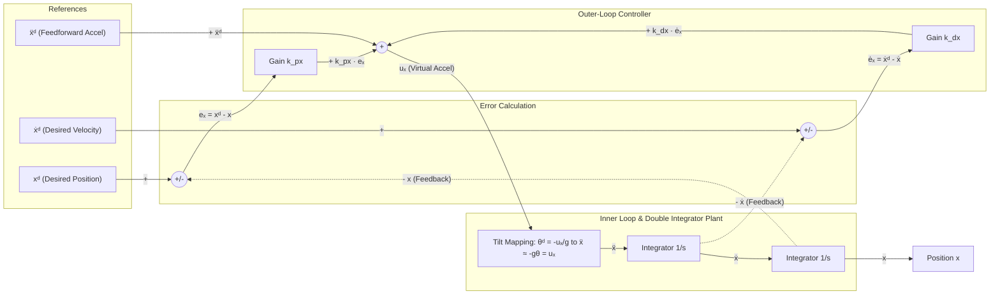
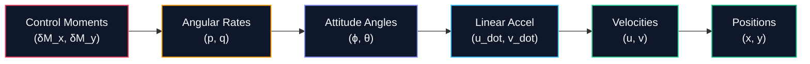

# Cascaded Flight Control & State-Space Design for Quadrotors

**Subject:** EEEE4138 — Aerial Robotics  
**Topic:** Topic 5: Flight Control II (Cascaded Position & Attitude Control, Allocation, State-Space Models & Feedback Design)  
**Coverage:** Complete Slide Deck (Slides 1–50 / Pages 1–44)

---

## 1. The Big Picture: Why Cascaded Control?

A conventional quadrotor is an **underactuated system**: it possesses **6 degrees of freedom** (3 translational $[x, y, z]$ and 3 rotational $[\phi, \theta, \psi]$), but only **4 independent control inputs** (the 4 rotor speeds).

Because the rotors are rigidly fixed to the airframe pointing upwards:
* The aircraft **cannot generate horizontal thrust while remaining level**.
* To accelerate horizontally ($+x$ or $+y$), the airframe must **tilt** so that a component of the collective rotor thrust vectors sideways.
* This motivates a **cascaded control architecture** separating translation from rotation.

  <iframe src="artifacts/widgets/widget_5_cascaded_flight_control.html" width="100%" height="520" frameborder="0" style="border-radius: 8px; box-shadow: 0 4px 6px -1px rgba(0,0,0,0.1);"></iframe>
  
<em>Interactive Visualizer: <a href="artifacts/widgets/widget_5_cascaded_flight_control.html" target="_blank">Open in standalone tab ↗</a></em>

* **Outer Loop (Position Loop — Slower):** Compares actual position against the reference trajectory, generates a required linear acceleration ($u_x, u_y$), and converts it into a **desired attitude angle** ($\theta^d, \phi^d$).
* **Inner Loop (Attitude Loop — Faster):** Commands differential rotor thrusts to produce moments ($M_x, M_y, M_z$), driving the physical attitude ($\theta, \phi$) to track the desired tilt angles.
* **Direct Feedthrough:** Total thrust command $T$ bypasses the attitude loop and feeds straight into control allocation to regulate altitude.

> [!NOTE]
> ### Time-Scale Separation Principle
> The outer loop assumes the aircraft tilts *almost instantaneously* on demand ($\theta \approx \theta^d$). Therefore, the attitude loop must have a much higher natural frequency than the position loop ($\omega_{n,\text{att}} \gg \omega_{n,\text{pos}}$, typically by a factor of $5\times$ to $10\times$).

---

## 2. Coordinate System & Sign Conventions

Understanding coordinate conventions prevents sign errors throughout the entire control cascade:

* **Inertial Frame (North-East-Down / NED Convention):**
  * $x$-axis: Points **forward** (positive forwards).
  * $y$-axis: Points **right** (positive starboard).
  * $z$-axis: Points **downward** (positive downwards; gravity pulls in $+z$, so $\ddot{z} = +g$ in free-fall).
* **Body Frame / Pitch Angle ($\theta$):**
  * **Positive pitch ($\theta > 0$) is nose-up** (right-hand rule around $+y$ pointing to the right).
  * When $\theta > 0$ (nose up), collective thrust tilts **backwards** (towards $-x$).
  * When $\theta < 0$ (nose down), collective thrust tilts **forwards** (towards $+x$).

---

## 3. Nonlinear Equations of Motion (Longitudinal Plane)

Considering 2D motion in the vertical-longitudinal plane ($x\text{--}z$):

$$\begin{aligned}
m \ddot{x} &= -T \sin\theta \\
m \ddot{z} &= mg - T \cos\theta \\
J_y \ddot{\theta} &= M_y
\end{aligned}$$

Dividing by aircraft mass $m$:

$$\ddot{x} = -\frac{T}{m} \sin\theta$$

$$\ddot{z} = g - \frac{T}{m} \cos\theta$$

$$J_y \ddot{\theta} = M_y$$

* $m$: Total aircraft mass ($\text{kg}$)
* $T$: Total collective rotor thrust ($\text{N}$)
* $g$: Gravitational acceleration ($9.81\text{ m/s}^2$)
* $J_y$: Moment of inertia about the pitch axis ($\text{kg}\cdot\text{m}^2$)
* $M_y$: Pitch control moment produced by differential rotor thrusts ($\text{N}\cdot\text{m}$)

---

## 4. Linearization Near Hover

At steady hover, the aircraft is stationary and level:
* Nominal pitch: $\theta_0 = 0$
* Nominal thrust balances weight: $T_0 = mg$

Consider small perturbations around this equilibrium:
$$T = mg + \delta T, \qquad \theta \approx 0$$

Using small-angle approximations ($\sin\theta \approx \theta$ and $\cos\theta \approx 1$):

### Horizontal Motion ($\ddot{x}$)
$$\ddot{x} = -\frac{mg + \delta T}{m} \sin\theta \approx -\left(g + \frac{\delta T}{m}\right)\theta = -g\theta - \frac{\delta T \cdot \theta}{m}$$

Discarding the second-order small product $\delta T \cdot \theta \approx 0$:
$$\boxed{\ddot{x} \approx -g\theta}$$

### Vertical Motion ($\ddot{z}$)
$$\ddot{z} = g - \frac{mg + \delta T}{m} \cos\theta \approx g - \left(g + \frac{\delta T}{m}\right)(1) = -\frac{\delta T}{m}$$
$$\boxed{\ddot{z} \approx -\frac{\delta T}{m}}$$

> [!NOTE]
> ### Fundamental Decoupling Near Hover
> 1. **Horizontal Acceleration ($\ddot{x}$):** Governed purely by **pitch tilt angle** ($\theta$) through gravity vectoring ($\ddot{x} \approx -g\theta$).  
> 2. **Vertical Acceleration ($\ddot{z}$):** Governed purely by **thrust variation** ($\delta T$) through collective rotor thrust ($\ddot{z} \approx -\delta T/m$).  
> 3. **Pitch Angular Acceleration ($\ddot{\theta}$):** Governed purely by **pitch moment** ($M_y$) through differential rotor thrust ($J_y \ddot{\theta} = M_y$).

---

## 5. Outer Loop: Position Controller Design

Given target position $x^d(t)$ and velocity $\dot{x}^d(t)$:

### 1. Tracking Errors
$$e_x = x^d - x, \qquad \dot{e}_x = \dot{x}^d - \dot{x}$$

### 2. Commanded Virtual Acceleration ($u_x$)
Using a feedforward + PD control law:
$$u_x = \ddot{x}^d + k_{px} e_x + k_{dx} \dot{e}_x$$
*(For setpoint regulation where $\ddot{x}^d = 0$ and $\dot{x}^d = 0$: $u_x = k_{px} e_x - k_{dx} \dot{x}$.)*

#### Closed-Loop Architecture & Block Diagram
The signal flow connecting reference trajectory $(x^d, \dot{x}^d, \ddot{x}^d)$, tracking errors $(e_x, \dot{e}_x)$, virtual control acceleration $u_x$, and actual states $(\dot{x}, x)$ forms the following closed negative feedback loop:

#### How the Closed Loop is Obtained (Error Dynamics Derivation)
1. **Controller Output ($u_x$):**
   $$u_x = \ddot{x}^d + k_{px} e_x + k_{dx} \dot{e}_x = \ddot{x}^d + k_{px}(x^d - x) + k_{dx}(\dot{x}^d - \dot{x})$$

2. **Plant Response ($\ddot{x}$):**
   Assuming the high-bandwidth inner attitude loop tracks the commanded pitch angle quickly ($\theta \approx \theta^d = -\frac{u_x}{g}$), the linearized horizontal motion satisfies:
   $$\ddot{x} \approx -g\theta = -g\left(-\frac{u_x}{g}\right) = u_x$$
   Thus, $u_x$ acts directly as the commanded acceleration $\ddot{x}_{\text{cmd}}$.

3. **Closed-Loop Error Dynamics:**
   Equating plant acceleration to the controller command ($\ddot{x} = u_x$):
   $$\ddot{x} = \ddot{x}^d + k_{px} e_x + k_{dx} \dot{e}_x$$
   Rearranging into tracking error terms (since $e_x = x^d - x \implies \ddot{e}_x = \ddot{x}^d - \ddot{x}$):
   $$\ddot{x}^d - \ddot{x} + k_{dx}\dot{e}_x + k_{px}e_x = 0 \implies \boxed{\ddot{e}_x + k_{dx}\dot{e}_x + k_{px}e_x = 0}$$

4. **Second-Order Characteristic Equation:**
   Taking the Laplace transform yields the closed-loop characteristic equation:
   $$s^2 + k_{dx}s + k_{px} = 0 \iff s^2 + 2\zeta\omega_n s + \omega_n^2 = 0$$
   * **Gains:** $k_{px} = \omega_n^2$ and $k_{dx} = 2\zeta\omega_n$.
   * **Tracking Convergence:** For positive gains $k_{px}, k_{dx} > 0$ ($\zeta > 0$), the error dynamics are strictly Hurwitz stable: $e_x(t) \to 0$ and $\dot{e}_x(t) \to 0$ exponentially as $t \to \infty$.

### 3. Acceleration-to-Tilt Mapping ($\theta^d$)
Matching the requested acceleration $u_x$ with the linearized plant $\ddot{x} \approx -g\theta$:
$$u_x = -g\theta^d \implies \boxed{\theta^d = -\frac{u_x}{g}}$$

* **Sign logic:** To accelerate forward ($u_x > 0$), the aircraft must pitch **nose-down** ($\theta < 0$). Hence, the minus sign is strictly necessary.

---

## 6. Inner Loop: Attitude Controller Design

Given the pitch angle request $\theta^d$:

### 1. Pitch Errors
$$e_\theta = \theta^d - \theta$$
$$\dot{e}_\theta = \dot{\theta}^d - \dot{\theta} = \dot{\theta}^d - q$$
where $q = \dot{\theta}$ is the body pitch rate measured directly by gyroscopes. For a piecewise constant reference ($\dot{\theta}^d = 0$):
$$\dot{e}_\theta = -q$$

### 2. Angular Acceleration Request ($\alpha_{\text{cmd}}$)
Using PD feedback:
$$\alpha_{\text{cmd}} = k_{p\theta} e_\theta + k_{d\theta} \dot{e}_\theta = k_{p\theta}(\theta^d - \theta) - k_{d\theta} q$$

### 3. Pitch Moment Request ($M_{y,\text{cmd}}$)
Using Newton-Euler rotational dynamics $M_y = J_y \ddot{\theta} = J_y \alpha_{\text{cmd}}$:
$$\boxed{M_{y,\text{cmd}} = J_y \left[ k_{p\theta}(\theta^d - \theta) - k_{d\theta} q \right]}$$

---

## 7. Gain Parameterisation: Acceleration vs Torque Gains

The feedback gains can be expressed in two standard notations:

| Parameterisation | Expression | Relationship | Units |
| :--- | :--- | :--- | :--- |
| **Acceleration Gains** (lowercase $k$) | $\alpha_{\text{cmd}} = k_{p\theta} e_\theta + k_{d\theta} \dot{e}_\theta$ | $k_{p\theta} = \omega_n^2$ $k_{d\theta} = 2\zeta\omega_n$ | $k_{p\theta} \in [\text{s}^{-2}]$ $k_{d\theta} \in [\text{s}^{-1}]$ |
| **Torque Gains** (uppercase $K$) | $M_{y,\text{cmd}} = K_{p\theta} e_\theta + K_{d\theta} \dot{e}_\theta$ | $K_{p\theta} = J_y k_{p\theta} = J_y \omega_n^2$ $K_{d\theta} = J_y k_{d\theta} = 2 J_y \zeta \omega_n$ | $K_{p\theta} \in [\text{N}\cdot\text{m/rad}]$ $K_{d\theta} \in [\text{N}\cdot\text{m}\cdot\text{s/rad}]$ |

### Standard Second-Order Form
Substituting the acceleration control law into $J_y \ddot{\theta} = M_{y,\text{cmd}}$ yields:
$$\ddot{\theta} + k_{d\theta}\dot{\theta} + k_{p\theta}\theta = k_{p\theta}\theta^d$$

Comparing with the canonical 2nd-order polynomial $s^2 + 2\zeta\omega_n s + \omega_n^2 = 0$:
* **Natural frequency:** $\omega_n = \sqrt{k_{p\theta}}$
* **Damping ratio:** $\zeta = \frac{k_{d\theta}}{2\sqrt{k_{p\theta}}}$

---

## 8. Time-Scale Separation & Motor Lag Criterion

### Loop Bandwidth Separation
* Position loop bandwidth: $\omega_{n,\text{pos}} \approx 2\text{--}4\text{ rad/s}$
* Attitude loop bandwidth: $\omega_{n,\text{att}} \approx 20\text{--}30\text{ rad/s}$

> [!IMPORTANT]
> ### Motor Lag Stability Criterion (Routh-Hurwitz Condition)
> Rotor response is not instantaneous; motor ESC dynamics are modeled as a 1st-order lag with time constant $\tau_m$ (typically $0.02\text{--}0.05\text{ s}$):
> $$\frac{T(s)}{T_{\text{cmd}}(s)} = \frac{1}{\tau_m s + 1}$$
> To prevent phase-lag-induced limit-cycle oscillations, the derivative damping gain must strictly satisfy:
> $$\boxed{k_{d\theta} > \tau_m k_{p\theta}}$$

---

## 9. Altitude Maintenance Under Tilt (Thrust Compensation)

When the aircraft tilts by roll $\phi$ and pitch $\theta$, the vertical component of thrust drops by $\cos\phi\cos\theta$:

$$\ddot{z} = g - \frac{T}{m}\cos\phi\cos\theta$$

To track a requested vertical acceleration $u_z$ (where $u_z = 0$ for level hover):
$$\ddot{z} = u_z \implies g - \frac{T_{\text{cmd}}}{m}\cos\phi\cos\theta = u_z$$

Solving for total commanded thrust:
$$\boxed{T_{\text{cmd}} = \frac{m(g - u_z)}{\cos\phi\cos\theta}}$$

### Bank Angle Sensitivity Table
At hover ($u_z = 0$), compensating for tilt requires multiplying nominal hover thrust $mg$ by $\frac{1}{\cos\phi\cos\theta}$:

| Bank Angle ($\theta$ or $\phi$) | $\cos(\text{angle})$ | Thrust Multiplier | Extra Thrust Required | Flight Regime Implication |
|---|---|---|---|---|
| $0^\circ$ (Level Hover) | $1.0000$ | $1.000$ | $+0.0\%$ | Equilibrium $T_0 = mg$ |
| $15^\circ$ | $0.9659$ | $1.035$ | $+3.5\%$ | Cruising flight |
| $30^\circ$ | $0.8660$ | $1.155$ | $+15.5\%$ | Standard maximum operational bound |
| $45^\circ$ | $0.7071$ | $1.414$ | $+41.4\%$ | Aggressive maneuvering ($TWR > 1.5$) |
| $60^\circ$ | $0.5000$ | $2.000$ | $+100.0\%$ | Steep banked turns ($2\times$ aircraft weight) |
| $80^\circ$ | $0.1736$ | $5.759$ | $+476.0\%$ | Near-vertical knife edge (saturation limit) |
| $90^\circ$ | $0.0000$ | $\to \infty$ | $\infty$ | Singularity (zero vertical lift component) |

*Safety Clamping:* Flight controllers enforce $\cos\phi\cos\theta \ge \cos(35^\circ) \approx 0.819$ to prevent numerical singularities.

---

## 10. Rotor Control Allocation (+ Configuration)

Control allocation maps the collective virtual control loads $[T, M_x, M_y, M_z]^T$ to individual rotor thrusts $T_i$ and motor speeds $\Omega_i$.

For a **Plus layout** (+ configuration):
* Rotor 1: Front
* Rotor 2: Right (+y)
* Rotor 3: Rear ($-x$)
* Rotor 4: Left ($-y$)
* Arm length: $l$ (distance from center of mass to each rotor)

$$\begin{aligned}
T &= T_1 + T_2 + T_3 + T_4 \\
M_x &= l(T_4 - T_2) \\
M_y &= l(T_1 - T_3) \\
M_z &= k_{MT}(T_1 - T_2 + T_3 - T_4)
\end{aligned}$$

In matrix form:

$$\begin{bmatrix} T \\ M_x \\ M_y \\ M_z \end{bmatrix} = \begin{bmatrix} 1 & 1 & 1 & 1 \\ 0 & -l & 0 & l \\ l & 0 & -l & 0 \\ k_{MT} & -k_{MT} & k_{MT} & -k_{MT} \end{bmatrix} \begin{bmatrix} T_1 \\ T_2 \\ T_3 \\ T_4 \end{bmatrix}$$

* $k_{MT} = \frac{k_M}{k_T}$: Rotor drag-to-thrust torque ratio ($M_{\text{drag}} = k_M \Omega^2$, $T_i = k_T \Omega^2$).
* Once individual thrusts $T_i$ are solved by inverting the matrix, the required motor angular velocities are:
  $$\Omega_i = \sqrt{\frac{T_i}{k_T}}$$

> [!WARNING]
> ### Actuator Feasibility Limits & Priority Allocation
> * **Hardware Bounds:** Individual rotor thrusts are constrained by $0 \le T_i \le T_{i,\max}$ with motor time lag $\tau_m$.
> * **Attitude Priority Rule:** When actuators saturate, **attitude moment tracking must strictly take priority over collective altitude thrust**. An altitude drop causes a gentle descent, whereas loss of attitude torque causes catastrophic unrecoverable tumbling.
> * **Anti-Windup Clamping:** Integrators in both loops must halt accumulation (clamping) whenever commands saturate to prevent overshoot on setpoint arrival.

---

## 11. State-Space Formulation for Altitude Dynamics

### 1. State Definition
Position alone is insufficient to describe or predict motion. In the vertical channel, choose the state vector $\xi$ as deviations from steady hover ($z_0$):
$$\xi = \begin{bmatrix} \delta z \\ \delta w \end{bmatrix}$$
* $\delta z = z - z_0$: Vertical position deviation ($\text{m}$)
* $\delta w = \dot{z} = w$: Vertical velocity deviation ($\text{m/s}$)

### 2. State-Space Equations
With commanded acceleration deviation $v_c = \ddot{z} = -\frac{\delta T}{m}$ as input:
$$\begin{aligned}
\delta \dot{z} &= \delta w \\
\delta \dot{w} &= v_c
\end{aligned}$$

Writing in standard continuous-time state-space form:
$$\dot{\xi} = A\xi + B v_c$$
$$y = C\xi + D v_c$$

$$\boxed{A = \begin{bmatrix} 0 & 1 \\ 0 & 0 \end{bmatrix}, \quad B = \begin{bmatrix} 0 \\ 1 \end{bmatrix}, \quad C = \begin{bmatrix} 1 & 0 \end{bmatrix}, \quad D = 0}$$

* **Block Diagram View:** A double integrator chain:
  $$v_c \xrightarrow{\quad\frac{1}{s}\quad} \delta w \xrightarrow{\quad\frac{1}{s}\quad} \delta z$$

### 3. Impact of Input Units on the $B$ Matrix
The state matrix $A$ represents the physical plant (independent of input units), but $B$ scales with the chosen actuator command:
* If input is **acceleration** $v_c$: $\delta\dot{w} = v_c \implies B = \begin{bmatrix} 0 \\ 1 \end{bmatrix}$
* If input is **thrust deviation** $\delta T$: $\delta\dot{w} = -\frac{1}{m}\delta T \implies B_T = \begin{bmatrix} 0 \\ -1/m \end{bmatrix}$

---

## 12. Controllability & Observability

### Controllability
A system is controllable if its control input can drive any initial state to any arbitrary final state in finite time.
For $n = 2$ states, the controllability matrix $\mathcal{C}$ is:
$$\mathcal{C} = \begin{bmatrix} B & AB \end{bmatrix}$$

$$AB = \begin{bmatrix} 0 & 1 \\ 0 & 0 \end{bmatrix} \begin{bmatrix} 0 \\ 1 \end{bmatrix} = \begin{bmatrix} 1 \\ 0 \end{bmatrix}$$

$$\mathcal{C} = \begin{bmatrix} 0 & 1 \\ 1 & 0 \end{bmatrix} \implies \det(\mathcal{C}) = -1 \ne 0 \implies \mathbf{\text{rank}(\mathcal{C}) = 2}$$

The system is **fully controllable**. Physical meaning: acceleration directly modifies velocity, which subsequently integrates into position.

### Observability
A system is observable if the internal state trajectory can be uniquely determined from historical measurements of output $y(t)$.
The observability matrix $\mathcal{O}$ for position measurement ($C = [1 \;\; 0]$) is:
$$\mathcal{O} = \begin{bmatrix} C \\ CA \end{bmatrix}$$

$$CA = \begin{bmatrix} 1 & 0 \end{bmatrix} \begin{bmatrix} 0 & 1 \\ 0 & 0 \end{bmatrix} = \begin{bmatrix} 0 & 1 \end{bmatrix}$$

$$\mathcal{O} = \begin{bmatrix} 1 & 0 \\ 0 & 1 \end{bmatrix} \implies \det(\mathcal{O}) = 1 \ne 0 \implies \mathbf{\text{rank}(\mathcal{O}) = 2}$$

The system is **fully observable**. Physical meaning: velocity can be completely reconstructed by differentiating position measurements over time.

---

## 13. State Feedback Design (Pole Placement)

### 1. State Feedback Control Law
Let the control law be a linear combination of all states:
$$v_c = -K \xi = -\begin{bmatrix} k_1 & k_2 \end{bmatrix} \begin{bmatrix} \delta z \\ \delta w \end{bmatrix} = -k_1 \delta z - k_2 \delta w$$

### 2. Closed-Loop Dynamics
Substituting $v_c = -K\xi$ into $\dot{\xi} = A\xi + Bv_c$:
$$\dot{\xi} = (A - BK)\xi$$

$$A - BK = \begin{bmatrix} 0 & 1 \\ 0 & 0 \end{bmatrix} - \begin{bmatrix} 0 \\ 1 \end{bmatrix} \begin{bmatrix} k_1 & k_2 \end{bmatrix} = \begin{bmatrix} 0 & 1 \\ -k_1 & -k_2 \end{bmatrix}$$

The closed-loop characteristic equation is:
$$\det(sI - (A - BK)) = \det\begin{bmatrix} s & -1 \\ k_1 & s + k_2 \end{bmatrix} = s(s + k_2) + k_1 = \boxed{s^2 + k_2 s + k_1 = 0}$$

### 3. Pole Placement Procedure
To place the closed-loop poles at desired locations $s = p_1$ and $s = p_2$:
$$\Delta_{\text{desired}}(s) = (s - p_1)(s - p_2) = s^2 - (p_1 + p_2)s + p_1 p_2$$

Equating coefficients with $s^2 + k_2 s + k_1$:
$$\boxed{k_1 = p_1 p_2, \qquad k_2 = -(p_1 + p_2)}$$

---

## 14. Reference Tracking & Thrust Command

To track a setpoint position deviation $r$ (where $r = z^d - z_0$):
$$v_c = k_1 r - K\xi = k_1(r - \delta z) - k_2 \delta w$$

At steady state ($\delta\dot{z} = 0, \delta w = 0, \dot{\xi} = 0$):
$$\delta z_{\text{ss}} = r$$
Zero steady-state tracking error is achieved.

### Converting Acceleration Command to Total Thrust
Once $v_c$ is determined by the state feedback law:
$$\delta T = -m v_c$$
$$\boxed{T_{\text{cmd}} = mg + \delta T = m(g - v_c)}$$

---

## 15. Actuator Lag in State-Space (3-State Model)

In reality, commanded acceleration $v_c$ is delayed by rotor and motor inertia. Modeling this as a 1st-order lag with time constant $\tau_m$:
$$\tau_m \dot{a} + a = v_c \implies \dot{a} = \frac{1}{\tau_m}(v_c - a)$$
where $a$ is the **actual vertical acceleration deviation**.

### Augmented State Vector
$$\xi_a = \begin{bmatrix} \delta z \\ \delta w \\ a \end{bmatrix} \in \mathbb{R}^3$$

### Augmented State Equations
$$\begin{aligned}
\delta \dot{z} &= \delta w \\
\delta \dot{w} &= a \\
\dot{a} &= -\frac{1}{\tau_m}a + \frac{1}{\tau_m}v_c
\end{aligned}$$

In matrix form:
$$\dot{\xi}_a = \begin{bmatrix} 0 & 1 & 0 \\ 0 & 0 & 1 \\ 0 & 0 & -1/\tau_m \end{bmatrix} \xi_a + \begin{bmatrix} 0 \\ 0 \\ 1/\tau_m \end{bmatrix} v_c$$

* Adding actuator lag increases system order from 2 to 3, introducing phase lag and requiring derivative damping to avoid resonance.

---

## 16. The Full 12-State Quadrotor Linear Model

Near hover, the full 6-DOF quadrotor dynamics linearize into a **12th-order state-space model** with 4 input channels:

### 1. State Vector (12 States)
$$\mathbf{x} = \begin{bmatrix} \mathbf{p} \\ \mathbf{v} \\ \mathbf{\eta} \\ \mathbf{\omega} \end{bmatrix} \in \mathbb{R}^{12}$$

1. **Position (Inertial):** $\mathbf{p} = [x, y, z]^T$
2. **Velocity (Body/Inertial):** $\mathbf{v} = [u, v, w]^T$
3. **Attitude (Euler Angles):** $\mathbf{\eta} = [\phi, \theta, \psi]^T$ (Roll, Pitch, Yaw)
4. **Angular Rates (Body):** $\mathbf{\omega} = [p, q, r]^T$ (Roll rate, Pitch rate, Yaw rate)

### 2. Control Input Vector (4 Inputs)
$$\mathbf{u} = \begin{bmatrix} \delta T \\ \delta M_x \\ \delta M_y \\ \delta M_z \end{bmatrix} \in \mathbb{R}^4$$

### 3. Coupling Hierarchy at Hover
At hover, the 12 states break down into 4 decoupled channels:
* **Vertical Channel:** $\delta T \implies \dot{w} \implies \dot{z}$
* **Pitch-Longitudinal Channel:** $\delta M_y \implies \dot{q} \implies \dot{\theta} \implies \dot{u} \implies \dot{x}$
* **Roll-Lateral Channel:** $\delta M_x \implies \dot{p} \implies \dot{\phi} \implies \dot{v} \implies \dot{y}$
* **Yaw Channel:** $\delta M_z \implies \dot{r} \implies \dot{\psi}$

| Dynamic Layer | Physical Variables | Governing Dynamics | Control Role |
|---|---|---|---|
| **Control Moments** | $\delta M_x, \delta M_y$ | Actuator differential rotor thrust | Input actuation torques |
| **Angular Rates** | $p, q$ | $J_x \dot{p} = \delta M_x, \quad J_y \dot{q} = \delta M_y$ | Rotational body rates |
| **Attitude Angles** | $\phi, \theta$ | $\dot{\phi} \approx p, \quad \dot{\theta} \approx q$ | Spatial orientation / tilt |
| **Translational Accel** | $\dot{u}, \dot{v}$ | $\dot{u} \approx -g\theta, \quad \dot{v} \approx +g\phi$ | Thrust projection |
| **Linear Velocities** | $u, v$ | $\dot{x} = u, \quad \dot{y} = v$ | Velocity integration |
| **Inertial Positions** | $x, y$ | Guidance tracking | Target position |

---

## 17. Equivalence Between PD Control and State Feedback

For a 2nd-order translational or rotational channel, **PD control and Full State Feedback represent the exact same control law**:

* **PD Control:**
  $$u_{\text{PD}} = k_p (r - z) - k_d \dot{z}$$
* **State Feedback:**
  $$u_{\text{SF}} = -K \xi + k_1 r = -k_1 \delta z - k_2 \delta w + k_1 r = k_1(r - \delta z) - k_2 \delta w$$

By setting:
$$k_1 = k_p, \qquad k_2 = k_d$$
the two approaches yield **identical closed-loop poles, stability margins, and time responses**.
* **PD Perspective:** Focuses on error signals and frequency-domain loop shaping.
* **State-Space Perspective:** Generalizes seamlessly to multi-variable (MIMO) systems, observer/Kalman filter design, and LQR optimal control.

---

## 18. Comprehensive Step-by-Step Worked Examples

### Example 1: Attitude Gains from Second-Order Specs (Slide 17)
* **Given:** $J_y = 0.00500\text{ kg}\cdot\text{m}^2$, $\omega_n = 25.0\text{ rad/s}$, $\zeta = 0.700$, $\tau_m = 0.020\text{ s}$.

1. **Acceleration Gains:**
   $$k_{p\theta} = \omega_n^2 = 25.0^2 = \mathbf{625\text{ s}^{-2}}$$
   $$k_{d\theta} = 2\zeta\omega_n = 2(0.700)(25.0) = \mathbf{35.0\text{ s}^{-1}}$$
2. **Torque Gains:**
   $$K_{p\theta} = J_y k_{p\theta} = 0.00500 \times 625 = \mathbf{3.125\text{ N}\cdot\text{m/rad}}$$
   $$K_{d\theta} = J_y k_{d\theta} = 0.00500 \times 35.0 = \mathbf{0.175\text{ N}\cdot\text{m}\cdot\text{s/rad}}$$
3. **Motor Lag Stability Check:**
   $$\tau_m k_{p\theta} = 0.020 \times 625 = 12.5\text{ s}^{-1}$$
   Since $k_{d\theta} = 35.0 > 12.5$, the system is stable against motor phase lag.

---

### Example 2: End-to-End Position Error to Torque (Slides 18–19)
* **Given:** $e_x = +0.0200\text{ m}$, $\dot{e}_x = 0$, $k_{px} = 16.0\text{ s}^{-2}$, $\theta = 0$, $q = 0$, $K_{p\theta} = 3.125\text{ N}\cdot\text{m/rad}$.

1. **Virtual Acceleration Request:**
   $$u_x = k_{px} e_x = 16.0 \times 0.0200 = \mathbf{+0.320\text{ m/s}^2}$$
2. **Desired Pitch Angle:**
   $$\theta^d = -\frac{u_x}{g} = -\frac{0.320}{9.81} = \mathbf{-0.0326\text{ rad}} \quad (-1.87^\circ)$$
   *(Negative pitch = nose-down to accelerate forward).*
3. **Commanded Pitch Torque:**
   $$e_\theta = \theta^d - \theta = -0.0326\text{ rad}$$
   $$M_{y,\text{cmd}} = K_{p\theta} e_\theta = 3.125 \times (-0.0326) = \mathbf{-0.102\text{ N}\cdot\text{m}}$$

---

### Example 3: State Feedback Pole Placement (Slides 34–35)
* **Given:** Desired poles at $p_1 = -2\text{ s}^{-1}$ and $p_2 = -3\text{ s}^{-1}$. Current state: $\delta z = 0.100\text{ m}$ (below hover), $\delta w = 0.200\text{ m/s}$ (moving downwards). Mass $m = 1.50\text{ kg}$.

1. **Determine Gain Matrix $K$:**
   $$\Delta_{\text{desired}}(s) = (s + 2)(s + 3) = s^2 + 5s + 6$$
   Matching with $s^2 + k_2 s + k_1 = 0$:
   $$k_1 = 6, \qquad k_2 = 5 \implies \mathbf{K = [6 \quad 5]}$$
2. **Calculate Commanded Acceleration:**
   $$v_c = -K\xi = -6(0.100) - 5(0.200) = -0.60 - 1.00 = \mathbf{-1.60\text{ m/s}^2}$$
   *(Negative acceleration = upwards acceleration to correct downward displacement and downward speed).*
3. **Convert to Commanded Thrust:**
   $$\delta T = -m v_c = -1.50 \times (-1.60) = \mathbf{+2.40\text{ N}}$$
   $$T_{\text{cmd}} = mg + \delta T = 1.50(9.81) + 2.40 = 14.715 + 2.40 = \mathbf{17.115\text{ N}}$$

---

### Example 4: State Feedback Setpoint Tracking (Slides 38–39)
* **Given:** Desired poles at $p_1 = -3\text{ s}^{-1}, p_2 = -4\text{ s}^{-1}$. Target deviation: $r = -0.200\text{ m}$ ($0.2\text{ m}$ higher altitude). Initial state at hover: $\xi = [0 \quad 0]^T$. Mass $m = 1.00\text{ kg}$.

1. **Determine Gain Matrix $K$:**
   $$\Delta_{\text{desired}}(s) = (s + 3)(s + 4) = s^2 + 7s + 12 \implies \mathbf{K = [12 \quad 7]}$$
   $$A - BK = \begin{bmatrix} 0 & 1 \\ -12 & -7 \end{bmatrix}$$
2. **Calculate Commanded Acceleration:**
   $$v_c = k_1 r - K\xi = 12(-0.200) - 0 = \mathbf{-2.40\text{ m/s}^2}$$
3. **Calculate Commanded Total Thrust:**
   $$T_{\text{cmd}} = m(g - v_c) = 1.00(9.81 - (-2.40)) = 1.00(9.81 + 2.40) = \mathbf{12.21\text{ N}}$$

---

## 19. Watch Out For (Exam & Implementation Pitfalls)

* **Missing the minus sign in $\theta^d = -u_x/g$:** In NED coordinates, positive pitch is nose-up. To accelerate forward along $+x$, the drone must pitch nose-down ($\theta < 0$).
* **Confusion between $k$ and $K$:**
  * Lowercase $k$ are **acceleration gains** (pure kinematics).
  * Uppercase $K$ are **torque gains** ($K = J \cdot k$), which incorporate mass moment of inertia.
* **Input-dependent $B$ matrix in state-space:**
  * If input is acceleration $v_c$: $B = [0 \quad 1]^T$.
  * If input is thrust deviation $\delta T$: $B = [0 \quad -1/m]^T$.
* **Altitude loss during turns/accelerations:** If collective thrust is not scaled by $\frac{1}{\cos\phi\cos\theta}$, the drone will sink during horizontal acceleration.
* **Actuator saturation & prioritization:** If motors saturate ($T_i > T_{i,\max}$), **attitude moments must always take priority over altitude thrust**, otherwise loss of attitude control leads to an unrecoverable flip.
* **Motor lag instability ($k_d > \tau_m k_p$):** Setting derivative damping too low in the presence of ESC/motor lag $\tau_m$ causes limit-cycle oscillations.
