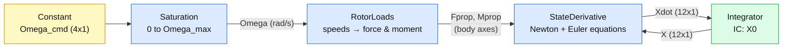
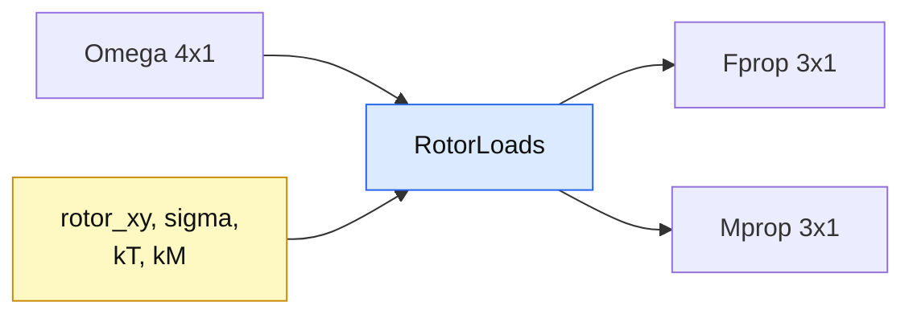
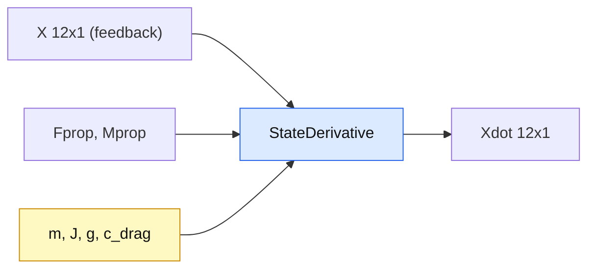
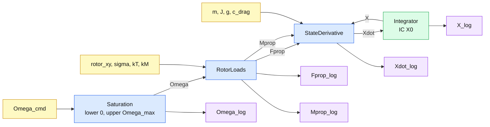
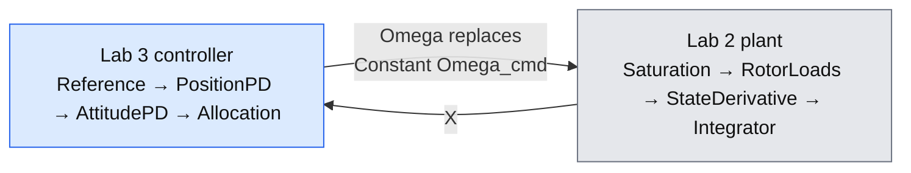

# Practical 2 Guide: Nonlinear Quadrotor Model and Validation

This guide covers `EEEE4138 Practical 2 Guided Laboratory.pdf` (Sections 1–8) for `Practical2_Quadrotor.slx`, using `practical2_parameters.m` (`student_id = 19`, X configuration). It is written for re-reading: each block has a **why** next to its **how**.

> **Viewing the diagrams:** they are written in mermaid. GitHub renders them automatically. In VS Code, install **"Markdown Preview Mermaid Support"** (bierner.markdown-mermaid), then open the preview with `Ctrl+Shift+V`.

---

## 0. The big picture

Lab 2 builds the **plant**: a simulation of the drone's physics, with **no controller**. You command four rotor speeds, and the model works out how the drone moves. Lab 3 later puts a controller in front of it.



| Block | Question it answers | Physics |
| :--- | :--- | :--- |
| `Saturation` | What speeds can the motors actually reach? | 0 ≤ Ω ≤ 800 rad/s (ideal motor, no lag) |
| `RotorLoads` | What force and moment do these speeds produce? | Tᵢ = kT Ωᵢ², moments from lever arms + rotor drag torque |
| `StateDerivative` | Given the forces and the current state, how fast is each state changing? | F = ma (translation), M = Jω̇ + ω×Jω (rotation), frame rotations |
| `Integrator` | Where is the drone now? | X(t) = X0 + ∫ Xdot dt |

The `X → StateDerivative` feedback is **not a controller**. The equations of motion depend on the current state (for example, gravity's direction in the body frame depends on the attitude), so the derivative block needs to see X.

### The 12 states

| Index | Symbol | Meaning | Frame | Units |
| :--- | :--- | :--- | :--- | :--- |
| 1–3 | pN, pE, pD | Position | NED (world) | m |
| 4–6 | u, v, w | Velocity | **Body** | m/s |
| 7–9 | φ, θ, ψ | Roll, pitch, yaw | Euler angles (ZYX) | rad |
| 10–12 | p, q, r | Angular rates | **Body** | rad/s |

> **Trap:** `pN` (North position) is not `p` (roll rate). Also, **Down is positive** in NED, so climbing means pD becomes *more negative*.

### Frames

- **NED (world):** x = North, y = East, z = **Down**.
- **Body (FRD):** x = Forward (nose), y = Right, z = **Down** (through the belly).
- Rotor thrust pushes along **−z body** (up through the top of the drone).
- `R` converts body → NED: `v_NED = R v_body`. `Rᵀ` converts NED → body.

---

## 1. Folder and Quick Start

1. The PDF asks for a folder named `Practical2_S19`. Yours is `Lab2_S20617556/`, containing a `results/` subfolder.
2. `practical2_parameters.m` holds every parameter. MATLAB Function blocks **cannot** see workspace variables directly, so each parameter enters through a Constant block.
3. Workflow for every test: **run `practical2_parameters` → apply the test overrides → `sim` → save under a distinct filename.** Never re-run the parameter script after applying overrides, because it resets them.

---

## 2. Parameters (`student_id = 19`)

The script is copied from the PDF with `student_id = 19`. Since 19 > 10, you get the **X configuration**.

| Quantity | Formula | Value |
| :--- | :--- | :--- |
| `m0` | round(100(1.31 + 0.02·18))/100 | 1.67 kg |
| `l` | arm_values(mod(54,5)+1) = arm_values(5) | 0.27 m |
| `d` | l/√2 (lever arm about x or y) | 0.190919 m |
| `m_nom` | 1.5·m0 | 2.505 kg |
| `Jdiag` | [0.03;0.03;0.05]·(m0/1.5)·(l/0.25)² | [0.038958; 0.038958; 0.064930] kg·m² |
| `kT` | 2·m_nom·g/(4·800²) | 1.919848e-5 N/(rad/s)² |
| `kM` | 0.020·kT | 3.839696e-7 N·m/(rad/s)² |
| `Omega_hover` | √(m_nom g/(4 kT)) = 800/√2 | 565.685 rad/s |
| Hover thrust per rotor | m_nom g/4 | 6.1435 N |

`kT` is chosen so that full speed (800 rad/s) gives **2× hover thrust**: a thrust-to-weight ratio of 2.

### Rotor layout (X configuration, viewed from above)

|  | **Left** (y < 0) | | **Right** (y > 0) |
| :---: | :---: | :---: | :---: |
| **Front** (x > 0) | **1** (+d, −d)<br/>σ = +1, CCW | ↑ nose | **2** (+d, +d)<br/>σ = −1, CW |
| **Rear** (x < 0) | **4** (−d, −d)<br/>σ = −1, CW | | **3** (−d, +d)<br/>σ = +1, CCW |

- Columns of `rotor_xy = [d d -d -d; -d d d -d]` are rotors 1–4: row 1 is x, row 2 is y.
- Diagonal rotors (1 & 3, 2 & 4) spin the **same** way and neighbours spin opposite ways. This cancels the yaw torque at hover.

---

## 3. RotorLoads: speeds → force and moment

### Physics, per rotor i

$$T_i = k_T\Omega_i^2,\qquad \mathbf F_i = \begin{bmatrix}0\\0\\-T_i\end{bmatrix},\qquad \mathbf M_i = \mathbf r_i\times\mathbf F_i + \begin{bmatrix}0\\0\\\sigma_i k_M\Omega_i^2\end{bmatrix}$$

Expanding the cross product with **r** = [x, y, 0]:

$$\mathbf r_i\times\mathbf F_i = \begin{bmatrix} y\cdot(-T) - 0 \\ 0 - x\cdot(-T) \\ 0\end{bmatrix} = \begin{bmatrix}-y_iT_i\\ x_iT_i\\0\end{bmatrix}$$

What this means physically:
- **Mx = −y T (roll):** a rotor on the **left** (y < 0) gives **+Mx**, which lifts the left side and rolls right.
- **My = x T (pitch):** a rotor at the **front** (x > 0) gives **+My**, which lifts the nose (pitch up).
- **Mz = σ kM Ω² (yaw):** each spinning rotor drags on the air, and the air twists the airframe the opposite way. σ sets the direction. Thrust itself produces no yaw because it is vertical.

### 🟦 Block card: `RotorLoads`

| | |
| :--- | :--- |
| **Library** | *Simulink → User-Defined Functions → MATLAB Function* |
| **Rename to** | `RotorLoads` |
| **Inputs** | `Omega` (from Saturation), Constants `rotor_xy`, `sigma`, `kT`, `kM` |
| **Outputs** | `Fprop` (3×1), `Mprop` (3×1) → StateDerivative |



```matlab
function [Fprop,Mprop] = RotorLoads(Omega,rotor_xy,sigma,kT,kM)
% Sum thrust forces and moments from all 4 rotors (body axes: x fwd, y right, z down)
Fprop = zeros(3,1);
Mprop = zeros(3,1);
for i = 1:4
    Ti = kT * Omega(i)^2;
    Fi = [0; 0; -Ti];                                   % thrust along -z body
    ri = [rotor_xy(1,i); rotor_xy(2,i); 0];
    Mi = cross(ri, Fi) + [0; 0; sigma(i)*kM*Omega(i)^2];
    Fprop = Fprop + Fi;
    Mprop = Mprop + Mi;
end
end
```

> **Don't add gravity here.** `RotorLoads` is propulsion only, and gravity is added exactly once, in `StateDerivative`.

### Allocation matrix A (the PDF's "Allocation task")

Stacking the four rotors gives a linear map from rotor thrusts to the total load:

$$\begin{bmatrix}T_{total}\\M_x\\M_y\\M_z\end{bmatrix} = A\begin{bmatrix}T_1\\T_2\\T_3\\T_4\end{bmatrix},\qquad \text{column } i = \begin{bmatrix}1\\-y_i\\x_i\\\sigma_i k_M/k_T\end{bmatrix}$$

For your X geometry (`kM/kT = 0.020`):

$$A = \begin{bmatrix} 1 & 1 & 1 & 1 \\ d & -d & -d & d \\ d & d & -d & -d \\ 0.02 & -0.02 & 0.02 & -0.02 \end{bmatrix},\quad d = 0.190919$$

How to read each row:
- **Row 2, Mx = d(T1 − T2 − T3 + T4):** left rotors (1, 4) minus right rotors (2, 3).
- **Row 3, My = d(T1 + T2 − T3 − T4):** front rotors (1, 2) minus rear rotors (3, 4).
- **Row 4, Mz = 0.02(T1 − T2 + T3 − T4):** CCW pair (1, 3) minus CW pair (2, 4).
- **rank(A) = 4,** so any [T; Mx; My; Mz] has a unique set of rotor thrusts. Lab 3's `Allocation` block uses `A \ cmd` for exactly this.
- **T_total vs Fprop,z:** T_total is a positive magnitude, while `Fprop(3) = −T_total` because thrust points up and z points down.

### Hover check

All Ω = 565.685 rad/s, so every Tᵢ = 6.1435 N. That gives `Fprop = [0; 0; −24.574] N`, and `Mprop = 0` because the left/right, front/rear and CCW/CW contributions all cancel.

**Zero moment ≠ zero angular velocity:** M = 0 means no angular **acceleration**. A drone that is already spinning keeps spinning (Newton's first law for rotation).

---

## 4. StateDerivative: the equations of motion

### Physics, one line per state group

| States | Equation | Meaning |
| :--- | :--- | :--- |
| ṗ (1–3) | **R v_b** | Body velocity rotated into NED gives the rate of change of world position |
| v̇_b (4–6) | **(F_g + F_prop + F_drag)/m − ω × v_b** | Newton's 2nd law, written in the rotating body frame |
| Euler rates (7–9) | **E ω** | Converts body rates (p, q, r) into Euler-angle rates |
| ω̇ (10–12) | **J⁻¹[M_prop − ω × (Jω)]** | Euler's rotation equation |

What each term does:
- **F_g = Rᵀ[0; 0; mg]:** gravity is "straight down" in NED. Rᵀ expresses it in body axes. When the drone is tilted, part of gravity lies along body x or y, and that is what makes a tilted drone accelerate sideways.
- **F_drag = −c·v_b:** linear drag opposing body velocity. It is zero in the baseline (c_drag = 0).
- **−ω × v_b:** the body axes themselves rotate. Even with no force, a body-frame velocity component appears to change when the axes turn under it. This is why v̇_b is **not** simply "acceleration in body axes".
- **ω × Jω:** gyroscopic coupling between axes. It is zero when ω = 0, which is why the initial-derivative predictions in Section 6 are simple.
- **E:** at φ = θ = 0, E = I, so Euler rates equal (p, q, r). E blows up at θ = ±90° (gimbal lock: cos θ = 0).

### Rotation matrix (ZYX)

```matlab
Rx = [1 0 0; 0 cos(phi) -sin(phi); 0 sin(phi) cos(phi)];
Ry = [cos(theta) 0 sin(theta); 0 1 0; -sin(theta) 0 cos(theta)];
Rz = [cos(psi) -sin(psi) 0; sin(psi) cos(psi) 0; 0 0 1];
R  = Rz*Ry*Rx;      % body -> NED: yaw applied last
```

### 🟦 Block card: `StateDerivative`

| | |
| :--- | :--- |
| **Library** | *Simulink → User-Defined Functions → MATLAB Function* |
| **Rename to** | `StateDerivative` |
| **Inputs** | `X` (Integrator output, fed back), `Fprop`, `Mprop` (RotorLoads), Constants `m`, `J`, `g`, `c_drag` |
| **Output** | `Xdot` (12×1) → Integrator |



```matlab
function Xdot = StateDerivative(X,Fprop,Mprop,m,J,g,c_drag)
% Compute 12-state rigid-body quadrotor derivatives in NED / body axes.

% Extract states
vb    = X(4:6);
phi   = X(7);
theta = X(8);
psi   = X(9);
omega = X(10:12);

% Body-to-NED rotation matrix R = Rz * Ry * Rx
Rx = [1 0 0; 0 cos(phi) -sin(phi); 0 sin(phi) cos(phi)];
Ry = [cos(theta) 0 sin(theta); 0 1 0; -sin(theta) 0 cos(theta)];
Rz = [cos(psi) -sin(psi) 0; sin(psi) cos(psi) 0; 0 0 1];
R  = Rz * Ry * Rx;

% Position kinematics (NED)
pos_dot = R * vb;

% Translational dynamics (body axes)
Fg     = R.' * [0; 0; m*g];
Fdrag  = -c_drag * vb;
vb_dot = (Fg + Fprop + Fdrag)/m - cross(omega, vb);

% Attitude kinematics (Euler angle rates)
E = [1  sin(phi)*tan(theta)   cos(phi)*tan(theta);
    0  cos(phi)             -sin(phi);
    0  sin(phi)/cos(theta)   cos(phi)/cos(theta)];
euler_dot = E * omega;

% Rotational dynamics (body axes)
omega_dot = J \ (Mprop - cross(omega, J * omega));

% Assemble 12x1 state derivative
Xdot = zeros(12,1);
Xdot(1:3)   = pos_dot;
Xdot(4:6)   = vb_dot;
Xdot(7:9)   = euler_dot;
Xdot(10:12) = omega_dot;
end

```

### 🟦 Block card: `Integrator`

| | |
| :--- | :--- |
| **Library** | *Simulink → Continuous → Integrator* |
| **Settings** | **Initial condition** = `X0` |
| **Wiring** | `Xdot` → in; out = `X` → back to `StateDerivative.X` (and to `X_log`) |

---

## 5. Assembling the model

### How to add a block (general Simulink moves)

| Action | How |
| :--- | :--- |
| Add a block | Click an empty spot on the canvas and **type the block name** → Enter. Or open the Library Browser with `Ctrl+Shift+L` and drag. |
| Rename | Double-click the name text under the block |
| Constant value | Double-click the block → **Constant value** = the variable name (e.g. `kT`) |
| MATLAB Function code | Double-click → paste → `Ctrl+S`. Ports appear from the function signature. |
| Branch a line | `Ctrl` + drag from an existing line |
| Check | `Ctrl+D`. Show sizes with **Debug → Information Overlays → Signal Dimensions** |

### Full wiring, including parameters and logs



| Block | Library | Settings |
| :--- | :--- | :--- |
| Constant `Omega_cmd` | *Sources → Constant* | value `Omega_cmd` (4×1) |
| Saturation | *Discontinuities → Saturation* | Upper `Omega_max`, Lower `0` |
| 8 parameter Constants | *Sources → Constant* | `rotor_xy`, `sigma`, `kT`, `kM`, `m`, `J`, `g`, `c_drag` |
| 5 × To Workspace | *Sinks → To Workspace* | names as in the diagram, **Timeseries**, sample time **0.01** |

`Omega_log` taps the **Saturation output**, so it records the speeds actually applied.

### Model settings (`Ctrl+E`)

| Pane → setting | Value |
| :--- | :--- |
| Solver → Type / Solver | **Variable-step**, **`ode45`** |
| Max step size | `0.01` |
| Relative / Absolute tolerance | `1e-6` / `1e-8` |
| Stop time | `2` (`0.20` for the differential-moment tests) |
| Data Import/Export → Single simulation output | on, `out` |

> Lab 3 switches this to fixed-step `ode4`.

### Pre-run check (`Ctrl+D`)

`X` and `Xdot` must be **12**, `Fprop` and `Mprop` **3**, and `Omega` **4**.

---

## 6. Isolated validation tests: predictions vs your results

Predict first, then simulate. Each test isolates **one** piece of the physics, so if it fails you know which equation is wrong. The scripts are [run_hover_test.m](run_hover_test.m) (Section 5 hover) and [run_validation_tests.m](run_validation_tests.m) (all of Section 6, written to `results/section6_validation.csv`).

| Test | What it isolates | Setup |
| :--- | :--- | :--- |
| Frame mapping | `R` alone | φ = θ = 0, ψ = 90°, v_b = [5; 0; 0] |
| Hover | Force balance | All Ω = Ω_hover |
| Free fall | Gravity sign and direction | All Ω = 0 |
| Differential pitch | `My` row of A, then q̇ = My/Jyy | T1, T2 + δ; T3, T4 − δ; 0.20 s |
| Yaw reaction | σ signs, then Mz | T1, T3 + δ; T2, T4 − δ; 0.20 s |

where Ti0 = 6.143513 N and δ = 0.05·Ti0 = 0.307176 N.

### Worked predictions

**1. Frame mapping.** At ψ = 90°, `R = [0 −1 0; 1 0 0; 0 0 1]`, so R·[5; 0; 0] = **[0; 5; 0]**: the nose points East, so forward motion is East. Also RRᵀ = I and det R = +1, which confirms a proper rotation (no reflection).

**2. Hover.** Fprop = [0; 0; −24.574] N and Fg = [0; 0; +24.574] N cancel, and M = 0. So **every entry of Ẋ(0) = 0** and nothing moves.

**3. Free fall.** No thrust, so ẇ = +g (Down is +). At t = 2 s: **w = gt = 19.62 m/s** and **pD = ½gt² = 19.62 m**. The two numbers match only because t = 2 s. Attitude stays 0 because there is no moment.

**4. Differential pitch.** The front pair (1, 2) gets +δ and the rear pair (3, 4) gets −δ:
- Ω = [579.655; 579.655; 551.362; 551.362] rad/s, all within [0, 800].
- **My = d(T1 + T2 − T3 − T4) = 4dδ = 0.234582 N·m.** Mx = Mz = 0, and T_total is unchanged at 24.574 N.
- **q̇(0) = My/Jyy = 6.021456 rad/s²** (ω = 0, so ω × Jω = 0). Positive q means nose up.
- Over 0.20 s: q ≈ 1.204 rad/s and θ ≈ ½·6.02·0.2² = 0.1204 rad.

**5. Yaw reaction.** The CCW pair (1, 3) gets +δ and the CW pair (2, 4) gets −δ:
- **Mz = kMT(T1 − T2 + T3 − T4) = 4·0.02·δ = 0.024574 N·m.** Mx = My = 0.
- **ṙ(0) = Mz/Jzz = 0.378472 rad/s².** Positive r means the nose turns right (clockwise seen from above).
- This is about 16× smaller than the pitch response from the same δ, because reaction torque (factor 0.02) is far weaker than a lever arm (d = 0.19).

### ✅ Your results (from `results/section6_validation.csv`)

| Test | Predicted | Your simulation | Abs. difference |
| :--- | :--- | :--- | :--- |
| Frame mapping | [0; 5; 0] m/s, det = 1 | [0.0000; 5.0000; 0.0000], det = 1.000000 | 3.1e-16 m/s |
| Hover | Ẋ(0) = 0, drift 0 | max\|Ẋ(0)\| = 1.4e-15, max\|X(2)\| = 2.8e-15 | ~1e-15 |
| Free fall | pD = w = 19.620000 | 19.620000 m, 19.620000 m/s | 3.6e-14 m |
| Diff. pitch | My = 0.234582, q̇ = 6.021456 | 0.234582, 6.021456; θ(0.2) = 0.120429 | 2.4e-14 rad/s² |
| Yaw reaction | Mz = 0.024574, ṙ = 0.378472 | 0.024574, 0.378472; ψ(0.2) = 0.007569 | 1.9e-15 rad/s² |

All differences are at floating-point roundoff (~1e-15), so **the model is correct**. Report these as **absolute** differences with units. A percentage error is meaningless when the expected value is 0.

> **Initial vs final:** q̇(0) = My/J is an *initial* angular acceleration. Later values come from the full state evolving, so record initial-derivative checks separately from final-state checks.

---

## 7. Payload, drag and numerical checks

> ⚠️ **Your `results/` folder has no Section 7 outputs yet.** [run_section7_tests.m](run_section7_tests.m) runs all three checks. It saves `payload.mat/png`, `drag.mat`, `nodrag.mat`, `drag.png` and `diff_pitch_fine.mat`, and prints simulated vs predicted values. It needs `results/diff_pitch.mat`, which you already have.

### 7.1 Payload: m = 1.80·m0, rotor speeds kept at the old hover values

- New mass m = 1.8 × 1.67 = **3.006 kg**, so the weight is 29.489 N. Thrust is still 24.574 N, sized for the old 2.505 kg.
- Net downward force 4.915 N, so **ẇ(0) = g(1 − m_nom/m) = 9.81 × (1 − 1.5/1.8) = 1.635 m/s²**, constant because the attitude stays level.
- At 2 s: **w = 3.270 m/s** and **pD = ½·1.635·2² = 3.270 m** (sinks).
- **Why it can't hover:** hover speed is set by √(m g/(4kT)). A heavier drone needs √(1.8/1.5) ≈ 1.095× faster rotors (619.7 rad/s), but Ω_cmd was left at 565.7. In the payload convention J is unchanged, so only mass changes.

### 7.2 Drag: u(0) = 2 m/s, c_drag = 0.25 N·s/m vs 0

- Initial drag force −c·u = −0.5 N, so **u̇(0) = −0.5/2.505 = −0.199601 m/s²**.
- With level attitude and hover thrust (gravity and thrust cancel), only drag acts along x: m u̇ = −c u, so **u(t) = 2e^(−t/τ)** with τ = m/c = **10.02 s**.
- At 2 s: **u = 1.638 m/s**, and **pN = 2τ(1 − e^(−2/τ)) = 3.626 m**.
- Without drag: u stays 2 m/s and **pN = 4.000 m**.
- **Physical explanation:** u decays exponentially and never reverses, because drag shrinks as speed shrinks, so it can't push the drone backwards. North-position traces: the drag case curves below the straight no-drag line, and the gap grows with time.

### 7.3 Numerical check: differential pitch with max step 0.005 s

- Re-run the 0.20 s differential-pitch test with `MaxStep = 0.005` (same inputs, same 0.01 s logging) and compare with the original `diff_pitch.mat`.
- **Expect absolute differences of about 1e-12 or smaller.** With constant moment and ω × Jω ≈ 0 over this short pitch-only run, q(t) is linear and θ(t) is quadratic, and ode45 integrates polynomials essentially exactly. A large change would mean a bug, such as a discontinuity or a wrong sign.
- Report it as e.g. "final |Δq| = 3e-15 rad/s, |Δθ| = 2e-16 rad: step-size independent."

### 7.4 Other checks to document

- Orthogonality: RRᵀ = I and det R = +1 (Section 6.1).
- rank(A) = 4 (printed by the script).
- Units: Ω rad/s, T N, M N·m, J kg·m², kT N/(rad/s)², kM N·m/(rad/s)².
- Assumptions behind the analytical predictions: rigid body, diagonal J, no motor lag, no drag (except in 7.2), no gyroscopic rotor effects, no wind or ground contact, ω(0) = 0 so the coupling terms vanish initially.

---

## 8. Demonstration: what to say

- **"Where is gravity added?"** Only in `StateDerivative`, as `Fg = R.'*[0;0;m*g]`, a NED-down vector expressed in body axes. `RotorLoads` is propulsion only.
- **"What is the plant input?"** **Rotor speed** (`Omega_cmd` → Saturation), not a force or moment. Forces and moments are *computed* from the speeds in `RotorLoads`. This is why Lab 3 needs the `Allocation` block to convert the desired [T; M] back into speeds.
- **Hover:** all states stay at about 1e-15 for 2 s.
- **Differential moment (pitch):** front rotors faster, so +My and q̇(0) = 6.02 rad/s² (nose up), matching My/Jyy exactly.
- **One discrepancy / tolerance:** differences of about 1e-15 are floating-point roundoff, and the solver tolerances (RelTol 1e-6, AbsTol 1e-8) bound the integration error. Halving the max step changes nothing visible.

### Submission checklist

- [x] `practical2_parameters.m`, `Practical2_Quadrotor.slx`
- [x] Allocation matrix with reaction signs (Section 3)
- [x] Section 6 table + `hover/freefall/diff_pitch/yaw_reaction` `.mat` + `.png`
- [ ] Section 7: payload, drag and step-size results and explanations (run `run_section7_tests.m`)

---

## 9. How this connects to Lab 3



- Lab 3's `Allocation` is `A \ [T; Mx; My; Mz]`: the **inverse** of the A you derived here.
- The test signs carry over directly. In Lab 3, +My (front rotors faster) means nose up, and a nose-up drone drifts South.
- Lab 3's `PositionPD` uses the same R as `StateDerivative` to get NED velocity.

---

## 10. Troubleshooting

| Symptom | Likely cause |
| :--- | :--- |
| Hover accelerates down | About g: gravity added twice. About 2g: thrust sign wrong (`+Ti` instead of `−Ti`) |
| Free fall goes *up* (pD negative) | `Fg` uses `R` instead of `R.'`, or `[0;0;-m*g]` |
| Pitch test gives Mx ≠ 0 | `rotor_xy` rows swapped (x and y mixed up) |
| Yaw test gives the wrong-sign r | `sigma` sign flipped, or yaw term missing from `Mprop(3)` |
| Size errors on `Ctrl+D` | Set port sizes in **Symbols / Edit Data**: `X` [12 1], `Omega` [4 1], `rotor_xy` [2 4], `J` [3 3] |
| A test "remembers" the previous test | Didn't re-run `practical2_parameters` before applying overrides |
| "Undefined variable" in `sim` | Parameter script not run, or a Constant's value is misspelled |
