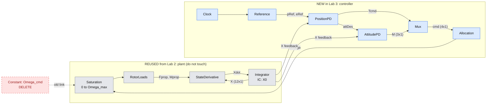
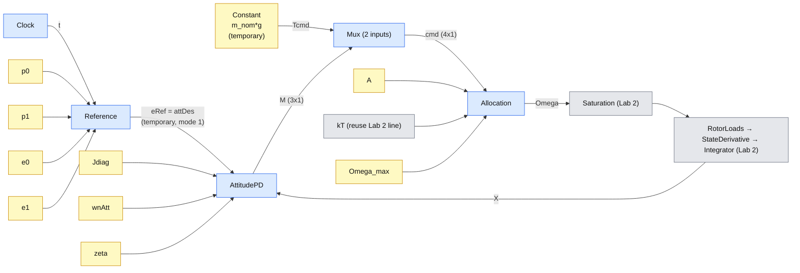
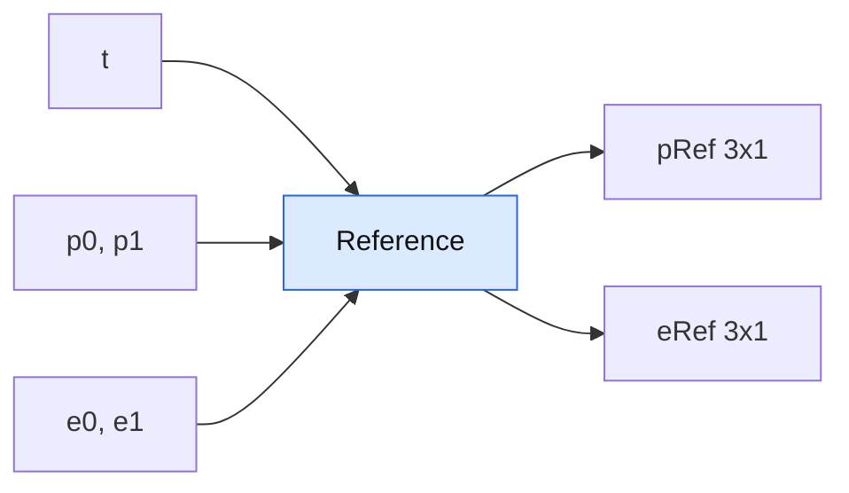
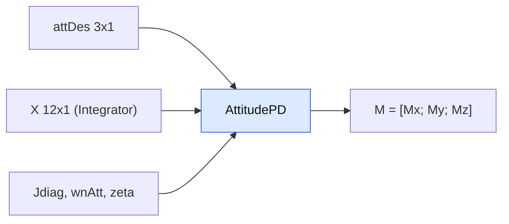
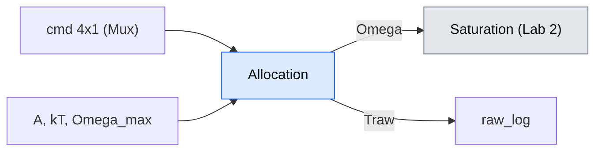
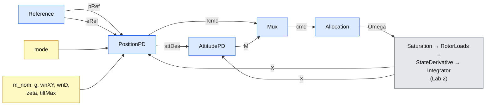
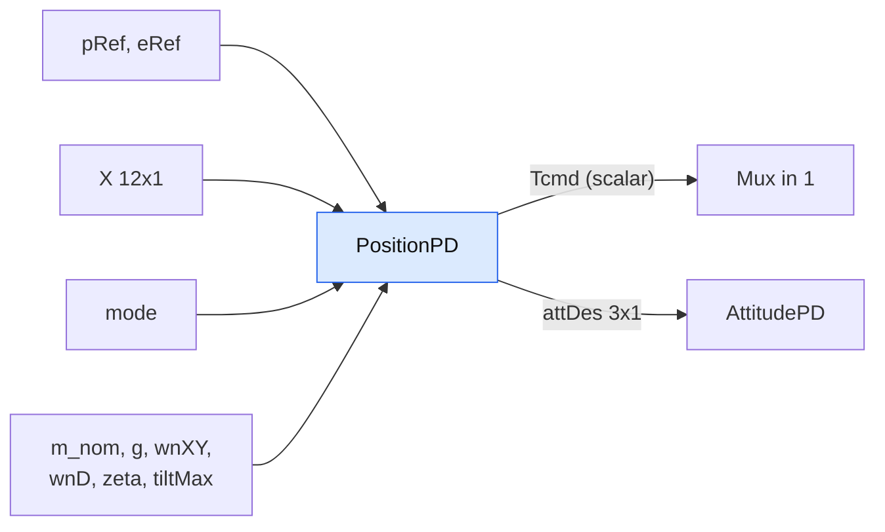
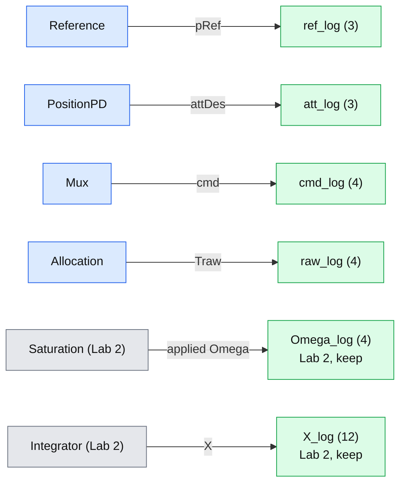

# Practical 3 Guide: Cascaded PD Control

This guide covers `EEEE4138 Practical 3 Guided Laboratory.pdf` for `Practical3_Cascaded_PD.slx`, using `practical2_parameters.m` (`student_id = 19`, X configuration).

> **Viewing the diagrams:** they are written in mermaid. GitHub renders them automatically. In VS Code, install **"Markdown Preview Mermaid Support"** (bierner.markdown-mermaid), then open the preview with `Ctrl+Shift+V`.

---

## 0. What is reused vs new

**You do not rebuild the plant.** Lab 3 starts from a *Save As* copy of your Lab 2 model. The whole Lab 2 plant stays exactly as it is. You delete **one** block, the `Omega_cmd` Constant, and add the controller in front of the `Saturation` block where it used to be.



| Status | Blocks |
| :--- | :--- |
| ⬜ **Reused, untouched** | `Saturation`, `RotorLoads`, `StateDerivative`, `Integrator`, and their Constants (`rotor_xy`, `sigma`, `kT`, `kM`, `m`, `J`, `g`, `c_drag`). The `X_log` and `Omega_log` To Workspace blocks are reused too. |
| 🟦 **New** | `Clock`, `Reference`, `PositionPD`, `AttitudePD`, `Mux`, `Allocation`, their parameter Constants, and the `ref_log`, `att_log`, `cmd_log`, `raw_log` To Workspace blocks |
| 🟥 **Deleted** | `Constant: Omega_cmd` |
| Optional to delete | Lab 2's `Fprop_log`, `Mprop_log`, `Xdot_log`. They are harmless, so you can keep them. |

The existing `kT` and `g` Constant blocks can also feed the new blocks: **branch the existing line** by holding `Ctrl` and dragging from it. You don't need duplicate Constants.

The scripts work the same way: `practical2_parameters.m` is reused unchanged, and `practical3_setup.m` calls it first, then adds the controller gains.

---

## 1. Quick Start

1. The PDF asks for a folder named `Practical3_S19`. This guide uses the existing `Lab3_S20617556/` folder; rename it if your submission needs the PDF's name.
2. Copy `practical2_parameters.m` from `Lab2_S20617556/` into this folder.
3. Open `Practical2_Quadrotor.slx` and use **File → Save As** to save `Practical3_Cascaded_PD.slx` **in this folder**.
4. Run `practical3_setup` in the Command Window. It is already in this folder and contains the PDF's Section 1 code.
5. Build in the order of the steps below: **Step A (attitude) → hover test → Step B (position) → Step C (logging)**.

### Key numbers (`student_id = 19`)

| Quantity | Value |
| :--- | :--- |
| `m_nom` | 2.5050 kg |
| `Jdiag` | [0.038958; 0.038958; 0.064930] kg·m² |
| `kT` | 1.919848e-5 N/(rad/s)² |
| Hover thrust per rotor | 6.1435 N (total 24.5741 N) |
| `Omega_hover` | 565.685 rad/s |
| `Tmax` per rotor at 800 / 575 rad/s | 12.2870 N / 6.3475 N |

---

## 2. How to add a block (general Simulink moves)

You'll repeat these moves for every block below:

| Action | How |
| :--- | :--- |
| **Add a block (fast)** | Click an empty spot on the canvas and **start typing the block name** (e.g. `MATLAB Function`). Press Enter to place it. |
| **Add a block (Library Browser)** | `Ctrl+Shift+L` → navigate the library path → drag the block onto the canvas. |
| **Rename a block** | Double-click the name text under the block and type the new name. |
| **Set a Constant's value** | Double-click the Constant → **Constant value** = the workspace variable name (e.g. `wnAtt`) → OK. |
| **Write code in a MATLAB Function** | Double-click the block → editor opens → replace everything with the code → `Ctrl+S`. Input and output ports **appear automatically** from the function signature. |
| **Wire** | Drag from an output port (`>`) to an input port. |
| **Branch an existing line** | Hold `Ctrl` and drag from any point on an existing line (or right-click drag). |
| **Delete a block** | Click it → `Delete`. |
| **Check** | `Ctrl+D` (Update Diagram). Turn on **Debug → Information Overlays → Signal Dimensions** to see the sizes on the wires. |

---

## 3. Step A: Attitude loop and allocation (build and test first)

### Target for this step



`pRef` from `Reference` is left unconnected in this step. `PositionPD` uses it in Step B.

---

### 🟥 A0. Delete `Constant: Omega_cmd`

1. Click the `Omega_cmd` Constant that feeds `Saturation` → `Delete`.
2. The `Saturation` input port is now free. `Allocation` will connect there.

---

### 🟦 A1. `Clock` + 4 reference Constants

| | |
| :--- | :--- |
| **Library** | *Simulink → Sources → Clock* and *Simulink → Sources → Constant* (×4) |
| **Settings** | Constants: values `p0`, `p1`, `e0`, `e1` (each 3×1, from `practical3_setup`) |
| **Connects to** | `Reference` inputs `t`, `p0`, `p1`, `e0`, `e1` |

---

### 🟦 A2. `Reference` (MATLAB Function)

| | |
| :--- | :--- |
| **Library** | *Simulink → User-Defined Functions → MATLAB Function* |
| **Rename to** | `Reference` |
| **Inputs** | `t` (Clock), `p0`, `p1`, `e0`, `e1` (Constants) |
| **Outputs** | `pRef` (3×1) → PositionPD (Step B); `eRef` (3×1) → AttitudePD (now), PositionPD (Step B) |



Paste this code:

```matlab
function [pRef, eRef] = Reference(t, p0, p1, e0, e1)
% Position: step from p0 to p1 at t = 1 s
if t < 1
    pRef = p0;
else
    pRef = p1;
end

% Attitude: smooth 1-second ramp (smoothstep) from e0 to e1, starting at t = 1 s
u = min(1, max(0, t - 1));
S = u^2 * (3 - 2*u);
eRef = e0 + S*(e1 - e0);

% Wrap the yaw reference to (-pi, pi]
eRef(3) = atan2(sin(eRef(3)), cos(eRef(3)));
end
```

`S = u²(3−2u)` rises from 0 to 1 with zero slope at both ends, so the attitude reference has no velocity jump.

---

### 🟦 A3. `AttitudePD` (MATLAB Function)

| | |
| :--- | :--- |
| **Library** | *Simulink → User-Defined Functions → MATLAB Function* |
| **Rename to** | `AttitudePD` |
| **Inputs** | `attDes` (for now: `eRef`; in Step B: `PositionPD.attDes`), `X` (**branch from the Integrator output**), Constants `Jdiag`, `wnAtt`, `zeta` |
| **Output** | `M` (3×1) → Mux input 2 |



Per axis j (roll, pitch, yaw): $M_j = J_j\left[\omega_{n,\text{att}}^2\, e_j - 2\zeta\omega_{n,\text{att}}\, \omega_j\right]$. Multiplying by J makes each axis behave like a second-order system with ωn = 6 rad/s, ζ = 1 near hover.

```matlab
function M = AttitudePD(attDes, X, Jdiag, wnAtt, zeta)
att   = X(7:9);      % [phi; theta; psi]
rates = X(10:12);    % [p; q; r]

e = attDes - att;
e(3) = atan2(sin(e(3)), cos(e(3)));   % shortest-path yaw error

M = Jdiag(:) .* (wnAtt^2 * e - 2*zeta*wnAtt * rates);
end
```

Damping uses **body rates** (p, q, r), not Euler-angle rates. This approximation holds near hover, so keep the commanded angles small.

---

### 🟦 A4. Temporary thrust Constant + `Mux`

| | |
| :--- | :--- |
| **Library** | *Simulink → Sources → Constant*; *Simulink → Signal Routing → Mux* |
| **Settings** | Constant value `m_nom*g` (hover thrust, used for mode 1 only). Mux: **Number of inputs = 2** |
| **Wiring** | Constant → Mux input 1 (`Tcmd`, scalar). `AttitudePD.M` → Mux input 2 (3×1). Mux output = `cmd` (4×1) → `Allocation` |

The Mux stacks `[Tcmd; Mx; My; Mz]`. In Step B, replace this temporary Constant with `PositionPD.Tcmd`.

---

### 🟦 A5. `Allocation` (MATLAB Function)

| | |
| :--- | :--- |
| **Library** | *Simulink → User-Defined Functions → MATLAB Function* |
| **Rename to** | `Allocation` |
| **Inputs** | `cmd` (Mux), Constants `A` (new), `kT` (**branch the existing Lab 2 `kT` line**), `Omega_max` (new Constant) |
| **Outputs** | `Omega` (4×1) → **the Lab 2 `Saturation` input** (where `Omega_cmd` used to go); `Traw` (4×1) → `raw_log` (Step C) |



```matlab
function [Omega, Traw] = Allocation(cmd, A, kT, Omega_max)
% cmd = [Tcmd; Mx; My; Mz]
Traw     = A \ cmd;                       % requested rotor thrusts (may be infeasible)
Tmax     = kT*Omega_max^2;
Tbounded = min(Tmax, max(0, Traw));       % clip to [0, Tmax]
Omega    = sqrt(Tbounded/kT);
end
```

`A \ cmd` inverts the Lab 2 mapping `[T1..T4] → [T; Mx; My; Mz]`. Keep the **positive** total-thrust row in `A`. `RotorLoads` already applies thrust along −z body.

---

### Port sizes (only if `Ctrl+D` complains)

In the MATLAB Function editor, open **Symbols** (or **Edit Data**) → select the port → set **Size**:

| Block | Port | Size |
| :--- | :--- | :--- |
| `Reference` | `t` / `p0,p1,e0,e1` / `pRef,eRef` | `1` / `[3 1]` / `[3 1]` |
| `AttitudePD` | `attDes`, `Jdiag` / `X` / `M` | `[3 1]` / `[12 1]` / `[3 1]` |
| `Allocation` | `cmd` / `A` / `kT,Omega_max` / `Omega,Traw` | `[4 1]` / `[4 4]` / `1` / `[4 1]` |
| `PositionPD` | `pRef,eRef,attDes` / `X` / scalars / `Tcmd` | `[3 1]` / `[12 1]` / `1` / `1` |

> **Shortcut (fewer Constant blocks):** In the same Symbols panel you can change a port's **Scope** from *Input* to *Parameter*. It then reads the workspace variable of the same name with no wire. This is fine for gains. The PDF asks that `A`, `kT`, `Omega_max` stay as Constant blocks.

### ✅ Test after Step A

Do the Section 6 model settings first, then run `practical3_setup`, `Ctrl+D`, and the mode-1 tests. These expected values come from an independent Python simulation of the same equations:

| Test (mode 1) | Expect |
| :--- | :--- |
| Hover | Every `Omega` = 565.685 rad/s, `Traw` = 6.1435 N each, X stays 0 |
| Roll +5° | φ → 5° with **no overshoot** (ζ = 1), settled by about 2.5 s. **Drifts East** (≈ +74 m at 15 s) and sinks (≈ +3.1 m Down). This drift is expected: only attitude is controlled, and `Tcmd = mg` doesn't compensate for tilt. |
| Pitch +5° | θ → 5° (nose **up**), **drifts South** (≈ −74 m) |
| Yaw wrap 179° → 181° | ψ state goes 179° → **181°**, with `r ≥ 0` throughout: the short +2° path |

**Why the yaw wrap works:** after t = 2 s the wrapped reference is −179° while the state ψ = 181°. The raw error is −360°, which `atan2(sin, cos)` maps to **0**.

---

## 4. Step B: Position loop

### Target for this step (final controller)



### What changes from Step A

1. **Delete** the temporary `m_nom*g` Constant.
2. **Delete** the wire `Reference.eRef → AttitudePD.attDes`.
3. **Add** `PositionPD` (below) and wire it as in the diagram above.

### 🟦 B1. `PositionPD` (MATLAB Function)

| | |
| :--- | :--- |
| **Library** | *Simulink → User-Defined Functions → MATLAB Function* |
| **Rename to** | `PositionPD` |
| **Inputs** | `pRef`, `eRef` (Reference), `X` (branch from Integrator), `mode` (new Constant), Constants `m_nom`, `g` (branch Lab 2 `g`), `wnXY`, `wnD`, `zeta` (branch Step A `zeta`), `tiltMax` |
| **Outputs** | `Tcmd` → Mux input 1; `attDes` → `AttitudePD.attDes` |



The `mode` Constant selects the behaviour inside the block: `mode = 1` passes `eRef` and `m_nom*g` straight through, which matches Step A. If you prefer the PDF's literal Switch-block wiring, two **Switch** blocks (*Signal Routing*, criterion `u2 > 1`, middle input = `mode`) after `PositionPD` do the same job.

```matlab
function [Tcmd, attDes] = PositionPD(pRef, eRef, X, mode, m_nom, g, wnXY, wnD, zeta, tiltMax)
if mode == 1
    % Attitude-only: hover thrust, attitude straight from Reference
    Tcmd   = m_nom*g;
    attDes = eRef;
    return
end

phi = X(7); theta = X(8); psi = X(9);
p   = X(1:3);                         % [pN; pE; pD]

% Body velocity -> NED velocity (same R as Lab 2 StateDerivative)
Rx = [1 0 0; 0 cos(phi) -sin(phi); 0 sin(phi) cos(phi)];
Ry = [cos(theta) 0 sin(theta); 0 1 0; -sin(theta) 0 cos(theta)];
Rz = [cos(psi) -sin(psi) 0; sin(psi) cos(psi) 0; 0 0 1];
vNED = (Rz*Ry*Rx) * X(4:6);

% --- Vertical (Down) ---
aD = wnD^2*(pRef(3) - p(3)) - 2*zeta*wnD*vNED(3);
aD = min(0.5*g, max(-0.5*g, aD));
den  = max(cos(phi)*cos(theta), 0.5);           % guard against large tilt
Tcmd = m_nom*(g - aD)/den;

% --- Horizontal (North, East) ---
aN = wnXY^2*(pRef(1) - p(1)) - 2*zeta*wnXY*vNED(1);
aE = wnXY^2*(pRef(2) - p(2)) - 2*zeta*wnXY*vNED(2);

% Rotate NED acceleration into heading frame (yaw only)
aForward =  cos(psi)*aN + sin(psi)*aE;
aRight   = -sin(psi)*aN + cos(psi)*aE;

phiRef   = min(tiltMax, max(-tiltMax,  aRight/g));
thetaRef = min(tiltMax, max(-tiltMax, -aForward/g));

attDes = [phiRef; thetaRef; eRef(3)];
end
```

### Where the equations come from (for the write-up)

- **Vertical:** NED Down is positive, and the vertical component of thrust is `T cosφ cosθ` (upward). So `m aD = mg − T cosφ cosθ`, which gives **`T = m(g − aD)/(cosφ cosθ)`**.
- **Horizontal (small angles, heading frame):** Pitch θ gives forward acceleration `−gθ`, so nose-down moves the drone forward. Roll φ gives rightward acceleration `+gφ`. So **`θ_ref = −a_fwd/g`** and **`φ_ref = a_right/g`**.
- **Yaw rotation:** `a_fwd` and `a_right` are the NED acceleration rotated by −ψ. Only yaw is needed because roll and pitch are small.

### ✅ Predict the signs before running (mode 2)

| Test | Prediction |
| :--- | :--- |
| **Climb** `p1 = [0;0;−0.5]` | `aD = −0.5 m/s²`, so `Tcmd = 2.505(9.81 + 0.5) = 25.822 N`. **Thrust rises by +1.25 N** at t = 1 s, because climbing means negative Down acceleration and therefore thrust > weight. Within 2 % by about t ≈ 6.8 s, no overshoot. |
| **North, ψ = 0** | `aN = 0.49 × 0.5 = +0.245 m/s²`, so **θ_ref = −1.43° (nose down)** and φ_ref = 0. Rear rotors 3 and 4 speed up first. |
| **East, ψ = 0** | **φ_ref = +1.43° (roll right)** |
| **North facing East, ψ = 90°** | `aRight = −sin90·aN = −0.245`, so **φ_ref = −1.43° (roll left)** and θ_ref = 0. Facing East, North is to the drone's left. |
| **Combined** | At t = 1 s: Tcmd = 25.822 N, φ_ref = +0.86°, θ_ref = −1.43°. All axes reach their targets together, with Ω between 540 and 596 rad/s. |

---

## 5. Step C: Logging (To Workspace blocks)

| | |
| :--- | :--- |
| **Library** | *Simulink → Sinks → To Workspace* |
| **Settings (every one)** | **Variable name** as below, **Save format = `Timeseries`**, **Sample time = `0.01`** |

`X_log` and `Omega_log` already exist from Lab 2 and are attached at the right places, so just confirm their settings. Add the 4 new ones by **branching** the wires shown:



`att_log` taps `PositionPD.attDes`, the reference that `AttitudePD` actually tracks in both modes. `Omega_log` taps the **Saturation output**, so it records applied speeds, not requested ones.

---

## 6. Model Settings (`Ctrl+E`): these differ from Lab 2

| Setting | Lab 2 | **Lab 3** |
| :--- | :--- | :--- |
| Solver → Type | Variable-step | **Fixed-step** |
| Solver | `ode45` | **`ode4` (Runge-Kutta)** |
| Step size | max 0.01 | **Fixed-step size = 0.01** |
| Stop time | 2 s | **15 s** (8 s for the limit test) |
| Data Import/Export | Single simulation output = `out` | same |

---

## 7. Run and Save the Tests

Run `practical3_setup` → apply changes → `sim` → save under a **distinct** filename.

| Test | Changes after `practical3_setup` | Check |
| :--- | :--- | :--- |
| Hover | `mode = 1` (or 2), everything else zero | Position and attitude steady |
| Roll / Pitch | `mode = 1`; `e1(1)` **or** `e1(2)` `= 5*pi/180` (separate runs) | Correct direction, settles, drift expected |
| Yaw wrap | `mode = 1`; `X0(9) = 179*pi/180; e0(3) = X0(9); e1(3) = 181*pi/180` | Short positive rotation across 180° |
| Climb | `mode = 2; p1 = [0;0;-.50]` | Down decreases, thrust initially **rises** |
| North / East | `mode = 2; p1 = [.50;0;0]` or `[0;.50;0]` | Motion along that NED axis |
| North facing East | `mode = 2; p1 = [.50;0;0]; X0(9) = pi/2; e0(3) = pi/2; e1(3) = pi/2` | Rolls left (φ < 0), moves North |
| Combined | `mode = 2; p1 = [.50;.30;-.50]; e1(3) = 15*pi/180` | Position and yaw track together |
| Combined + limit | Combined, then `Omega_max = 575`; Stop Time 8 s | Speed limit hit; find when Traw is clipped |

[run_practical3_tests.m](run_practical3_tests.m) runs every row above. For each test it saves `results/<name>.mat` and a 3-panel plot `results/<name>.png` (position vs reference, attitude vs reference, rotor speeds), and it prints the limit-test statistics. At the end it re-runs `practical3_setup`, which restores 800 rad/s.

The PDF's single-test template (climb), if you'd rather run tests one at a time:

```matlab
practical3_setup
mode = 2;
p1 = [0;0;-.50];
out = sim('Practical3_Cascaded_PD');
if ~exist('results','dir'), mkdir('results'); end
save('results/climb.mat','out','p1','X0','Omega_max');
ts = out.X_log;
if ts.IsTimeFirst
    X = reshape(ts.Data,numel(ts.Time),[]);
else
    X = reshape(ts.Data,[],numel(ts.Time)).';
end
figure; plot(ts.Time,X(:,3)); hold on
stairs([0 1 15],[0 -.50 -.50],'--'); grid on
xlabel('Time (s)'); ylabel('Down position (m)');
legend('Actual','Reference');
saveas(gcf,'results/climb_position.png');
```

> `Omega_max = 575` must be set **after** `practical3_setup`. `kT` is computed from the nominal 800 rad/s inside `practical2_parameters` and must stay at that value. Only the limit changes.

---

## 8. Demonstrate and Record

### 8.1 Demo: what to say

- **Climb:** "Down is positive in NED, so climbing 0.5 m means pD,ref = −0.5. The PD gives aD = −0.5 m/s². Tcmd = m(g − aD) = 25.82 N, which is **more** than the weight of 24.57 N, so thrust initially rises by 1.25 N."
- **North at ψ = 90°:** "The drone faces East, so North is to its **left**. aRight = −sinψ·aN < 0, so φ_ref = −1.43°. It rolls left, and the tilted thrust pushes it North. Pitch stays about 0."

### 8.2 Gains and units

| Loop | Gain | Formula | Value | Units |
| :--- | :--- | :--- | :--- | :--- |
| Attitude roll/pitch | Kp | Jxx·ωn² | 1.4025 | N·m/rad |
| | Kd | Jxx·2ζωn | 0.4675 | N·m·s/rad |
| Attitude yaw | Kp | Jzz·ωn² | 2.3375 | N·m/rad |
| | Kd | Jzz·2ζωn | 0.7792 | N·m·s/rad |
| Vertical | Kp | ωnD² | 1.00 | (m/s²)/m = s⁻² |
| | Kd | 2ζωnD | 2.00 | (m/s²)/(m/s) = s⁻¹ |
| Horizontal | Kp | ωnXY² | 0.49 | s⁻² |
| | Kd | 2ζωnXY | 1.40 | s⁻¹ |

The position loops output acceleration. Multiplying by m_nom gives an equivalent force gain (e.g. Kp,D = 2.505 N/m).

### 8.3 Why the inner loop is faster

The position loop does not command force directly. It commands a **tilt**, and the tilt has to actually happen before any horizontal force appears. Cascaded design assumes that, from the outer loop's point of view, the inner loop has already settled (attitude ≈ attitude_ref). That needs bandwidth separation, typically **5–10×**. Here ωn,att / ωn,XY = 6 / 0.7 ≈ **8.6×**, and 6 / 1.0 = 6× against the vertical loop. If the two loops were close in speed, the attitude lag would add phase lag to the position loop and cause overshoot or oscillation.

### 8.4 Limit test analysis (`Omega_max = 575`)

What to expect, from the Python check:

- `Tmax = 6.3475 N` per rotor, while hover needs 6.1435 N. That leaves only **0.82 N of total thrust margin**, so the maximum upward acceleration is about **0.33 m/s²**.
- At t = 1 s the climb asks for 25.82 N, so **`Traw` exceeds `Tmax` immediately** (peak ≈ 8.1 N on one rotor). No `Traw` goes below 0.
- **Fraction of samples with any applied Ω at 575 rad/s ≈ 0.43**, mostly in the seconds after t = 1 s. Compute your own value with the script.
- **Tracking change:** at 8 s the position is only about [0.43, 0.21, −0.43] m instead of [0.5, 0.3, −0.5], and small attitude errors appear (≈ 0.1–0.2°).
- **Why:** Clipping each rotor separately does **not** preserve the requested `[T; Mx; My; Mz]`. Total thrust falls below `Tcmd`, so the climb slows, and the moments are distorted, so attitude tracking suffers. The allocator has no priority between thrust and attitude.
- Restore `Omega_max = 800` (re-run `practical3_setup`) before any further runs.

### 8.5 Submission checklist

- [ ] `Practical3_Cascaded_PD.slx`
- [ ] `practical3_setup.m`, `practical2_parameters.m`, `run_practical3_tests.m`
- [ ] `results/*.mat` (one per test)
- [ ] Labelled plots: reference vs actual position **and** attitude, plus rotor speeds
- [ ] Gain table with units (8.2) and the inner/outer bandwidth reasoning (8.3)
- [ ] Climb thrust-sign and North-at-90° tilt-sign explanations (8.1)
- [ ] Limit test: Traw vs 0 and Tmax, fraction of samples at the limit, tracking explanation (8.4)

---

## 9. Troubleshooting

| Symptom | Likely cause |
| :--- | :--- |
| Drone spins about 358° in the yaw test | Yaw **error** not wrapped in `AttitudePD` (wrapping only the reference is not enough) |
| Moves the wrong way in North/East | Sign of `thetaRef` (should be `-aForward/g`), or `aForward`/`aRight` swapped |
| Falls instead of climbing | `Tcmd = m(g + aD)` typo, or body `w` used instead of `vNED(3)` |
| Roll goes the wrong direction | `A` row 2 must be `-rotor_xy(2,:)` |
| Saturation input unconnected error | `Omega_cmd` deleted but `Allocation.Omega` not wired to `Saturation` |
| Everything diverges immediately | Wrong `mode` for the test, or `Omega_max` left at 575 |
| Size mismatch on `Ctrl+D` | Set port sizes (table in Step A); `mode` Constant should be a scalar |
| `Traw` stays exactly at hover in mode 2 | Still wired through the temporary `m_nom*g` Constant / `eRef` wire from Step A |
